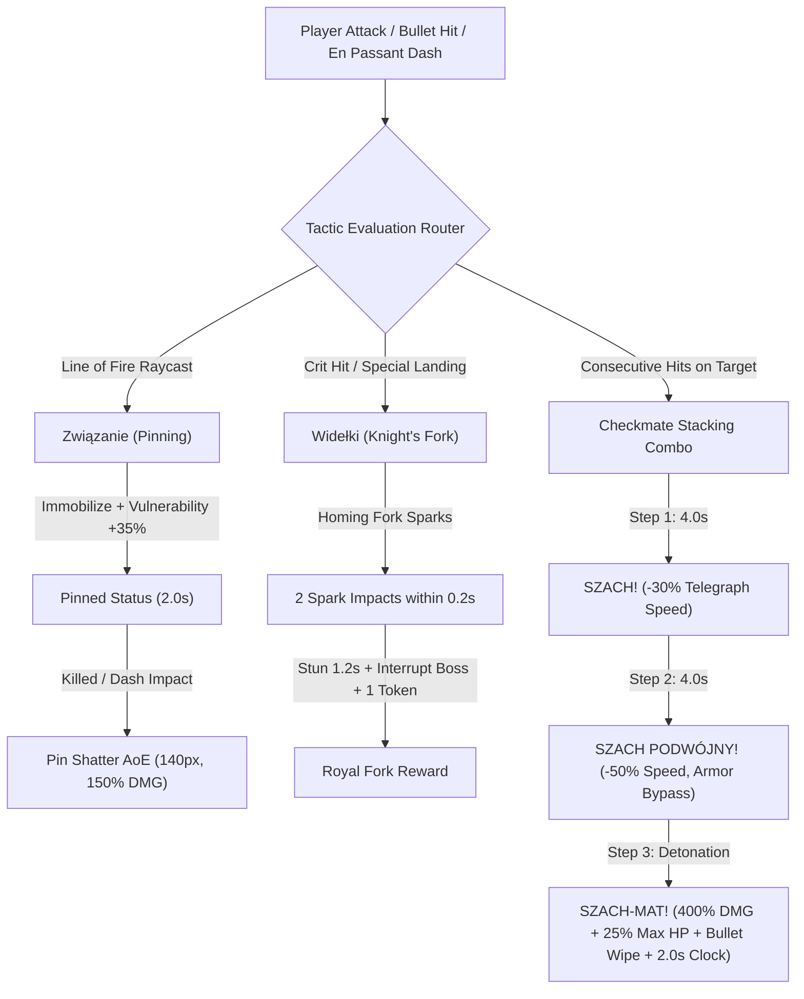

# Chess Combat Tactics Design

**Feature**: `chess-combat-tactics`
**Spec**: `.specs/features/chess-combat-tactics/spec.md`
**Status**: Verified
**Date**: 2026-10-25

---

## Architecture Overview



---

## Data Structures & Zero-GC Memory Layout

All tactical status tracking is embedded directly into the pre-allocated enemy entity object structure within `this.pools.enemies` (`src/game.js` and `src/pool.js`), with zero dynamic heap allocations during gameplay:

```javascript
// Entity extensions in FixedPool / enemy acquire:
enemy = {
  // Existing fields
  x: 0, y: 0, vx: 0, vy: 0, hp: 1, maxHp: 1, active: true,
  
  // Tactical Combat Fields (Zero-GC):
  pinTimer: 0.0,       // Duration remaining in Pinned state (seconds)
  isPinned: false,     // Boolean flag for fast checks
  pinVulnerability: 1.0,// Damage multiplier (1.35x standard, 1.20x boss)
  
  forkHitTimestamp: 0.0, // Timestamp of last fork spark hit (ms)
  
  mateStep: 0,         // 0: None, 1: Szach, 2: Szach Podwójny
  mateTimer: 0.0,      // Timeout countdown (4.0s)
  
  stunTimer: 0.0       // Stun duration (locks movement and attacks)
};
```

---

## Component Details & Mechanics

### 1. Związanie (Pinning & Skewer) (`TAC-01`, `TAC-02`, `TAC-03`)
- **Raycast Detection**:
  When a projectile with angle $\theta$ hits enemy $A$, the system evaluates other active enemies $B$ within distance $d \le 250\text{ px}$ behind $A$:
  $$\Delta x = B.x - A.x, \quad \Delta y = B.y - A.y$$
  $$\text{Angle to } B = \text{atan2}(\Delta y, \Delta x), \quad |\text{Angle to } B - \theta| \le 18^\circ$$
  If an enemy $B$ or the arena wall ($\le 120\text{ px}$ in bullet direction) is detected, $A$ is Pinned.
- **Normal Enemies (`TAC-01`)**:
  `A.pinTimer = 2.0`, `A.isPinned = true`, `A.vx = 0`, `A.vy = 0`, `A.pinVulnerability = 1.35`.
- **Bosses / Elites (`TAC-02`)**:
  `A.pinTimer = 2.0`, `A.isPinned = true`, speed slowed by $40\%$, `A.pinVulnerability = 1.20`.
- **Pin Shatter (`TAC-03`)**:
  When a pinned enemy is destroyed or struck by En Passant Dash, an AoE burst triggers dealing $150\%$ damage to all enemies within $140\text{ px}$.

### 2. Widełki Skoczka (Knight's Fork & Royal Fork) (`TAC-04`, `TAC-05`, `TAC-06`)
- **Activation (`TAC-04`)**:
  On critical hits or special landings (Knight slam, Rook charge impact), the system acquires up to 2 fork sparks from `pools.bullets` homing towards the 2 closest active enemies within $350\text{ px}$.
- **Royal Fork Detection (`TAC-05`, `TAC-06`)**:
  If 2 fork sparks impact distinct targets within $\Delta t \le 0.20\text{ s}$, Royal Fork is triggered:
  - Both targets receive `stunTimer = 1.2`.
  - Spawns $+1$ Gambit Token (`this.gambitTokens++`).
  - If a target is a boss charging an attack telegraph, its telegraph is cancelled and the boss is stunned for $0.6\text{ s}$.

### 3. Szach i Mat w 3 Ruchach (Checkmate Stacking) (`TAC-07`, `TAC-08`, `TAC-09`)
- **Combo Progression**:
  - **Hit 1 (`TAC-07`)**: `e.mateStep = 1`, `e.mateTimer = 4.0`. Telegraph charge speed reduced by $30\%$. Floating text `"SZACH!"` (`#ffaa44`).
  - **Hit 2 (`TAC-08`)**: `e.mateStep = 2`, `e.mateTimer = 4.0`. Enemy speed $-50\%$, armor bypass. Floating text `"SZACH PODWÓJNY!"` (`#ff5533`).
  - **Hit 3 (`TAC-09`)**: Detonation! Finisher deals $400\%$ damage $+ 25\%$ max HP (boss damage capped at $250\text{ HP}$).
    - Wipes enemy bullets within $200\text{ px}$.
    - Adds $+2.0\text{ s}$ to `this.chessClock`.
    - Resets `e.mateStep = 0`, `e.mateTimer = 0`.
    - Floating text `"SZACH-MAT!"` (`#ffffff` with gold outline).
    - Plays `AudioEngine.playPieceShatter()`.

### 4. Zero-GC Rendering & Procedural Visuals (`TAC-10`)
- **Pinning Ring**: Cyan geometric ring drawn at enemy base using Canvas 2D paths.
- **Check / Double Check Markers**: Stylized crowns (Roman numeral I and II) rendered above enemy sprites.
- **Faux-Glow**: Multi-pass alpha circles without `ctx.shadowBlur`.

---

## Risks & Concerns

1. **Risk**: Raycasting for Pinning on every projectile hit could cause latency with 80+ enemies.
   - **Mitigation**: Filter by squared distance ($dx^2 + dy^2 \le 250^2 = 62500$) before any trigonometric checks. Max 1 check per bullet impact.
2. **Risk**: Checkmate combo could accidentally trigger too easily on high-fire-rate classes.
   - **Mitigation**: Hits must be separated by at least $0.25\text{ s}$ cooldown per enemy to count as distinct combo steps (preventing single shotgun blasts from instantly triggering Checkmate).

