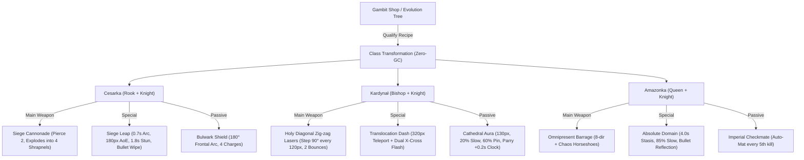

# Chess Fusions and Evolutions Design

**Feature**: `chess-fusions-evolutions`  
**Spec**: `.specs/features/chess-fusions-evolutions/spec.md`  
**Status**: Ready for Review  
**Date**: 2026-10-25  

---

## Architecture Overview



---

## Data Structures & Memory Layout (Zero-GC)

### 1. `PLAYER_CLASSES` Configurations (`src/chessData.js`)

```javascript
export const PLAYER_CLASSES = {
  // Existing: pawn, knight, bishop, rook, queen ...
  
  empress: {
    id: 'empress',
    name: 'Cesarka',
    title: 'Twierdza Zagłady',
    tier: 'fusion',
    hp: 8,
    speed: 230,
    radius: 13,
    fireRate: 0.24,
    dashCooldown: 3.2,
    dashSpeed: 600,
    bulletKind: 'siege_cannon',
    specialId: 'siege_leap',
    shieldCharges: 4,
    desc: 'Fuzja Wieży i Skoczka: Działa oblężnicze, Taranujący Skok i Bastion 180°.'
  },
  cardinal: {
    id: 'cardinal',
    name: 'Kardynał',
    title: 'Arcybiskup Światła',
    tier: 'fusion',
    hp: 6,
    speed: 250,
    radius: 11,
    fireRate: 0.18,
    dashCooldown: 2.6,
    dashSpeed: 640,
    bulletKind: 'zigzag_laser',
    specialId: 'translocation',
    auraRadius: 130,
    desc: 'Fuzja Gońca i Skoczka: Schodkowe lasery, Translokacja i Aura Katedry.'
  },
  amazon: {
    id: 'amazon',
    name: 'Amazonka',
    title: 'Królowa Chaosu',
    tier: 'fusion',
    hp: 10,
    speed: 275,
    radius: 14,
    fireRate: 0.14,
    dashCooldown: 12.0,
    dashSpeed: 700,
    bulletKind: 'royal_chaos',
    specialId: 'absolute_domain',
    desc: 'Najwyższa Fuzja Hetmana i Skoczka: Salwa Chaosu, Władza Absolutna i Cesarski Mat.'
  }
};
```

### 2. Player Entity Tactical Extensions (`src/game.js`)

All variables are scalar primitives on `this.player` without runtime heap allocations:

```javascript
this.player = {
  // Existing fields ...
  classId: 'pawn',
  
  // Fusion mechanics fields:
  bulwarkShieldCharges: 0,
  bulwarkRegenTimer: 0.0,
  absoluteDomainTimer: 0.0,
  cathedralParryCount: 0,
  cathedralParryTimer: 0.0,
  amazonKillCount: 0,
  translocationStartX: 0,
  translocationStartY: 0
};
```

---

## Detailed Component Specifications

### 1. Fuzja Klasy w Sklepie Gambitu (`FUS-01`)
- In `src/game.js`, `applyFusion(fusionId)`:
  1. Validates recipe eligibility (base class matches and tokens >= cost).
  2. Copies configuration stats from `PLAYER_CLASSES[fusionId]` into `this.player`.
  3. Deducts `recipe.tokenCost` from `this.gambitTokens`.
  4. Triggers audio fanfare `AudioEngine.playShopBuy()`, hitstop `0.05s`, and floating text `FUZJA: [NAME]!`.

### 2. Cesarka (Empress / Chancellor) (`FUS-02`, `FUS-03`, `FUS-04`)
- **Kanonada Oblężnicza (`FUS-02`)**:
  - `b.kind === 'siege_cannon'`, `pierceLeft = 2`, `damage = 4.2`.
  - When `pierceLeft === 0` or upon colliding with arena wall:
    Spawn 4 diagonal horseshoe sparks at angles $\frac{\pi}{4}, \frac{3\pi}{4}, \frac{5\pi}{4}, \frac{7\pi}{4}$ with speed $550\text{ px/s}$, damage $2.5$, applying Pinning on hit.
- **Taranujący Skok (`FUS-03`)**:
  - Parabolic arc lasting $0.7\text{ s}$ (`zHeight = Math.sin(progress * Math.PI) * 125`), player invulnerable.
  - On landing at $(x, y)$: 
    - Shockwave ring with radius $180\text{ px}$.
    - Deals $350\%$ weapon damage ($D = 14.0$) to all enemies within $180\text{ px}$.
    - Applies `e.stunTimer = 1.8` to all struck enemies.
    - Wipes all enemy bullets within $180\text{ px}$.
    - Trauma $0.65$, screen shake.
- **Bastion Frontalny (`FUS-04`)**:
  - Frontal $180^\circ$ arc relative to aim/movement direction.
  - Absorbs incoming bullets from front arc if `p.bulwarkShieldCharges > 0`, consuming 1 charge with shield deflect particles.
  - Regenerates 1 charge every $12.0\text{ s}$ up to max 4 charges.

### 3. Kardynał (Cardinal / Archbishop) (`FUS-05`, `FUS-06`, `FUS-07`)
- **Schodkowe Lasery "L" (`FUS-05`)**:
  - `b.kind === 'zigzag_laser'`, `damage = 3.2`, `bouncesLeft = 2`.
  - Step counter tracks travel distance; every $120\text{ px}$, velocity turns $90^\circ$ alternating left/right (Knight-step motion).
  - Bouncing from wall grants $+30\%$ damage multiplier per bounce.
- **Błysk Translokacyjny (`FUS-06`)**:
  - Instantly teleports player up to $320\text{ px}$ towards aim cursor (clamped within board bounds).
  - Calls `_fireXCrossLasers(startX, startY)` and `_fireXCrossLasers(targetX, targetY)`.
  - Each X-Cross fires 4 diagonal laser beams ($200\text{ px}$ length) dealing $4.0$ damage and clearing enemy bullets along paths.
- **Aura Katedry (`FUS-07`)**:
  - Pulsing circle of radius $130\text{ px}$ rendered around player.
  - Enemies inside aura have speed slowed by $20\%$ (`auraSlow = 0.8`) and receive $+60\%$ Pinning chance on damage.
  - Parries enemy bullets passing within aura: wipes bullet, restores $+0.2\text{ s}$ to Chess Clock (rate-limited to max 5/s).

### 4. Amazonka (Amazon) (`FUS-08`, `FUS-09`, `FUS-10`)
- **Wszechobecna Salwa Królewska (`FUS-08`)**:
  - Simultaneous 8-directional burst.
  - Every 2nd volley replaces the 4 diagonal bullets with Chaos Horseshoes: bypasses enemy armor (Rook front shield and King pawn shields), 3x knockback, and spawns Knight's Fork homing sparks on impact.
- **Władza Absolutna (Staza Czasoprzestrzenna) (`FUS-09`)**:
  - Active for $4.0\text{ s}$ (`p.royalMajestyTimer = 4.0` / `absoluteDomainTimer = 4.0`).
  - Enemy speed multiplied by $0.15$ ($85\%$ slow).
  - Enemy projectiles frozen in place (`b.vx = 0, b.vy = 0`).
  - Dashing through frozen projectiles converts them to friendly bullets flying towards nearest enemy with 3x damage.
  - Dash cooldown clamped to minimum $0.30\text{ s}$ (preventing permanent invulnerability).
  - Chess Clock and panic timer paused during stasis.
- **Cesarski Mat (`FUS-10`)**:
  - Tracks `this.amazonKillCount`. Every 5th enemy kill, finds the nearest champion, elite, or boss and automatically triggers `_triggerCheckmateDetonation(target, 4.0)` without requiring prior combo marks.

### 5. Proceduralne Renderowanie Sylwetek Bierek (`FUS-11`)
- In `src/sprites.js`:
  - `drawEmpressPiece(...)`: Combines a heavy stone rook battlement with a muscular knight's equine crest and reinforced frontal shield.
  - `drawCardinalPiece(...)`: Elegant elongated bishop mitre adorned with an arched golden horseshoe clasp and cross finial.
  - `drawAmazonPiece(...)`: Grand queen crown flanked by twin feathered pegasus wings with multi-tier faux glow.
  - Strict adherence to Zero-GC and absence of `ctx.shadowBlur`.

---

## Risks & Mitigations

1. **Risk**: Amazon's Absolute Domain could break game difficulty or cause infinite invulnerability.
   - **Mitigation**: Rigid clamp of $0.30\text{ s}$ minimum dash cooldown and 12.0s special cooldown. Bullet reflection limited to active domain duration.
2. **Risk**: Step calculations for zig-zag lasers in 60 FPS loop could impact performance.
   - **Mitigation**: Distance tracking uses scalar distance increments (`b.travelDist += stepDt * speed`) without trigonometric recalculations except on the $90^\circ$ step.
