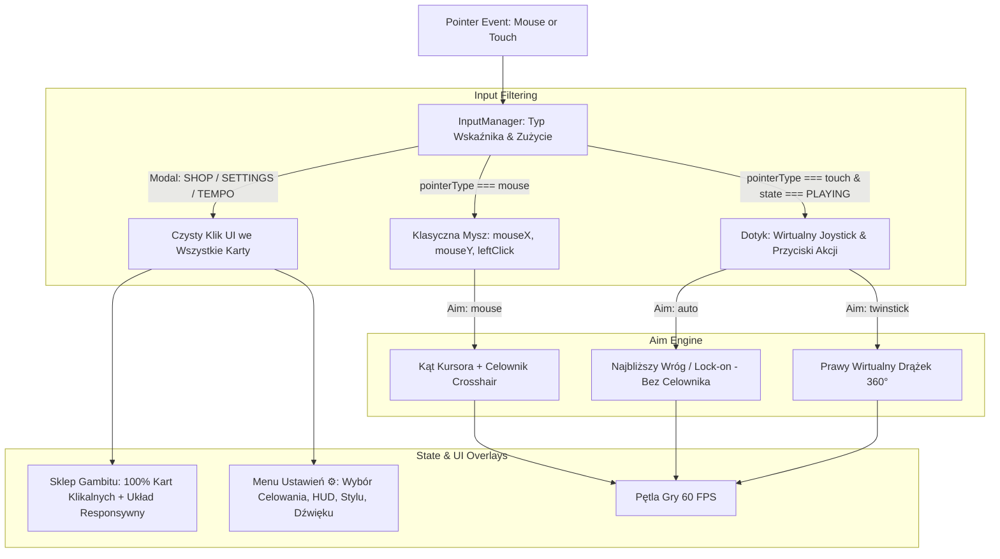

# Controls, Settings & Shop Fix Design

**Spec**: `.specs/features/controls-settings-shop-fix/spec.md`
**Status**: Approved

---

## Architecture Overview

Nowa architektura izoluje kontroler dotykowy, wprowadza dedykowaną maszynę stanu dla Menu Ustawień (`SETTINGS`), przywraca klasyczne celowanie myszką dla graczy desktopowych oraz sprawia, że interfejs Sklepu Gambitu i przyciski HUD stają się w 100% responsywne i klikalne.



---

## Code Reuse Analysis

### Existing Components to Leverage

| Component | Location | How to Use |
| --- | --- | --- |
| `InputManager` | [`src/input.js`](file:///home/wiktor/projects/am76_game_studio/ChessSurvivors76/src/input.js) | Izolacja `_handlePointerDown` wg `pointer.type === 'touch'` i `touchControlsActive`. |
| `Game` | [`src/game.js`](file:///home/wiktor/projects/am76_game_studio/ChessSurvivors76/src/game.js) | Dodanie stanu `SETTINGS`, metody `_handleSettingsInput`, obsługa kliknięć w HUD i zębatkę ⚙. |
| `UIRenderer` | [`src/uiRenderer.js`](file:///home/wiktor/projects/am76_game_studio/ChessSurvivors76/src/uiRenderer.js) | Nowa funkcja `renderSettingsOverlay`, klikalne strefy w `renderGameHUD`, responsywna siatka w `renderGambitShopOverlay`. |
| `StorageEngine` | [`src/storage.js`](file:///home/wiktor/projects/am76_game_studio/ChessSurvivors76/src/storage.js) | Zapis i odczyt preferencji `aimMode`, `hudMode`, `touchOverlayMode`, `soundMuted` w profilu. |

---

## Components

### 1. Pointer Event Filter (`src/input.js`)
- **Purpose**: Gwarancja, że kliknięcia myszą na PC nigdy nie są pożerane przez wirtualny joystick dotykowy, a dotyk w modalach sklepu i ustawień działa jako czysty klik interfejsu.
- **Interfaces**:
  - `setTouchControlsActive(active: boolean)`: włącza joysticki tylko podczas `PLAYING`.
  - `_handlePointerDown(pointer)`: ignoruje `pointer.type === 'mouse'` dla wirtualnych joysticków.

### 2. Aiming Controller (`src/game.js`)
- **Purpose**: Zapewnia precyzyjne sterowanie celowaniem zgodnie z preferencją gracza.
- **Modes**:
  - `'mouse'`: Tradycyjne celowanie kursorem myszy z celownikiem `drawCrosshair`.
  - `'auto'`: Automatyczne celowanie w najbliższego wroga lub wybrany cel (Touch Focus), bez celownika myszy.
  - `'twinstick'`: Prawy drążek dotykowy.

### 3. Settings Overlay & Interactive HUD (`src/uiRenderer.js`)
- **Purpose**: Dedykowany ekran opcji z klikalnymi kafelkami i przycisk zębatki ⚙ w HUD.
- **Layout**:
  - Responsywne okno modalne dopasowane do szerokości okna (`panelW = Math.min(game.width - 24, 760)`).
  - Sekcje opcji z natychmiastowym wizualnym potwierdzeniem wyboru.
  - Sklep Gambitu: 4 kolumny na szerokim ekranie, 2 kolumny na smartfonie w pionie.

---

## Data Models

```typescript
interface SettingsState {
  aimMode: 'mouse' | 'auto' | 'twinstick';
  touchOverlayMode: 'auto' | 'always' | 'off';
  hudLayout: 'top' | 'bottom' | 'compact';
  themeIndex: number;
  soundMuted: boolean;
}
```

---

## Error Handling & Risk Mitigation

- **Błędne wykrywanie ekranu dotykowego na laptopie**: Ruch myszką natychmiast przywraca `touchActive = false` i tryb klasyczny celownika.
- **Kliknięcie poza oknem modalnym**: Kliknięcie w przyciemnione tło wokół modalu lub w `[X]` bezpiecznie zamyka modal i wznawia rozgrywkę.
- **Brak wycieków pamięci (Zero-GC)**: Nowe menu opcji wykorzystuje istniejące prymitywy rysowania Canvas 2D bez dynamicznych alokacji w pętli renderującej.

