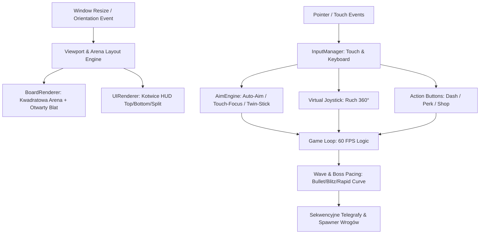

# Mobile Viewport & Balance Design

**Spec**: `.specs/features/mobile-viewport-balance/spec.md`
**Status**: Approved

---

## Architecture Overview

Nowa architektura rozszerza silnik Canvas 2D o płynne dopasowanie 100% okna (brak czarnych pasów), modularny renderer HUD operujący na kotwicach ekranu (Anchors), podsystem obsługi zdarzeń wielodotykowych z wirtualnym joystickiem i silnikiem celowania hybrydowego (Auto-Aim + Touch Focus) oraz nową konfigurację tempa i balansu fal.



---

## Code Reuse Analysis

### Existing Components to Leverage

| Component | Location | How to Use |
| --- | --- | --- |
| `FixedPool` | [`src/pool.js`](file:///home/wiktor/projects/am76_game_studio/ChessSurvivors76/src/pool.js) | Zero-GC pooling dla pocisków, cząsteczek dotyku i wskaźników celowania. |
| `BoardRenderer` | [`src/boardRenderer.js`](file:///home/wiktor/projects/am76_game_studio/ChessSurvivors76/src/boardRenderer.js) | Rozszerzenie bufora pomocniczego `cacheCanvas` o dynamiczny rozmiar i render otwartego stołu. |
| `AudioEngine` | [`src/audio.js`](file:///home/wiktor/projects/am76_game_studio/ChessSurvivors76/src/audio.js) | Istniejące procedury ZzFX dla dasha, strzału, uderzenia i kliknięć UI. |
| `StorageEngine` | [`src/storage.js`](file:///home/wiktor/projects/am76_game_studio/ChessSurvivors76/src/storage.js) | Asynchroniczny zapis w IndexedDB `AM76_CHESS_DB` preferencji HUD i trybu celowania. |
| `math.js` | [`src/math.js`](file:///home/wiktor/projects/am76_game_studio/ChessSurvivors76/src/math.js) | Wykorzystanie funkcji `clamp`, `distSq`, `sweptCircleCollision` i `computeTraumaShake`. |
| `sprites.js` | [`src/sprites.js`](file:///home/wiktor/projects/am76_game_studio/ChessSurvivors76/src/sprites.js) | Renderowanie wektorowe figur szachowych, celownika, żetonów i nowo dodanych kontrolek dotykowych. |

### Integration Points

| System | Integration Method |
| --- | --- |
| Canvas Buffer (`main.js`) | Rezygnacja ze stałych `960x720` na rzecz dynamicznego `window.innerWidth/innerHeight` z ogranicznikiem DPR. |
| Input Flow (`game.update`) | `input.getMoveVector()` przyjmuje dane z klawiatury LUB wirtualnego joysticka dotykowego. |
| Aiming Flow (`game._firePlayerWeapon`) | Kąt strzału określany przez kursor myszy (Desktop) LUB Auto-Aim / prawy joystick (Mobile). |
| HUD Layout (`uiRenderer.renderGameHUD`) | Zamiast stałych koordynatów, renderowanie względem `game.width`, `game.height` i wybranego profilu HUD. |

---

## Components

### 1. Viewport & Responsive Board (`src/boardRenderer.js`, `src/main.js`)
- **Purpose**: Odpowiada za płynne skalowanie Canvasu do 100% ekranu, pozycjonowanie kwadratowej szachownicy i proceduralne wypełnienie krawędzi stołu.
- **Interfaces**:
  - `resize(width, height, dpr)`: przelicza geometrię szachownicy, rozmiar kafelka i bufor tła.
  - `getBounds()`: zwraca aktualne granice aktywnej szachownicy `{ left, top, right, bottom, size, tileSize }`.
  - `renderBackground(ctx, theme)`: proceduralnie rysuje otwarty blat stołu dopasowany do proporcji okna (16:9, 21:9, Portrait).
- **Dependencies**: `themes.js`, `math.js`.
- **Reuses**: Istniejące algorytmy faktur motywów (Woodcraft, Cyber-Grid, 1-Bit, Blackboard).

### 2. Touch Controller & InputManager (`src/input.js`)
- **Purpose**: Przechwytuje zdarzenia `pointerdown`, `pointermove`, `pointerup`, `pointercancel` z obsługą multitouch i wirtualnych kontrolek ekranowych.
- **Interfaces**:
  - `initTouchControls(canvas)`: konfiguruje nasłuchiwanie wskaźników dotykowych z `touch-action: none`.
  - `setAimMode('hybrid' | 'twinstick')`: przełącza algorytm wyliczania kąta ataku.
  - `getTouchControlsState()`: zwraca stan wirtualnego joysticka (promień, kąt, aktywność) i przycisków (Dash, Perk, Shop).
  - `renderTouchOverlay(ctx, theme)`: rysuje półprzezroczysty joystick i przyciski akcji na warstwie UI.
- **Dependencies**: `math.js`.
- **Reuses**: Obiekt `InputManager` w `src/input.js`.

### 3. Auto-Aim & Targeting Engine (`src/game.js`)
- **Purpose**: Automatycznie wyznacza cel ataku na ekranach dotykowych z możliwością manualnego wskazania celu (Touch Focus).
- **Interfaces**:
  - `getAimTargetAngle()`: zwraca kąt w radianach w stronę najbliższego lub zablokowanego celu.
  - `setPriorityTarget(enemy)`: ustawia cel priorytetowy po kliknięciu/dotknięciu figury wroga.
- **Dependencies**: Pula wrogów `pools.enemies`, `math.distSq`.

### 4. Modular HUD Renderer (`src/uiRenderer.js`)
- **Purpose**: Adaptacyjny rendering Zegara Szachowego, paska HP, statystyk fali i bossów na bazie kotwic ekranowych (Landscape vs Portrait).
- **Interfaces**:
  - `renderAdaptiveHUD(ctx, game, theme, layoutMode)`: renderuje interfejs w wybranym trybie (`top`, `bottom`, `compact`).
  - `getHUDTouchZones()`: zwraca klikalne obszary przycisków UI (Pauza, Sklep, Ustawienia) dla obsługi dotykowej.
- **Dependencies**: `chessData.js`, `storage.js`.

### 5. Pacing & Waves Balancer (`src/chessData.js`, `src/game.js`)
- **Purpose**: Nowa struktura fal dla formatów Bullet (6 fal x 30s), Blitz (8 fal x 45s) i Rapid (10 fal x 50s) z czyszczeniem pocisków i sekwencyjnymi telegrafami.
- **Interfaces**:
  - `CHESS_TEMPOS`: zaktualizowana macierz konfiguracji tempa (liczba fal, czas trwania, wskaźniki gęstości, fala mini-bossa).
  - `spawnBossForCurrentWave()`: sekwencyjny scheduler ataków bossa.

---

## Data Models

### Touch Controller State
```typescript
interface TouchControllerState {
  enabled: boolean;
  aimMode: 'hybrid' | 'twinstick'; // default: 'hybrid'
  leftStick: {
    active: boolean;
    startX: number;
    startY: number;
    currentX: number;
    currentY: number;
    vectorX: number; // -1.0 .. 1.0
    vectorY: number; // -1.0 .. 1.0
  };
  rightStick: { // dla trybu twinstick
    active: boolean;
    startX: number;
    startY: number;
    currentX: number;
    currentY: number;
    angle: number;
  };
  buttons: {
    dashPressed: boolean;
    perkPressed: boolean;
    shopPressed: boolean;
  };
  lockedTargetId: number | null;
}
```

### Viewport Layout State
```typescript
interface ViewportLayoutState {
  screenWidth: number;
  screenHeight: number;
  dpr: number;
  orientation: 'landscape' | 'portrait';
  hudLayout: 'top' | 'bottom' | 'compact';
  boardBounds: {
    left: number;
    top: number;
    right: number;
    bottom: number;
    size: number;
    tileSize: number;
  };
}
```

---

## Error Handling Strategy

| Error Scenario | Handling | User Impact |
| --- | --- | --- |
| Gwałtowny obrót ekranu urządzenia (Orientation Flip) | Zdarzenie `resize` natychmiast przelicza `getBounds()` i klamruje gracza do wnętrza szachownicy. | Gracz płynnie kontynuuje grę bez utknięcia poza planszą. |
| Wielokrotne dotknięcie dłonią (Palm Contact) | Ignorowanie dotknięć o powierzchni `radiusX/Y > 40px` lub poza strefami kontrolek. | Brak przypadkowych ruchów czy wystrzałów od oparcia dłoni na ramce ekranu. |
| Brak wrogów na szachownicy w trybie Auto-Aim | Domyślny kąt zgodny z ostatnim wektorem ruchu gracza lub ostatnim kątem celownika. | Brak błędu `null/NaN` przy strzale w pustą szachownicę. |
| Skrajne proporcje ekranu (np. Foldable lub 32:9) | Szachownica klamrowana jest do mniejszego wymiaru z minimalnym marginesem na kontrolki. | Szachownica zawsze w całości mieści się na ekranie. |

---

## Risks & Concerns

| Concern | Location (file:line) | Impact | Mitigation |
| --- | --- | --- | --- |
| Domyślny scroll i gesty przeglądarki na telefonie | [`src/main.js:27`](file:///home/wiktor/projects/am76_game_studio/ChessSurvivors76/src/main.js#L27) | Przypadkowe przewijanie lub odświeżanie strony (pull-to-refresh) podczas ruchu gałką. | Zastosowanie stylów CSS `touch-action: none` oraz `e.preventDefault()` na zdarzeniach dotykowych. |
| Przebudowa offscreen bufora szachownicy przy ciągłym resize | [`src/boardRenderer.js:18`](file:///home/wiktor/projects/am76_game_studio/ChessSurvivors76/src/boardRenderer.js#L18) | Spadek FPS przy płynnym przeciąganiu krawędzi okna na pulpicie. | Debouncing `rebuildCache` i ponowne wypalanie bufora tylko po zakończeniu lub zmianie wymiaru całkowitego. |
| Skurczenie szachownicy przez Rękę Arcymistrza na telefonie | [`src/game.js:1968`](file:///home/wiktor/projects/am76_game_studio/ChessSurvivors76/src/game.js#L1968) | Szachownica 4x4 staje się za mała na ekranie smartfona. | Zwiększenie bazowej skali kafelka w trybie portrait tak, by arena 4x4 nadal była w pełni czytelna. |

---

## Tech Decisions

| Decision | Choice | Rationale |
| --- | --- | --- |
| Pointer Events API zamiast osobnych Touch Events | `PointerEvent` (`pointerdown`, `pointermove`, `pointerup`) | Nowoczesny, zunifikowany standard W3C obsługujący jednocześnie mysz, rysik i wiele palców bez duplikacji kodu. |
| Dynamiczny wirtualny joystick (Floating Joystick) | Gałka pojawia się pod palcem | Gracz nie musi trafić bezwzrokowo w sztywno narysowaną gałkę; joystick centruje się tam, gdzie położono kciuk. |
| Hybryda Auto-Aim jako domyślny tryb mobilny | Automatyczne namierzanie + Touch Focus | W dynamicznym bullet-hellu skupienie się na unikaniu pocisków zapewnia znacznie lepszy game feel niż wymuszone celowanie drugą gałką. |

