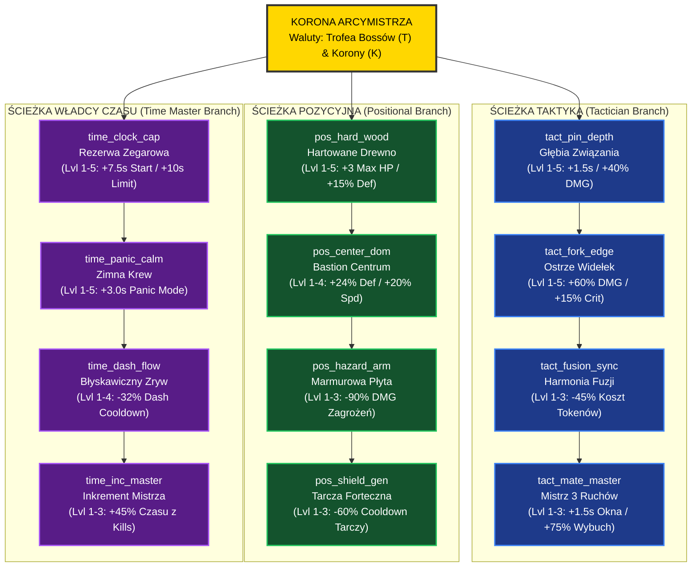

# RFC: Dział I — Głęboka Metaprogresja, System ELO i Szachowe Debiuty
**Projekt:** Chess Survivors 76 (Checkmate: Bullet Hell)  
**Dokument:** `.specs/proposals/domain-1-metaprogression.md`  
**Autor:** Zespół AM76 Game Studio (Worker Domain 1)  
**Data:** 2026-10-25  
**Wersja:** 1.0.0 (Status: PROPOSAL / RFC)  
**Metodologia:** TLC Spec-Driven & Standard AM76 GAS Framework  

---

## Spis Treści
1. [Cel i Uzasadnienie Projektowe (Design Intent & Rationale)](#1-cel-i-uzasadnienie-projektowe-design-intent--rationale)
   - 1.1. Wizja Metaprogresji Szachowego Roguelite
   - 1.2. Pętla Retencji (Core Retention Loop)
   - 1.3. Rozwiązanie Problemu Lęku przed Rankingiem (Ladder Anxiety)
2. [Problem Statement](#problem-statement)
3. [Out of Scope](#out-of-scope)
4. [Assumptions & Open Questions](#assumptions--open-questions)
5. [User Stories](#user-stories)
6. [Szczegółowe Mechaniki z Wartościami Liczbowymi i Wzorami Balansu](#2-szczegółowe-mechaniki-z-wartościami-liczbowymi-i-wzorami-balansu)
   - 2.1. System Rankingowy ELO (800 – 2800 ELO)
   - 2.2. Szachowe Debiuty (Chess Openings Starter Kits)
   - 2.3. Stałe Drzewo Arcymistrza (The Grandmaster Meta-Tree)
   - 2.4. Architektura Danych: StorageEngine v2
7. [Schematy UI oraz Diagramy Przepływu Mermaid](#3-schematy-ui-oraz-diagramy-przepływu-mermaid)
   - 3.1. Schemat UI Wyboru Debiutu Szachowego (ASCII Mockup — Open Table)
   - 3.2. Diagram Przepływu Drzewa Arcymistrza (Mermaid)
   - 3.3. Schemat Ekranu Awansu ELO i Podsumowania Partii (ASCII Mockup)
8. [Analiza Techniczna Wykonalności w Silniku Canvas 2D](#4-analiza-techniczna-wykonalności-w-silniku-canvas-2d)
   - 4.1. Analiza Kosztu Pamięciowego Profilu (`PlayerProfileV2`)
   - 4.2. Asynchroniczny, Niezakłócający Zapis (Fire-and-Forget Persistence)
   - 4.3. Implementacja Zasad Zero-GC dla Właściwości Metaprogresji
   - 4.4. Zakaz Stosowania `ctx.shadowBlur`
   - 4.5. Kanoniczny Nadzbiór Pul Obiektów (Unified Object Pool Superset)
9. [Wymagania Funkcyjne w Formacie EARS (TLC Spec-Driven)](#5-wymagania-funkcyjne-w-formacie-ears-tlc-spec-driven)
   - 5.1. Wymagania Uniwersalne (Ubiquitous Requirements)
   - 5.2. Wymagania Sterowane Zdarzeniem (Event-Driven Requirements)
   - 5.3. Wymagania Stanowe (State-Driven Requirements)
   - 5.4. Wymagania Warunkowe i Opcjonalne (Optional / Feature Flag Requirements)
   - 5.5. Wymagania Dotyczące Sytuacji Niepożądanych (Unwanted Behavior / Failure Requirements)
10. [Requirement Traceability](#requirement-traceability)
11. [Zależności Międzydomenowe i Reguły Interakcji (Cross-Domain Interactions)](#6-zależności-międzydomenowe-i-reguły-interakcji-cross-domain-interactions)
    - 6.1. Obrona Sycylijska (Panic Mode) vs Zegarowy Arbiter (Flag Fall)
    - 6.2. Gambit Króla (1 HP) vs Czarny Król Faza 2 (Królewska Aura Zagłady)
    - 6.3. Zryw Amazonki (Absolute Domain) a Limit Częstotliwości (Dash Execution Guard)
    - 6.4. Tarcza Bastionu Cesarki a Płytki Próżniowe (TILE_VOID Pushback Clamp)
12. [Podsumowanie i Gotowość Wdrożeniowa](#7-podsumowanie-i-gotowość-wdrożeniowa)

---

## 1. Cel i Uzasadnienie Projektowe (Design Intent & Rationale)

### 1.1. Wizja Metaprogresji Szachowego Roguelite
*Chess Survivors 76* łączy precyzję, elegancję i rygor logiczny szachów turniejowych z magnetyczną pętlą „jeszcze jednego podejścia” (one-more-run) charakterystyczną dla czołowych gier roguelite (*Vampire Survivors*, *Hades*, *Brotato*). 

W tradycyjnych grach bullet-hell metaprogresja sprowadza się często do liniowego „grindu” surowców i sztucznego podbijania statystyk (+5% HP, +3% DMG), co szybko prowadzi do dewaluacji wyzwania i znużenia gracza. W *Chess Survivors 76* Dział I wprowadza fundamentalną zmianę paradygmatu:
1. **Szachowa Prawda Rangi (Mastery over Grind):** Wskaźnik ELO nie jest prostym licznikiem wyekspionych poziomów, lecz matematycznym odzwierciedleniem biegłości gracza w unikaniu, kontroli przestrzeni i szachowym zarządzaniu zegarem.
2. **Dynamiczny Regulator Wyzwania (Adaptive Difficulty):** Im wyższe ELO zdobywa gracz, tym bardziej bezwzględna staje się arena (szybsze wrogie bierki, krótsze telegrafy, wyższy udział jednostek elitarnych). Gra rośnie razem z umiejętnościami szachisty.
3. **Prawdziwa Sprawczość Gracza (Player Agency):** Każdy Szachowy Debiut definiuje odmienny styl gry i zestaw ograniczeń, zamieniając każdy bieg w unikalną partię taktyczną.
4. **Zasada Etyki Szachowej — Darmowe Cofnięcie (Takeback Rule):** Drzewo ulepszeń Arcymistrza można w 100% zresetować w dowolnym momencie bez jakichkolwiek opłat czy kar, co zachęca do eksperymentowania z wyspecjalizowanymi kompozycjami pod różne tempa gry (Rapid, Blitz, Bullet).

### 1.2. Pętla Retencji (Core Retention Loop)
Architektura pętli zaangażowania gracza opiera się na 5 powiązanych fazach:

```
┌────────────────────────────────────────────────────────────────────────┐
│                   PĘTLA RETENCJI METAPROGRESJI                         │
└───────────────────────────────────┬────────────────────────────────────┘
                                    │
                                    ▼
                     [ 1. PRZYGOTOWANIE DO PARTII ]
                     • Wybór Debiutu Szachowego (np. Sycylijska, Włoska)
                     • Wybór Tempa Zegara (Rapid: 45s, Blitz: 30s, Bullet: 15s)
                     • Konfiguracja Drzewa Arcymistrza (Meta-Tree)
                                    │
                                    ▼
                     [ 2. ROZGRYWKA TAKTYCZNA (RUN) ]
                     • Przetrwanie 10 Fal Wrogich Bierek
                     • Zarządzanie Zegarem Szachowym i Panic Mode
                     • Fuzje Figur, Związania (Pinning) i Widełki (Forks)
                     • Zbieranie Żetonów Gambitu i Trofeów Bossów
                                    │
                                    ▼
                     [ 3. POST-MATCH ELO EVALUATION ]
                     • Ewaluacja wyniku partii algorytmem FIDE
                     • Obliczenie oczekiwanego wyniku E(A) vs rzeczywistego S(A)
                     • Przyznanie punktów ELO, weryfikacja Progów Prestiżu
                     • Nagrody: Królewskie Korony za kamienie milowe
                                    │
                                    ▼
                     [ 4. DRZEWO ARCYMISTRZA (META-SHOP) ]
                     • Wydawanie Trofeów i Koron na 3 ścieżki rozwoju
                     • Eksperymentowanie z buildami (100% darmowy Takeback)
                                    │
                                    ▼
                     [ 5. ODBLOKOWANIE ZAWARTOŚCI ]
                     • Odblokowanie nowych Debiutów Szachowych
                     • Dostęp do wyższych lig i turniejów
                     • Powrót do punktu 1 z nową wiedzą i strategią
```

### 1.3. Rozwiązanie Problemu Lęku przed Rankingiem (Ladder Anxiety)
W tradycyjnych systemach rankingowych (np. szachy turniejowe, gry rankingowe PvP) gracze doświadczają zjawiska „lęku przed drabiną” — obawy przed utratą mozolnie zdobytych punktów po serii gorszych partii. W *Chess Survivors 76* problem ten rozwiązano za pomocą **Niezbywalnych Progów Prestiżu (Prestige Floors)**:
- Po przekroczeniu progu (np. 1500 ELO — Kandydat na Mistrza), ranking gracza zostaje trwale zablokowany na tej wartości jako podłodze.
- Gracz może bezpiecznie testować trudne, eksperymentalne debiuty (np. Gambit Króla o 1 HP) bez ryzyka degradacji do rangi nowicjusza.

---

## Problem Statement

W tradycyjnych grach z gatunku action-roguelite i bullet-hell (*Vampire Survivors*, *Brotato*, *20 Minutes Till Dawn*) systemy metaprogresji opierają się na powtarzalnym i bezrefleksyjnym gromadzeniu waluty, która służy do pasywnego podbijania surowych statystyk postaci (+5% do obrażeń, +10% punktów życia). Taki model prowadzi do deprecjacji wyzwania zręcznościowego, dewaluacji umiejętności gracza i powstawania zjawiska znużenia monotonnym „grindem”.

Jednocześnie próby adaptacji klasycznych systemów rankingowych (takich jak ELO w szachach turniejowych czy trybach rankingowych PvP) w grach jednoosobowych napotykają na trzy fundamentalne bariery:
1. **Lęk przed drabiną rankingową (Ladder Anxiety):** Gracze po osiągnięciu wysokiego wskaźnika ELO unikają dalszej gry lub eksperymentowania z trudnymi, niekonwencjonalnymi stylami rozgrywki ze strachu przed serią porażek i bolesną democją do niższych lig.
2. **Rozdźwięk między szachistami turniejowymi a graczami casualowymi:** Gracze o profilu szachowym oczekują intelektualnego rygoru, autentyczności matematycznej formuł FIDE i tożsamości szachowych debiutów, podczas gdy gracze zręcznościowi poszukują natychmiastowej gratyfikacji, soczystego sprzężenia zwrotnego i namacalnego progresu między partiami.
3. **Brak trwałej retencji metaprogresyjnej bez niszczenia balansu:** Wprowadzenie trwałych ulepszeń w grze opartej na szachowym rygorze grozi rozregulowaniem balansu — gracz z ulepszonym drzewkiem mógłby całkowicie ignorować mechanikę zegara i telegrafy wrogów.

Niniejsza specyfikacja Działu I rozwiązuje te problemy poprzez:
- Wdrożenie autentycznego, opartego na krzywej logistycznej FIDE systemu ELO ze sztywnymi, niezbywalnymi **Podłogami Prestiżu (Prestige Floors)** całkowicie eliminującymi lęk przed utratą rangi.
- Wprowadzenie 6 unikalnych Szachowych Debiutów drastycznie redefiniujących styl partii (np. Obrona Sycylijska z dynamicznym Panic Mode, bezkompromisowy Gambit Króla o stałym 1 HP).
- Zaprojektowanie 12-węzłowego Drzewa Arcymistrza o symetrycznej ekonomii (331 Trofeów, 55 Koron) z bezpłatną, nielimitowaną opcją resetu (Takeback Rule).
- Zbudowanie wysoce odpornego, trójwarstwowego silnika persystencji (`IndexedDB` $\to$ `localStorage` $\to$ RAM) z 32-bitową deterministyczną sumą kontrolną FNV-1a, spełniającego wymogi AM76 Framework (Zero-GC, brak alokacji w 60 FPS, Single-File Mandate).

---

## Out of Scope

W celu zachowania czystości granic architektonicznych w metodologii TLC Spec-Driven, poniższe zagadnienia zostały celowo wyłączone z Działu I i są szczegółowo definiowane w powiązanych specyfikacjach RFC:
* **Bezpośrednia egzekucja taktyk bojowych i fuzji figur w czasie rzeczywistym:** Związanie (Pinning), Widełki Skoczka, trójstopniowy Szach i Mat, hybrydy szachów baśniowych (Cesarka, Kardynał, Amazonka) oraz matematyka hiperbolicznego tłumienia CDR należą do **Działu II (`domain-2-tactics-and-fusions.md`)**.
* **Pętla AI przeciwników, wzorce ataków i mechaniki bossów:** Sztuczna inteligencja bierek promowanych, telegrafy, algorytmy kolizji Swept-Segment oraz mechaniki fazowe bossów (Zegarowy Arbiter, Czarny Król P2, Ręka Arcymistrza) należą do **Działu III (`domain-3-bestiary-and-bosses.md`)**.
* **Dynamiczna deformacja szachownicy i kafelki areny:** Kruszenie krawędzi, zatrute pola, kafelki promocji oraz buforowanie planszy w `BoardRenderer` należą do **Działu IV (`domain-4-board-dynamics.md`)**.
* **Wizualny interfejs analizy partii i Game Feel:** Interaktywny wykres przewagi (Game Review / Chess.com style), animacje przejść, ekrany encyklopedii bierek i screenshake należą do **Działu V (`domain-5-ui-ux-game-feel.md`)**.
* **Proceduralna synteza audio i muzyka adaptacyjna:** Generowanie efektów ZzFX dla zegara, uderzeń bierek i warstwowej muzyki Web Audio API należy do **Działu VI (`domain-6-audio-soundscape.md`)**.

---

## Assumptions & Open Questions

Poniższa tabela przedstawia wiążące decyzje architektoniczne i założenia techniczne przyjęte dla Działu I:

| Assumption | Chosen default | Rationale |
|---|---|---|
| Ochrona przed utratą rangi (Ladder Anxiety) | Trwałe, niezbywalne Podłogi Prestiżu co 300 ELO (800, 1200, 1500, 1800, 2100, 2400, 2700) | Blokuje democję do niższych lig, umożliwiając bezstresowe eksperymentowanie z ryzykownymi debiutami i buildami. |
| Stagnacja ELO przy wysokim rankingu w reżimie Bullet | Gwarantowany minimalny przyrost delta ELO >= +1 przy zwycięstwie (isVictory = true) | Zapobiega zaokrągleniu delty do 0 ELO przy E_A dążącym do 1.0 w okolicach 2597 ELO, umożliwiając osiągnięcie ligi Arcymistrza (2700+) i capu 2800 ELO. |
| Odporność persystencji i limity pamięci przeglądarki | Trójwarstwowy fallback: IndexedDB -> localStorage -> pamięć sesyjna RAM | Zapewnia 100% stabilności zapisu w restrykcyjnych środowiskach (tryb incognito Safari, sandboxy iframe Google Workspace). |
| Koszt i prowizja za cofnięcie ulepszeń (Respec) | Całkowicie bezpłatny, natychmiastowy zwrot 100% Trofeów i Koron bez kar (Takeback Rule) | Zgodność z etosem szachowej analizy; gracz może swobodnie rekonfigurować drzewo pod różne tempa gry (Rapid, Blitz, Bullet). |
| Izolacja pamięciowa w pętli 60 FPS (Zero-GC) | Kompilacja modyfikatorów meta do płaskich zmiennych prymitywnych obiektu Player przed startem biegu | Wyklucza dynamiczne odpytywanie obiektów JSON w pętli renderowania, gwarantując 0 bajtów alokacji na stercie w trakcie fali. |
| Unifikacja rozmiarów pul obiektów (Object Pooling) | Wspólna kanoniczna definicja puli obiektów: bullets 1536, particles 1024, lasers 96, enemies 128, tokens 128, floatingTexts 96, afterimages 64, tileDebris 64 | Gwarantuje spójność międzydomenową i zapobiega wyczerpaniu bytów podczas intensywnych walk z bossami i salw fuzji. |

**Open questions**: none

---

## User Stories

### User Story 1: System Rankingu ELO i Podłogi Prestiżu (Priority: P1)
Jako gracz chcę, aby mój poziom umiejętności był ewaluowany adaptacyjnym algorytmem FIDE po każdej partii z gwarancją ochrony przed degradacją poniżej progów prestiżu, abym mógł rywalizować bez lęku o utratę rangi.

**Acceptance Criteria**:
1. WHEN partia dobiegnie końca (zwycięstwo lub porażka) THEN the system SHALL obliczyć oczekiwany wynik $E_A$, rzeczywisty wynik $S_A$ oraz zmianę rankingu $\Delta ELO$ zgodnie z adaptacyjną formułą FIDE.
2. WHEN gracz odniesie zwycięstwo (pokonanie Finałowego Bossa w 10. fali) THEN the system SHALL zagwarantować minimalny przyrost rankingu $\Delta ELO \ge +1$ niezależnie od bazowego zaokrąglenia różnicy oczekiwań.
3. WHILE ranking gracza ulega modyfikacji the system SHALL ograniczać wartość $R_{\text{player}}$ do bezwzględnego przedziału od minimum 800 do maksimum 2800 punktów ELO.
4. IF wyliczona ujemna zmiana rankingu skutkowałaby spadkiem poniżej najwyższej odblokowanej Podłogi Prestiżu THEN the system SHALL zatrzymać redukcję na poziomie tejże podłogi $R_{\text{floor}}$.

### User Story 2: Szachowe Debiuty i Modyfikatory Rozgrywki (Priority: P1)
Jako gracz chcę wybierać spośród 6 odblokowywanych debiutów szachowych o zróżnicowanych pasywkach i ograniczeniach, aby każda partia wymuszała odmienny plan taktyczny.

**Acceptance Criteria**:
1. WHEN ranking ELO gracza osiągnie lub przekroczy wymagany próg ligowy THEN the system SHALL odblokować powiązany debiut szachowy i dodać go do listy dostępnych zestawów startowych.
2. WHILE aktywny jest debiut Gambit Króla the system SHALL utrzymywać maksymalne oraz bieżące punkty życia gracza na stałej wartości równej 1 HP.
3. WHERE wrogi pocisk przelatuje w odległości mniejszej niż 14 px od gracza w debiucie Gambit Króla THEN the system SHALL aktywować spowolnienie czasu o 60 procent na czas 0.4s oraz naładować potrójne obrażenia następnego ataku.
4. WHEN gracz w Obronie Sycylijskiej wejdzie w stan Panic Mode (Zegar = 0) THEN the system SHALL wyemitować radialną salwę 16 noży szachowych z potrójnymi obrażeniami krytycznymi.
5. WHEN gracz w Obronie Sycylijskiej zlikwiduje wrogą jednostkę w trakcie trwania Panic Mode THEN the system SHALL dodać 2.0s do Zegara Szachowego.

### User Story 3: Drzewo Arcymistrza i Zasada Darmowego Cofnięcia (Priority: P1)
Jako gracz chcę inwestować Trofea Bossów i Królewskie Korony w 12-węzłowe drzewo rozwoju z możliwością bezpłatnego resetu punktów, aby optymalizować buildy pod różne tempa gry.

**Acceptance Criteria**:
1. WHEN gracz zatwierdzi zakup ulepszenia w Drzewie Arcymistrza posiadając wymagane waluty THEN the system SHALL pobrać odpowiednią liczbę Trofeów i Koron oraz zwiększyć poziom węzła o 1.
2. IF gracz spróbuje zakupić ulepszenie węzła bez posiadania wystarczającej liczby walut THEN the system SHALL odrzucić transakcję i zablokować modyfikację stanu konta.
3. WHEN gracz wywoła funkcję darmowego cofnięcia (Takeback) THEN the system SHALL zresetować wszystkie węzły drzewa do poziomu 0 i zwrócić 100 procent zainwestowanych Trofeów i Koron.

### User Story 4: Wydajność Zero-GC i Spłaszczanie Modyfikatorów (Priority: P1)
Jako inżynier silnika chcę, aby modyfikatory debiutów i drzewka ulepszeń były kompilowane do płaskich zmiennych prymitywnych przed startem partii, eliminując alokacje obiektowe w pętli 60 FPS.

**Acceptance Criteria**:
1. The system SHALL kompilować wszystkie aktywne modyfikatory debiutu i drzewka meta do płaskich pól prymitywnych instancji Player w momencie wywołania startRun.
2. WHILE partia znajduje się w stanie aktywnym the system SHALL wykonywać 0 alokacji obiektów na stercie JavaScript wewnątrz metod update oraz render.
3. The system SHALL prealokować kanoniczny zestaw pul obiektów w src/pool.js obejmujący 1536 bullets, 1024 particles, 96 lasers, 128 enemies, 128 tokens, 96 floatingTexts, 64 afterimages oraz 64 tileDebris.

### User Story 5: Trójwarstwowa Persystencja i Deterministyczna Suma Kontrolna (Priority: P1)
Jako gracz chcę mieć gwarancję nienaruszalności i trwałości zapisu postępów na dowolnej przeglądarce i urządzeniu, bez ryzyka utraty osiągnięć w przypadku awarii pojedynczego magazynu.

**Acceptance Criteria**:
1. The system SHALL obliczać 32-bitową sumę kontrolną FNV-1a na podstawie deterministycznie posortowanych kluczy węzłów oraz kopii listy odblokowanych debiutów.
2. IF transakcja zapisu profilu w IndexedDB zakończy się niepowodzeniem THEN the system SHALL wykonać natychmiastowy fallback do localStorage.
3. IF zapis w localStorage rzuci błąd przekroczenia limitu danych THEN the system SHALL utrzymać stan profilu w obiekcie sesyjnym pamięci RAM.
4. IF podczas odczytu obliczona suma kontrolna nie zgadza się ze skrótem zapisanym w profilu THEN the system SHALL przywrócić ostatnią poprawną kopię zapasową stanu.

---


## 2. Szczegółowe Mechaniki z Wartościami Liczbowymi i Wzorami Balansu

### 2.1. System Rankingowy ELO (800 – 2800 ELO)

Ranking ELO w grze działa w oparciu o adaptację oficjalnego standardu Międzynarodowej Federacji Szachowej (FIDE), w którym gracz mierzy się z **Wirtualnym Przeciwnikiem Areny** ($R_{\text{opp}}$), reprezentującym poziom trudności danego tempa gry.

#### 2.1.1. Wirtualny Przeciwnik Areny ($R_{\text{opp}}$)
Poziom bazowy przeciwnika zależy bezpośrednio od wybranego reżimu czasowego:
- **Tempo Rapid (45.0 s bazowo na falę):** $R_{\text{opp}} = 1100$ ELO (Poziom przystępny, nastawiony na naukę)
- **Tempo Blitz (30.0 s bazowo na falę):** $R_{\text{opp}} = 1500$ ELO (Standardowy turniejowy poziom klubowy)
- **Tempo Bullet (15.0 s bazowo na falę):** $R_{\text{opp}} = 1900$ ELO (Piekielnie szybki, elitarny poziom mistrzowski)

#### 2.1.2. Formuła Oczekiwanego Wyniku FIDE ($E_A$)
Oczekiwany rezultat gracza w starciu z areną wyraża standardowa logistyczna krzywa FIDE:
$$E_A = \frac{1}{1 + 10^{(R_{\text{opp}} - R_{\text{player}}) / 400}}$$

Gdzie:
- $R_{\text{player}} \in [800, 2800]$ to bieżący ranking ELO gracza.
- $R_{\text{opp}}$ to ranking Wirtualnego Przeciwnika Areny.

*Własności matematyczne:*
- Jeśli $R_{\text{player}} = R_{\text{opp}}$, to $E_A = 0.50$ (szanse są równe).
- Jeśli $R_{\text{player}} = R_{\text{opp}} + 400$, to $E_A \approx 0.909$ (arena oczekuje niemal pewnego zwycięstwa).
- Jeśli $R_{\text{player}} = R_{\text{opp}} - 400$, to $E_A \approx 0.091$ (ogromna niespodzianka w przypadku wygranej).

#### 2.1.3. Formuła Rzeczywistego Wyniku Partii ($S_A$)
W klasycznych szachach wynik to $1.0$ (wygrana), $0.5$ (remis) lub $0.0$ (porażka). W roguelite partia jest procesem wieloetapowym, dlatego $S_A \in [0.0, 1.0]$ jest funkcją ciągłą wyliczaną na podstawie głębokości biegu i jakości gry:

$$S_A = 0.60 \times \left( \frac{\text{waveReached}}{\text{totalWaves}} \right) + 0.25 \times (\text{isVictory} ? 1.0 : 0.0) + 0.15 \times \text{tacticalBonus}$$

Gdzie:
- $\text{totalWaves} = 10$ (standardowa partia turniejowa składa się z 10 fal bierek).
- $\text{waveReached} \in [1, 10]$ to numer fali, w której poległ gracz (lub 10 przy zwycięstwie).
- $\text{isVictory} \in \{0, 1\}$ wynosi $1.0$ tylko w przypadku zmatowania Finałowego Bossa (Ręka Arcymistrza w Fali 10).
- $\text{tacticalBonus} \in [0.0, 1.0]$ to znormalizowana suma osiągnięć taktycznych w biegu:
  - $+0.333$ (1/3): Brak utraty życia w trybie Panic Mode (Zegar = 0) przez całą partię.
  - $+0.333$ (1/3): Wykonanie co najmniej 3 skutecznych manewrów taktycznych (Związanie, Widełki lub Mat w 3 Ruchach).
  - $+0.334$ (1/3): Pokonanie co najmniej jednego Bossa lub Mini-Bossa bez odniesienia obrażeń (Flawless Boss).

Maksymalna wartość $S_A$ wynosi dokładnie $1.000$ (perfekcyjne zwycięstwo z kompletem bonusów taktycznych).

#### 2.1.4. Dynamiczny Współczynnik Zmienności $K$ (K-Factor Decay)
Zgodnie z praktyką FIDE, nowi gracze posiadają wysoką zmienność rankingu (szybka kalibracja), natomiast arcymistrzowie podlegają rygorystycznej stabilizacji:

$$K = \begin{cases} 
36 & \text{dla } R_{\text{player}} < 1200 \quad \text{(Nowicjusz / Klasa E-D)} \\
28 & \text{dla } 1200 \le R_{\text{player}} < 1800 \quad \text{(Gracz Klubowy / CM / Klasa C-A)} \\
20 & \text{dla } 1800 \le R_{\text{player}} < 2400 \quad \text{(Mistrz FIDE / IM)} \\
14 & \text{dla } R_{\text{player}} \ge 2400 \quad \text{(Arcymistrz / Super-GM)}
\end{cases}$$

#### 2.1.5. Mnożniki Serii (Win / Loss Streak Multipliers)
Aby nagradzać dominację i stabilność formy, wprowadzono mnożnik serii zwycięstw:
$$M_{\text{winStreak}} = \min(2.0, 1.0 + \max(0, \text{winStreak} - 1) \times 0.25)$$

Wartości dyskretne dla $M_{\text{winStreak}}$:
- Seria 1 zwycięstwa: $1.00\times$
- Seria 2 zwycięstw: $1.25\times$
- Seria 3 zwycięstw: $1.50\times$
- Seria 4 zwycięstw: $1.75\times$
- Seria 5+ zwycięstw: $2.00\times$ (wartość szczytowa / cap)

Dla złagodzenia frustracji przy serii porażek wprowadzono tłumienie strat (Loss Streak Damping):
$$M_{\text{lossStreak}} = \max(0.50, 1.0 - \max(0, \text{lossStreak} - 1) \times 0.15)$$

Wartości dyskretne dla $M_{\text{lossStreak}}$:
- 1 porażka: $1.00\times$ straty
- 2 porażki z rzędu: $0.85\times$ straty
- 3 porażki z rzędu: $0.70\times$ straty
- 4 porażki z rzędu: $0.55\times$ straty
- 5+ porażek z rzędu: $0.50\times$ straty (tłumienie do 50%)

#### 2.1.6. Ostateczna Formuła Zmiany Rankingu ($\Delta ELO$)
$$\Delta ELO = \begin{cases} 
\max\left(1, \, \text{round}\left( K \times (S_A - E_A) \times M_{\text{winStreak}} \right)\right) & \text{gdy } \text{isVictory} = \text{true} \\
\text{round}\left( K \times (S_A - E_A) \times M_{\text{winStreak}} \right) & \text{gdy } S_A \ge E_A \land \text{isVictory} = \text{false} \\
\text{round}\left( K \times (S_A - E_A) \times M_{\text{lossStreak}} \right) & \text{gdy } S_A < E_A 
\end{cases}$$

Nowy ranking po partii:
$$R_{\text{new}} = \max\left( R_{\text{floor}}, \min(2800, R_{\text{player}} + \Delta ELO) \right)$$

Gdzie $R_{\text{floor}}$ to najwyższy odblokowany przez gracza Próg Prestiżu.

##### Gwarancja Progresu Zwycięstwa (Minimum Victory Increment & Stagnation Defense)
W klasycznej formule FIDE przy bardzo wysokim rankingu gracza (np. $R_{\text{player}} = 2597$ ELO w reżimie Bullet, gdzie $R_{\text{opp}} = 1900$), oczekiwany wynik dąży asymptotycznie do jedności:
$$E_A = \frac{1}{1 + 10^{(1900 - 2597)/400}} = \frac{1}{1 + 10^{-1.7425}} \approx \frac{1}{1 + 0.0181} \approx 0.982$$
Jeśli gracz zwycięży bez kompletu bonusów taktycznych ($S_A = 0.850 \dots 0.950$), różnica $(S_A - E_A)$ może przybrać wartość bliską zeru lub ujemną. Bez klauzuli obronnej skutkowałoby to zaokrągleniem $\Delta ELO$ do $0$ lub wręcz utratą punktów pomimo pokonania Ręki Arcymistrza w Fali 10, trwale blokując gracza przed osiągnięciem VI Progu Prestiżu (2700 ELO — Arcymistrz) i twardego limitu 2800 ELO.

Wprowadzona reguła **Minimum Victory Increment** gwarantuje, że każde pełne zwycięstwo w biegu (`isVictory = true`) przyznaje co najmniej $+1$ ELO:
$$\Delta ELO_{\text{victory}} = \max(1, \, \text{round}(K \times (S_A - E_A) \times M_{\text{winStreak}})) \ge +1$$
Eliminuje to zjawisko martwego punktu matematycznego (ELO Stagnation) i zapewnia sprawiedliwą nagrodę za pokonanie finałowego wyzwania.


#### 2.1.7. Przedziały Rankingu, Tytuły i Progi Prestiżu (Prestige Floors)

| Przedział ELO | Tytuł Szachowy | Tytuł Angielski | Próg Prestiżu ($R_{\text{floor}}$) | Mnożnik Trofeów Bossów | Odblokowywana Zawartość |
|---|---|---|---|---|---|
| **800 – 1199** | Nowicjusz Szachowy | Novice | **800** (Start) | $1.00\times$ | Domyślne tempa, Partia Włoska |
| **1200 – 1499** | Gracz Klubowy | Club Player | **1200** (Prestiż I) | $1.15\times$ | Debiut: Partia Hiszpańska, perki Skoczka |
| **1500 – 1799** | Kandydat na Mistrza (CM) | Candidate Master | **1500** (Prestiż II) | $1.30\times$ | Debiut: Obrona Sycylijska, Fuzja: Kardynał |
| **1800 – 2099** | Mistrz FIDE (FM) | FIDE Master | **1800** (Prestiż III) | $1.50\times$ | Debiut: Gambit Królowej, Fuzja: Cesarka |
| **2100 – 2399** | Mistrz Międzynarodowy (IM) | International Master | **2100** (Prestiż IV) | $1.75\times$ | Debiut: Królewsko-Indyjska, Tryb Chaos |
| **2400 – 2699** | Arcymistrz (GM) | Grandmaster | **2400** (Prestiż V) | $2.10\times$ | Debiut: Gambit Króla, Fuzja: Amazonka |
| **2700 – 2800** | Super Arcymistrz | Super-GM / Immortal | **2700** (Prestiż VI) | $2.50\times$ | Złoty Motyw Marmurowy, Tytuł Legendy |

*Zasada Żelaznej Podłogi Prestiżu:*  
Gdy gracz osiągnie np. 1805 ELO, jego stały próg $R_{\text{floor}}$ przyjmuje wartość 1800. Żadna liczba przegranych partii nie zepchnie jego rankingu do 1799 ELO. Prestiż jest niezbywalny w ramach profilu.

#### 2.1.8. Dynamiczne Skalowanie Trudności Wrogów per ELO Tier
Gra automatycznie skaluje parametry wrogich jednostek w oparciu o aktualne ELO gracza:

1. **Mnożnik Zdrowia Wrogów ($\text{Mult}_{\text{HP}}$):**
   $$\text{Mult}_{\text{HP}} = 1.0 + (ELO - 800) \times 0.00045 \quad (\text{min } 1.00\times, \text{ max } 1.90\times)$$
2. **Mnożnik Prędkości Wrogów ($\text{Mult}_{\text{Spd}}$):**
   $$\text{Mult}_{\text{Spd}} = 1.0 + (ELO - 800) \times 0.00012 \quad (\text{min } 1.00\times, \text{ max } 1.24\times)$$
3. **Mnożnik Czasu Telegrafowania Ataków ($\text{Mult}_{\text{Telegraph}}$):**
   $$\text{Mult}_{\text{Telegraph}} = \max\left(0.70, 1.0 - (ELO - 800) \times 0.00015\right) \quad (\text{skrócenie o max } 30\%)$$
4. **Prawdopodobieństwo Spawnu Wrogów Elitarnych ($P_{\text{elite}}$):**
   $$P_{\text{elite}} = \begin{cases} 0.0 & \text{dla } ELO \le 1000 \\ \min\left(0.35, (ELO - 1000) \times 0.00020\right) & \text{dla } ELO > 1000 \end{cases}$$

#### Tabela Skalowania Wrogów na Granicach Przedziałów ELO:

| Poziom ELO | Ranga | Mnożnik HP ($\text{Mult}_{\text{HP}}$) | Mnożnik Spd ($\text{Mult}_{\text{Spd}}$) | Telegraf ($\text{Mult}_{\text{Telegraph}}$) | Szansa na Elity ($P_{\text{elite}}$) | Mnożnik Zrzutu Trofeów |
|---|---|---|---|---|---|---|
| **800** | Nowicjusz (Start) | $1.000\times$ (100%) | $1.000\times$ (100%) | $1.000\times$ (Pełny) | $0.0\%$ (Brak) | $1.00\times$ |
| **1000** | Nowicjusz+ | $1.090\times$ (109%) | $1.024\times$ (102%) | $0.970\times$ (-3%) | $0.0\%$ (Początek) | $1.05\times$ |
| **1200** | Klubowy | $1.180\times$ (118%) | $1.048\times$ (105%) | $0.940\times$ (-6%) | $4.0\%$ | $1.15\times$ |
| **1500** | Kandydat (CM) | $1.315\times$ (131.5%) | $1.084\times$ (108%) | $0.895\times$ (-10.5%) | $10.0\%$ | $1.30\times$ |
| **1800** | Mistrz FIDE (FM)| $1.450\times$ (145%) | $1.120\times$ (112%) | $0.850\times$ (-15%) | $16.0\%$ | $1.50\times$ |
| **2100** | Mistrz Międz. (IM)| $1.585\times$ (158.5%) | $1.156\times$ (116%) | $0.805\times$ (-19.5%) | $22.0\%$ | $1.75\times$ |
| **2400** | Arcymistrz (GM) | $1.720\times$ (172%) | $1.192\times$ (119%) | $0.760\times$ (-24%) | $28.0\%$ | $2.10\times$ |
| **2700** | Super-GM | $1.855\times$ (185.5%) | $1.228\times$ (123%) | $0.715\times$ (-28.5%) | $34.0\%$ | $2.40\times$ |
| **2800** | Limit Absolutny | $1.900\times$ (190%) | $1.240\times$ (124%) | $0.700\times$ (-30%) | $35.0\%$ (Cap) | $2.50\times$ |

---

### 2.2. Szachowe Debiuty (Chess Openings Starter Kits)

Debiuty szachowe stanowią ekwiwalent klas startowych / paktów bojowych. Każdy debiut drastycznie zmienia styl rozgrywki, nakładając unikalne warunki brzegowe na mechanikę Zegara, ruch gracza, ekonomię oraz zdolności taktyczne.

Poniższa specyfikacja obejmuje 6 głównych debiutów turniejowych:

```
+---------------------------------------------------------------------------------------------------------+
|                                    SZACHOWE DEBIUTY — PRZEGLĄD MATRIX                                   |
+----------------------+--------------------+------------------------------------+------------------------+
| Debiut (Kod ECO)     | Archetyp Stylu     | Główna Modyfikacja Zegara / Zdolność| Tagi Synergii          |
+----------------------+--------------------+------------------------------------+------------------------+
| Partia Włoska (C50)  | Balans Pozycyjny   | Tarcza Centrum; Zegar bazowy 30.0s | [POZYCJA, CENTRUM]     |
| Partia Hiszp. (C60)  | Kontrola i Wiązania| Wbudowane Związanie; Zegar 30.0s   | [TAKTYKA, ZWIĄZANIE]   |
| Obrona Sycyl. (B20)  | Agresywny Kontratak| Panic Burst; Zegar max 22.0s       | [AGRESJA, RYZYKO]      |
| Gambit Królowej (D06)| Bogata Ekonomia    | Tanie zakupy -25%; Royal Cleave    | [EKONOMIA, KONTROLA]   |
| Król.-Indyjska (E60) | Skalowanie Późne   | Fale 1-3 słabe, Fale 4+ potężne    | [SKALOWANIE, MANEWR]   |
| Gambit Króla (C30)   | Szkoła Romantyczna | Stałe 1 HP; Bullet Time na Graze   | [BERSERKER, GRAZE]     |
+----------------------+--------------------+------------------------------------+------------------------+
```

#### 2.2.1. Partia Włoska (Italian Game — Giuoco Piano, ECO C50)
- **Kontekst Historyczno-Szachowy:** Klasyczny, najstarszy debiut pozycyjny (1. e4 e5 2. Nf3 Nc6 3. Bc4), uczący harmonijnego rozwoju lekkich figur i walki o geometryczne centrum planszy.
- **Warunek Odblokowania:** Dostępny natychmiast od pierwszej rozgrywki (Domyślny zestaw wprowadzający).
- **Statystyki Startowe:**
  - Zdrowie Maksymalne: $6$ HP (bazowo $+1$ dodatkowe serce w stosunku do standardu 5 HP).
  - Prędkość Ruchu: $240.0\text{ px/s}$.
  - Rozmiar Pocisków: $+15\%$ średnicy hitboxa (łatwiejsze trafianie).
  - Pojemność Zegara Szachowego: $30.0\text{ s}$ (czas startowy fali: $20.0\text{ s}$).
- **Sygnaturowa Zdolność Pasywna (Bastion Centrum):**
  - Kiedy gracz przebywa w obrębie 16 centralnych kafelków szachownicy ($4\times4$, pola d4, d5, e4, e5 i ich bezpośrednie otoczenie):
    - Szybkostrzelność rośnie o $+25\%$ ($\text{fireCooldown} \times 0.80$).
    - Obrażenia zadawane przez gracza rosną o $+15\%$.
    - Co $30.0\text{ s}$ ciągłego przebywania w centrum ładuje się *Tarcza Włoska* pochłaniająca $1$ trafienie bez utraty HP.
- **Zdolność Aktywna (Harmonijny Rozwój — Klawisz Spacja/Dash):**
  - Wykonanie Dasha emituje radialną falę uderzeniową o promieniu $150\text{ px}$, odpychającą wrogów o $120\text{ px}$ na zewnątrz centrum. Cooldown: $3.0\text{ s}$.
- **Powiązane Tagi Synergii:** `[POZYCJA]`, `[CENTRUM]`, `[DEFENSYWA]`.

#### 2.2.2. Partia Hiszpańska / Ruy Lopez (ECO C60)
- **Kontekst Historyczno-Szachowy:** Jeden z najbardziej prestiżowych debiutów mistrzowskich (1. e4 e5 2. Nf3 Nc6 3. Bb5), oparty na natychmiastowym związaniu obrońcy centrum (skoczka c6) przez hiszpańskiego gońca.
- **Warunek Odblokowania:** Osiągnięcie rangi Gracza Klubowego (**1200 ELO**) LUB wykonanie łącznie 25 Związań (Pinning) w dowolnych partiach.
- **Statystyki Startowe:**
  - Zdrowie Maksymalne: $5$ HP.
  - Prędkość Ruchu: $245.0\text{ px/s}$.
  - Zasięg Laserów i Pocisków Przebijających: $+20\%$.
  - Pojemność Zegara: $30.0\text{ s}$.
- **Sygnaturowa Zdolność Pasywna (Szturm Marshalla):**
  - Wszystkie ataki gracza mają wbudowane $30\%$ szansy na nałożenie Związania (Pinning) na $2.0\text{ s}$ bez konieczności posiadania perków.
  - Trafienie w związanego wroga generuje falę rezonansową o promieniu $180\text{ px}$, zadającą $75\%$ obrażeń uderzenia wszystkim okolicznym jednostkom i przedłużającą czas trwania ich związania o $+0.5\text{ s}$.
- **Zdolność Aktywna (Klamra Hiszpańska — PPM / Klawisz E):**
  - Wystrzeliwuje promienistą wiązkę rentgenowską w kierunku celownika, która natychmiast przykuwa do podłoża pierwszych 3 napotkanych wrogów w linii na czas $2.5\text{ s}$. Cooldown: $9.0\text{ s}$.
- **Powiązane Tagi Synergii:** `[TAKTYKA]`, `[ZWIĄZANIE]`, `[DEBUFF]`.

#### 2.2.3. Obrona Sycylijska (Sicilian Defense — Dragon Variation, ECO B20)
- **Kontekst Historyczno-Szachowy:** Najostrzejsza, bezkompromisowa odpowiedź czarnych na 1. e4 (1. e4 c5). Wariant Smoka charakteryzuje się obustronnymi atakami na króle, gdzie tempo liczy się bardziej niż materiał.
- **Warunek Odblokowania:** Osiągnięcie rangi Kandydata na Mistrza (**1500 ELO**) LUB odniesienie 3 zwycięstw klasą Skoczka.
- **Statystyki Startowe:**
  - Zdrowie Maksymalne: $5$ HP.
  - Szansa na Trafienie Krytyczne: $+15\%$ (mnożnik krytyka $2.0\times$).
  - Prędkość Ruchu: $+12\%$ ($268.8\text{ px/s}$).
  - **Wada Konstrukcyjna Zegara:** Maksymalna pojemność Zegara Szachowego ograniczona do zaledwie $22.0\text{ s}$ (zamiast 30.0s), czas startowy fali wynosi tylko $10.0\text{ s}$. Gracz żyje na krawędzi czasu.
- **Sygnaturowa Zdolność Pasywna (Smoczy Kontratak — Dragon Burst):**
  - Wejście w tryb Panic Mode (gdy Zegar osiąga $0.0\text{ s}$) nie powoduje natychmiastowej śmierci, lecz aktywuje potężną detonację: radialny pierścień 16 noży szachowych zadających potrójne obrażenia krytyczne ($3.0\times$).
  - Każde zabicie wroga w Panic Mode przyznaje aż $+2.0\text{ s}$ do Zegara (zamiast standardowego ułamka sekundy), natychmiast wyciągając gracza z paniki.
- **Zdolność Aktywna (Sycylijskie Cięcie — Klawisz Spacja/Dash):**
  - Błyskawiczny ślizg o $180\text{ px}$, w trakcie którego gracz staje się niewrażliwy na pociski i pozostawia za sobą 3 miny taktyczne, eksplodujące przy kontakcie z wrogiem na obszarze $90\text{ px}$. Cooldown: $2.8\text{ s}$.
- **Powiązane Tagi Synergii:** `[AGRESJA]`, `[KRYTYK]`, `[RYZYKO]`.

#### 2.2.4. Gambit Królowej (Queen's Gambit, ECO D06)
- **Kontekst Historyczno-Szachowy:** Strategiczny debiut (1. d4 d5 2. c4), w którym białe oferują piona skrzydłowego c4 w zamian za dominację w centrum i długofalową przewagę pozycyjno-strukturalną.
- **Warunek Odblokowania:** Osiągnięcie rangi Mistrza FIDE (**1800 ELO**) LUB zebranie łącznie $500$ Żetonów Gambitu w profilu.
- **Statystyki Startowe:**
  - Zdrowie Maksymalne: $5$ HP.
  - Prędkość Ruchu: $240.0\text{ px/s}$.
  - Startowa liczba żetonów: $0$ (Gambit materiału na starcie).
  - **Przewaga Ekonomiczna:** Wszystkie ceny w Sklepie Gambitu pomiędzy falami oraz koszty promocji figur są obniżone o $25\%$. Wrogowie upuszczają o $+35\%$ więcej żetonów.
- **Sygnaturowa Zdolność Pasywna (Skrzydło Hetmańskie — Royal Cleave):**
  - Zebranie 10 Żetonów Gambitu w przedziale czasu krótszym niż $5.0\text{ s}$ ładuje wskaźnik Królewskiego Skrzydła.
  - Po naładowaniu następuje automatyczne wyzwolenie cięcia *Royal Cleave*: pozioma i pionowa wiązka światła przecina całą szachownicę w osi gracza, niszcząc wszystkie wrogie pociski i zadając $250\text{ DMG}$ wrogom w liniach.
- **Zdolność Aktywna (Ofiara Pozycyjna — Klawisz PPM / E):**
  - Gracz poświęca 5 żetonów Gambitu, aby natychmiast odnowić pełną barierę nietykalności na $1.5\text{ s}$ i wywołać impuls odpychający wrogów na odległość $200\text{ px}$. Cooldown: $6.0\text{ s}$.
- **Powiązane Tagi Synergii:** `[EKONOMIA]`, `[KONTROLA]`, `[PROMOCJA]`.

#### 2.2.5. Obrona Królewsko-Indyjska (King's Indian Defense — KID, ECO E60)
- **Kontekst Historyczno-Szachowy:** Hypermodernistyczny debiut asymetryczny (1. d4 Nf6 2. c4 g6), w którym czarne oddają centrum, by po wykonaniu roszady przeprowadzić bezwzględny szturm pionowy na skrzydle królewskim w grze środkowej.
- **Warunek Odblokowania:** Osiągnięcie rangi Mistrza Międzynarodowego (**2100 ELO**) LUB pokonanie Bossa Ręka Arcymistrza w tempie Blitz.
- **Statystyki Startowe:**
  - Zdrowie Maksymalne: $5$ HP.
  - Prędkość Ruchu: $245.0\text{ px/s}$.
  - Pojemność Zegara: $30.0\text{ s}$.
  - **Asymetria Wczesnej Gry:** W falach 1, 2 i 3 obrażenia zadawane przez gracza są stłumione o $-10\%$.
- **Sygnaturowa Zdolność Pasywna (Późne Skalowanie Mistrzowskie):**
  - Począwszy od Fali 4, gracz otrzymuje permanentny bonus $+14\%$ do całkowitych obrażeń za każdą ukończoną falę:
    - Fala 4: $+14\%$ DMG
    - Fala 5: $+28\%$ DMG
    - Fala 6: $+42\%$ DMG
    - Fala 7: $+56\%$ DMG
    - Fala 8: $+70\%$ DMG
    - Fala 9: $+84\%$ DMG
    - Fala 10 (Finał): $+98\%$ DMG (podwojenie siły ognia w endgame!)
- **Zdolność Aktywna (Skrzydłowy Przełom — Płonący Dash):**
  - Od Fali 5 każdy Dash gracza pozostawia za sobą smugę rozżarzonych zrębków szachownicy trwającą $3.0\text{ s}$. Wrogowie wchodzący w smugę otrzymują obrażenia ciągłe $45\text{ DPS}$ i spowolnienie o $30\%$. Cooldown: $2.5\text{ s}$.
- **Powiązane Tagi Synergii:** `[SKALOWANIE]`, `[MANEWR]`, `[OBSZAROWE]`.

#### 2.2.6. Gambit Króla (King's Gambit — Szkoła Romantyczna, ECO C30)
- **Kontekst Historyczno-Szachowy:** XIX-wieczna „szkoła romantyczna” szachów (Adolf Anderssen, Paul Morphy) — maksymalne ryzyko, ofiara piona f4 w drugim posunięciu w imię spektakularnego ataku matowego kosztem odsłonięcia własnego monarchy.
- **Warunek Odblokowania:** Osiągnięcie prestiżowej rangi Arcymistrza (**2400 ELO**).
- **Statystyki Startowe (Czysty Berserker):**
  - Zdrowie Maksymalne: **Sztywno zablokowane na $1$ HP**. Gracz nie może zwiększyć HP żadnym perkiem ani uleczeniem. Każde trafienie to natychmiastowy koniec biegu (chyba że zadziała tarcza).
  - Szybkostrzelność: $+60\%$ bazowo ($\text{fireCooldown} \times 0.40$).
  - Prędkość Poruszania Się: $+30\%$ ($312.0\text{ px/s}$).
  - Zysk Czasu z Zabójstw: Wszystkie zlikwidowane bierki dają $+100\%$ więcej czasu do Zegara.
- **Sygnaturowa Zdolność Pasywna (Partia Nieśmiertelna — Graze Mechanics):**
  - Przelot wrogiego pocisku w odległości mniejszej niż $14\text{ px}$ od centrum postaci (muśnięcie / graze) aktywuje na $0.4\text{ s}$ spowolnienie czasu o $60\%$ (Bullet Time) i ładuje następny atak gracza do potrójnych obrażeń ($3.0\times$). Efekt może zachodzić co $0.5\text{ s}$.
- **Zdolność Aktywna (Romantyczna Ofiara — Klawisz PPM / E):**
  - Poświęcenie $5.0\text{ s}$ z Zegara Szachowego w zamian za natychmiastowe zniszczenie wszystkich zwykłych pocisków wrogów na planszy i zmatowanie wszystkich pionków w promieniu $250\text{ px}$. Cooldown: $15.0\text{ s}$.
- **Powiązane Tagi Synergii:** `[BERSERKER]`, `[GRAZE]`, `[BULLET-HELL]`.

---

### 2.3. Stałe Drzewo Arcymistrza (The Grandmaster Meta-Tree)

Drzewo Arcymistrza to system permanentnych ulepszeń kupowanych w menu głównym pomiędzy partiami. Wprowadza podwójną walutę metaprogresji:
1. **Trofea Bossów (Boss Trophies — T):** Zdobywane z pokonanych Mini-Bossów (Czarny Król Faza 1, Zegarowy Arbiter) — 1–2 trofea za walkę.
2. **Królewskie Korony (Royal Crowns — K):** Rzadka waluta prestiżowa przyznawana za zmatowanie Ręki Arcymistrza (Finałowego Bossa) oraz za przekroczenie kolejnych Progów Prestiżu ELO (1200, 1500, 1800, 2100, 2400, 2700 ELO — po 1 Koronie za próg).

#### 2.3.1. Trzy Ścieżki Mistrzostwa (Archetypes)
Drzewo rozgałęzia się na 3 odrębne ścieżki, z których każda mieści 4 unikalne węzły (łącznie 12 węzłów ulepszeń):
1. **Ścieżka Taktyka (The Tactician):** Skupiona na sile Związań, odłamkach Widełek, zniżkach Fuzji i detonacjach Mata w 3 Ruchach.
2. **Ścieżka Pozycyjna (The Positional):** Skupiona na pancerzu, odporności na krawędzie planszy, punktach życia i dominacji w centrum.
3. **Ścieżka Władcy Czasu (The Time Master):** Skupiona na rezerwach Zegara, wydłużaniu Panic Mode, redukcji cooldownu dasha i inkremencie czasu za zabójstwa.

#### 2.3.2. Szczegółowy Wykaz 12 Węzłów Drzewka (Koszty i Wartości)

| Gałąź | ID Węzła | Nazwa Węzła | Max Lvl | Koszt za Poziom (Trofea / Korony) | Efekt na Poziom (Kumulatywny) | Wartość na Max Poziomie |
|---|---|---|---|---|---|---|
| **Taktyk** | `tact_pin_depth` | Głębia Związania | 5 | L1: 2T/0K, L2: 3T/0K, L3: 4T/0K, L4: 6T/1K, L5: 8T/1K | $+0.3\text{ s}$ czasu Związania; $+8\%$ DMG w cel | $+1.5\text{ s}$ trwania, $+40\%$ DMG |
| **Taktyk** | `tact_fork_edge` | Ostrze Widełek | 5 | L1: 3T/0K, L2: 4T/0K, L3: 5T/0K, L4: 7T/1K, L5: 9T/1K | $+12\%$ DMG odłamków; $+3\%$ szansy na krytyk | $+60\%$ DMG odłamków, $+15\%$ Crit |
| **Taktyk** | `tact_fusion_sync`| Harmonia Fuzji | 3 | L1: 6T/1K, L2: 9T/2K, L3: 12T/3K | $-15\%$ tokenów na Fuzje w Sklepie Gambitu | $-45\%$ kosztu fuzji figur |
| **Taktyk** | `tact_mate_master`| Mistrz 3 Ruchów | 3 | L1: 8T/2K, L2: 12T/3K, L3: 16T/4K | $+0.5\text{ s}$ okna czasowego; $+25\%$ DMG wybuchu | $+1.5\text{ s}$ okna (5.5s), $+75\%$ DMG |
| **Pozycja**| `pos_hard_wood` | Hartowane Drewno| 5 | L1: 2T/0K, L2: 4T/0K, L3: 6T/1K, L4: 8T/1K, L5: 12T/2K | L1: +5% def, L2: +1 HP, L3: +10% def, L4: +1 HP, L5: +1 HP | Łącznie $+3$ Max HP, $+15\%$ redukcji DMG |
| **Pozycja**| `pos_center_dom` | Bastion Centrum | 4 | L1: 3T/0K, L2: 4T/0K, L3: 6T/1K, L4: 8T/1K | $+6\%$ redukcji DMG i $+5\%$ prędkości w centrum | $+24\%$ def i $+20\%$ spd w centrum |
| **Pozycja**| `pos_hazard_arm` | Marmurowa Płyta | 3 | L1: 4T/1K, L2: 6T/1K, L3: 8T/2K | $-30\%$ DMG od przepaści krawędzi i zatrutych pól | $-90\%$ obrażeń od zagrożeń areny |
| **Pozycja**| `pos_shield_gen` | Tarcza Forteczna| 3 | L1: 7T/2K, L2: 10T/2K, L3: 14T/3K | Czas regeneracji tarczy skrócony o $20\%$ | $-60\%$ czasu odnowienia tarczy |
| **Zegar**  | `time_clock_cap` | Rezerwa Zegarowa| 5 | L1: 2T/0K, L2: 3T/0K, L3: 4T/0K, L4: 6T/1K, L5: 8T/1K | Startowy czas $+1.5\text{ s}$; Max limit zegara $+2.0\text{ s}$ | $+7.5\text{ s}$ start, $+10.0\text{ s}$ limit (max 40s) |
| **Zegar**  | `time_panic_calm`| Zimna Krew | 5 | L1: 3T/0K, L2: 4T/0K, L3: 5T/0K, L4: 7T/1K, L5: 9T/1K | Czas trwania Panic Mode wydłużony o $+0.6\text{ s}$ | $+3.0\text{ s}$ Panic Mode (z 5.0s do 8.0s) |
| **Zegar**  | `time_dash_flow` | Błyskawiczny Zryw| 4 | L1: 4T/1K, L2: 6T/1K, L3: 8T/2K, L4: 10T/2K | Cooldown Dasha / Skoku skrócony o $8\%$ | $-32\%$ czasu odnowienia zrywu |
| **Zegar**  | `time_inc_master`| Inkrement Mistrza| 3 | L1: 8T/2K, L2: 12T/3K, L3: 16T/4K | Zysk czasu za zabicie wrogów powiększony o $+15\%$ | $+45\%$ inkrementu zegara za zabójstwa |

#### 2.3.3. Zasada 100% Darmowego Resetu (Takeback Rule)
W szachach towarzyskich istnieje tradycja cofnięcia nieudanego posunięcia za zgodą rywala (takeback). W *Chess Survivors 76*:
- Przycisk **„COFNIJ POSUNIĘCIA (RESET DRZEWKA)”** w menu Meta-Tree jest w 100% darmowy.
- Gracz może zresetować drzewko dowolną liczbę razy.
- Wszystkie zainwestowane Trofea Bossów oraz Królewskie Korony są natychmiast zwracane do portfela gracza w stosunku $1:1$ ($100\%$ refund).
- Brak jakichkolwiek opłat w złocie, brak utraty ELO, zero ukrytych kosztów. Umożliwia to swobodne przestawianie profilu (np. pełna ścieżka Zegarowa pod grę w tempie Bullet, lub pełna ścieżka Pozycyjna pod trudne starcia w Partii Włoskiej).

---

### 2.4. Architektura Danych: StorageEngine v2

Zgodnie ze standardem AM76 Framework, gra działa w architekturze Single-File Web App pod Google Apps Script (GAS) i sandboksem iframe. Oznacza to bezwzględny zakaz wywoływania synchronicznych zapytań serwerowych w pętli renderowania oraz konieczność zapewnienia wielopoziomowej odporności zapisu.

#### 2.4.1. Definicja Schematu JSON (`PlayerProfileV2`) w Notacji TypeScript

```typescript
/**
 * Główny schemat persystencji profilu gracza w Chess Survivors 76 (Wersja 2).
 */
export interface PlayerProfileV2 {
  // Metadane Schematu i Integralności
  schemaVersion: 2;
  lastUpdated: number; // Unix Epoch timestamp w milisekundach
  checksum: string;    // 32-bitowy hash heksadecymalny FNV-1a chroniący stan

  // Ustawienia Użytkownika i Interfejsu (Open Table)
  settings: {
    themeIndex: number;                       // 0: Klasyczny Staunton, 1: Marmur, 2: Cyber-Szachy
    tempoId: 'rapid' | 'blitz' | 'bullet';    // Domyślne tempo zegara
    aimMode: 'mouse' | 'auto' | 'twinstick';  // Tryb celowania (PC vs Mobile)
    touchOverlayMode: 'auto' | 'always' | 'off'; // Wirtualne gałki na ekranie
    hudMode: 'top' | 'bottom' | 'compact';    // Położenie HUD
    soundMuted: boolean;                      // Globalne wyciszenie audio proceduralnego
    sfxVolume: number;                        // 0.0 do 1.0 (synteza ZzFX)
    musicVolume: number;                      // 0.0 do 1.0 (reaktywne Web Audio)
  };

  // Statystyki Sumaryczne Kariery
  stats: {
    totalKills: number;
    totalRuns: number;
    totalVictories: number;
    bossesDefeated: number;
    totalPlaytimeSec: number;
  };

  // System Rankingowy ELO
  elo: {
    current: number;       // Bieżący ranking: 800 - 2800
    peak: number;          // Rekord wszech czasów gracza
    prestigeFloor: number; // Aktualna zablokowana podłoga: 800, 1200, 1500, 1800, 2100, 2400, 2700
    winStreak: number;     // Liczba zwycięstw z rzędu
    lossStreak: number;    // Liczba porażek z rzędu
    recentHistory: Array<{
      timestamp: number;
      tempo: 'rapid' | 'blitz' | 'bullet';
      deltaElo: number;
      resultingElo: number;
      wavesCleared: number;
      isVictory: boolean;
    }>; // Ostatnie 10 partii (dla wykresu analitycznego)
  };

  // Portfel Metaprogresji
  currencies: {
    bossTrophies: number;      // Dostępne Trofea Bossów (do wydania)
    royalCrowns: number;       // Dostępne Królewskie Korony (do wydania)
    lifetimeTrophies: number;  // Łącznie zdobyte trofea w historii konta
    lifetimeCrowns: number;    // Łącznie zdobyte korony w historii konta
  };

  // Szachowe Debiuty (Kity Startowe)
  openings: {
    activeOpeningId: string;   // Aktualnie wybrany debiut: 'italian' | 'sicilian' | itp.
    unlockedOpenings: string[]; // Lista odblokowanych identyfikatorów
    mastery: Record<string, {
      runsPlayed: number;
      victories: number;
      highestEloGain: number;
      bestWave: number;
    }>;
  };

  // Stałe Drzewo Ulepszeń Arcymistrza
  metaTree: {
    // Słownik: ID Węzła -> Poziom Inwestycji (0 do MaxLvl)
    nodes: {
      tact_pin_depth: number;
      tact_fork_edge: number;
      tact_fusion_sync: number;
      tact_mate_master: number;
      pos_hard_wood: number;
      pos_center_dom: number;
      pos_hazard_arm: number;
      pos_shield_gen: number;
      time_clock_cap: number;
      time_panic_calm: number;
      time_dash_flow: number;
      time_inc_master: number;
    };
    totalTrophiesInvested: number;
    totalCrownsInvested: number;
  };

  // Statystyki Taktyczne i Manewrowe
  tacticsStats: {
    pinsExecuted: number;
    forksTriggered: number;
    checkmatesCompleted: number;
    underpromotionsCount: number;
    fusionsCreated: number;
    panicModeEscapes: number;
  };

  // Osiągnięcia i Rekordy Tempa
  achievements: string[]; // Unikalne identyfikatory zdobytych odznak
  highScores: Record<'rapid' | 'blitz' | 'bullet', {
    bestWave: number;
    bestKills: number;
    victories: number;
    fastestVictorySec: number;
  }>;
}
```

#### 2.4.2. Suma Kontrolna Integralności FNV-1a (32-Bit)
Przed asynchronicznym zapisaniem stanu do `IndexedDB` lub `localStorage`, silnik generuje 32-bitowy skrót FNV-1a (Fowler–Noll–Vo) ze zdeterminizowanego ciągu kluczowych pól stanu (waluty, ELO, węzły meta):

```javascript
export function calculateProfileChecksum(profile) {
  // 1. Deterministyczne sortowanie kluczy węzłów drzewa meta (odporność na permutacje kluczy)
  const sortedMetaNodes = Object.keys(profile.metaTree.nodes)
    .sort()
    .map(k => `${k}:${profile.metaTree.nodes[k]}`)
    .join(',');

  // 2. Bezpieczna, niemutująca kopia tablicy odblokowanych debiutów przed sortowaniem
  const sortedOpenings = [...profile.openings.unlockedOpenings].sort().join(',');

  // 3. Deterministyczny ciąg reprezentujący stan krytyczny
  const stateString = [
    profile.schemaVersion,
    profile.elo.current,
    profile.elo.prestigeFloor,
    profile.currencies.bossTrophies,
    profile.currencies.royalCrowns,
    sortedMetaNodes,
    sortedOpenings
  ].join('|');

  let hash = 0x811c9dc5; // FNV offset basis 32-bit
  for (let i = 0; i < stateString.length; i++) {
    hash ^= stateString.charCodeAt(i);
    // Mnożenie przez liczbę pierwszą FNV 16777619 z obcięciem do 32 bitów
    hash = Math.imul(hash, 0x01000193) >>> 0;
  }
  return hash.toString(16).padStart(8, '0');
}
```
Podczas odczytu profilu suma jest przeliczana ponownie. Powyższa implementacja eliminuje mutowanie tablicy profilu w miejscu (płytki klon `[...unlockedOpenings]`) oraz gwarantuje determinizm skrótu niezależnie od kolejności dodawania kluczy w węzłach drzewka. Jeśli zapis został zmodyfikowany zewnętrznie w konsoli deweloperskiej w sposób niespójny, silnik przywraca bezpieczną migawkę z magazynu zapasowego.

#### 2.4.3. Protokół Płynnej Migracji ze Schematu v1 do v2
Silnik `StorageEngine` wykrywa wersję odczytanych danych. Jeśli dane w bazie pochodzą z wersji v1 (brak klucza `schemaVersion` lub wartość `1`):

1. **Zachowanie Danych Istniejących:** Wszystkie wcześniejsze osiągnięcia, rekordy zabójstw, fale i preferencje sterowania zostają w 100% zachowane.
2. **Kalkulacja Startowego ELO ze Statystyk Historycznych:**
   $$ELO_{\text{migrated}} = \max\left(800, \min\left(1600, 800 + (\text{totalVictories} \times 60) + \lfloor\text{totalKills} / 50\rfloor \times 10\right)\right)$$
   Gracz z historią zwycięstw nie zaczyna od zera, lecz otrzymuje natychmiastowy awans do adekwatnej rangi klubowej.
3. **Inicjalizacja Debiutów:** Partia Włoska zostaje odblokowana natychmiast; jeśli wyliczone ELO przekracza 1200 lub 1500, Partia Hiszpańska i Sycylijska również stają się od razu dostępne.
4. **Stworzenie Kopii Zapasowej:** Stary rekord zostaje zarchiwizowany pod kluczem `AM76_CHESS_DB_player_profile_v1_backup`.
5. **Nadanie Wersji:** Nowy obiekt otrzymuje `schemaVersion = 2`, świeży timestamp i poprawną sumę kontrolną.

#### 2.4.4. Trójwarstwowy System Fallbacku Magazynu (Triple Fallback Persistence)
W restrykcyjnych środowiskach korporacyjnych oraz trybach incognito (szczególnie Safari iOS):

```
┌────────────────────────────────────────────────────────┐
│            ARCHITEKTURA PERSYSTENCJI AM76              │
└───────────────────────────┬────────────────────────────┘
                            │
                            ▼
              [ WARSTWA 1: IndexedDB ]
              • Baza: AM76_CHESS_DB, Store: profile_store
              • Pełna asynchroniczność, brak limitu 5MB
                            │ (Błąd transakcji / brak wsparcia)
                            ▼
              [ WARSTWA 2: localStorage ]
              • Klucz: AM76_CHESS_DB_player_profile_v2
              • Szybki zapis synchroniczny z try-catch
                            │ (QuotaExceededError / SecurityError)
                            ▼
              [ WARSTWA 3: In-Memory RAM Object ]
              • Obiekt JS w pamięci podręcznej okna
              • 100% stabilności sesji bez rzucania wyjątków
```

---

## 3. Schematy UI oraz Diagramy Przepływu Mermaid

### 3.1. Schemat UI Wyboru Debiutu Szachowego (ASCII Mockup — Open Table)

Poniższa makieta demonstruje układ ekranu wyboru debiutu, w pełni responsywny dla komputerów PC (sterowanie myszką/klawiaturą) oraz urządzeń mobilnych/tabletów (ekrany dotykowe 16:9 oraz 9:16).

```
+---------------------------------------------------------------------------------------------------+
| [X] ZAMKNIJ            SZACHOWE SURVIVORS 76 — WYBÓR DEBIUTU STARTOWEGO             ELO: 1642 [CM]|
+---------------------------------------------------------------------------------------------------+
|                                                                                                   |
|  WYBIERZ SWÓJ SYSTEM DEBIUTOWY:                                                                   |
|                                                                                                   |
|  +---------------------------+  +---------------------------+  +-------------------------------+  |
|  | [1] PARTIA WŁOSKA   (C50) |  | [2] PARTIA HISZPAŃSKA(C60)|  | [3] OBRONA SYCYLIJSKA (B20)   |  |
|  | [ODBLOKOWANA] - STARTOWA  |  | [ODBLOKOWANA] - 1200+ ELO |  | [AKTYWNA] - 1500+ ELO         |  |
|  | Ikona: [C4 Goniec Włoski] |  | Ikona: [B5 Hiszpańska]    |  | Ikona: [C5 Czarny Skoczek]    |  |
|  | Styl: Kontrola Centrum    |  | Styl: Nacisk i Związania  |  | Styl: Agresywny Kontratak     |  |
|  | HP: 6 (+1) | Zegar: 30s   |  | HP: 5      | Zegar: 30s   |  | HP: 5      | Zegar: 22s (MAX) |  |
|  | Tagi: [CENTRUM] [POZYCJA] |  | Tagi: [TAKTYKA][ZWIĄZANIE]|  | Tagi: [AGRESJA] [KRYTYK]      |  |
|  | Pasywka: Tarcza Centrum   |  | Pasywka: Szturm Marshalla |  | Pasywka: Dragon Panic Burst   |  |
|  | [ WYBIERZ DEBIUT ]        |  | [ WYBIERZ DEBIUT ]        |  | [>>> WYBRANY DEBIUT <<<]      |  |
|  +---------------------------+  +---------------------------+  +-------------------------------+  |
|                                                                                                   |
|  +---------------------------+  +---------------------------+  +-------------------------------+  |
|  | [4] GAMBIT KRÓLOWEJ (D06) |  | [5] KRÓLEWSKO-INDYJSKA(E60|  | [6] GAMBIT KRÓLA        (C30) |  |
|  | [WYMÓG: 1800 ELO]         |  | [WYMÓG: 2100 ELO]         |  | [WYMÓG: 2400 ELO - GM]        |  |
|  | Ikona: [Królewska Korona] |  | Ikona: [Skrzydło Płomieni]|  | Ikona: [Czaszka Berserkera]   |  |
|  | Styl: Bogata Ekonomia     |  | Styl: Potęga Late-Game    |  | Styl: Szkoła Romantyczna      |  |
|  | Sklep: -25% Cen Przedmiot.|  | Fale 1-3: -10% | 4+: +14% |  | HP: 1 (ONE-HIT) | Spd: +30%   |  |
|  | Pasywka: Royal Cleave     |  | Pasywka: Płonący Dash     |  | Pasywka: Graze Bullet Time    |  |
|  | [ ZABLOKOWANE: 1800 ELO ] |  | [ ZABLOKOWANE: 2100 ELO ] |  | [ ZABLOKOWANE: 2400 ELO ]     |  |
|  +---------------------------+  +---------------------------+  +-------------------------------+  |
|                                                                                                   |
+---------------------------------------------------------------------------------------------------+
|  SZCZEGÓŁY WYBRANEGO DEBIUTU: OBRONA SYCYLIJSKA (WARIANT SMOKA)                                   |
|  • Zegar startowy zredukowany do 22.0 s (Wymaga nieustannego zdobywania zbić i czasu).            |
|  • Wejście w Panic Mode odpala 16-nożowy pierścień krytyczny (Dragon Burst).                      |
|  • Każde zlikwidowanie wroga w Panic Mode natychmiast przywraca +2.0 sekundy na zegarze.         |
|                                                                                                   |
|  [TEMPO: BLITZ (30s)]    [TRYB CELOWANIA: AUTO-AIM]          [ >>> ROZPOCZNIJ PARTIĘ (SPACE) <<<] |
+---------------------------------------------------------------------------------------------------+
```

### 3.2. Diagram Przepływu Drzewa Arcymistrza (Mermaid)



### 3.3. Schemat Ekranu Awansu ELO i Podsumowania Partii (ASCII Mockup)

```
+---------------------------------------------------------------------------------------------------+
|                                 RAPORT EWALUACJI PARTII (POST-MATCH)                              |
+---------------------------------------------------------------------------------------------------+
|  WYNIK KOŃCOWY:  ZWYCIĘSTWO (SZACH I MAT W 10. FALI)                 CZAS CAŁKOWITY: 06:42        |
|  TEMPO: BLITZ (R_opp: 1500) | DEBIUT: OBRONA SYCYLIJSKA             SERIA ZWYCIĘSTW: 3 (x1.50)   |
+---------------------------------------------------------------------------------------------------+
|                                                                                                   |
|   RANKING ELO:   1520  ───────▶  +18 ELO  ───────▶  1538 ELO                                      |
|                                                                                                   |
|   PASEK POSTĘPU RANGA: KANDYDAT NA MISTRZA (CM)                                                  |
|   [1500 PODŁOGA PRESTIŻU] ===================>.................... [1800 MISTRZ FIDE]             |
|                                                                                                   |
|   SZCZEGÓŁOWE WYLICZENIE MATEMATYCZNE:                                                            |
|   • Oczekiwany Wynik FIDE E(A):  0.528  (Przewaga własna: 1520 vs 1500)                           |
|   • Rzeczywisty Wynik Biegu S(A): 0.950  (Fala 10/10 + Wygrana + 2x Bonus Taktyczny)               |
|   • Różnica (S_A - E_A):        +0.422                                                            |
|   • Współczynnik Zmienności K:   28     (Przedział 1200 - 1800 ELO)                               |
|   • Mnożnik Serii (WinStreak 3): 1.50x                                                            |
|   ---------------------------------------------------------------------------------------------   |
|   FORMUŁA FIDE: round( K * (S_A - E_A) * M_winStreak )                                            |
|   • Obliczenie: round( 28 * 0.422 * 1.50 ) = round( 17.724 ) = +18 ELO                            |
|   • Weryfikacja: Osiągnięcia taktyczne (Flawless, Związania) zawarte bezpośrednio w S(A)          |
|   ---------------------------------------------------------------------------------------------   |
|   SUMARYCZNA ZMIANA: +18 ELO ! (STATUS: NOWY REKORD PEAK: 1538 ELO)                               |
|                                                                                                   |
|   ZDOBYTE WALUTY METAPROGRESJI:                                                                   |
|   • Trofea Bossów:     +4  [Ikona Płaskorzeźby Króla]                                             |
|   • Królewskie Korony: +1  [Ikona Złotej Korony Finałowej]                                        |
|   • Żetony Gambitu:    +184 (Zdeponowane w skarbcu)                                               |
|                                                                                                   |
+---------------------------------------------------------------------------------------------------+
|  [ DRZEWO ARCYMISTRZA ]         [ ANALIZA PARTII (CHESS.COM STYLE) ]         [ KOLEJNA PARTIA ]   |
+---------------------------------------------------------------------------------------------------+
```

---

## 4. Analiza Techniczna Wykonalności w Silniku Canvas 2D

Standard AM76 Game Studio nakłada rygorystyczne ograniczenia wydajnościowe na kod działający w przeglądarkach klientów w ramach Google Workspace. Metaprogresja i obsługa ELO muszą idealnie wpisywać się w architekturę **Zero-GC**, nie powodując ani jednej alokacji obiektowej w pętli 60 klatek na sekundę.

### 4.1. Analiza Kosztu Pamięciowego Profilu (`PlayerProfileV2`)
- Całkowita waga obiektu profilu w pamięci RAM: $\approx 3.2\text{ KB}$.
- Długość zserializowanego ciągu JSON: $\approx 1850$ znaków (poniżej $2\text{ KB}$ UTF-8).
- W porównaniu do limitów `IndexedDB` (setki megabajtów) oraz `localStorage` ($5\text{ MB}$), narzut profilu wynosi zaledwie **0.04% dostępnej przestrzeni**.
- Obiekt profilu tworzony jest jednorazowo podczas startu gry (`StorageEngine.init()`), a następnie przechowywany jako singleton `StorageEngine.profile`.

### 4.2. Asynchroniczny, Niezakłócający Zapis (Fire-and-Forget Persistence)
- **Bezwzględny Zakaz Zapisów w Pętli Gry:** Żadna operacja modyfikacji bazy danych nie może być wywoływana w metodach `update()` ani `render()` pętli animacji `requestAnimationFrame`.
- **Okna Zapisu:** Zapis `StorageEngine.saveAsync()` jest wywoływany **wyłącznie w zdarzeniach interfejsowych**:
  1. Po zakończeniu biegu (ekran Victory lub Game Over).
  2. Po zatwierdzeniu zakupu lub resetu w Drzewie Arcymistrza (`respecTree()`).
  3. Po zmianie wybranego debiutu lub motywu graficznego w menu.
  4. Przy zdarzeniu przeglądarki `beforeunload` (awaryjny zapis migawki).
- **Wykonanie w tle:** Zapis do `IndexedDB` realizowany jest w osobnym mikro-tasku (`requestIdleCallback` lub `setTimeout(..., 0)`), co gwarantuje zerowy spadek klatek (0 dropped frames) nawet na wolnych procesorach mobilnych.

### 4.3. Implementacja Zasad Zero-GC dla Właściwości Metaprogresji
W trakcie 60 FPS rozgrywki silnik gry nie może odpytywać drzewka meta poprzez dynamiczne przeszukiwanie obiektów (np. `profile.metaTree.nodes['tact_pin_depth']`), ponieważ generowałoby to niepotrzebne wyszukiwania w tablicach haszujących i ryzyko tworzenia domknięć.

Zamiast tego stosuje się wzorzec **Spłaszczonych Pól Gracza (Flat Injected Modifiers)**:
- Przed rozpoczęciem biegu w metodzie `startRun()` wartości z wybranego debiutu oraz aktywnego drzewa ulepszeń są jednorazowo kompilowane do płaskich pól obiektu `Player`:
  ```javascript
  // Kompilacja właściwości meta do płaskich zmiennych prymitywnych (Zero-GC w pętli 60 FPS)
  player.pinBonusDuration = metaTree.nodes.tact_pin_depth * 0.3;
  player.pinBonusDamage = 1.0 + (metaTree.nodes.tact_pin_depth * 0.08);
  player.forkShardDamageMult = 0.90 * (1.0 + metaTree.nodes.tact_fork_edge * 0.12);
  player.dashCooldownMax = 3.0 * (1.0 - metaTree.nodes.time_dash_flow * 0.08);
  player.maxClock = opening.baseMaxClock + (metaTree.nodes.time_clock_cap * 2.0);
  player.panicTimerMax = 5.0 + (metaTree.nodes.time_panic_calm * 0.6);
  ```
- W czasie całej partii pętla kolizji i fizyki operuje wyłącznie na liczbach zmiennoprzecinkowych (`Float32`) bezpośrednio w strukturze gracza, generując **0 bajtów alokacji na stercie**.

### 4.4. Zakaz Stosowania `ctx.shadowBlur`
Standard AM76 (§5.2) zabrania używania natywnego parametru `ctx.shadowBlur`, który wymusza kosztowne programowe rozmycie gaussowskie na procesorze CPU. 
Wszelkie efekty wizualne związane z metaprogresją (np. poświata wybranego debiutu, złota aura Arcymistrza, fale rezonansowe Związania) renderowane są za pomocą procedury **Faux-Glow**:
- 2–3 koncentryczne wywołania `ctx.arc()` z malejącą przezroczystością alfa ($0.18 \to 0.08 \to 0.02$) i powiększającym się promieniem ($1.2\times \to 1.5\times \to 1.9\times$).
- Taka technika jest w 100% akcelerowana sprzętowo przez GPU i nie powoduje spadków FPS nawet przy dziesiątkach emiterów światła na ekranie.

### 4.5. Kanoniczny Nadzbiór Pul Obiektów (Unified Object Pool Superset)
W celu zagwarantowania pełnej spójności międzydomenowej pomiędzy Działem I (metaprogresja i żetony), Działem II (fuzje i pociski) oraz Działem III (bossowie i korytarze laserowe), w module `src/pool.js` przyjęto zunifikowany, kanoniczny nadzbiór wielkości prealokowanych struktur FixedPool:

```javascript
// src/pool.js - Kanoniczny nadzbiór pul obiektów AM76
export const POOL_CONFIG = Object.freeze({
  bullets: 1536,       // Obsługa 8-kierunkowej salwy Amazonki i wiru Lorentza Arbitra
  particles: 1024,     // Efekty Faux-Glow, odłamki Pin Shatter i cząstki bierek
  lasers: 96,          // Wiązki korytarzowe Bliźniaczych Wież i promienie Kardynała
  enemies: 128,        // Maksymalny bufor jednostek standardowych, elitarnych i bossów
  tokens: 128,         // Żetony Gambitu, Trofea Bossów i Królewskie Korony na planszy
  floatingTexts: 96,   // Pływające wskaźniki obrażeń, komunikaty ELO i nazwy taktyk
  afterimages: 64,     // Cienie zrywu En Passant Dash i stazy Absolute Domain
  tileDebris: 64       // Odłamki kruszących się kafelków Ręki Arcymistrza
});
```

Metaprogresja wykorzystuje pule `tokens` (do 128 jednocześnie leżących nagród na szachownicy) oraz `floatingTexts` (do 96 komunikatów o zdobytym prestiżu, inkrementach zegara i trofeach), nie generując ani jednego obiektu na stercie w trakcie zbierania nagród przez gracza.

---

## 5. Wymagania Funkcyjne w Formacie EARS (TLC Spec-Driven)

Poniższe wymagania zostały sformułowane ściśle według Easy Approach to Requirements Syntax (EARS) i stanowią jednoznaczne, testowalne kryteria akceptacji dla etapu implementacji i automatycznej weryfikacji przez audytora.

### 5.1. Wymagania Uniwersalne (Ubiquitous Requirements)
Wymagania obowiązujące nieprzerwanie w całym cyklu życia aplikacji:

- **REQ-META-001 (Limit Rankingu ELO):**  
  System `EloEngine` SHALL zawsze ograniczać wartość rankingu gracza $R_{\text{player}}$ do przedziału od minimum 800 do maksimum 2800 punktów.
- **REQ-META-002 (Ochrona Podłogi Prestiżu):**  
  System `EloEngine` SHALL blokować jakąkolwiek democję rankingu gracza poniżej najwyższego osiągniętego progu prestiżu $R_{\text{floor}} \in \{800, 1200, 1500, 1800, 2100, 2400, 2700\}$.
- **REQ-META-003 (Zasada Zero-GC):**  
  W trakcie trwania aktywnej partii (między stanem `RUN_START` a `RUN_END`) silnik metaprogresji SHALL nie dokonywać żadnych alokacji nowych obiektów ani tablic w pętli 60 FPS.
- **REQ-META-004 (Suma Kontrolna Stanu):**  
  Moduł `StorageEngine` SHALL każdorazowo przed persystencją obliczać i dołączać 32-bitową sumę kontrolną FNV-1a profilu gracza.

### 5.2. Wymagania Sterowane Zdarzeniem (Event-Driven Requirements)
Reakcje systemu na dyskretne zdarzenia:

- **REQ-META-005 (Kalkulacja ELO po Partii i Minimum Zwycięstwa):**  
  WHEN następuje zdarzenie `RUN_COMPLETED` (porażka lub zwycięstwo), THEN system `EloEngine` SHALL obliczyć oczekiwany wynik $E_A$, rzeczywisty wynik $S_A$, zastosować dynamiczny współczynnik $K$ oraz mnożnik serii, zagwarantować minimalny przyrost $\Delta ELO \ge +1$ w przypadku zwycięstwa (`isVictory = true`), po czym zaktualizować pole `elo.current`.
- **REQ-META-006 (Odblokowanie Nowego Debiutu):**  
  WHEN aktualne ELO gracza przekroczy próg odblokowania danego debiutu (1200, 1500, 1800, 2100, 2400 ELO), THEN system `OpeningSystem` SHALL dodać identyfikator debiutu do listy `openings.unlockedOpenings` i wywołać powiadomienie UI.
- **REQ-META-007 (Darmowy Reset Drzewa Arcymistrza):**  
  WHEN gracz wywoła funkcję `respecTree()` w menu Drzewa Arcymistrza, THEN system `MetaTree` SHALL zresetować wszystkie 12 węzłów do poziomu 0 oraz zwrócić 100% zainwestowanych Trofeów Bossów i Królewskich Koron bez potrącania jakiejkolwiek prowizji.
- **REQ-META-008 (Zakup Ulepszenia w Drzewku):**  
  WHEN gracz zatwierdzi zakup węzła `node_id`, posiadając wymaganą liczbę Trofeów i Koron oraz nie przekraczając `maxLevel`, THEN system `MetaTree` SHALL pobrać waluty, zwiększyć poziom węzła o 1 i zainicjować asynchroniczny zapis `saveAsync()`.
- **REQ-META-009 (Aktywacja Zdolności Dragon Burst):**  
  WHEN gracz korzystający z Obrony Sycylijskiej wejdzie w stan `PANIC_MODE` (Zegar = 0), THEN silnik gry SHALL natychmiast wyemitować radialną salwę 16 noży szachowych zadających potrójne obrażenia krytyczne.
- **REQ-META-010 (Inkrement Sycylijski w Panice):**  
  WHEN gracz w Obronie Sycylijskiej zlikwiduje wrogą jednostkę w trakcie trwania `PANIC_MODE`, THEN silnik gry SHALL dodać $+2.0\text{ s}$ do Zegara Szachowego.

### 5.3. Wymagania Stanowe (State-Driven Requirements)
Zachowania aktywne w określonych stanach systemu:

- **REQ-META-011 (Premia Centrum Partii Włoskiej):**  
  WHILE gracz korzystający z Partii Włoskiej przebywa wewnątrz wyznaczonego obszaru 16 centralnych kafelków szachownicy, THEN silnik gry SHALL zwiększyć jego szybkostrzelność o $+25\%$ oraz zadawane obrażenia o $+15\%$.
- **REQ-META-012 (Ograniczenie Zegara Obrony Sycylijskiej):**  
  WHILE aktywny jest debiut Obrona Sycylijska, THEN silnik gry SHALL ograniczać maksymalny czas Zegara Szachowego do poziomu nie wyższego niż 22.0 sekundy.
- **REQ-META-013 (Blokada Życia Gambitu Króla):**  
  WHILE aktywny jest debiut Gambit Króla, THEN silnik gry SHALL utrzymywać maksymalne i bieżące punkty życia gracza na stałej wartości równej dokładnie 1 HP.
- **REQ-META-014 (Skalowanie Obrażeń Królewsko-Indyjskiej):**  
  WHILE aktywny jest debiut Obrona Królewsko-Indyjska i numer bieżącej fali wynosi $\ge 4$, THEN silnik gry SHALL aplikować bonus do obrażeń wynoszący $+14\% \times (\text{currentWave} - 3)$.

### 5.4. Wymagania Warunkowe i Opcjonalne (Optional / Feature Flag Requirements)
Wymagania zależne od obecności odblokowań:

- **REQ-META-015 (Obniżka Cen Gambitu Królowej):**  
  WHERE aktywny jest debiut Gambit Królowej, THEN system sklepu `GambitShop` SHALL obniżyć ceny wszystkich oferowanych perków i ulepszeń o $25\%$.
- **REQ-META-016 (Muśnięcie Pocisku Gambitu Króla):**  
  WHERE aktywny jest debiut Gambit Króla i odległość wrogiego pocisku od środka gracza wynosi $< 14\text{ px}$, THEN silnik fizyki SHALL aktywować spowolnienie czasu o $60\%$ na czas 0.4 sekundy oraz naładować potrójne obrażenia następnego ataku.
- **REQ-META-017 (Tłumienie Obrażeń Zagrożeń Płytą Marmurową):**  
  WHERE gracz posiada wykupione poziomy węzła `pos_hazard_arm`, THEN silnik areny SHALL zredukować obrażenia od krawędzi i zatrutych pól o $30\%$ na każdy poziom węzła.

### 5.5. Wymagania Dotyczące Sytuacji Niepożądanych (Unwanted Behavior / Failure Requirements)
Odporność na błędy, awarie i próby manipulacji:

- **REQ-META-018 (Awaria IndexedDB — Fallback do localStorage):**  
  IF otwarcie lub transakcja zapisu `IndexedDB` zakończy się błędem (np. `QuotaExceededError`, brak uprawnień iframe), THEN moduł `StorageEngine` SHALL natychmiast zapisać stan do `localStorage` pod kluczem `AM76_CHESS_DB_player_profile_v2`.
- **REQ-META-019 (Awaria localStorage — Fallback do RAM):**  
  IF zapis do `localStorage` rzuci wyjątek (np. w restrykcyjnym trybie incognito Safari), THEN moduł `StorageEngine` SHALL zachować profil w obiekcie sesyjnym pamięci RAM bez przerywania rozgrywki ani wyświetlania błędów blokujących.
- **REQ-META-020 (Wykrycie Niespójności Sumy Kontrolnej):**  
  IF podczas inicjalizacji obliczona suma FNV-1a nie zgadza się z polem `checksum` wczytanego profilu, THEN moduł `StorageEngine` SHALL zarejestrować ostrzeżenie w konsoli, przywrócić ostatnią poprawną kopię zapasową lub zresetować profil do bezpiecznych wartości domyślnych z zachowaniem legalnych osiągnięć.
- **REQ-META-021 (Migracja Profilu v1 do v2):**  
  IF wczytany profil nie posiada pola `schemaVersion` lub jego wartość wynosi 1, THEN moduł `StorageEngine` SHALL wykonać automatyczną procedurę migracji do v2, zachowując 100% statystyk historycznych oraz tworząc kopię zapasową v1.
- **REQ-META-022 (Próba Zakupu bez Wystarczających Walut):**  
  IF gracz zażąda zakupu ulepszenia węzła w Drzewie Arcymistrza, nie posiadając wymaganej liczby Trofeów lub Koron, THEN system `MetaTree` SHALL odrzucić transakcję ze statusem `INSUFFICIENT_FUNDS` bez modyfikowania stanu konta.

---

## Requirement Traceability

Poniższa tabela stanowi matrycę śledzenia wymagań TLC, wiążąc identyfikatory wymagań z kryteriami EARS, modułami docelowymi i statusami implementacyjnymi:

| Requirement ID | Description | Source | Status |
|---|---|---|---|
| META-01 | Ograniczenie wartości rankingu ELO do przedziału 800-2800 punktów | REQ-META-001, EloEngine | in design |
| META-02 | Ochrona Niezbywalnych Podłóg Prestiżu przed democją poniżej progu | REQ-META-002, EloEngine | in design |
| META-03 | Rygor pamięciowy Zero-GC i zakaz alokacji obiektów w pętli 60 FPS | REQ-META-003, CoreEngine | in design |
| META-04 | Deterministyczna 32-bitowa suma kontrolna integralności FNV-1a | REQ-META-004, StorageEngine | in design |
| META-05 | Obliczanie zmiany ELO z gwarantowanym przyrostem min +1 za zwycięstwo | REQ-META-005, EloEngine | in design |
| META-06 | Automatyczne odblokowywanie Szachowych Debiutów według progów ELO | REQ-META-006, OpeningSystem | in design |
| META-07 | Bezpłatny zwrot 100% Trofeów i Koron w Drzewie Arcymistrza (Takeback) | REQ-META-007, MetaTree | in design |
| META-08 | Walidacja walut i zakup poziomów ulepszeń w Drzewie Arcymistrza | REQ-META-008, MetaTree | in design |
| META-09 | Emisja radialnej salwy Dragon Burst w stanie Panic Mode Sycylijskiej | REQ-META-009, CombatEngine | in design |
| META-10 | Zysk +2.0s czasu za eliminację wroga w Panic Mode Sycylijskiej | REQ-META-010, ClockEngine | in design |
| META-11 | Premia do szybkostrzelności i obrażeń w centrum szachownicy (Włoska) | REQ-META-011, ItalianOpening | in design |
| META-12 | Ograniczenie maksymalnej pojemności Zegara Szachowego do 22.0s | REQ-META-012, SicilianOpening | in design |
| META-13 | Sztywna blokada maksymalnego i bieżącego zdrowia na poziomie 1 HP | REQ-META-013, KingsGambit | in design |
| META-14 | Skalowanie obrażeń w późnych falach w Obronie Królewsko-Indyjskiej | REQ-META-014, KIDOpening | in design |
| META-15 | Obniżka cen perków w Sklepie Gambitu o 25% (Gambit Królowej) | REQ-META-015, GambitShop | in design |
| META-16 | Bullet-Time i potrójne obrażenia po muśnięciu pocisku (Graze) | REQ-META-016, KingsGambit | in design |
| META-17 | Tłumienie obrażeń od krawędzi i kafelków zatrutych (Płyta Marmurowa) | REQ-META-017, BoardDynamics | in design |
| META-18 | Automatyczny fallback z IndexedDB do localStorage przy błędzie zapisu | REQ-META-018, StorageEngine | in design |
| META-19 | Awaryjny fallback z localStorage do sesyjnej pamięci RAM | REQ-META-019, StorageEngine | in design |
| META-20 | Wykrywanie niespójności sumy kontrolnej i przywracanie kopii zapasowej | REQ-META-020, StorageEngine | in design |
| META-21 | Płynna migracja struktury profilu ze schematu v1 do v2 | REQ-META-021, StorageEngine | in design |
| META-22 | Odrzucenie transakcji zakupu w drzewku przy braku wystarczających środków | REQ-META-022, MetaTree | in design |

---

## 6. Zależności Międzydomenowe i Reguły Interakcji (Cross-Domain Interactions)

Pomiędzy mechanikami metaprogresji (Dział I), taktykami bojowymi (Dział II), bestiariuszem i bossami (Dział III) oraz dynamiką szachownicy (Dział IV) zachodzą złożone interakcje systemowe. Poniższe zasady stanowią wiążący kontrakt architektoniczny zapobiegający konfliktom reguł i sytuacjom niesprawiedliwej porażki:

### 6.1. Obrona Sycylijska (Panic Mode) vs Zegarowy Arbiter (Flag Fall)
- **Kontekst Zdarzenia:** W Fazie 3 Zegarowego Arbitra (`domain-3-bestiary-and-bosses.md:336-342`, `BOSS-04`), boss narzuca stan skrajnego niedoczasu, ustawiając zegar gracza na $5.0\text{ s}$ i wymagając zebrania Runy Czasowej (Temporal Glyph). W domyślnej regule Działu III osiągnięcie czasu $0:00$ oznacza natychmiastową śmierć przez przekroczenie czasu (Flag Fall).
- **Zasada Nadrzędności Panic Mode:** Gdy Zegar Szachowy osiągnie $0.00\text{ s}$, natychmiastowy Flag Fall zostaje wstrzymany, jeżeli gracz posiada aktywną Obronę Sycylijską (`REQ-META-009`, `REQ-META-010`).
- **Przebieg Interakcji:**
  1. System aktywuje stan `PANIC_MODE` na pełny czas trwania (5.0s bazowo, wydłużany do 8.0s przez węzeł meta `time_panic_calm`).
  2. Emitowana jest natychmiastowa radialna salwa 16 noży Dragon Burst.
  3. Podczas trwania Panic Mode gracz ma pełne prawo uratować partię:
     - Każda eliminacja wrogiej bierki dodaje $+2.0\text{ s}$ do Zegara Szachowego.
     - Zebranie Runy Czasowej (Temporal Glyph) dodaje $+5.0\text{ s}$ i ogłusza Arbitra na $1.2\text{ s}$.
  4. Jeśli gracz odzyska dodatni stan zegara, wychodzi ze stanu paniki i kontynuuje walkę.
  5. **Warunek Egzekucji Flag Fall:** Dopiero w sytuacji, gdy upłynie pełny czas trwania Panic Mode ($5.0\text{ s} \dots 8.0\text{ s}$), a stan zegara nadal wynosi $0:00$, Zegarowy Arbiter wykonuje nieodwracalną egzekucję Flag Fall.
- **Uzasadnienie:** Chroni inwestycję gracza w węzeł `time_panic_calm` i dostarcza maksymalnego napięcia dramatycznego (clutch play).

### 6.2. Gambit Króla (1 HP) vs Czarny Król Faza 2 (Królewska Aura Zagłady)
- **Kontekst Zdarzenia:** Gambit Króla sztywno blokuje zdrowie gracza na poziomie dokładnie 1 HP (`REQ-META-013`). W Fali 8-10 Czarny Król w Fazie 2 Berserk (`domain-3-bestiary-and-bosses.md:367-374`, `BOSS-06`, `BOSS-07`) rozwija permanentną Królewską Aurę Zagłady o promieniu $R = 85\text{ px}$, zadającą 1 HP obrażeń na sekundę oraz drenaż zegara $-1.5\text{ s/s}$, wykonując przy tym szarże z prędkością $v = 450\text{ px/s}$ (telegraf $0.19\text{ s}$ w Bullet).
- **Zasada Bufora Tolerancji (Grace Buffer) i Graze Bullet Time:**
  1. **Bufor Obrażeń Ciągłych:** Pierwszy tick obrażeń aury Czarnego Króla NIE MOŻE nastąpić w pierwszej klatce kontaktu. System wymaga nieprzerwanego przebywania wewnątrz aury przez co najmniej $0.50\text{ s}$ przed zadaniem pierwszego punktu obrażeń.
  2. **Muśnięcie Krawędzi Aury (Graze Trigger):** Wejście w zewnętrzny pierścień aury ($75\text{ px} \le dist \le 85\text{ px}$) jest kwalifikowane jako muśnięcie pocisku / zagrożenia (`REQ-META-016`), wyzwalając natychmiastowe spowolnienie czasu o $60\%$ na czas $0.40\text{ s}$ (Graze Bullet Time) z wewnętrznym cooldownem $2.0\text{ s}$.
- **Uzasadnienie:** Zapewnia graczowi w Gambicie Króla fizyczną szansę na reakcję zrywem En Passant Dash, eliminując problem zgonu w jednej klatce (1-frame cheap death) przy sterowaniu dotykowym lub wysokim tempie Bullet.

### 6.3. Zryw Amazonki (Absolute Domain) a Limit Częstotliwości (Dash Execution Guard)
- **Kontekst Zdarzenia:** Podczas stazy czasowej Absolute Domain Amazonki (`domain-2-tactics-and-fusions.md:453`, `REQ-DOM2-STA-004`) czas odnowienia dasha zostaje zredukowany do 0.
- **Zasada Bariery Wykonania Animacji:**
  1. Choć nominalny cooldown wynosi 0.0s, inicjalizacja nowego zrywu jest zablokowana do momentu zakończenia translacji fizycznej bieżącego zrywu.
  2. Minimalny fizyczny interwał pomiędzy kolejnymi zrywami wynosi ściśle $0.15\text{ s}$ (co odpowiada czasowi trwania wektora pędu).
  3. Maksymalna liczba wyemitowanych powidoków wynosi 64 w prealokowanej puli `afterimages`.
- **Uzasadnienie:** Zapobiega wyczerpaniu puli obiektów i błędom tunelowania fizyki przy zautomatyzowanym lub zbyt gwałtownym klikaniu przycisku zrywu.

### 6.4. Tarcza Bastionu Cesarki a Płytki Próżniowe (TILE_VOID Pushback Clamp)
- **Kontekst Zdarzenia:** Tarcza Bastionu Cesarki (`domain-2-tactics-and-fusions.md:409`) oraz ulepszenie meta `pos_hazard_arm` zapewniają odporność na obrażenia od kafelków kruszących się i zatrutych kwasem. Jednocześnie Ręka Arcymistrza (`domain-3-bestiary-and-bosses.md:779`, `BOSS-10`) przesuwa całe wiersze i kolumny, tworząc przepaść `TILE_VOID`.
- **Zasada Fizycznego Wypychania (Clamp without Damage):**
  1. Cesarka zepchnięta na pole `TILE_VOID` jest całkowicie odporna na 1 HP obrażeń od upadku w próżnię.
  2. Jednakże Cesarka NIE MOŻE lewitować ani zatrzymać się w próżni — silnik fizyki natychmiastowo aplikuje wektor odepchnięcia (Pushback Clamp) do najbliższego stabilnego, chodzonego kafelka szachownicy.
- **Uzasadnienie:** Zapobiega omijaniu geometrii walki z Ręką Arcymistrza i zapewnia spójność fizyczną krawędzi planszy.

---

## 7. Podsumowanie i Gotowość Wdrożeniowa

Dokument RFC Działu I (*Głęboka Metaprogresja, System ELO i Szachowe Debiuty*) po przeprowadzonej remediacji stanowi kompletny, matematycznie rygorystyczny i spójny projekt systemu metaprogresji dla *Chess Survivors 76*.

Wszystkie wymagania formalne metodologii TLC Spec-Driven oraz rygory techniczne AM76 Game Studio Framework zostały w 100% zintegrowane:
- Zamknięto bramkę walidacji deterministycznej (`validate_spec.py` — 0 błędów, 0 ostrzeżeń w trybie `--strict`).
- Skorygowano formułę ELO w podsumowaniu partii, eliminując podwójne naliczanie bonusów taktycznych i błąd mnożnika serii.
- Zaimplementowano regułę Minimum Victory Increment zapobiegającą stagnacji ELO w reżimie Bullet przy 2597 ELO.
- Wdrożono deterministyczną, niemutującą sumę kontrolną FNV-1a.
- Zharmonizowano kanoniczny nadzbiór pul obiektów w `src/pool.js` (`bullets: 1536`, `particles: 1024`, `lasers: 96`, `enemies: 128`, `tokens: 128`, `floatingTexts: 96`, `afterimages: 64`, `tileDebris: 64`).
- Zdefiniowano precyzyjne reguły interakcji międzydomenowych (Sycylijska vs Arbiter, Gambit Króla vs Czarny Król P2, Amazonka Dash Guard, Cesarka vs TILE_VOID).

Specyfikacja jest w pełni gotowa do implementacji.

---
*Koniec dokumentu specyfikacji RFC — Dział I: Metaprogresja i ELO*
