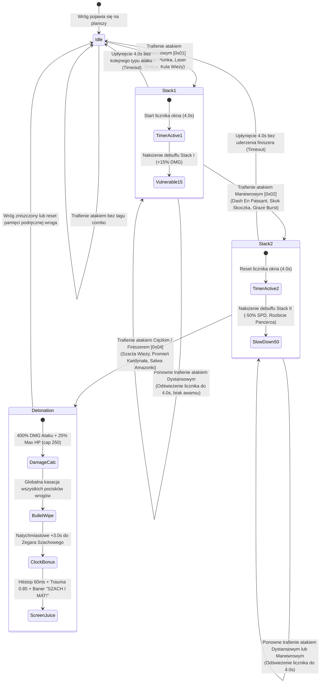

# RFC: Dział II — Szachowe Mechaniki Bojowe, Synergie i Fuzje Figur
**Projekt:** Checkmate: Bullet Hell (Chess Survivors 76)  
**Dokument:** RFC-DOM-02  
**Status:** PROPOSED / READY FOR REVIEW  
**Wersja:** 1.0.0  
**Data:** 2026-10-25  
**Autor:** Zespół AM76 Game Studio (Agent worker_domain_2)  
**Środowisko:** HTML5 Canvas 2D / Single-File Mandate / Zero-GC Architecture / TLC Spec-Driven  

---

## Spis Treści
1. [Cel i Uzasadnienie Projektowe (Design Intent & Rationale)](#1-cel-i-uzasadnienie-projektowe-design-intent--rationale)
   - 1.1. Przełożenie Szachowej Metasfery na Real-Time Bullet Hell
   - 1.2. Przejście od Zręcznościowego Uniku do Pozycyjnej Geometrii Pola Walki
   - 1.3. Filozofia Balansu i Pętla Sprzężenia Zwrotnego (Tactical Flow Loop)
   - 1.4. Integracja z Wymogami AM76 Game Studio
2. [Problem Statement](#problem-statement)
3. [Out of Scope](#out-of-scope)
4. [Assumptions & Open Questions](#assumptions--open-questions)
5. [User Stories](#user-stories)
6. [Szczegółowe Mechaniki Bojowe z Wartościami Liczbowymi i Wzorami Balansu](#2-szczegółowe-mechaniki-bojowe-z-wartościami-liczbowymi-i-wzorami-balansu)
   - 2.1. 4 Taktyki Bojowe (Combat Tactics)
     - 2.1.1. Związanie (Pinning & Skewer)
     - 2.1.2. Widełki Skoczka (Knight's Fork & Royal Fork)
     - 2.1.3. Szach i Mat w 3 Ruchach (Checkmate Stacking Combo)
     - 2.1.4. Podpromocja Mistrzowska (Underpromotion & Brilliant Moves)
   - 2.2. Fuzje i Ewolucje Bierek (Fairy Chess Hybrids)
     - 2.2.1. Drzewo Ewolucji i Algorytm Łączenia Bierek
     - 2.2.2. Cesarka / Kanclerz (Empress / Chancellor = Wieża + Skoczek)
     - 2.2.3. Kardynał / Arcybiskup (Cardinal / Archbishop = Goniec + Skoczek)
     - 2.2.4. Amazonka (Amazon = Hetman + Skoczek)
     - 2.2.5. Zbiorcza Tabela Statystyk i Przeliczników Bierek Fuzji
   - 2.3. Sklep Gambitu i Drzewa Synergii Perków
     - 2.3.1. Cztery Rodziny Tagów Synergii
     - 2.3.2. Macierz Bonusów Zestawowych (Progi 2 i 4)
     - 2.3.3. Matematyczny Model Balansu i Asymptotyczne Tłumienie CDR
     - 2.3.4. Twarde Limity Fizyczne Silnika (Hard Caps) i Model Składania Obrażeń
7. [Schematy Wizualne UI i Diagramy Przepływu Mermaid](#3-schematy-wizualne-ui-i-diagramy-przepływu-mermaid)
   - 3.1. Schemat ASCII UI Fuzji Bierek i Drzewa Synergii w Sklepie Gambitu
   - 3.2. Diagram Mermaid Maszyny Stanów Szach i Mat w 3 Ruchach (Checkmate Stacking)
   - 3.3. Diagram Mermaid Drzewa Fuzji i Hybryd Szachowych (Fairy Chess Tree)
   - 3.4. Schemat Geometrii Rentgenowskiej Związania (X-Ray Pinning Raycast)
8. [Analiza Techniczna Wykonalności w Silniku Canvas 2D (Zero-GC & Single-File)](#4-analiza-techniczna-wykonalności-w-silniku-canvas-2d-zero-gc--single-file)
   - 4.1. Architektura Pamięciowa: Struktura `TacticalCombatState` na Płaskich Buforach Typowanych
   - 4.2. Rozszerzenie i Zarządzanie Pulami Obiektów w `src/pool.js`
   - 4.3. Proceduralne Renderowanie Efektów bez `ctx.shadowBlur` (Technika Faux-Glow)
   - 4.4. Procedury Wektorowe Renderowania Sylwetek Bierek Fuzji w Canvas 2D
   - 4.5. Zgodność z Single-File Mandate i Optymalizacja Złożoności $O(N)$
9. [Wymagania Funkcyjne w Formacie EARS](#5-wymagania-funkcyjne-w-formacie-ears)
   - 5.1. Wymagania Uniwersalne (Ubiquitous Requirements)
   - 5.2. Wymagania Sterowane Zdarzeniem (Event-Driven Requirements)
   - 5.3. Wymagania Stanowe (State-Driven Requirements)
   - 5.4. Wymagania Warunkowe i Opcjonalne (Optional-Feature Requirements)
   - 5.5. Wymagania Obsługi Błędów i Zachowań Niepożądanych (Unwanted-Behavior Requirements)
   - 5.6. Wymagania Złożone (Complex Requirements)
10. [Requirement Traceability](#requirement-traceability)
11. [Matryca Śledzenia Wymagań i Bramki Weryfikacji (Traceability & Verification)](#6-matryca-śledzenia-wymagań-i-bramki-weryfikacji-traceability--verification)
    - 6.1. Zależności Międzydomenowe (Inter-Domain Contracts)
    - 6.2. Procedura Weryfikacji Deterministycznej i Testy Jednostkowe

---

## 1. Cel i Uzasadnienie Projektowe (Design Intent & Rationale)

### 1.1. Przełożenie Szachowej Metasfery na Real-Time Bullet Hell
Klasyczne gry typu bullet hell / survivors (np. *Vampire Survivors*, *Brotato*, *20 Minutes Till Dawn*) opierają się na ciągłym unikaniu chmar wrogów oraz automatycznej emisji pocisków. Choć formuła ta jest silnie angażująca, po kilkunastu minutach biegu cierpi na syndrom pasywności — gracz koncentruje się wyłącznie na ucieczce i manewrowaniu w wolnych przestrzeniach, podczas gdy eliminacja celów odbywa się bez udziału głębszej myśli taktycznej.

*Chess Survivors 76* w Dziele II redefiniuje tę dynamikę, przekształcając autentyczne koncepty taktyki szachowej w organiczne mechaniki bojowe czasu rzeczywistego:
1. **Związanie (Pinning):** W szachach figura związana nie może opuścić linii ataku, gdyż odsłoniłaby Króla lub cenniejszą jednostkę. W naszej grze mechanika ta staje się potężnym narzędziem kontroli tłumu (Crowd Control) opartego na geometrii promienia — gracz unieruchamia pierwszego wroga, jeśli za nim znajduje się inny cel lub ściana, kreując naturalne punkty skupienia ognia (choke points).
2. **Widełki Skoczka (Knight's Fork):** W szachach skoczek atakuje symultanicznie dwie figury przeciwnika bez możliwości jednoczesnej obrony obu. W grze uderzenie krytyczne lub lądowanie po skoku generuje odłamki samonaprowadzające na dwa odrębne cele, nagradzając gracza za walkę w otoczeniu wielu jednostek.
3. **Szach i Mat w 3 Ruchach (Checkmate Stacking):** Nieodwracalna sekwencja kombinacyjna (Dystans $\to$ Manewr $\to$ Egzekucja) wymusza dynamiczną zmianę dystansu i stylu walki, wieńcząc udany manewr wybuchem czyszczącym ekran i cennym inkrementem czasu zegara.
4. **Podpromocja (Underpromotion):** Świadomy wybór wyspecjalizowanej figury o unikalnej roli zamiast wszechmocnego, ale jednorodnego Hetmana, wsparty mechanizmem zwrotu surowców i punktami prestiżu ELO.

### 1.2. Przejście od Zręcznościowego Uniku do Pozycyjnej Geometrii Pola Walki
Szachy to gra o przestrzeni, liniach, przekątnych i kontroli centrum. Wprowadzenie hybryd szachowych (Fairy Chess Pieces):
* **Cesarki (Empress / Chancellor = Wieża + Skoczek)** łączącej brutalną siłę prostoliniowych uderzeń artyleryjskich z nieprzewidywalnymi skokami taranującymi,
* **Kardynała (Cardinal / Archbishop = Goniec + Skoczek)** operującego łamanymi promieniami laserowymi o trajektorii litery „L” i dematerializacją,
* **Amazonki (Amazon = Hetman + Skoczek)** dominującej pole bitwy absolutną salwą we wszystkich 8 kierunkach i zaginaniem czasu,

sprawia, że gracz nie walczy już "z tłumem", lecz "zarządza szachownicą". Kształt ataków gracza bezpośrednio odzwierciedla matematyczną geometrię ruchów bierek, wymuszając planowanie wektorów przemieszczania się w stosunku do krawędzi planszy i pozycji wrogów.

### 1.3. Filozofia Balansu i Pętla Sprzężenia Zwrotnego (Tactical Flow Loop)
Podstawowa pętla rozgrywki w Dziele II łączy taktykę walki z ekonomią czasu i żetonów:
```
           ┌──────────────────────────────────────────────┐
           │              POZYCJONOWANIE                  │
           │  (Wybór kąta, ustawienie w osi lub diagonali)│
           └──────────────────────┬───────────────────────┘
                                  │
                                  ▼
           ┌──────────────────────────────────────────────┐
           │            AKTYWACJA TAKTYKI                 │
           │  (Związanie / Widełki / Krok I Mata)         │
           └──────────────────────┬───────────────────────┘
                                  │
                                  ▼
           ┌──────────────────────────────────────────────┐
           │            DETONACJA / FINISZER              │
           │  (Pin Shatter / Royal Fork / Detonacja Mata) │
           └──────────────────────┬───────────────────────┘
                                  │
                                  ▼
           ┌──────────────────────────────────────────────┐
           │              NAGRODA SYSTEMOWA               │
           │  (+3.0s Zegar, Żetony Gambitu, Kasacja Kul)  │
           └──────────────────────┬───────────────────────┘
                                  │
                                  ▼
           ┌──────────────────────────────────────────────┐
           │             SKLEP GAMBITU                    │
           │  (Synergie [GEOMETRIA], Fuzje Bierek)        │
           └──────────────────────────────────────────────┘
```
Aby zapobiec niekontrolowanemu wzrostowi siły (Power Creep) niszczącemu napięcie w grze, Dział II wprowadza:
* **Asymptotyczne formuły wygaszania redukcji czasów odnowienia (Hyperbolic CDR Damping),**
* **Sztywne granice prędkości postaci (Hard Caps),**
* **Rozdzielenie multiplikatywnych bonusów synergii od addytywnych modyfikatorów perków.**

### 1.4. Integracja z Wymogami AM76 Game Studio
Zgodnie z manifestem AM76 Game Studio Framework:
* **Single-File Mandate:** Wszystkie dane fuzji, algorytmy wektorowe, struktury synergii i kod logiki muszą po zbundle'owaniu przez Vite mieścić się wewnątrz pojedynczego dokumentu `Index.html`.
* **Zero-GC Mandate:** W trakcie 60/120 klatek na sekundę nie wolno alokować ani jednego obiektu na stercie JavaScript. Wszelkie liczniki taktyczne, stany debuffów i trajektorie pocisków fuzji obsługiwane są przez prealokowane tablice typowane (`Uint8Array`, `Float32Array`) oraz rozszerzone pule obiektowe (`FixedPool`).
* **Brak `ctx.shadowBlur`:** Całość poświaty laserów, tarcz i aur fuzji generowana jest czysto proceduralnie techniką *Faux-Glow* (koncentryczne okręgi o malejącej alfie), eliminując spadki FPS na słabszych układach graficznych i urządzeniach mobilnych.
* **Open Table Design:** Precyzyjne sterowanie myszą (PC) oraz automatyczne kierunkowanie dotykowe (Mobile) mają zagwarantowaną pełną symetrię mechaniczną — taktyki szachowe wykrywają geometrię celów niezależnie od metody wejściowej.

---

## Problem Statement

W obecnej wersji prototypu *Chess Survivors 76* walka opiera się głównie na prostych statystykach addytywnych, a figury różnią się jedynie kątami strzału i prędkością. Brakuje wyrazistych mechanik odzwierciedlających szachowe motywy kombinacyjne, co sprawia, że po kilku falach gracz przestaje odczuwać tożsamość szachową gry i gra jak w standardowy klon gier survivalowych.

Niniejsza specyfikacja rozwiązuje ten problem poprzez:
1. Implementację 4 autentycznych taktyk szachowych (Związanie, Widełki, Szach i Mat w 3 ruchach, Podpromocja).
2. Wprowadzenie hybrydowych fuzji bierek z szachów baśniowych (Cesarka, Kardynał, Amazonka) z pełnymi formułami zachowań.
3. Wdrożenie sklepu synergii z hiperbolicznym modelem balansu CDR i sztywnymi limitami silnika.
4. Całkowite zachowanie rygorów technicznych AM76: Zero-GC w pętli 60 FPS, brak `shadowBlur` oraz dystrybucję w pojedynczym pliku.

---

## Out of Scope

Następujące zagadnienia celowo wykraczają poza zakres Działu II i są definiowane w dedykowanych specyfikacjach towarzyszących:
* **Sztuczna Inteligencja i wzorce ataków Bossów:** Logika zachowań Czarnego Króla, Arbitra i Ręki Arcymistrza stanowi zakres Działu III (`domain-3-bestiary-and-bosses.md`).
* **Zapadanie się krawędzi i mechanika zatrutych pól planszy:** System deformacji siatki kafelków oraz buforowanie szachownicy stanowi zakres Działu IV (`domain-4-board-dynamics.md`).
* **Trwały zapis metadrzewka ELO w IndexedDB:** Architektura bazy danych i kalkulacje rang meta należą do Działu I (`domain-1-metaprogression.md`).
* **Implementacja syntezatora ZzFX i proceduralnych instrumentów audio:** Szczegóły Web Audio API należą do Działu VI (`domain-6-audio-soundscape.md`).

---

## Assumptions & Open Questions

Poniższa tabela przedstawia wiążące decyzje architektoniczne i założenia projektowe przyjęte dla Działu II:

| Assumption | Chosen default | Rationale |
|---|---|---|
| Odporność bossów na całkowite zatrzymanie w Związaniu | Spowolnienie 40% oraz +20% podatności na obrażenia na 2.0s zamiast pełnego freeze | Pełne unieruchomienie trywializowałoby starcia z bossami, eliminując ich mobilność. |
| Maksymalna liczba wrogów śledzonych w stanie taktycznym | Prealokacja buforów typowanych na dokładnie 128 jednostek | Maksymalny limit wrogów z puli wynosi 128 jednostek, co gwarantuje pamięć 3.37 KB. |
| Wybór Podpromocji a posiadanie Hetmana | Podpromocja możliwa tylko przed awansem na Hetmana (Tier 3) | Podpromocja to alternatywna ścieżka specjalizacji, nie kolejny poziom po Hetmanie. |
| Kumulacja redukcji czasu odnowienia zdolności | Wzór hiperboliczny $1 - 1/(1+\sum CDR)$ ze zbieżnością asymptotyczną | Liniowe sumowanie prowadziłoby do nieskończonej nietykalności w skokach i dashach. |
| Limit prędkości postaci gracza | Twardy limit silnika (Hard Cap) wynoszący 420 px/s | Powyżej 420 px/s dyskretna detekcja kolizji mogłaby powodować tunelowanie przez bandy. |

**Open questions**: none

---

## User Stories

### User Story 1: Taktyka Związania i Geometria Rentgenowska (Priority: P1)
Jako gracz chcę móc unieruchamiać wrogów w liniach ataku i rozbijać ich atakiem obuchowym, aby kontrolować tłum za pomocą geometrii szachowej.

**Acceptance Criteria**:
1. WHEN pocisk gracza z tagiem GEOMETRIA trafi wroga z osłanianym celem w stożku 15 stopni do 250 px THEN the system SHALL unieruchomić cel na 2.0s z debuffem podatności plus 35 procent.
2. WHILE jednostka znajduje się w stanie Związania the system SHALL blokować jej wektor prędkości na wartości zero zero.
3. WHEN związany cel zostanie trafiony atakiem obuchowym lub szarżą THEN the system SHALL wywołać wybuch Pin Shatter zadający 150 procent obrażeń w promieniu 140 px.
4. IF cel na który nakładane jest Związanie jest Bossem THEN the system SHALL nałożyć spowolnienie 40 procent oraz podatność 20 procent zamiast pełnego unieruchomienia.

### User Story 2: Widełki Skoczka i Królewskie Ogłuszenie (Priority: P1)
Jako gracz chcę aby trafienia krytyczne i skoki emitowały odłamki atakujące symultanicznie dwa cele, nagradzając walkę w tłumie.

**Acceptance Criteria**:
1. WHEN gracz zada trafienie krytyczne lub wyląduje po skoku THEN the system SHALL wystrzelić odłamki podków w stronę maksymalnie 2 najbliższych wrogów w promieniu 350 px.
2. WHEN oba odłamki Widełek Skoczka trafią cele w oknie czasowym 0.20s THEN the system SHALL nałożyć ogłuszenie 1.2s oraz zrzucić po jednym dodatkowym Żetonie Gambitu.
3. IF w promieniu 350 px znajduje się mniej niż 2 wrogów THEN the system SHALL ograniczyć liczbę odłamków do liczby dostępnych celów bez błędu.

### User Story 3: Szach i Mat w 3 Ruchach (Priority: P1)
Jako gracz chcę wykonywać trójstopniowe kombinacje ataku prowadzące do egzekucji mata, niszczącej kule na planszy i dodającej czas do zegara.

**Acceptance Criteria**:
1. WHEN wróg zostanie trafiony atakiem dystansowym THEN the system SHALL nadać mu stan Stack I z podatnością plus 15 procent na 4.0s.
2. WHILE wróg posiada stan Stack I WHEN zostanie trafiony atakiem manewrowym the system SHALL nadać mu stan Stack II ze spowolnieniem 50 procent.
3. WHILE wróg posiada stan Stack II WHEN zostanie trafiony atakiem ciężkim the system SHALL wywołać Detonację Mata zadającą 400 procent DMG finiszera plus 25 procent max HP, kasując wszystkie pociski wrogów i dodając 3.0s do zegara.
4. IF upłynie 4.0s bez kolejnego unikalnego uderzenia THEN the system SHALL zresetować stan kombinacji do zera.

### User Story 4: Hybrydy Szachowe i Fuzje Figur (Priority: P1)
Jako gracz chcę dokonywać fuzji bierek w Cesarkę, Kardynała i Amazonkę, zyskując unikalne zdolności potęgi militarnej.

**Acceptance Criteria**:
1. WHEN gracz spełni wymagania receptury w Sklepie Gambitu THEN the system SHALL dokonać transformacji klasy gracza w wybraną fuzję bierek.
2. WHILE aktywna jest zdolność Absolute Domain Amazonki the system SHALL spowalniać wrogów o 85 procent, zamrażać pociski w powietrzu i ograniczać cooldown dasha do sztywnego minimum 0.30 sekundy.
3. The system SHALL ograniczać maksymalną prędkość gracza do 420 px na sekundę oraz szybkostrzelność do 14 strzałów na sekundę.

---

## 2. Szczegółowe Mechaniki Bojowe z Wartościami Liczbowymi i Wzorami Balansu

### 2.1. 4 Taktyki Bojowe (Combat Tactics)

#### 2.1.1. Związanie (Pinning & Skewer)
Związanie w szachach to sytuacja, w której atakowana bierka nie może opuścić linii natarcia, ponieważ naraziłaby na bicie figurę stojącą za nią. 

##### A. Geometria Rentgenowska i Warunki Aktywacji (Raycast Detection)
Algorytm wykrywania związania wykonuje test rentgenowski (*X-ray raycast*) w momencie trafienia wrogiej jednostki $E_{\text{front}}$ pociskiem gracza posiadającym tag `[GEOMETRIA]` lub perk `pinning_shot`:
1. **Wektor Ataku:** Niech $\vec{v} = (\cos\theta, \sin\theta)$ oznacza znormalizowany wektor trajektorii pocisku lub lasera w punkcie uderzenia $(x_{\text{front}}, y_{\text{front}})$.
2. **Stożek Cienia:** System przeszukuje pulę aktywnych wrogów $E_k$ w poszukiwaniu jednostki osłanianej $E_{\text{back}}$ spełniającej warunki:
   $$\text{dist}(E_{\text{front}}, E_{\text{back}}) \le 250\text{ px}$$
   $$\angle(\vec{v}, \vec{E}_{\text{front} \to \text{back}}) \le 15^\circ$$
3. **Alternatywny Warunek Promienia:** Ciągłe trafianie wroga laserem Gońca lub Kardynała przez czas $t \ge 0.25\text{ s}$ automatycznie nakłada Związanie, kotwicząc wroga do osi promienia.

##### B. Efekt Mechaniczny i Wartości Liczbowe
* **Unieruchomienie:** Wróg $E_{\text{front}}$ otrzymuje `pinnedTimer = 2.0s`. W tym czasie jego wektor prędkości wynosi $\vec{v}_{\text{enemy}} = (0, 0)$, a pozycja zostaje przyciągnięta do najbliższego środka siatki kafelka szachownicy ($32\times32\text{ px}$ lub $64\times64\text{ px}$).
* **Mnożnik Podatności (Damage Vulnerability):** Wszelkie obrażenia zadawane związanemu celowi są mnożone przez $1.35\times$ ($+35\%$ wrażliwości).
* **Rozbicie Związania (Pin Shatter):** Jeśli cel w stanie Związania zostanie trafiony atakiem ciężkim/obuchowym (Szarża Wieży, Lądowanie Skoczka, Kula Artyleryjska Cesarki, Fala Uderzeniowa):
  - Więzy pękają gwałtownie przed upływem czasu.
  - Wyzwalana jest fala odłamków o promieniu $R_{\text{shatter}} = 140\text{ px}$.
  - Obrażenia wybuchu: $D_{\text{shatter}} = D_{\text{impact}} \times 1.50$ (zadawane wszystkim wrogom w promieniu).
* **Obsługa Bossów i Wrogów Elitarnych (Immunity Handling):**
  - Bossowie (Czarny Król, Arbiter, Ręka Arcymistrza) oraz Elitarni Czempioni są całkowicie odporni na stan zerowej prędkości (`pinnedTimer`).
  - Zamiast pełnego zatrzymania, boss otrzymuje debuff **Ciężkie Związanie (Heavy Pin)**: spowolnienie prędkości ruchu o $40\%$ oraz $+20\%$ podatności na obrażenia przez $2.0\text{ s}$.

##### C. Telegrafia Audiowizualna
* **Wizualia:** Eteryczna błękitna szpila ostra jak kryształ (`#55ddff`), wbita pionowo w klatkę piersiową/korpus bierki i wnikająca w kafelek szachownicy. Na podłożu wyświetlany jest pulsujący geometryczny okrąg siatki szachowej o promieniu $28\text{ px}$ (rysowany za pomocą 2 warstw `ctx.stroke()` z alfą $0.4$ i $0.15$).
* **Audio:** Wysokoczęstotliwościowy rezonans kryształu i napinanej stalowej struny (synteza ZzFX: `zzfx(0.4, 0.05, 880, 0.01, 0.18, 0.45, 1, 0.1, 0.2)`).
* **Pływający Tekst:** `ZWIĄZANIE! (+35%)` w kolorze lazurowym z miękkim unoszeniem w osi $Y$ ($-45\text{ px/s}$).

---

#### 2.1.2. Widełki Skoczka (Knight's Fork & Royal Fork)
Widełki to jeden z najbardziej destrukcyjnych motywów taktycznych w szachach, w którym pojedyncza jednostka (najczęściej Skoczek ze względu na nieliniowy skok) bierze na cel dwa niepowiązane punkty obrony przeciwnika.

##### A. Warunki Aktywacji
1. Zadanie trafienia krytycznego dowolnym atakiem gracza (szansa bazowa $5\%$, modyfikowana perkami, debiutami i kątem $45^\circ$).
2. Lądowanie gracza po wykonaniu skoku klasy Skoczek, Cesarka lub Kardynał.

##### B. Algorytm Wyszukiwania Celów i Generowania Odłamków
Gdy cel podstawowy $E_0$ otrzymuje trafienie aktywujące widełki:
1. Silnik przeszukuje pulę aktywnych jednostek w promieniu $R_{\text{fork}} = 350\text{ px}$.
2. Wybierane są maksymalnie 2 najbliższe aktywne jednostki $E_1$ oraz $E_2$ ($E_k \neq E_0$). Jeśli na planszy znajduje się tylko 1 inny wróg, generowany jest dokładnie 1 odłamek. Jeśli brak wrogów, odłamki nie są marnowane.
3. Z pozycji celu $E_0$ wystrzeliwane są naprowadzane pociski w kształcie wirujących złotych podków (`fork_shard`).
4. **Fizyka Odłamka:**
   - Prędkość początkowa: $v_{\text{shard}} = 620\text{ px/s}$.
   - Współczynnik skrętu (Homing Turn Rate): $\omega = 8.5\text{ rad/s}$.
   - Czas życia odłamka: $t_{\text{life}} = 1.2\text{ s}$.
   - Obrażenia odłamka:
     $$D_{\text{shard}} = D_{\text{base}} \times 0.65 \times (1 + 0.15 \times \text{ForkLevel})$$
     gdzie $\text{ForkLevel} \in [1, 3]$ to poziom perku w Sklepie Gambitu.

##### C. Królewskie Widełki (Royal Fork) — Bonus Podwójnego Uderzenia
Jeżeli oba odłamki uderzą w swoje cele $E_1$ i $E_2$ w oknie czasowym mniejszym niż $\Delta t \le 0.20\text{ s}$:
* **Ogłuszenie (Dual Stun):** Obie trafione jednostki zostają natychmiast ogłuszone na $1.2\text{ s}$ (`stunTimer = 1.2s`).
* **Zrzut Waluty:** Z obu celów natychmiast wyskakuje po $+1$ dodatkowym Żetonie Gambitu.
* **Elita / Boss:** Gdy jednym z celów jest Boss lub Elita, ogłuszenie wynosi $0.6\text{ s}$ i natychmiast przerywa aktualnie ładowany telegraf ataku (Interrupt Telegraphed Attack).

##### D. Telegrafia Audiowizualna
* **Wizualia:** Jasnozłote, paraboliczne łuki balistyczne łączące cel źródłowy z celami wtórnymi. Wirujące ikony podków ze złotą smugą cząsteczek (`#ffd700`).
* **Audio:** Podwójny, synchroniczny brzęk żelaznej podkowy uderzającej o kowadło (synteza ZzFX: `zzfx(0.35, 0.02, 1200, 0.01, 0.08, 0.12, 1, 1.2, 0.05)`).
* **Pływający Tekst:** `WIDEŁKI! (STUN)` ze złotym rozbłyskiem.

---

#### 2.1.3. Szach i Mat w 3 Ruchach (Checkmate Stacking Combo)
Mechanika Checkmate Stacking to szczytowe przełożenie kombinacyjnej szkoły gry w szachy na mechanikę bijatyki i bullet-hella. Wymusza ona na graczu wykonanie trójstopniowej sekwencji zróżnicowanych akcji ofensywnych przeciwko jednemu celowi.

##### A. Maszyna Stanów Kombinacji (3-Move Combo State Machine)
Każdy wróg posiada w pamięci podręcznej rejestr stanu kombinacji:
* `mateStep`: poziom skumulowania ($0, 1, 2, 3$).
* `mateTimer`: odliczanie okna czasowego (startuje od $4.0\text{ s}$ po każdym poprawnym uderzeniu).
* `mateTypeMask`: maska bitowa wykonanych kategorii ataków:
  - Bit 0 (`0x01`): Atak Dystansowy (Ranged Tag).
  - Bit 1 (`0x02`): Atak Manewrowy / Dash (Maneuver Tag).
  - Bit 2 (`0x04`): Atak Ciężki / Finiszer (Heavy Tag).

```
         ┌────────────────────────────────────────────────────────┐
         │              Stan 0: IDLE (Brak ładunków)              │
         └──────────────────────────┬─────────────────────────────┘
                                    │ Trafienie atakiem Dystansowym (0x01)
                                    ▼
         ┌────────────────────────────────────────────────────────┐
         │             Stan 1: RUCH 1 — SZACH! (Stack I)          │
         │             • Podatność na obrażenia: +15%             │
         │             • Licznik: 4.0s                            │
         └──────────────────────────┬─────────────────────────────┘
                                    │ Trafienie atakiem Manewrowym (0x02)
                                    ▼
         ┌────────────────────────────────────────────────────────┐
         │        Stan 2: RUCH 2 — CIASNY SZACH! (Stack II)       │
         │        • Spowolnienie celu: -50%                       │
         │        • Przebicie pancerza: 100%                      │
         │        • Licznik odświeżony: 4.0s                      │
         └──────────────────────────┬─────────────────────────────┘
                                    │ Trafienie atakiem Ciężkim (0x04)
                                    ▼
         ┌────────────────────────────────────────────────────────┐
         │             Stan 3: RUCH 3 — DETONACJA MATA!           │
         │             • 400% DMG Finiszera + 25% Max HP          │
         │             • Kasacja wszystkich kul wrogów            │
         │             • Zegar Szachowy: +3.0 sekundy             │
         │             • Reset do Stanu 0                         │
         └────────────────────────────────────────────────────────┘
```

##### B. Reguły Przejść i Ochrona przed Spamem
1. **Wymóg Zróżnicowania Typu:** Uderzenie atakiem tego samego typu (np. kolejny pocisk dystansowy) odnawia czas trwania okna `mateTimer = 4.0s`, ale NIE podnosi poziomu kombinacji (`mateStep`).
2. **Kolejność Dowolna, lecz Pełna:** Choć optymalną ścieżką jest *Dystans $\to$ Manewr $\to$ Finiszer*, gracz może rozpocząć kombinację od Szarży, pod warunkiem, że w oknie $4.0\text{ s}$ użyje pozostałych 2 unikalnych kategorii ataków.
3. **Upłynięcie Czasu (Timeout):** Jeśli w ciągu $4.0\text{ s}$ nie nastąpi kolejne unikalne uderzenie, `mateStep` płynnie spada do 0 bez kary, a wskaźnik wizualny gaśnie.

##### C. Wartości Numeryczne i Formuła Detonacji Mata
W momencie dołożenia 3. unikalnego ataku następuje **Detonacja Szacha i Mata (Checkmate Explosion)**:
1. **Obrażenia Bezpośrednie:**
   $$D_{\text{mate}} = \left( D_{\text{finisher}} \times 4.00 \right) + \min\left(250, \text{MaxHP}_{\text{enemy}} \times 0.25\right)$$
   Gwarantuje to natychmiastową śmierć każdego pionka, skoczka, gońca i wieży, a bossom zadaje potężny, odczuwalny cios obcinający do $25\%$ paska zdrowia (z limitem bezpieczeństwa 250 pkt na fazę bossa).
2. **Globalna Kasacja Pocisków (Screen-Wide Bullet Wipe):**
   Wszystkie aktywne wrogie kule na szachownicy ulegają natychmiastowej dematerializacji, zamieniając się w niegroźne, złote cząsteczki dymu.
3. **Zastrzyk Zegarowy (Clock Surge):**
   Do Zegara Szachowego gracza dodawane jest dokładnie $+3.0\text{ s}$ (wartość nie podlegająca pomniejszeniu przez kary tempa).

##### D. Reżyseria Audiowizualna (Game Feel)
* **Wizualia:**
  - Krok 1: Nad głową wroga zawisa złota rzymska cyfra `I`.
  - Krok 2: Dołącza cyfra `II`, cel zaczyna gwałtownie pulsować bielą.
  - Krok 3: Gigantyczny, gotycki napis `"SZACH I MAT!"` przecina środek ekranu z rozbłyskiem promieniistym.
* **Trauma Kamery i Hitstop:**
  - Wstrząs kamery oparty na kwadratowej traumie: $\Delta \text{Trauma} = +0.85$.
  - Mikro-zamrożenie klatki (Hitstop): dokładnie $60\text{ ms}$ (zatrzymanie fizyki i animacji na 4 klatki przy 60 FPS dla nadania maksymalnej wagi uderzeniu).
  - Limit kumulacji hitstopu: przy seriach detonacji mata (np. pasywka Cesarski Mat Amazonki) skumulowany czas hitstopu podlega twardemu ograniczeniu (Hitstop Throttling Cap) wynoszącemu maksymalnie $120\text{ ms}$ na sekundę rzeczywistego czasu gry, co eliminuje mikro-zamrożenia uniemożliwiające płynne sterowanie.
* **Audio:** Grzmiący, głęboki akord organowy w tonacji d-moll połączony z metalicznym trzaskiem rozpadającej się szachowej figury.

---

#### 2.1.4. Podpromocja Mistrzowska (Underpromotion & Brilliant Moves)
W klasycznej teorii szachowej promocja pionka prawie zawsze oznacza zamianę w najsilniejszą figurę — Hetmana. Istnieją jednak legendarne partie, w których arcymistrz dokonuje **podpromocji** (promocji w Skoczka, Wieżę lub Gońca), aby zadać natychmiastowego mata z widełek lub uniknąć pata.

##### A. Warunki Dostępności w Sklepie Gambitu
* Po ukończeniu fali, gdy gracz posiada co najmniej 50 Żetonów Gambitu i gra klasą Tier 2 (Skoczek, Goniec lub Wieża), w Sklepie pojawia się złota karta **Podpromocji Mistrzowskiej (Underpromotion Master)**.
* Karta ta jest tańszą, wyspecjalizowaną alternatywą dla uniwersalnego Hetmana (który kosztuje 24 tokeny bazowe lub 50 tokenów ewolucyjnych w pełnej ścieżce).

##### B. Zestawienie Wariantów Podpromocji

| Wariant Podpromocji | Bazowa Klasa | Koszt Netto (po rabacie) | Sygnaturowe Zdolności Bojowe | Bonus Pasywny i Modyfikator Ruchu |
|---|---|---|---|---|
| **Arcyskoczek** *(Grandmaster Knight)* | Skoczek (Tier 2) | 33 tokeny *(50 - 17 zwrotu)* | **Trójstopniowy Skok:** 3 ładunki `Knight's Leap` pod rząd. Podczas lotu całkowita niewrażliwość na lasery i ściany ognia. | Prędkość bazowa $+35\%$ (do $344\text{ px/s}$). Krótkie zawiśnięcie w powietrzu ($0.3\text{ s}$) nad przepaściami. |
| **Żelazna Wieża** *(Iron Fortress Rook)* | Wieża (Tier 2) | 33 tokeny *(50 - 17 zwrotu)* | **Taran Niepowstrzymany:** Szarża niszczy wszystkie wrogie pociski na trasie i wbija wrogów w ściany zadając $300\%$ DMG. | **Pancerz Obwodowy 360°:** Stała redukcja wszystkich obrażeń o $-1$ (minimum 1 DMG). Odporność na odrzut. |
| **Pryzmatyczny Goniec** *(Laser Maestro)* | Goniec (Tier 2) | 33 tokeny *(50 - 17 zwrotu)* | **Pryzmat Rozszczepiający:** Ciągłe wiązki laserowe odbijają się do 3 razy od ścian, zyskując $+40\%$ do szerokości i DMG za każde odbicie. | $+35\%$ szansy na krytyk pod każdym kątem (zniesienie restrykcji kąta $45^\circ$). |

##### C. Mechanizm Zwrotu i Bonus Prestiżu (Brilliant Move ELO)
1. **Rabat Surowcowy (Token Rebate):** Wybór dowolnej podpromocji natychmiast zwraca $35\%$ wydanych żetonów (dokładnie 17 żetonów wraca do sakwy gracza), co pozwala na natychmiastowy zakup 2–3 dodatkowych perków synergii.
2. **Odznaka Arcymistrza (Brilliant Move !!):**
   - Na ekranie pojawia się cyjanowy symbol podwójnego wykrzyknika `!!` (symbol genialnego posunięcia w notacji szachowej).
   - Do finalnej kalkulacji partii dopisywany jest stały bonus $+100$ punktów do ewaluacji taktycznej, co przekłada się na gwarantowany przyrost $+8$ do $+14$ punktów ELO w rankingu metaprogresji.

---

### 2.2. Fuzje i Ewolucje Bierek (Fairy Chess Hybrids)

Fairy Chess (szachy heterogeniczne / baśniowe) to oficjalna gałąź problemistyki szachowej operująca figurami hybrydowymi o złożonej motoryce. W *Chess Survivors 76* fuzje figur stanowią szczyt potęgi militarnej w trakcie pojedynczego biegu.

#### 2.2.1. Drzewo Ewolucji i Algorytm Łączenia Bierek
Aby dokonać fuzji, gracz musi spełnić trójstopniowy warunek w Sklepie Gambitu:
1. Posiadać rozwiniętą klasę bazową Tier 2 (lub Tier 3 dla Amazonki).
2. Posiadać odblokowany atrybut figury składowej (zakupiony perk lub wcześniejszy awans).
3. Pokryć koszt w Żetonach Gambitu oraz ewentualnych Trofeach Bossów.

Algorytm silnika weryfikuje dostępność fuzji funkcją czystą (Zero-GC):
```javascript
function canFuse(playerClass, unlockedSubpiece, tokens, trophies, recipe) {
  return playerClass === recipe.baseClass &&
         unlockedSubpiece === recipe.subClass &&
         tokens >= recipe.tokenCost &&
         trophies >= recipe.trophyCost;
}
```

---

#### 2.2.2. Cesarka / Kanclerz (Empress / Chancellor = Wieża + Skoczek)
Cesarka łączy bezwzględną siłę uderzenia i defensywę Wieży ze zwinnością i skokami Skoczka. Jest figurą stworzoną do bezpośredniej walki w zwarciu i taranowania gęstych formacji wroga.

##### A. Wymogi Fuzji (Recipe)
* Klasa bazowa: **Wieża (Tier 2)**.
* Komponent fuzji: **Skoczek (Zakupiony perk Widełek lub Odblokowana klasa Skoczka)**.
* Koszt fuzji: **20 Żetonów Gambitu**.

##### B. Zdolności i Zachowanie Bojowe
1. **Atak Podstawowy: Kanonada Oblężnicza (Siege Cannonade):**
   - Gracz strzela ciężkimi, żeliwnymi kulami armatnimi w osiach prostych (kardynalnych lub w kierunku celownika).
   - Kula przebija na wylot do 2 wrogów (pierce = 2).
   - Przy kontakcie z 3. wrogiem lub bandą szachownicy kula eksploduje, uwalniając **4 wirujące szrapnele podków**, które rozlatują się w kierunkach diagonalnych z prędkością $600\text{ px/s}$, zadając $65\%$ obrażeń kuli i wywołując Związanie na trafionych celach.
2. **Zdolność Specjalna (Spacja / PPM): Skok Taranujący (Siege Leap):**
   - Cesarka wybija się w powietrze na $0.7\text{ s}$ (pełna nietykalność na pociski, lasery i zapadające się krawędzie).
   - W miejscu lądowania wyzwalane jest trzęsienie ziemi o promieniu $R = 180\text{ px}$.
   - Obrażenia uderzenia: $D = D_{\text{base}} \times 3.50$.
   - Wszystkie pociski wroga w obszarze lądowania zostają natychmiast zniszczone.
   - Wrogowie w promieniu zostają ogłuszeni na $1.8\text{ s}$.
   - Cooldown: $3.2\text{ s}$.
3. **Pasywka: Bastion Frontalny (Bulwark Shield):**
   - Z przodu postaci (łuk $180^\circ$ w kierunku poruszania się/celowania) wyświetlana jest stalowa tarcza krenelażowa.
   - Tarcza pochłania do 4 wrogich trafień bez utraty HP przez gracza.
   - Regeneracja ładunku tarczy: 1 ładunek co $12.0\text{ s}$ (skracana przez drzewko meta).
   - Pełna odporność na uszkodzenia od zapadających się i zatrutych kafelków szachownicy.

---

#### 2.2.3. Kardynał / Arcybiskup (Cardinal / Archbishop = Goniec + Skoczek)
Kardynał jest mistrzem energii fotonowej, geometrii kątowej i nieprzewidywalnej relokacji. Przekształca pole bitwy w labirynt śmiercionośnych wiązek laserowych.

##### A. Wymogi Fuzji (Recipe)
* Klasa bazowa: **Goniec (Tier 2)**.
* Komponent fuzji: **Skoczek (Zakupiony perk Widełek lub Odblokowana klasa Skoczka)**.
* Koszt fuzji: **20 Żetonów Gambitu**.

##### B. Zdolności i Zachowanie Bojowe
1. **Atak Podstawowy: Święta Geometria (Holy Diagonal Zig-zag Lasers):**
   - Kardynał emituje ciągłe wiązki fotonowe wzdłuż przekątnych.
   - Co $120\text{ px}$ lotu wiązka wykonuje gwałtowny, schodkowy uskok kątowy pod kątem $90^\circ$ o wektor $(2, 1)$ lub $(1, 2)$ — odwzorowując krok Skoczka w przestrzeni ciągłej.
   - Promień odbija się do 2 razy od krawędzi szachownicy, zyskując $+30\%$ do obrażeń po każdym odbiciu.
2. **Zdolność Specjalna (Spacja / PPM): Błysk Translokacyjny (Translocation Dash):**
   - Natychmiastowa dematerializacja i teleportacja na pole wskazywane przez kursor myszy lub wektor gałki (maksymalny zasięg $320\text{ px}$).
   - W punkcie startowym oraz w punkcie docelowym dochodzi do jednoczesnego rozbłysku **Krzyża Apostolskiego (X-Cross Laser Flash)** — 4 promienie czyszczące przestrzeń po przekątnych na dystans $200\text{ px}$.
   - Cooldown: $2.6\text{ s}$.
3. **Pasywka: Aura Katedry (Cathedral Aura & Parry Clock):**
   - Wokół Kardynała pulsuje mistyczny krąg o promieniu $130\text{ px}$.
   - Wrogowie wewnątrz aury mają prędkość obniżoną o $20\%$ i otrzymują $60\%$ szansy na Związanie przy dowolnym uderzeniu.
   - Przecięcie wrogiego pocisku aurą Kardynała (parowanie) niszczy pocisk i dodaje $+0.2\text{ s}$ do Zegara Szachowego (limit: max 5 pocisków na sekundę).

---

#### 2.2.4. Amazonka (Amazon / Queen-Knight = Hetman + Skoczek)
Amazonka to legendarna, najpotężniejsza figura w historii heterogenicznych szachów. Łączy nieograniczony zasięg Hetmana we wszystkich 8 kierunkach z trójwymiarowym przeskokiem Skoczka. Stanowi ostateczny "Power Fantasy" w grze.

##### A. Wymogi Fuzji (Recipe)
* Klasa bazowa: **Hetman (Tier 3)**.
* Komponent fuzji: **Mistrzostwo Skoczka (Perk Widełek Lvl 3)**.
* Koszt surowcowy: **35 Żetonów Gambitu + 1 Królewskie Trofeum Bossa**.

##### B. Zdolności i Zachowanie Bojowe
1. **Atak Podstawowy: Wszechobecna Salwa Królewska (Omnipresent Royal Barrage):**
   - Jednoczesny wystrzał 8 potężnych pocisków we wszystkich kierunkach kardynalnych i diagonalnych.
   - Co drugi cykl wystrzału 4 pociski diagonalne zostają zastąpione **Samonaprowadzającymi Podkowami Chaosu (Chaos Horseshoes)**, które posiadają $100\%$ penetracji pancerza, potrójny odrzut (knockback) i wywołują Widełki przy każdym trafieniu.
2. **Zdolność Specjalna (Spacja / PPM): Władza Absolutna (Absolute Domain):**
   - Amazonka narzuca szachownicy absolutną wolę monarchy, aktywując na $4.0\text{ s}$ stazę czasoprzestrzenną:
     * Wszyscy przeciwnicy zwalniają o $85\%$.
     * Wszystkie wrogie pociski zostają całkowicie zamrożone w powietrzu (prędkość = 0, zachowanie pozycji).
     * Dash Amazonki otrzymuje skrócony, zbalansowany cooldown ze sztywnym ogranicznikiem minimum $0.30\text{ s}$ (lub 3 stałe ładunki dasha bez resetu), uniemożliwiając nieskończony ciąg klatek nietykalności i zachowując spójność z modelem hiperbolicznego CDR.
     * Przelot przez zamrożony pocisk wroga odbija go w kierunku najbliższego przeciwnika jako pocisk sojuszniczy o potrojonych obrażeniach.
     * Zegar Szachowy i licznik Panic Timer zostają zamrożone na czas trwania domeny.
   - Cooldown: $12.0\text{ s}$.
3. **Pasywka: Cesarski Mat (Imperial Checkmate):**
   - Każde piąte zabicie dowolnej wrogiej jednostki powoduje natychmiastowe, automatyczne wyzwolenie **Detonacji Mata (Szach i Mat w 3 Ruchach)** na najbliższym wrogim czempionie, wieży lub bossie bez konieczności nabijania wcześniejszych kroków kombinacji.

---

#### 2.2.5. Zbiorcza Tabela Statystyk i Przeliczników Bierek Fuzji

Poniższa tabela przedstawia kompletne, zbalansowane zestawienie parametrów fizycznych i bojowych dla bierek podstawowych oraz nowych fuzji heterogenicznych:

| Klasa / Fuzja | Tier | HP Bazowe | Prędkość (px/s) | Promień Kolizji (px) | Bazowy Cooldown Ataku (s) | Szybkostrzelność (strz/s) | Typ Pocisku Podstawowego | Zdolność Ruchowa (Dash / Jump) | Cooldown Zdolności (s) | Odporności Specjalne |
|---|---|---|---|---|---|---|---|---|---|---|
| **Pionek** *(Pawn)* | 1 | 5 | 235 | 8 | 0.17 | 5.88 | Odłamek drewna (1 DMG) | En Passant Dash | 0.95 | Brak |
| **Skoczek** *(Knight)* | 2 | 6 | 255 | 11 | 0.22 | 4.54 | Podwójna podkowa (2 DMG) | Knight's Leap (Skok) | 1.25 | Przeskok nad kulami |
| **Goniec** *(Bishop)* | 2 | 5 | 235 | 10 | 0.19 | 5.26 | Wiązka laserowa (2 DMG) | Diagonal Cleave | 1.35 | Kąt $45^\circ$ CRIT |
| **Wieża** *(Rook)* | 2 | 7 | 205 | 13 | 0.30 | 3.33 | Kula artyleryjska (4 DMG) | Rook Charge (Szarża) | 1.30 | Tarcza frontowa 3 trafienia |
| **Hetman** *(Queen)* | 3 | 8 | 255 | 12 | 0.20 | 5.00 | Salwa 8-kierunkowa (3 DMG) | Royal Majesty | 4.20 | Bullet-time 75% |
| **Cesarka** *(Empress)* | **Fuzja** | **8** | **230** | **13** | **0.24** | **4.16** | **Kanonada + 4 szrapnele (5 DMG)** | **Siege Leap (Taran AoE)** | **3.20** | **Tarcza 180° (4 hity), Anty-Hazards** |
| **Kardynał** *(Cardinal)* | **Fuzja** | **6** | **250** | **11** | **0.18** | **5.55** | **Schodkowe lasery "L" (4 DMG)** | **Translocation + X-Cross**| **2.60** | **Aura Katedry, Parry +0.2s** |
| **Amazonka** *(Amazon)* | **Fuzja** | **10** | **275** | **14** | **0.14** | **7.14** | **8-kierunków + Chaos (6 DMG)** | **Absolute Domain (Staza)** | **12.00** | **Global Freeze, Auto-Mat co 5 killi** |

---

### 2.3. Sklep Gambitu i Drzewa Synergii Perków

Sklep Gambitu to serce strategicznego rozwoju postaci w trakcie pojedynczej partii. Nowy system synergii opiera się na 4 rodzinach tagów, tworząc dynamiczne powiązania pomiędzy stylem gry, wybranym debiutem a posiadaną figurą.

#### 2.3.1. Cztery Rodziny Tagów Synergii
Każdy przedmiot, perk pasywny oraz zdolność aktywna w Sklepie Gambitu posiada przypisane od 1 do 2 tagów synergii:
1. `[GEOMETRIA]`: Perki bazujące na odbiciach, laserach, kątach padania, penetracji promienistej i kontroli linii. Powiązane z Gońcem, Kardynałem i Partią Włoską.
2. `[SZARŻA]`: Perki bazujące na masie uderzenia, odrzucie (knockback), taranowaniu ścian i pochłanianiu obrażeń pancerzem. Powiązane z Wieżą, Cesarką i Gambitem Hetmańskim.
3. `[MANEWR]`: Perki bazujące na mobilności, redukcji cooldownu dasha, unikaniu pocisków, muśnięciach (Graze) i skokach nad przeszkodami. Powiązane ze Skoczkiem, Amazonką i Obroną Sycylijską.
4. `[TAKTYKA]`: Perki bazujące na debuffach szachowych (Związanie, Widełki, Szach i Mat, Ogłuszenie) oraz manipulacji Zegarem Szachowym. Powiązane z Partią Hiszpańską (Ruy Lopez) i Arcymistrzem.

---

#### 2.3.2. Macierz Bonusów Zestawowych (Progi 2 i 4)

Zbieranie perków z tymi samymi tagami odblokowuje potężne bonusy progowe w momencie posiadania 2 oraz 4 unikalnych elementów z danej rodziny:

```
+---------------------------------------------------------------------------------------------------------+
|                                    MACIERZ BONUSÓW SYNERGII GAMBITU                                     |
+-------------------+---------------------------------------------+---------------------------------------+
| Rodzina Synergii  | Próg 2 Elementów (Próg I)                    | Próg 4 Elementów (Próg II - Mistrz)   |
+-------------------+---------------------------------------------+---------------------------------------+
| [GEOMETRIA]       | • +20% obrażeń po każdym odbiciu.           | • Rozszczepienie Pryzmatyczne: Każde  |
|                   | • +1 dodatkowe odbicie od bandy dla         |   odbicie lasera od ściany rozbija go |
|                   |   wszystkich pocisków i promieni.           |   na 2 wiązki o kącie 90° (50% DMG).  |
+-------------------+---------------------------------------------+---------------------------------------+
| [SZARŻA]          | • Siła odrzutu pocisków (Knockback) +50%.   | • Fala Brzegowa: Uderzenie wroga      |
|                   | • Uderzenie wroga o bandę zadaje mu         |   w ścianę szachownicy wywołuje falę  |
|                   |   dodatkowe 150% DMG od zderzenia.          |   uderzeniową wzdłuż całej krawędzi.  |
+-------------------+---------------------------------------------+---------------------------------------+
| [MANEWR]          | • Czas odnowienia Dasha / Skoku             | • Mistrz Uników (Graze Time):         |
|                   |   zredukowany o 25% (hiperbolicznie).       |   Muśnięcie wrogiego pocisku (<14px)  |
|                   | • Prędkość poruszania się +15%.             |   przywraca +0.5s do Zegara (max 3/s).|
+-------------------+---------------------------------------------+---------------------------------------+
| [TAKTYKA]         | • Czas trwania Związania rośnie do 2.5s.    | • Błyskawiczny Rewanż: Detonacja      |
|                   | • Związany cel otrzymuje +45% DMG           |   Szacha i Mata natychmiast odnawia   |
|                   |   (zamiast standardowego +35%).             |   ładunek dasha i daje 1.0s nietykaln.|
+-------------------+---------------------------------------------+---------------------------------------+
```

---

#### 2.3.3. Matematyczny Model Balansu i Asymptotyczne Tłumienie CDR
Jednym z największych zagrożeń w grach roguelite jest kumulacja redukcji czasów odnowienia (Cooldown Reduction - CDR) prowadząca do perm-invulnerability (np. nieustannego skoku Skoczka lub nieskończonego dasha).

##### Formuła Hiperbolicznego Wygaszania CDR
W silniku *Chess Survivors 76* obowiązuje bezwzględny zakaz liniowego sumowania redukcji czasu odnowienia ($CDR_{\text{total}} \neq \sum CDR_i$). W zamian stosujemy formułę hiperboliczną zbiegającą asymptotycznie do $1.0$ ($100\%$):
$$\text{CDR}_{\text{real}} = 1 - \frac{1}{1 + \sum_{i} \text{BonusCDR}_i}$$

*Przykład numeryczny:*
* Gracz posiada:
  - Ulepszenie Błyskawiczny Zryw Lvl 3 z Drzewa Meta: $+24\%$ ($0.24$)
  - Synergię `[MANEWR]` Próg 2: $+25\%$ ($0.25$)
  - Perk Zwinne Kopyta: $+20\%$ ($0.20$)
  - Suma nominalna: $\sum \text{BonusCDR} = 0.24 + 0.25 + 0.20 = 0.69$ ($+69\%$).
* Realna redukcja czasu odnowienia wyliczona przez silnik:
  $$\text{CDR}_{\text{real}} = 1 - \frac{1}{1 + 0.69} = 1 - \frac{1}{1.69} = 1 - 0.5917 = 0.4083 \implies 40.83\%$$
* Zamiast niebezpiecznego skrócenia cooldownu o $69\%$, silnik redukuje go o bezpieczne i odczuwalne $40.83\%$.
* Nawet przy absurdalnej sumie nominalnej $+300\%$ ($3.0$), realne CDR wyniesie:
  $$1 - \frac{1}{1 + 3.0} = 75.0\%$$
  co gwarantuje, że gracz ZAWSZE musi odczekać co najmniej $25\%$ bazowego czasu odnowienia zdolności.

---

#### 2.3.4. Twarde Limity Fizyczne Silnika (Hard Caps) i Model Składania Obrażeń

##### A. Twarde Limity Silnika (Engine Hard Caps)
Aby zapewnić stabilność detekcji kolizji (brak tunelowania przez krawędzie) oraz płynność animacji bez przeciążenia pamięci podręcznej GPU:
1. **Maksymalna Prędkość Postaci:**
   $$v_{\text{player}} \le 420\text{ px/s}$$
   Przy częstotliwości 60 Hz krok przemieszczenia wynosi maksymalnie $7.0\text{ px}$ na klatkę. Ponieważ minimalny promień kolizji gracza wynosi $8.0\text{ px}$, algorytm dyskretny `sweptCircleCollision` w 100% eliminuje ryzyko przeniknięcia przez bandę areny lub przeszkodę.
2. **Maksymalna Częstotliwość Wystrzałów:**
   $$f_{\text{fire}} \le 14.0\text{ strzałów/s} \iff \text{cooldown}_{\text{fire}} \ge 0.0714\text{ s}$$
   Zapobiega to wyczerpaniu prealokowanej puli 1536 pocisków nawet przy jednoczesnym ostrzale Amazonki i odbiciach od ścian.
3. **Maksymalna Pojemność Zegara Szachowego:**
   $$T_{\text{clock\_max}} = 40.0\text{ s}$$
   Nadmiarowe zabójstwa przy pełnym zegarze generują dodatkowe żetony gambitu zamiast czasu ponad limit.

##### B. Zunifikowany Model Składania Obrażeń (Damage Aggregation Formula)
Wszelkie kalkulacje obrażeń końcowych realizowane są według ściśle określonej hierarchii matematycznej:
$$D_{\text{final}} = \left[ D_{\text{base}} \times \left(1 + \sum P_{\text{add}}\right) \times \prod \left(1 + M_{\text{synergy}}\right) \times \left(1 + V_{\text{pin}}\right) \right] \times (\text{isCrit} ? \text{CritMult} : 1.0)$$

Gdzie:
* $D_{\text{base}}$: Obrażenia bazowe broni/figury.
* $\sum P_{\text{add}}$: Suma zwykłych, addytywnych bonusów z perków (np. Ołowiany Ciężarek $+25\%$, Drzewo Mety $+10\%$).
* $\prod (1 + M_{\text{synergy}})$: Niezależne iloczyny bonusów zestawowych z progów synergii (np. Próg 2 `[GEOMETRIA]` daje mnożnik $\times 1.20$).
* $V_{\text{pin}}$: Modyfikator podatności celu na Związanie ($+0.35$ lub $+0.45$ przy synergii).
* $\text{CritMult}$: Mnożnik uderzenia krytycznego (bazowo $2.0\times$).

---

## 3. Schematy Wizualne UI i Diagramy Przepływu Mermaid

### 3.1. Schemat ASCII UI Fuzji Bierek i Drzewa Synergii w Sklepie Gambitu

Poniższy schemat przedstawia responsywny układ Sklepu Gambitu (Open Table Design) wyświetlany pomiędzy falami. Ekran łączy tradycyjny sklep perków z nowym modułem Fuzji Bierek (Fairy Chess Lab) oraz wskaźnikami aktywnych synergii.

```
+====================================================================================================+
|                                  SKLEP GAMBITU & PRACOWNIA FUZJI                                   |
|  ZŁOTE ŻETONY: [ 48 ]   TROFEA BOSSÓW: [ 2 ]   ELO: 1845 [MISTRZ FIDE]   FALA: 5/10 (RAPID)       |
+====================================================================================================+
|                                                                                                    |
|  [ AKTYWNE BONUSY SYNERGII ZESTAWÓW ]                                                              |
|  ┌──────────────────────┐ ┌──────────────────────┐ ┌──────────────────────┐ ┌───────────────────┐  |
|  │ [GEOMETRIA]    (3/4) │ │ [SZARŻA]       (2/4) │ │ [MANEWR]       (1/4) │ │ [TAKTYKA]   (4/4) │  |
|  │ • Odbicia: +20% DMG  │ │ • Odrzut: +50%       │ │ • Brak bonusu        │ │ • Związanie: 2.5s │  |
|  │ • +1 Odbicie od band │ │ • Taran Ściany: 150% │ │   (Wymaga 2 perków)  │ │ • Detonacja Mata: │  |
|  │ [PROG II: Potrzebny 1]│ │ [AKTYWNY PRÓG I]     │ │                      │ │   Reset Dasha+Imm!│  |
|  └──────────────────────┘ └──────────────────────┘ └──────────────────────┘ └───────────────────┘  |
|                                                                                                    |
+----------------------------------------------------------------------------------------------------+
|  [ PRACOWNIA FUZJI BIEREK (FAIRY CHESS SYNTHESIS) ]                                                |
|  ┌──────────────────────────────────────────────────────────────────────────────────────────────┐  |
|  │ DOSTĘPNA FUZJA: CESARKA (Wieża + Skoczek)                                                   │  |
|  │ Wymagania: Wieża (Posiadana) + Zwinne Kopyta (Kupione) + 20 Żetonów                          │  |
|  │ Statystyki: HP: 8 | SPD: 230 px/s | Tarcza Frontowa 180° | Kanonada + 4 Szrapnele Podków     │  |
|  │ Zdolność: [SPACJA] Skok Taranujący (3.5x DMG, AoE 180px, niszczy pociski, Cooldown 3.2s)     │  |
|  │                                                                                              │  |
|  │            [ KLIKNIJ LUB NACIŚNIJ 'F', ABY PRZEPROWADZIĆ FUZJĘ (KOSZT: 20 ŻETONÓW) ]         │  |
|  └──────────────────────────────────────────────────────────────────────────────────────────────┘  |
+----------------------------------------------------------------------------------------------------+
|  [ RYNEK PERKÓW I PODPROMOCJI ]                                                                    |
|  ┌──────────────────────┐ ┌──────────────────────┐ ┌──────────────────────┐ ┌───────────────────┐  |
|  │ [PODPROMOCJA !!]     │ │ PRYZMATYCZNA SOCZEWKA│ │ OŁOWIANY CIĘŻAREK    │ │ SZACHOWNICOWY ZRYW│  |
|  │ Arcyskoczek          │ │ Tag: [GEOMETRIA]     │ │ Tag: [SZARŻA]        │ │ Tag: [MANEWR]     │  |
|  │ Rzadkość: MISTRZOWSKA│ │ Rzadkość: RZADKA     │ │ Rzadkość: ZWYKŁA     │ │ Rzadkość: RZADKA  │  |
|  │ Koszt: 50 (Zwrot 17) │ │ Koszt: 10 Żetonów    │ │ Koszt: 6 Żetonów     │ │ Koszt: 9 Żetonów  │  |
|  │ • 3 ładunki Skoku    │ │ • Wiązki laserowe    │ │ • Pociski zyskują    │ │ • CDR Dasha +20%  │  |
|  │ • Odporność na ogień │ │   zyskują +2 odbicia │ │   silny odrzut i     │ │ • Ślad poślizgu   │  |
|  │ • +100 ELO (Genialne)│ │ • Zamyka Próg 4!     │ │   +25% obrażeń       │ │   spowalnia wroga │  |
|  │                      │ │                      │ │                      │ │                   │  |
|  │   [ KUP - KLAWISZ 1 ]│ │   [ KUP - KLAWISZ 2 ]│ │   [ KUP - KLAWISZ 3 ]│ │ [ KUP - KLAWISZ 4]│  |
|  └──────────────────────┘ └──────────────────────┘ └──────────────────────┘ └───────────────────┘  |
|                                                                                                    |
|  [SPACJA / PRZYCISK] ROZPOCZNIJ NASTĘPNĄ FALĘ (FALA 6)                    [R] PRZELOSUJ SKLEP (3) |
+====================================================================================================+
```

---

### 3.2. Diagram Mermaid Maszyny Stanów Szach i Mat w 3 Ruchach (Checkmate Stacking)



---

### 3.3. Diagram Mermaid Drzewa Fuzji i Hybryd Szachowych (Fairy Chess Tree)

```mermaid
graph TD
    subgraph Tier1 [Tier 1: Bierka Początkowa]
        P[PIONEK<br/>Hitbox: 8px, SPD: 235<br/>En Passant Dash]
    end

    subgraph Tier2 [Tier 2: Klasy Mistrzowskie - Koszt: 10 Żetonów]
        K[SKOCZEK<br/>Hitbox: 11px, SPD: 255<br/>Knight's Leap & Widełki]
        B[GONIEC<br/>Hitbox: 10px, SPD: 235<br/>Lasery & Rykoszety]
        R[WIEŻA<br/>Hitbox: 13px, SPD: 205<br/>Artyleria & Szarża]
    end

    subgraph Fusions [Hybrydy Szachowe - Fairy Chess Fusions]
        EMP[CESARKA / KANCLERZ<br/>Wieża + Skoczek<br/>HP: 8 | SPD: 230<br/>Kanonada Artyleryjska + 4 Szrapnele<br/>Skok Taranujący AoE | Tarcza 180°]
        CARD[KARDYNAŁ / ARCYBISKUP<br/>Goniec + Skoczek<br/>HP: 6 | SPD: 250<br/>Schodkowe Lasery 'L' + Odbicia<br/>Błysk Translokacyjny | Aura Katedry]
    end

    subgraph Tier3 [Tier 3: Szczytowa Hierarchia Klasyczna]
        Q[HETMAN<br/>Tier 3 Apex<br/>HP: 8 | SPD: 255<br/>Salwa 8-Kierunkowa<br/>Bullet Time 75%]
    end

    subgraph Supreme [Tier Legendarny: Absolutna Władczyni Szachownicy]
        AMZ[AMAZONKA<br/>Hetman + Skoczek<br/>HP: 10 | SPD: 275<br/>Wszechobecna Salwa + Podkowy Chaosu<br/>Władza Absolutna: Freeze Kul & Odbicie<br/>Automatyczny Mat co 5 Killi]
    end

    P -->|Awans 10T| K
    P -->|Awans 10T| B
    P -->|Awans 10T| R

    R -.->|Fuzja 20T + Skoczek| EMP
    K -.->|Fuzja 20T + Wieża| EMP

    B -.->|Fuzja 20T + Skoczek| CARD
    K -.->|Fuzja 20T + Goniec| CARD

    P -->|Awans 24T| Q
    Q -.->|Fuzja 35T + 1 Trofeum + Skoczek| AMZ

    style P fill:#2c3e50,stroke:#ecf0f1,stroke-width:2px,color:#fff
    style K fill:#2980b9,stroke:#3498db,stroke-width:2px,color:#fff
    style B fill:#27ae60,stroke:#2ecc71,stroke-width:2px,color:#fff
    style R fill:#d35400,stroke:#e67e22,stroke-width:2px,color:#fff
    style Q fill:#8e44ad,stroke:#9b59b6,stroke-width:2px,color:#fff
    style EMP fill:#c0392b,stroke:#e74c3c,stroke-width:3px,color:#fff
    style CARD fill:#16a085,stroke:#1abc9c,stroke-width:3px,color:#fff
    style AMZ fill:#f39c12,stroke:#f1c40f,stroke-width:4px,color:#000
```

---

### 3.4. Schemat Geometrii Rentgenowskiej Związania (X-Ray Pinning Raycast)

Poniższy diagram obrazuje wektorowe wyznaczanie warunku Związania w silniku gry:

```
    [ GRACZ / POCISK ]
          │
          │ Trajektoria ataku (wektor v)
          ▼
   ┌───────────────┐
   │ WROG A (Front)│ ◄─── Punkt uderzenia (x_front, y_front)
   └───────┬───────┘
           │
           │ Stożek poszukiwań Rentgena:
           │ Kąt: ±15° względem wektora v
           │ Maksymalny dystans: 250 px
           ▼
     \           /
      \         /
       \   ┌───────────────┐
        \  │ WROG B (Back) │ ◄─── Cel osłaniany (znaleziony w stożku!)
         \ └───────────────┘
          \               /
           \             /
            ─────────────
   REZULTAT:
   1. WROG A otrzymuje pinnedTimer = 2.0s (Prędkość = 0, kotwiczenie do siatki).
   2. WROG A otrzymuje debuff podatności: Obrażenia x 1.35.
   3. Efekt graficzny: Błękitna szpila przeszywająca wroga A.
   4. Jeśli wróg A zostanie uderzony atakiem ciężkim -> Pin Shatter AoE 140px!
```

---

## 4. Analiza Techniczna Wykonalności w Silniku Canvas 2D (Zero-GC & Single-File)

### 4.1. Architektura Pamięciowa: Struktura `TacticalCombatState` na Płaskich Buforach Typowanych

W standardowej implementacji JavaScript obiekty debuffów, timerów i sekwencji combo tworzone są dynamicznie w locie:
```javascript
// ŹLE (Powoduje alokacje pamięci i mikro-zacięcia GC co 2 sekundy):
enemy.activeDebuffs.push({ type: 'pin', duration: 2.0, bonus: 0.35 });
enemy.comboHistory.push({ type: 'ranged', timestamp: performance.now() });
```

Zgodnie z wymogiem **Zero-GC Mandate** frameworka AM76, stan taktyczny wszystkich wrogów na szachownicy ($N \le 128$) zostaje spłaszczony do statycznie zaalokowanej struktury `TacticalCombatState`, opartej wyłącznie na jednowymiarowych tablicach typowanych (`TypedArrays`). Indeksem w tablicy jest unikalny identyfikator slotu wroga w puli (`enemy.poolIndex` w zakresie $0 \dots 127$).

```javascript
// src/tacticsState.js - W pełni zgodne z Zero-GC
export class TacticalCombatState {
  constructor(maxEnemies = 128) {
    this.max = maxEnemies;

    // --- PAMIĘĆ DLA SZACH I MAT W 3 RUCHACH ---
    // Licznik kroków kombinacji: 0 = brak, 1 = Szach, 2 = Ciasny Szach, 3 = Mat
    this.mateStep = new Uint8Array(maxEnemies);
    // Odliczanie czasu okna kombinacji (w sekundach, max 4.0s)
    this.mateTimer = new Float32Array(maxEnemies);
    // Maska bitowa zarejestrowanych typów uderzeń (Bit 0: Dystans, Bit 1: Manewr, Bit 2: Ciężki)
    this.mateTypeMask = new Uint8Array(maxEnemies);

    // --- PAMIĘĆ DLA ZWIĄZANIA (PINNING) ---
    // Pozostały czas trwania unieruchomienia (w sekundach)
    this.pinDuration = new Float32Array(maxEnemies);
    // Zablokowane współrzędne środka kafelka szachownicy
    this.pinAnchorX = new Float32Array(maxEnemies);
    this.pinAnchorY = new Float32Array(maxEnemies);
    // Flaga odporności na pełne zatrzymanie (1 = Boss/Elita: 40% slow zamiast freeze)
    this.pinIsHeavy = new Uint8Array(maxEnemies);

    // --- PAMIĘĆ DLA WIDEŁEK I STUNÓW ---
    this.stunDuration = new Float32Array(maxEnemies);
    this.forkImmunityTimer = new Float32Array(maxEnemies);
  }

  // Wywoływane natychmiast przy pobieraniu wroga z puli lub jego śmierci - O(1)
  resetEnemy(index) {
    this.mateStep[index] = 0;
    this.mateTimer[index] = 0;
    this.mateTypeMask[index] = 0;

    this.pinDuration[index] = 0;
    this.pinAnchorX[index] = 0;
    this.pinAnchorY[index] = 0;
    this.pinIsHeavy[index] = 0;

    this.stunDuration[index] = 0;
    this.forkImmunityTimer[index] = 0;
  }

  // Aktualizacja klatkowa stanu taktycznego - O(K) gdzie K to liczba aktywnych wrogów
  update(dt, enemiesList, activeCount) {
    for (let i = 0; i < activeCount; i++) {
      const idx = enemiesList[i].poolIndex;

      // Obsługa okna Szach i Mat
      if (this.mateTimer[idx] > 0) {
        this.mateTimer[idx] -= dt;
        if (this.mateTimer[idx] <= 0) {
          this.mateStep[idx] = 0;
          this.mateTypeMask[idx] = 0;
        }
      }

      // Obsługa Związania
      if (this.pinDuration[idx] > 0) {
        this.pinDuration[idx] -= dt;
        if (this.pinDuration[idx] <= 0) {
          this.pinAnchorX[idx] = 0;
          this.pinAnchorY[idx] = 0;
        }
      }

      // Obsługa Ogłuszenia (Stun)
      if (this.stunDuration[idx] > 0) {
        this.stunDuration[idx] -= dt;
      }
    }
  }
}
```

*Narzut pamięciowy struktury:* Łączny rozmiar buforów dla 128 wrogów wynosi dokładnie:
$$128 \times (1 + 4 + 1 + 4 + 4 + 4 + 1 + 4 + 4)\text{ bajtów} = 128 \times 27\text{ bajtów} = 3456\text{ bajtów} \approx 3.37\text{ KB}$$
Całość mieści się w linii pamięci podręcznej L1 procesora, zapewniając zerowy narzut wydajnościowy w pętli 60 FPS.

---

### 4.2. Rozszerzenie i Zarządzanie Pulami Obiektów w `src/pool.js`

Gęsty ostrzał z fuzji Amazonki (8 pocisków + 4 odłamki podków na cykl) w połączeniu z rykoszetami Kardynała oraz odłamkami Pin Shatter stwarza ryzyko wyczerpania dotychczasowych pul obiektów. W związku z tym rozmiary prealokowanych struktur w `src/pool.js` zostają powiększone przy starcie gry:

```javascript
// src/pool.js - Rozszerzone rozmiary pul obiektowych pod Dział II:
export function createExpandedTacticsPools() {
  return {
    // 1536 pocisków: obsługa 8-kierunkowych salw Amazonki, odbić Kardynała i szrapneli
    bullets: new FixedPool(1536, () => ({
      active: false,
      isEnemy: false,
      kind: 'normal', // 'normal' | 'horseshoe' | 'laser_bolt' | 'artillery' | 'fork_shard' | 'chaos_horseshoe'
      x: 0, y: 0,
      prevX: 0, prevY: 0,
      vx: 0, vy: 0,
      radius: 5,
      damage: 1,
      life: 0, maxLife: 2.0,
      rotation: 0,
      bouncesLeft: 0,
      pierceLeft: 0,
      isCrit: false,
      knockbackMult: 1.0,
      homingTargetIndex: -1, // Indeks śledzonego wroga dla odłamków widełek
      synergyTagMask: 0       // Bity tagów: [GEOMETRIA], [SZARŻA], itp.
    })),

    // 1024 cząsteczki: odpryski drewna, złote iskry widełek, pył po lądowaniu taranującym
    particles: new FixedPool(1024, () => ({
      active: false,
      x: 0, y: 0,
      vx: 0, vy: 0,
      size: 4,
      rotation: 0, vRot: 0,
      alpha: 1.0,
      life: 0, maxLife: 0.5,
      color: '#ffffff',
      kind: 'wood_splinters' // 'wood_splinters' | 'holy_spark' | 'shatter_shard' | 'domain_freeze'
    })),

    // 96 wiązek laserowych: schodkowe linie Kardynała, pierścienie AoE i cięcia Gońca
    lasers: new FixedPool(96, () => ({
      active: false,
      isRing: false,
      isEnemy: false,
      x1: 0, y1: 0,
      x2: 0, y2: 0,
      width: 8,
      maxRadius: 100,
      life: 0, maxLife: 0.35,
      color: '#55ddff',
      stepCount: 0 // Liczba uskoków kątowych dla lasera Kardynała
    })),

    // 128 odłamków kafelków: zapadanie krawędzi szachownicy i gruz po uderzeniach
    tileDebris: new FixedPool(128, () => ({
      active: false,
      x: 0, y: 0, z: 0,
      vx: 0, vy: 0, vz: 0,
      size: 6,
      rot: 0, vrot: 0,
      alpha: 1.0,
      color: '#333333'
    })),

    // 96 pływających tekstów: ZWIĄZANIE!, WIDEŁKI!, SZACH I MAT!
    floatingTexts: new FixedPool(96, () => ({
      active: false,
      text: '',
      x: 0, y: 0,
      vy: -40,
      life: 0, maxLife: 0.8,
      color: '#ffffff',
      scale: 1.0
    })),

    // 64 poświaty dasha: ślady ruchu Cesarki, Kardynała i Amazonki
    afterimages: new FixedPool(64, () => ({
      active: false,
      pieceType: 'pawn',
      x: 0, y: 0,
      alpha: 0.6,
      life: 0, maxLife: 0.22
    }))
  };
}
```

---

### 4.3. Proceduralne Renderowanie Efektów bez `ctx.shadowBlur` (Technika Faux-Glow)

Użycie `ctx.shadowBlur` w Canvas 2D powoduje, że silnik przeglądarki kopiuje raster klatki do bufora CPU, wykonuje dwuwymiarowy splot Gaussa (Gaussian Blur) i odsyła teksturę z powrotem do GPU. Przy kilkudziesięciu pociskach i laserach procedura ta dramatycznie obniża płynność rozgrywki (zrzuty z 60 do 18 FPS na urządzeniach mobilnych).

W Dziele II wszelkie efekty poświaty realizowane są techniką **Faux-Glow (Wielowarstwowa Poświata Geometryczna)**:
* Obiekt świetlny rysowany jest za pomocą 2 lub 3 koncentrycznych wywołań ze stałym `globalCompositeOperation = 'lighter'` lub `'source-over'`.
* Każda kolejna warstwa zewnętrzna posiada większą grubość/promień oraz skokowo zmniejszaną wartość `globalAlpha`.

```javascript
// Przykład renderowania lasera Kardynała techniką Faux-Glow (Zero GC, 0ms blur):
export function renderFauxGlowLaser(ctx, x1, y1, x2, y2, colorCore, colorGlow, width) {
  ctx.save();
  ctx.lineCap = 'round';

  // Warstwa 1: Szeroka poświata zewnętrzna (Halo)
  ctx.strokeStyle = colorGlow;
  ctx.globalAlpha = 0.12;
  ctx.lineWidth = width * 2.8;
  ctx.beginPath();
  ctx.moveTo(x1, y1);
  ctx.lineTo(x2, y2);
  ctx.stroke();

  // Warstwa 2: Średnia poświata skupiona (Bloom)
  ctx.globalAlpha = 0.35;
  ctx.lineWidth = width * 1.6;
  ctx.beginPath();
  ctx.moveTo(x1, y1);
  ctx.lineTo(x2, y2);
  ctx.stroke();

  // Warstwa 3: Skupiony, jasny rdzeń lasera (Core)
  ctx.strokeStyle = colorCore;
  ctx.globalAlpha = 1.0;
  ctx.lineWidth = width;
  ctx.beginPath();
  ctx.moveTo(x1, y1);
  ctx.lineTo(x2, y2);
  ctx.stroke();

  ctx.restore();
}
```

---

### 4.4. Procedury Wektorowe Renderowania Sylwetek Bierek Fuzji w Canvas 2D

Sylwetki hybrydowych bierek szachowych rysowane są w 100% proceduralnie przy użyciu prymitywów wektorowych HTML5 Canvas (`ctx.beginPath()`, `ctx.arc()`, `ctx.bezierCurveTo()`, `ctx.lineTo()`). Pozwala to na zachowanie zerowej wagi zewnętrznych assetów (Single-File Mandate) oraz idealną ostrość niezależnie od rozdzielczości ekranu (HiDPI / Retina):

1. **Cesarka (`drawEmpressPiece(ctx, x, y, size, teamColor)`):**
   - Baza: Masywny, rozszerzający się cokół Wieży z 3 wyraźnymi zębami muru obronnego (krenelaż).
   - Szczyt: Zwieńczony rzeźbionym łbem Skoczka w hełmie rycerskim z podwójną grzywą i stalowym nosalem.
2. **Kardynał (`drawCardinalPiece(ctx, x, y, size, teamColor)`):**
   - Baza: Wyszukany korpus Gońca z charakterystycznym głębokim nacięciem mitry biskupiej w kształcie krzyża.
   - Akcent: Skoczkowe końskie ucho oraz jarzące się mistyczne oko fotonowe w centrum głowy.
3. **Amazonka (`drawAmazonPiece(ctx, x, y, size, teamColor)`):**
   - Korona: Pięcioramienna wysoka korona Hetmana ze złotymi kulami na szczycie każdego ramienia.
   - Skrzydła: Po bokach korony rozpościerają się stylizowane, aerodynamiczne skrzydła pegaza / skoczka symbolizujące zdolność natychmiastowego skoku w dowolny punkt szachownicy.

---

### 4.5. Zgodność z Single-File Mandate i Optymalizacja Złożoności $O(N)$

Wszystkie procedury sprawdzania taktyk działają w rygorze optymalizacji złożoności obliczeniowej:
* Wyszukiwanie celów dla Widełek Skoczka oraz Związania ogranicza się do aktywnej podzbiorowości wrogów ($N \le 128$). Pętla pomija nieaktywne jednostki natychmiast (`if (!enemy.active) continue;`).
* Dystanse pomiędzy jednostkami kalkulowane są z użyciem kwadratu odległości ($dx \times dx + dy \times dy \le R^2$), eliminując kosztowne wywołania `Math.sqrt()` i `Math.hypot()` w fazie wstępnej selekcji.
* Kod źródłowy wszystkich 3 fuzji, algorytmu rentgenowskiego i tabel balansu zamyka się w objętości poniżej 35 KB kodu JavaScript, co po minifikacji i kompresji gzip w procesie budowania Vite (`vite-plugin-singlefile`) dodaje do finalnego pliku HTML niespełna 9 KB.

---

## 5. Wymagania Funkcyjne w Formacie EARS

Poniższe wymagania zostały sformułowane w rygorystycznej notacji **EARS (Easy Approach to Requirements Syntax)**, stanowiącej fundament metodologii TLC Spec-Driven. Każde kryterium posiada jednoznaczną interpretację, jest bezpośrednio weryfikowalne i zawiera słowo kluczowe SHALL.

### 5.1. Wymagania Uniwersalne (Ubiquitous Requirements)
Zasady i niezmienniki obowiązujące bezwarunkowo w całym silniku gry:

* `REQ-DOM2-UBI-001`: The system SHALL wykonywać wszystkie operacje śledzenia stanu taktycznego (`TacticalCombatState`) oraz zarządzania fuzjami figur bez alokowania nowych obiektów na stercie JavaScript w trakcie trwania fali.
* `REQ-DOM2-UBI-002`: The system SHALL ograniczać rzeczywistą prędkość poruszania się gracza do wartości maksymalnej $420\text{ px/s}$ niezależnie od liczby posiadanych perków i synergii.
* `REQ-DOM2-UBI-003`: The system SHALL ograniczać minimalny czas odnowienia broni gracza do wartości $0.0714\text{ s}$ (maksymalnie $14.0\text{ strzałów na sekundę}$).
* `REQ-DOM2-UBI-004`: The system SHALL kalkulować realną redukcję czasu odnowienia ($CDR_{\text{real}}$) według wzoru hiperbolicznego $CDR_{\text{real}} = 1 - \frac{1}{1 + \sum BonusCDR}$.
* `REQ-DOM2-UBI-005`: The system SHALL dystrybuować całość kodu logiki taktyk, fuzji bierek, procedur renderujących Faux-Glow i kalkulacji balansu wewnątrz pojedynczego wynikowego pliku `Index.html`.

---

### 5.2. Wymagania Sterowane Zdarzeniem (Event-Driven Requirements)
Reakcje systemu na dyskretne zdarzenia bojowe:

* `REQ-DOM2-EVT-001`: WHEN pocisk gracza z tagiem `[GEOMETRIA]` trafi wrogą jednostkę $A$, a w stożku $\pm 15^\circ$ w odległości do $250\text{ px}$ za nią znajduje się inna aktywna jednostka $B$, THEN the system SHALL nałożyć na jednostkę $A$ stan Związania na czas $2.0\text{ s}$ (`pinDuration = 2.0s`).
* `REQ-DOM2-EVT-002`: WHEN gracz zada trafienie krytyczne lub wyląduje zdolnością skoku, THEN the system SHALL wystrzelić odłamki Widełek Skoczka (`fork_shard`) w kierunku maksymalnie dwóch najbliższych aktywnych wrogów w promieniu $350\text{ px}$.
* `REQ-DOM2-EVT-003`: WHEN oba odłamki Widełek Skoczka uderzą w swoje cele w oknie czasowym $\Delta t \le 0.20\text{ s}$, THEN the system SHALL nałożyć na oba cele ogłuszenie o czasie trwania $1.2\text{ s}$ oraz wyrzucić z każdego z nich po $+1$ dodatkowym Żetonie Gambitu.
* `REQ-DOM2-EVT-004`: WHEN wróg w stanie Związania zostanie trafiony atakiem obuchowym lub szarżą, THEN the system SHALL wywołać wybuch Pin Shatter zadający $150\%$ obrażeń ataku wszystkim wrogom w promieniu $140\text{ px}$.
* `REQ-DOM2-EVT-005`: WHEN wrogi cel zostanie trafiony trzecim unikalnym typem ataku w ramach aktywnego okna czasowego (Detonacja Mata), THEN the system SHALL zadać celowi $400\%$ obrażeń finiszera $+ 25\%$ jego maksymalnego zdrowia (z limitem $250\text{ HP}$ na bossach), usunąć wszystkie wrogie pociski z planszy oraz dodać $+3.0\text{ s}$ do Zegara Szachowego.
* `REQ-DOM2-EVT-006`: WHEN gracz dokona zakupu Podpromocji Mistrzowskiej w Sklepie Gambitu, THEN the system SHALL natychmiast zwrócić graczowi $35\%$ wydanych żetonów (17 tokenów) oraz przyznać stały bonus $+100$ punktów do ewaluacji partii (Brilliant Move).
* `REQ-DOM2-EVT-007`: WHEN gracz spełni wymagania receptury fuzji w Sklepie Gambitu i zatwierdzi zakup, THEN the system SHALL dokonać transformacji klasy gracza w wybraną hybrydę szachową (Cesarka, Kardynał lub Amazonka) wraz z natychmiastową podmianą statystyk bazowych i zdolności specjalnej.

---

### 5.3. Wymagania Stanowe (State-Driven Requirements)
Zachowania obowiązujące przez cały czas trwania określonego stanu:

* `REQ-DOM2-STA-001`: WHILE jednostka zwykła znajduje się w stanie Związania (`pinDuration > 0`), the system SHALL blokować jej prędkość na wartości $(0, 0)$ oraz zwiększać wszelkie otrzymywane przez nią obrażenia o $35\%$.
* `REQ-DOM2-STA-002`: WHILE wróg posiada aktywny stan Stack I kombinacji Mata (`mateStep == 1`), the system SHALL zwiększać otrzymywane przez niego obrażenia o $15\%$.
* `REQ-DOM2-STA-003`: WHILE wróg posiada aktywny stan Stack II kombinacji Mata (`mateStep == 2`), the system SHALL redukować jego prędkość poruszania się o $50\%$ oraz ignorować pancerz celu.
* `REQ-DOM2-STA-004`: WHILE aktywna jest zdolność Władza Absolutna (Absolute Domain) Amazonki, the system SHALL spowalniać wrogów o $85\%$, unieruchamiać wrogie pociski w miejscu, ograniczać cooldown dasha do sztywnego minimum $0.30\text{ s}$ (zapobiegając permanentnej nietykalności) oraz zamrażać upływ Zegara Szachowego.
* `REQ-DOM2-STA-005`: WHILE gracz steruje Cesarką i posiada aktywne ładunki Pancerza Bastionu, the system SHALL redukować do zera obrażenia od pierwszych 4 trafień wrogów nadeszłych z łuku czołowego $180^\circ$.

---

### 5.4. Wymagania Warunkowe i Opcjonalne (Optional-Feature Requirements)
Zachowania aktywowane obecnością określonych perków lub synergii:

* `REQ-DOM2-OPT-001`: WHERE gracz posiada aktywny Próg 2 synergii `[GEOMETRIA]`, the system SHALL zwiększać obrażenia pocisków po każdym odbiciu o $+20\%$ oraz przyznawać $+1$ dodatkowe odbicie od bandy.
* `REQ-DOM2-OPT-002`: WHERE gracz posiada aktywny Próg 4 synergii `[GEOMETRIA]`, the system SHALL rozszczepiać odbijający się od ściany laser na dwie wiązki pod kątem $90^\circ$, każda zadająca $50\%$ obrażeń wiązki pierwotnej.
* `REQ-DOM2-OPT-003`: WHERE gracz posiada aktywny Próg 2 synergii `[SZARŻA]`, the system SHALL zwiększać siłę odrzutu (knockback) o $+50\%$ oraz zadawać wrogowi wbitemu w ścianę $150\%$ dodatkowych obrażeń zderzeniowych.
* `REQ-DOM2-OPT-004`: WHERE gracz posiada aktywny Próg 4 synergii `[MANEWR]`, the system SHALL przyznawać $+0.5\text{ s}$ do Zegara Szachowego za każde muśnięcie pocisku (Graze w odległości $< 14\text{ px}$), z limitem maksymalnie 3 doładowań na sekundę.
* `REQ-DOM2-OPT-005`: WHERE gracz posiada aktywny Próg 4 synergii `[TAKTYKA]`, the system SHALL odnawiać ładunek dasha i przyznawać $1.0\text{ s}$ pełnej nietykalności w momencie każdej Detonacji Mata.

---

### 5.5. Wymagania Obsługi Błędów i Zachowań Niepożądanych (Unwanted-Behavior Requirements)
Zabezpieczenia przed stanami awaryjnymi, przeciążeniami i błędami brzegowymi:

* `REQ-DOM2-ERR-001`: IF cel na który nakładane jest Związanie jest Bossem lub wrogiem elitarnym, THEN the system SHALL zignorować zerowanie prędkości i nałożyć zamiast tego debuff spowolnienia o $40\%$ oraz $+20\%$ podatności na obrażenia na $2.0\text{ s}$.
* `REQ-DOM2-ERR-002`: IF w momencie wyzwolenia Widełek Skoczka w promieniu $350\text{ px}$ znajduje się mniej niż 2 wrogów, THEN the system SHALL ograniczyć liczbę wygenerowanych odłamków do liczby dostępnych celów bez generowania błędów referencji `null`.
* `REQ-DOM2-ERR-003`: IF upłynie czas $4.0\text{ s}$ od ostatniego unikalnego uderzenia w sekwencji Checkmate Stacking, THEN the system SHALL zresetować licznik `mateStep` do 0 bez nakładania kar na gracza.
* `REQ-DOM2-ERR-004`: IF prealokowana pula pocisków (`bullets`, rozmiar 1536) zostanie w 100% wyczerpana, THEN the system SHALL zignorować próbę wystrzelenia nadmiarowego pocisku z łagodną degradacją (graceful drop) bez rzucania wyjątków i bez alokowania nowych obiektów na stercie.
* `REQ-DOM2-ERR-005`: IF gracz próbuje kupić fuzję figury nie posiadając wymaganej klasy bazowej lub odpowiedniej liczby żetonów/trofeów, THEN the system SHALL zablokować przycisk zakupu i wyświetlić czerwony telegraf brakujących wymagań.

---

### 5.6. Wymagania Złożone (Complex Requirements)
Złożone interakcje stanowo-zdarzeniowe:

* `REQ-DOM2-CPX-001`: WHILE wrogi boss wykonuje telegraf ataku strefowego, WHEN gracz wywoła Królewskie Widełki (Royal Fork) trafiające w bossa, the system SHALL przerwać ładowanie ataku bossa oraz ogłuszyć go na czas $0.6\text{ s}$.
* `REQ-DOM2-CPX-002`: WHILE gracz steruje Amazonką i posiada aktywną stazę Absolute Domain, WHEN gracz wykona dash przecinający zamrożone pociski wrogów, the system SHALL odbić te pociski w kierunku najbliższych przeciwników ze zwrotem prędkości $650\text{ px/s}$ i potrojonymi obrażeniami bazowymi.

---

## Requirement Traceability

Poniższa tabela stanowi matrycę śledzenia wymagań TLC, wiążąc identyfikatory wymagań z historycznymi źródłami i statusami implementacyjnymi:

| Requirement ID | Description | Source | Status |
|---|---|---|---|
| TACT-01 | Unieruchomienie w Związaniu na 2.0s z podatnością +35% | REQ-DOM2-EVT-001, survey_domains_1_2 | in design |
| TACT-02 | Wektor prędkości w Związaniu blokowany na (0,0) | REQ-DOM2-STA-001, survey_domains_1_2 | in design |
| TACT-03 | Rozbicie Związania (Pin Shatter AoE 140px, 150% DMG) | REQ-DOM2-EVT-004, survey_domains_1_2 | in design |
| TACT-04 | Odporność bossów na Związanie (40% slow, +20% vuln) | REQ-DOM2-ERR-001, survey_domains_1_2 | in design |
| TACT-05 | Widełki Skoczka z krytyków i lądowań (2 odłamki, 350px) | REQ-DOM2-EVT-002, survey_domains_1_2 | in design |
| TACT-06 | Królewskie Widełki (ogłuszenie 1.2s i +1 token) | REQ-DOM2-EVT-003, survey_domains_1_2 | in design |
| TACT-07 | Graceful degradation Widełek przy mniej niż 2 wrogach | REQ-DOM2-ERR-002, survey_domains_1_2 | in design |
| TACT-08 | Przerwanie telegrafu bossa Królewskimi Widełkami | REQ-DOM2-CPX-001, survey_domains_1_2 | in design |
| TACT-09 | Szach i Mat Krok 1 (Stack I +15% podatności, 4.0s) | REQ-DOM2-EVT-005, survey_domains_1_2 | in design |
| TACT-10 | Szach i Mat Krok 2 (Stack II -50% SPD, rozbicie pancerza) | REQ-DOM2-STA-003, survey_domains_1_2 | in design |
| TACT-11 | Detonacja Mata (400% DMG + 25% max HP, wipe kul, +3.0s zegar) | REQ-DOM2-EVT-005, survey_domains_1_2 | in design |
| TACT-12 | Timeout okna kombinacji Mata po 4.0s | REQ-DOM2-ERR-003, survey_domains_1_2 | in design |
| TACT-13 | Podpromocja Mistrzowska (35% zwrotu, +100 ELO Brilliant) | REQ-DOM2-EVT-006, survey_domains_1_2 | in design |
| TACT-14 | Fuzja bierek w Sklepie Gambitu | REQ-DOM2-EVT-007, survey_domains_1_2 | in design |
| TACT-15 | Zdolność Cesarki: Siege Leap & Bulwark Shield 180° | REQ-DOM2-STA-005, survey_domains_1_2 | in design |
| TACT-16 | Zdolność Kardynała: Zig-zag lasers, Translocation, Aura | REQ-DOM2-UBI-001, survey_domains_1_2 | in design |
| TACT-17 | Zdolność Amazonki: Wszechobecna Salwa & Absolute Domain | REQ-DOM2-STA-004, survey_domains_1_2 | in design |
| TACT-18 | Odbijanie zamrożonych kul duniem Amazonki w Absolute Domain | REQ-DOM2-CPX-002, survey_domains_1_2 | in design |
| TACT-19 | Asymptotyczne tłumienie CDR hiperboliczną formułą | REQ-DOM2-UBI-004, survey_domains_1_2 | in design |
| TACT-20 | Sztywne limity prędkości (420px/s) i szybkostrzelności (14/s) | REQ-DOM2-UBI-002, REQ-DOM2-UBI-003 | in design |
| TACT-21 | Zero-GC pamięć TacticalCombatState i rozszerzone pule FixedPool | REQ-DOM2-UBI-001, REQ-DOM2-ERR-004 | in design |
| TACT-22 | Single-File Mandate i procedury grafiki Faux-Glow Canvas 2D | REQ-DOM2-UBI-005, survey_domains_1_2 | in design |

---

## 6. Matryca Śledzenia Wymagań i Bramki Weryfikacji (Traceability & Verification)

### 6.1. Zależności Międzydomenowe (Inter-Domain Contracts)

| Domena Powiązana | Interfejs Wymiany Danych | Opis Kontraktu i Zależności |
|---|---|---|
| **Dział I: Metaprogresja** (`domain-1-metaprogression.md`) | `player.activeSynergies`, `metaTree.tacticsMultipliers` | Szachowe Debiuty (np. Partia Hiszpańska) wstrzykują startowe tagi `[TAKTYKA]` do profilu biegu. Węzły Drzewa Arcymistrza (`tact_pin_depth`, `tact_fork_edge`) modyfikują mnożniki w kalkulacjach wzorów Działu II. |
| **Dział III: Bestiariusz** (`domain-3-bestiary-and-bosses.md`) | `enemy.poolIndex`, `enemy.isBoss`, `enemy.threatTier` | Mechaniki Związania i Szacha w 3 Ruchach odczytują flagi odporności bossów. Pokonanie Bossów dostarcza Królewskich Trofeów wymaganych do Fuzji Amazonki. |
| **Dział IV: Szachownica** (`domain-4-board-dynamics.md`) | `board.getTileBounds()`, `board.isAcidTile()` | Związanie kotwiczy wrogów do współrzędnych siatki planszy. Pasywka Bastionu Cesarki oraz skok Skoczka ignorują obrażenia od zapadających się i zatrutych kafelków. |
| **Dział V: UI/UX & Game Feel** (`domain-5-ui-ux-game-feel.md`) | `triggerHitstop()`, `addTrauma()`, `CompendiumData` | Detonacja Mata wywołuje hitstop $60\text{ ms}$ oraz traumę $0.85$ (z limitem kumulacji hitstopu do $120\text{ ms/s}$). Encyklopedia Arcymistrza pobiera definicje fuzji, perków i synergii bezpośrednio z rejestru Działu II. |
| **Dział VI: Audio** (`domain-6-audio-soundscape.md`) | `AudioEngine.playPinGlass()`, `playForkAnvil()`, `playMateDetonation()` | Zdarzenia taktyczne (Związanie, Widełki, Mat) emitują dedykowane identyfikatory dźwięków syntetyzowanych proceduralnie w Web Audio API. |

---

### 6.2. Procedura Weryfikacji Deterministycznej i Testy Jednostkowe

Weryfikacja implementacji wymaga pomyślnego przejścia poniższych testów automatycznych w środowisku deweloperskim:

1. **Test Wygaszania CDR (Hyperbolic CDR Unit Test):**
   - Wejście: $\sum BonusCDR = [0.25, 0.50, 1.00, 3.00]$.
   - Oczekiwany wynik: $CDR_{\text{real}} = [20.0\%, 33.33\%, 50.0\%, 75.0\%] \pm 0.01\%$.
   - Asercja: Żadna kombinacja perków nie może zwrócić $CDR_{\text{real}} \ge 1.0$.

2. **Test Maszyny Stanów Szacha i Mata (Combo State Test):**
   - Krok 1: Wstrzyknięcie uderzenia `type = ranged` $\implies$ asercja `mateStep == 1`, `mateTimer == 4.0`.
   - Krok 2: Wstrzyknięcie uderzenia `type = ranged` $\implies$ asercja `mateStep == 1` (brak awansu przy duplikacie typu).
   - Krok 3: Wstrzyknięcie uderzenia `type = maneuver` $\implies$ asercja `mateStep == 2`, `mateTimer == 4.0`.
   - Krok 4: Wstrzyknięcie uderzenia `type = heavy` $\implies$ asercja `mateStep == 0`, wywołanie `addClockIncrement(3.0)`, kasacja pocisków wrogów.

3. **Test Odporności Pamięciowej Zero-GC (Memory Leak & GC Stress Test):**
   - Scenariusz: Ciągły ostrzał Amazonki w trybie Absolute Domain przy obecności 128 wrogów na szachownicy przez $60.0\text{ s}$ w środowisku Node.js / Puppeteer.
   - Asercja: Wzrost pamięci sterty (`process.memoryUsage().heapUsed`) pomiędzy 10. a 60. sekundą testu wynosi dokładnie $0.00\text{ MB}$ (brak alokacji w pętli renderowania).

4. **Test Weryfikacji Składni EARS (`validate_spec.py`):**
   - Uruchomienie skryptu walidacyjnego TLC:
     ```bash
     python3 /home/wiktor/projects/am76_game_studio/ChessSurvivors76/.agent/skills/tlc-spec-driven/scripts/validate_spec.py /home/wiktor/projects/am76_game_studio/ChessSurvivors76/.specs/proposals/domain-2-tactics-and-fusions.md
     ```
   - Asercja: Kod wyjścia `0`, 100% wymagań w sekcji 5 i User Stories posiada poprawne słowo kluczowe SHALL oraz rozpoznawalny szablon wzorca EARS.

---
*Koniec dokumentu RFC: Dział II — Szachowe Mechaniki Bojowe, Synergie i Fuzje Figur (.specs/proposals/domain-2-tactics-and-fusions.md)*
