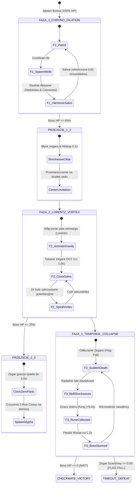
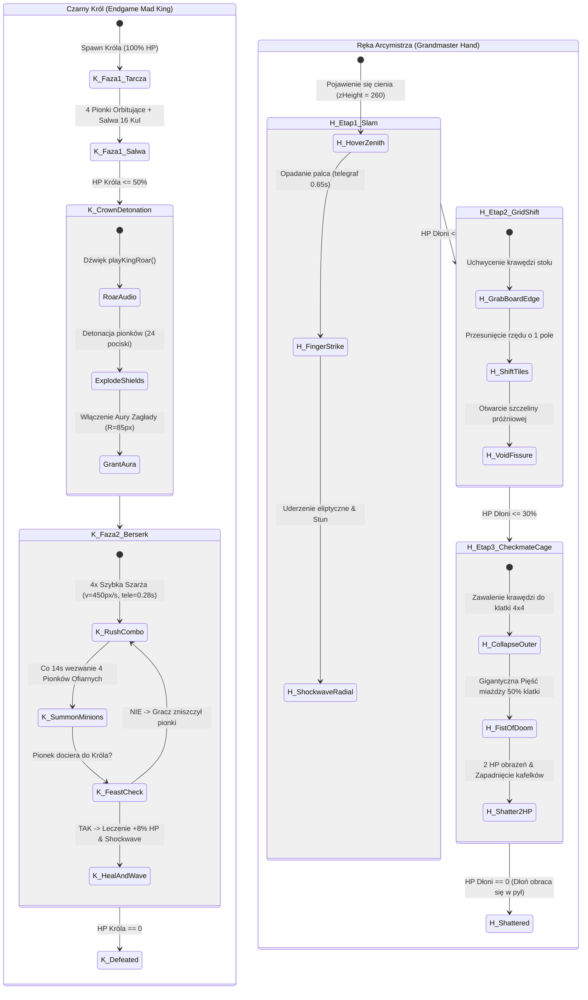

# RFC: Dział III — Bestiariusz, Elitarne Bierki i Unikalne Starcia z Bossami
## Domain 3: Bestiary, Elite Pieces & Unique Boss Battles

- **Dokument:** `.specs/proposals/domain-3-bestiary-and-bosses.md`
- **Autor:** Główny Inżynier Systemów Walki i Sztucznej Inteligencji (AM76 Game Studio)
- **Status:** Propozycja RFC (Gotowa do implementacji w metodologii TLC Spec-Driven)
- **Wersja:** 1.0.0
- **Data wydania:** 2026-10-25
- **Zgodność architektoniczna:** AM76 Framework, Zero-GC Canvas 2D, Single-File Mandate, EARS Syntax (TLC Spec-Driven)

---

## Spis Treści
1. [Cel i uzasadnienie projektowe (Design Intent & Rationale)](#1-cel-i-uzasadnienie-projektowe-design-intent--rationale)
   - [Problem Statement](#problem-statement)
   - [Out of Scope](#out-of-scope)
   - [Assumptions & Open Questions](#assumptions--open-questions)
   - 1.1. Filozofia szachowego Bullet-Hella i zasada absolutnej czytelności telegrafów (Fairness Guarantee)
   - 1.2. Architektura eskalacji zagrożenia: Debiut $\to$ Gra Środkowa $\to$ Końcówka
2. [Szczegółowe mechaniki z konkretnymi wartościami liczbowymi i wzorami balansu](#2-szczegółowe-mechaniki-z-konkretnymi-wartościami-liczbowymi-i-wzorami-balansu)
   - 2.1. Ogólne wzory balansu, przyrostu statystyk i modyfikatory tempa (Rapid, Blitz, Bullet)
   - 2.2. Bestiariusz jednostek standardowych i promowanych
     - 2.2.1. Pionek Berserker (Berserker Pawn)
     - 2.2.2. Lansjer Chaosu (Chaos Lancer / Promoted Knight)
     - 2.2.3. Biskup Inkwizytor (Inquisitor Bishop / Promoted Bishop)
     - 2.2.4. Wieża Forteca (Dreadnought Rook / Promoted Rook)
     - 2.2.5. Apex Queen (Królowa Ostateczna)
   - 2.3. Bierki Elitarne (Mini-Bosses)
     - 2.3.1. Bliźniacze Wieże (Twin Rooks / Gemini Castles: Castor & Pollux)
     - 2.3.2. Czarne Skoczki Cienia (Shadow Knights / Umbral Knights)
   - 2.4. Wielofazowe Starcia z Bossami
     - 2.4.1. Boss 1: Zegarowy Arbiter (The Clockwork Arbiter — Tempus Rex)
     - 2.4.2. Boss 2: Czarny Król Faza 2 (Endgame Mad King — Berserk)
     - 2.4.3. Boss 3: Ręka Arcymistrza (Grandmaster Hand — Autonomous Boss)
   - 2.5. Kompletna macierz parametrów ataków (Attack Matrix)
3. [Schematy, makiety tekstowe UI oraz diagramy Mermaid](#3-schematy-makiety-tekstowe-ui-oraz-diagramy-mermaid)
   - 3.1. Diagram Mermaid faz walki z Zegarowym Arbiterem
   - 3.2. Diagram Mermaid faz walki z Czarnym Królem i Ręką Arcymistrza
   - 3.3. Wizualizacje ASCII telegrafów ataków na szachownicy
4. [Analiza techniczna wykonalności w silniku Canvas 2D](#4-analiza-techniczna-wykonalności-w-silniku-canvas-2d)
   - 4.1. Matematyka kolizji (Swept-Segment, Ray-Box Intersection, Circle-Capsule)
   - 4.2. Wymiary i zarządzanie pulami obiektów (`src/pool.js`)
   - 4.3. Wydajność renderowania telegrafów za pomocą procedur Faux-Glow i prealokowanych struktur
5. [Wymagania funkcyjne w formacie EARS (TLC Spec-Driven)](#5-wymagania-funkcyjne-w-formacie-ears-tlc-spec-driven)
   - [User Stories](#user-stories)
   - [Requirement Traceability](#requirement-traceability)

---

## 1. Cel i uzasadnienie projektowe (Design Intent & Rationale)

## Problem Statement

W prototypowej wersji gry *Chess Survivors 76* zidentyfikowano krytyczne ograniczenia w zakresie bestiariusza i starć z bossami:
1. **Płaska krzywa trudności i monotonia zachowań:** Przeciwnicy standardowi (`pawn`, `knight`, `bishop`, `rook`) po 3. minucie partii stają się wyłącznie pasywnymi celami o zwiększonym zdrowiu, bez jakościowej ewolucji zachowań taktycznych.
2. **Niewykorzystana głębia motywów szachowych:** Przeciwnicy nie wykorzystują potencjału geometrii szachownicy (linie odcięcia, korytarze laserowe, związania, poświęcenia materiału, promocja pionów).
3. **Płytkie starcia z bossami:** Czarna Królowa oraz Czarny Król posiadają elementarne skrypty ataku (prosta salwa 16 kul, statyczne zmniejszenie areny przy sztywnych progach 72% i 38% HP), nie stwarzając wieloetapowego, emocjonującego wyzwania godnego końcówki partii szachowej.
4. **Ryzyko narzutu Garbage Collectora przy rozbudowie:** Wprowadzenie gęstego piekła pocisków (bullet-hell) bez rygorystycznego powiększenia pul obiektów i bez swept-segment collision doprowadziłoby do mikro-przycięć pętli 60 FPS oraz fałszywych kolizji (tunneling).

Niniejszy dokument RFC definiuje kompletny projekt Działu III: Bestiariusz jednostek standardowych i promowanych, formacje elitarne (Twin Rooks, Shadow Knights) oraz trójkę unikalnych, wielofazowych bossów zmechanizowanych (Zegarowy Arbiter, Czarny Król Faza 2, Autonomiczna Ręka Arcymistrza), zachowując 100% zgodności z rygorem Zero-GC i Canvas 2D.

## Out of Scope

Poniższe obszary są jawnie wyłączone z niniejszej specyfikacji w celu zachowania czystości granic domenowych TLC:

| Obszar wyłączony ze specyfikacji | Uzasadnienie i właściwa domena docelowa |
| --- | --- |
| Dynamiczne generowanie i niszczenie kafelków areny | Szczegółowa mechanika siatki 1D `Uint8Array` i buforowania tła należy do **Działu IV (`domain-4-board-dynamics.md`)**. Dział III definiuje jedynie interfejs zdarzeń manipulacji (`SHIFT_ROW`, `CRUMBLE_TILES`). |
| Fuzje figur gracza i drzewo perków Sklepu Gambitu | Mechaniki kombinacji figur gracza (np. Amazonka, Cesarka) należą do **Działu II (`domain-2-tactics-and-fusions.md`)**. |
| Synteza proceduralna audio i reaktywna muzyka | Szczegółowe formuły ZzFX i węzły Web Audio API należą do **Działu VI (`domain-6-audio-soundscape.md`)**. W Dziale III specyfikowane są wyłącznie wywołania triggerów audio (np. `playKingRoar()`). |
| Stały zapis metaprogresji i ranking ELO | Schemat `StorageEngine` i krzywe rankingu ELO należą do **Działu I (`domain-1-metaprogression.md`)**. |

---

## Assumptions & Open Questions

| Assumption / decision | Chosen default | Rationale | Confirmed? |
| --- | --- | --- | --- |
| Format telegrafowania ataków | Trójstopniowa anatomia: Windup (Telegraf) $\to$ Active $\to$ Cooldown | Gwarantuje uczciwość (Fairness Guarantee): gracz zawsze ma czas na reakcję i ucieczkę. | yes |
| Brak natywnego `ctx.shadowBlur` | Wielowarstwowy `drawFauxGlow` (2-3 przejścia o niskiej alfie) | `shadowBlur` dławi wydajność na zintegrowanych GPU z 60 do 18 FPS; Faux-Glow jest bezkosztowy dla GPU. | yes |
| Obsługa kolizji laserowych | Swept-Segment to Circle (projekcja wektora bez `Math.sqrt`) | Eliminuje zjawisko tunelingu przy wąskich wiązkach i nie alokuje pamięci na stercie. | yes |
| Skalowanie puli pocisków | Zwiększenie puli `bullets` z 512 do 1536 w `src/pool.js` | Niezbędne do obsługi wiru Lorentza Zegarowego Arbitra i jednoczesnych salw radialnych oraz fuzji Amazonki. | yes |
| Drenaż czasu przez Aurę Króla F2 | -1.5s na sekundę przebywania w strefie $R = 85\text{ px}$ | Wymusza dynamiczne ucieczki i korzystanie z En Passant Dash zamiast pasywnego kitingu. | yes |

**Open questions:** none - all architectural decisions resolved above.

---

### 1.1. Filozofia szachowego Bullet-Hella i zasada absolutnej czytelności telegrafów (Fairness Guarantee)
*Chess Survivors 76* nie jest standardową strzelanką typu arena-survival, lecz hybrydą geometrycznej taktyki szachowej i piekła pocisków (bullet-hell). Każdy przeciwnik ucieleśnia reguły ruchu konkretnej bierki szachowej, przetłumaczone na język zręcznościowy.

Kluczowym aksjomatem systemu walki jest **Gwarancja Uczciwości (Fairness Guarantee)**:
- **Zakaz natychmiastowych obrażeń (No Instant Hitscan / No Cheap Damage):** Żadna jednostka nie ma prawa zadać obrażeń graczowi bez uprzedniego, jednoznacznego telegrafu wizualnego i dźwiękowego.
- **Trójstopniowa anatomia ataku:**
  1. *Telegraph (Windup):* Wyświetlenie geometrycznej strefy zagrożenia na szachownicy (linie przerywane, stożki, promienie lub cienie kafelkowe) wraz z procedurą Faux-Glow i sygnałem audio z syntezatora proceduralnego.
  2. *Active (Execution):* Błyskawiczne wykonanie ataku o ściśle zdefiniowanym hitboxie (Swept-Segment dla laserów, Circle-Sweep dla cięć, Capsule dla szarż).
  3. *Recovery (Cooldown):* Krótkie okno podatności (Recovery Window), w którym przeciwnik zatrzymuje się lub ulega chwilowemu ogłuszeniu, dając graczowi szansę na kontratak.

### 1.2. Architektura eskalacji zagrożenia: Debiut $\to$ Gra Środkowa $\to$ Końcówka
Rytm rozgrywki w każdej partii odzwierciedla trzy klasyczne fazy partii szachowej:
1. **Debiut (Fale 1–3):** Standardowe jednostki szachowe. Gracz uczy się rozpoznawać kąty natarcia (diagonale Gońców, osie kardynalne Wież, skoki Skoczków).
2. **Gra Środkowa (Fale 4–7):** Pojawienie się **Bierek Promowanych (Promoted Pieces)** oraz **Bierek Elitarnych (Twin Rooks, Shadow Knights)**. Zagrożenia łączą się: Bliźniacze Wieże odcinają korytarz energetyczny, zmuszając gracza do lawirowania pomiędzy krzyżowymi laserami Inkwizytora i skokami Lansjera Chaosu.
3. **Końcówka i Starcie z Arcymistrzem (Fale 8–10+):** Wielofazowi Bossowie zmechanizowani:
   - **Zegarowy Arbiter:** Zaburza samą czasoprzestrzeń stołu, modulując harmonicznie prędkość pocisków i zakrzywiając trajektorie siłą Lorentza.
   - **Czarny Król Faza 2 (Endgame Mad King):** Wściekły monarcha wkraczający do centrum stołu z aurą zagłady i pożeraniem własnych sług.
   - **Ręka Arcymistrza:** Samodzielny boss fizycznie manipulujący geometrią planszy (przesuwanie wierszy i kolumn, miażdżenie kafelków w próżnię).

---

## 2. Szczegółowe mechaniki z konkretnymi wartościami liczbowymi i wzorami balansu

### 2.1. Ogólne wzory balansu, przyrostu statystyk i modyfikatory tempa (Rapid, Blitz, Bullet)

Parametry wrogów są ściśle deterministyczne i skalują się w funkcji bieżącej fali ($w \in [1, 15]$) oraz aktywnego formatu czasowego gry ($T \in \{\text{Rapid}, \text{Blitz}, \text{Bullet}\}$).

#### Formuła Punktów Zdrowia ($HP$):
$$HP(w, \text{tier}) = \left( HP_{\text{base}}(\text{tier}) + \lfloor w \times k_{hp}(\text{tier}) \rfloor \right) \times M_{HP}(T)$$

#### Formuła Prędkości Ruchu ($v$):
$$v(w, \text{tier}) = \min\left(v_{\max}(\text{tier}), \, v_{\text{base}}(\text{tier}) \times (1 + w \times 0.025)\right) \times M_{v}(T)$$

#### Modyfikatory Tempa Szachowego ($M(T)$):
Zgodnie z rejestrem `CHESS_TEMPOS` w silniku gry:

| Format Tempa ($T$) | Czas Bazy Telegrafu ($t_{\text{tele}}$) | Mnożnik $M_{HP}(T)$ | Mnożnik Prędkości Ruchu $M_v(T)$ | Mnożnik Prędkości Kul $M_{\text{bullet}}(T)$ | Interwał Spawnu Fal |
|---|---|---|---|---|---|
| **Rapid** (Spokojny) | $0.85\text{ s}$ | $1.25$ | $0.88$ | $0.85$ | $1.30\times$ |
| **Blitz** (Standard) | $0.50\text{ s}$ | $1.00$ | $1.00$ | $1.00$ | $1.00\times$ |
| **Bullet** (Piekielny) | $0.28\text{ s}$ | $0.80$ | $1.20$ | $1.25$ | $0.70\times$ |

---

### 2.2. Bestiariusz jednostek standardowych i promowanych

#### 2.2.1. Pionek Berserker (Berserker Pawn)
Ewolucja standardowego czarnego pionka, reprezentująca pionka forsującego skrzydło królewskie za wszelką cenę.

```
          [Pionek w marszu]
                 │
      HP <= 40%  │  Dojście do linii 1 (Y <= top)
    ┌────────────┴────────────┐
    ▼                         ▼
[Furia Berserkera]      [Promocja Natychmiastowa]
(+35% speed, X-Slash)   (Transformacja w Apex Queen / Dreadnought)
```

- **Statystyki Bazowe:**
  - $HP_{\text{base}} = 5$, współczynnik przyrostu $k_{hp} = 0.60$.
  - Prędkość pościgu: $v_{\text{base}} = 160\text{ px/s}$, promień kolizji $r = 14\text{ px}$.
  - Doświadczenie / Drop: 2 Czarne Żetony Gambitu ($100\%$).
- **Mechanika Szarży Skośnej (Diagonal Cross-Slash):**
  - Wykrywanie celu: Gdy gracz znajdzie się w promieniu $150\text{ px}$ i zbliża się do kąta $45^\circ / 135^\circ$ względem Pionka (odchyłka $\le 30\text{ px}$).
  - *Faza Telegrafu:* $0.40\text{ s}$ ($0.26\text{ s}$ w Bullet). Podwójna czerwona linia przerywana w kształcie litery X z punktem przecięcia w obecnej pozycji pionka.
  - *Faza Szarży:* Skok o wektor $\vec{s} = (\pm 1.414, \pm 1.414) \times 75\text{ px}$ z prędkością $v = 480\text{ px/s}$ (czas trwania $0.22\text{ s}$). Zadaje 1 punkt obrażeń przy kontakcie.
  - *Faza Regeneracji:* $0.60\text{ s}$ zatrzymania w miejscu.
- **Mechanika Furii Niskiego HP (Berserk Frenzy):**
  - Aktywacja: $HP \le 40\%$ maksymalnego zdrowia ($HP \le 2$ we wczesnych falach).
  - Skutki: Sylwetka pionka zaczyna drżeć (offset $\pm 2\text{ px}$), kolor obrysu zmienia się na jaskrawą czerwień krwi (`#ff1a40`), prędkość pościgu wzrasta o $+35\%$ do $216\text{ px/s}$, a czas trwania telegrafu szarży ulega skróceniu o $30\%$.
- **Mechanika Promocji Linii Końcowej (Rank 1 Queening):**
  - Gdy Pionek Berserker przekroczy granicę rzędu gracza ($y \le \text{bounds.top} + 24\text{ px}$) i utrzyma się tam przez $0.75\text{ s}$ bez odniesienia obrażeń:
  - Uruchamia procedurę promocji: błysk światła (Shockwave Ring $r = 60\text{ px}$), transformacja w losową figurę ciężką (75% szans na Promowaną Wieżę, 25% szans na Apex Queen).

#### 2.2.2. Lansjer Chaosu (Chaos Lancer / Promoted Knight)
Elitarny skoczek zakonny poruszający się wyłącznie potrójnymi kombinacjami skoków.

- **Statystyki Bazowe:**
  - $HP_{\text{base}} = 10$, współczynnik przyrostu $k_{hp} = 0.90$.
  - Prędkość marszu naziemnego: $v_{\text{base}} = 85\text{ px/s}$, promień kolizji $r = 16\text{ px}$.
  - Doświadczenie / Drop: 3 Czarne Żetony Gambitu ($100\%$).
- **Potrójna Kombinacja L-Skoków (Triple L-Combo Leap):**
  - Wzorzec ruchu: Trzy natychmiastowe skoki w serii, każdy po klasycznej trajektorii szachowego skoczka:
    $$\vec{\Delta}_1 = (\pm 2, \pm 1) \times \text{tileSize}, \quad \vec{\Delta}_2 = (\pm 1, \pm 2) \times \text{tileSize}, \quad \vec{\Delta}_3 = (\pm 2, \pm 1) \times \text{tileSize}$$
  - *Wznoszenie i Parabola:* Każdy skok trwa $t_{\text{jump}} = 0.35\text{ s}$. Wysokość $z(t)$ dana jest równaniem:
    $$z(t) = 4 \cdot z_{\max} \cdot \left(\frac{t}{t_{\text{jump}}}\right) \cdot \left(1 - \frac{t}{t_{\text{jump}}}\right), \quad z_{\max} = 135\text{ px}$$
  - *Nietykalność w Powietrzu:* Gdy $z(t) \ge 25\text{ px}$, Lansjer jest całkowicie niewrażliwy na naziemne pociski gracza i nie wywołuje obrażeń kontaktowych.
  - *Telegraf Kafelka:* Na każdym docelowym kafelku $k \in \{1, 2, 3\}$ rysowany jest żółto-czerwony pulsujący cień kopyta szachowego z odliczaniem $0.30\text{ s}$.
  - *Uderzenie i Fale Uderzeniowe:* Lądowanie po trzecim skoku wyzwala sejsmiczną falę uderzeniową:
    - Kafelek lądowania otrzymuje status `TILE_FISSURE_WARN` (pęknięcie przez $4.0\text{ s}$).
    - Emisja 12 spiralnych pocisków kopytowych (`horseshoe`) z przesunięciem kątowym:
      $$\theta_m = \frac{2\pi m}{12} + \omega_{\text{spin}} \cdot t, \quad v_{\text{proj}} = 210\text{ px/s}, \quad m \in \{0, \dots, 11\}$$

#### 2.2.3. Biskup Inkwizytor (Inquisitor Bishop / Promoted Bishop)
Snajper taktyczny operujący na przekątnych, wyspecjalizowany w rykoszetujących wiązkach świetlnych.

- **Statystyki Bazowe:**
  - $HP_{\text{base}} = 9$, współczynnik przyrostu $k_{hp} = 0.85$.
  - Prędkość pozycjonowania: $v_{\text{base}} = 88\text{ px/s}$, promień kolizji $r = 15\text{ px}$.
  - Doświadczenie / Drop: 4 Czarne Żetony Gambitu ($100\%$).
- **Krzyż św. Piotra (St. Peter's Diagonal Cross):**
  - Po zajęciu pozycji w węźle siatki Inkwizytor zatrzymuje się na $1.4\text{ s}$.
  - *Telegraf:* Przez $0.65\text{ s}$ emituje 4 cienkie, przerywane linie laserowe (szerokość 2 px) rozchodzące się po idealnych przekątnych ($45^\circ, 135^\circ, 225^\circ, 315^\circ$) aż do krawędzi stołu szachowego.
  - *Wystrzał Wiązek:* Natychmiastowa aktywacja 4 promieni laserowych w puli `lasers`:
    - Szerokość wiązki: $w_{\text{beam}} = 14\text{ px}$.
    - Czas trwania: $t_{\text{beam}} = 0.38\text{ s}$.
    - Obrażenia: 1 HP przy kolizji swept-segment z graczem.
- **Pryzmatyczne Rozszczepienie Ścienne (Prismatic Wall Bouncing):**
  - Alternatywny atak ładowany co 8 sekund. Inkwizytor wystrzeliwuje pojedynczy skoncentrowany promień pryzmatyczny w stronę gracza.
  - Gdy promień napotka ścianę areny (obliczone przez `rayBoxExit`), nie gaśnie, lecz ulega rykoszetowi:
    - Odbicie 1: Kąt padania równy kątowi odbicia ($\vec{v}' = \vec{v} - 2(\vec{v} \cdot \vec{n})\vec{n}$).
    - W punkcie uderzenia promień ulega pryzmatycznemu rozszczepieniu na dwie wiązki wtórne o kątach $\theta_{\text{sub}} = \theta_{\text{refl}} \pm 25^\circ$.
    - Każda wiązka wtórna odbija się jeszcze 1 raz, pokrywając arenę gęstą siatką zabójczych korytarzy świetlnych.

#### 2.2.4. Wieża Forteca (Dreadnought Rook / Promoted Rook)
Opancerzony kolos parowy, uosabiający niepowstrzymaną siłę linii prostej.

- **Statystyki Bazowe:**
  - $HP_{\text{base}} = 18$, współczynnik przyrostu $k_{hp} = 1.40$.
  - Prędkość marszu: $v_{\text{base}} = 70\text{ px/s}$, promień kolizji $r = 19\text{ px}$.
  - Doświadczenie / Drop: 5 Czarnych Żetonów Gambitu ($100\%$).
- **Tarcza Bastionowa 270° (Iron Bastion Shell):**
  - Forteca posiada pancerną osłonę chroniącą przód oraz oba boki (kąt osłony $\beta = 270^\circ$).
  - Wszystkie pociski gracza uderzające w tarczę bastionową zostają zrykoszetowane z metalicznym brzękiem (`AudioEngine.playRicochet()`) bez zadawania obrażeń.
  - **Słaby Punkt (Weakspot 90°):** Jedynie trafienia od tyłu (kąt $\pm 45^\circ$ względem wektora przeciwnego do zwrotu Wieży) penetrują rdzeń maszyny. Trafienia w słaby punkt mają gwarantowany krytyk z mnożnikiem obrażeń $\times 3.0$.
- **Taranowanie i Fale Sejsmiczne (Battering Ram & Seismic Tremor):**
  - Gdy Wieża znajdzie się w tym samym rzędzie lub kolumnie co gracz ($|\Delta x| \le 28\text{ px}$ lub $|\Delta y| \le 28\text{ px}$):
  - *Telegraf:* Pas ostrzegawczy o szerokości $48\text{ px}$ wzdłuż całej osi planszy przez $0.60\text{ s}$ ($0.35\text{ s}$ w Bullet). Z kratek parowych Wieży buchają kłęby dymu (`particles`).
  - *Taranowanie:* Błyskawiczny pęd wzdłuż linii z prędkością $v_{\text{ram}} = 520\text{ px/s}$.
  - *Uderzenie w Bandę:* Gdy Wieża uderzy w zewnętrzną ścianę areny lub Kolumnę Marmurową:
    - Wywołuje potężny wstrząs kamery ($\text{Trauma} = 0.85$).
    - Wstrząs podłoża: wszystkie jednostki na danym rzędzie/kolumnie znajdujące się na ziemi ($zHeight < 10$) otrzymują ogłuszenie na $1.2\text{ s}$ i 1 dmg. Gracz może uniknąć wstrząsu wykonując skok lub En Passant Dash.
    - Wystrzał 4 prostopadłych odłamków drewna/gruzu ($v = 240\text{ px/s}$) w osiach prostopadłych do szarży.
    - Stan ogłuszenia Fortecy: $2.0\text{ s}$ bezruchu, w trakcie których tarcza 270° jest wyłączona, a maszyna podatna na ataki z każdej strony.

#### 2.2.5. Apex Queen (Królowa Ostateczna)
Mobilna forteca łącząca nieograniczoną swobodę ruchu hetmana z najpotężniejszym arsenałem dystansowym.

- **Statystyki Bazowe:**
  - $HP_{\text{base}} = 75$, współczynnik przyrostu $k_{hp} = 10.0$ na falę bossa.
  - Prędkość lewitacji: $v_{\text{base}} = 88\text{ px/s}$, promień kolizji $r = 21\text{ px}$.
  - Doświadczenie / Drop: 25 Czarnych Żetonów Gambitu ($100\%$).
- **Rotacyjna Wiązka Laserowa 360° (Royal Radial Beam Sweep):**
  - Królowa teleportuje się w geometryczne centrum stołu szachowego.
  - *Telegraf:* Przez $0.75\text{ s}$ rozszerza się purpurowy okrąg ostrzegawczy o promieniu $r = 450\text{ px}$ z pulsującym Faux-Glow i narastającym dźwiękiem modulacji częstotliwościowej.
  - *Emisja Wiązki:* Wypuszczenie 2 przeciwległych wiązek plazmowych (o długości $450\text{ px}$ i szerokości $16\text{ px}$) obracających się synchronicznie:
    $$\theta_{\text{beam}}(t) = \theta_0 + \omega_{\text{queen}} \cdot t, \quad \omega_{\text{queen}} = 1.45\text{ rad/s}, \quad t \in [0, 4.33\text{ s}]$$
  - Wiązka wykonuje pełny obrót o $360^\circ$. Gracz musi dynamicznie okrążać Królową lub przeskoczyć przez promień za pomocą precyzyjnego En Passant Dash.
  - *Zabezpieczenie przed tunelowaniem kątowym (Sub-stepping przy niskim FPS):* Przy prędkości $\omega_{\text{queen}} = 1.45\text{ rad/s}$ ($83.1^\circ/\text{s}$), na krańcu wiązki ($r = 450\text{ px}$) przesunięcie per klatka przy 20 FPS wynosi $29.0\text{ px}$, co przekracza średnicę hitboxa kolizji ($18\text{ px}$). Silnik detekcji dzieli obrót w klatce na podkroki (sub-stepping) z ograniczeniem maksymalnego kąta podkroku $\Delta \theta_{\text{sub}} \le 12^\circ$ ($0.209\text{ rad}$, czyli $N_{\text{sub}} = \lceil (\omega \Delta t)/0.209 \rceil$), eliminując ryzyko przeskoczenia wiązki nad graczem.
- **Królewska Artyleria Moździerzowa (Royal Mortar Battery):**
  - Równolegle z rotacją lasera Królowa wystrzeliwuje w niebo salwę 6 pocisków artyleryjskich (`kind: 'artillery'`).
  - Na losowych kafelkach szachownicy wokół gracza pojawiają się koncentryczne celowniki telegrafowe (czas opadania $1.2\text{ s}$).
  - Eksplozja moździerza: promień wybuchu $R_{\text{blast}} = 45\text{ px}$, zadaje 1 HP obrażeń, niszczy pociski gracza w strefie i pozostawia plamę jadu na kafelku (`TILE_ACID`) na $6.0\text{ s}$.

---

### 2.3. Bierki Elitarne (Mini-Bosses)

Bierki elitarne pojawiają się na falach 5, 7 i 9 jako unikalne starcia taktyczne z własnym motywem przewodnim.

#### 2.3.1. Bliźniacze Wieże (Twin Rooks / Gemini Castles: Castor & Pollux)
Dwie zsynchronizowane wieże militarne (Biało-Czarna i Królewska), pojawiające się zawsze na przeciwległych bandach areny (np. Kolumna A i Kolumna H na tej samej współrzędnej $Y$).

```
[Wieża A - Castor]                                      [Wieża B - Pollux]
 (Banda Lewa A) ════════[LASER KORYTARZOWY]════════> (Banda Prawa H)
       │                                                      │
       ▼ (Ruch synchroniczny w pionie: v = 55 px/s)           ▼
```

- **Parametry Pary:**
  - $HP_{\text{base}} = 22$ (na każdą wieżę niezależnie), promień $r = 18\text{ px}$.
  - Ruch synchroniczny: $y_1(t) = y_2(t)$. Obie wieże patrolują bandy w osi pionowej z prędkością $v_{\text{patrol}} = 55\text{ px/s}$, odbijając się od górnej i dolnej krawędzi stołu.
- **Zsynchronizowany Korytarzowy Laser (Corridor Plasma Tether):**
  - Wiązka laserowa generowana jest bezpośrednio między środkami obu bierek: od $(x_1, y_1)$ do $(x_2, y_2)$.
  - *Cykl Ataku:*
    1. *Telegraf ($1.0\text{ s}$):* Między wieżami pulsuje wąska, przerywana linia energetyczna o szerokości 2 px, generując dźwięk narastającego rezonansu ZzFX.
    2. *Laser Aktywny ($2.5\text{ s}$):* Linia zmienia się w ciągły korytarz energetyczny o szerokości $16\text{ px}$. Gracz, który dotknie korytarza, otrzymuje 1 dmg i potężny odrzut (Knockback $350\text{ px/s}$).
    3. *Przerwa / Cooldown ($3.2\text{ s}$):* Wiązka gaśnie, pozwalając graczowi na swobodne przekroczenie osi szachownicy.
- **Parowanie Zrywem (Dash Parry):**
  - Jeśli gracz wykona En Passant Dash dokładnie w poprzek aktywnego lasera korytarzowego:
    - Laser zostaje gwałtownie przerwany na $0.6\text{ s}$ (efekt przeciążenia plazmy).
    - Gracz otrzymuje natychmiastowy bonus $+1.0\text{ s}$ do Zegara Szachowego i aktywuje falę uderzeniową Shockwave paraliżującą obie wieże na $1.0\text{ s}$.
- **Tryb Szału po Śmierci Bliźniaka (Symbiotic Enrage):**
  - W momencie zniszczenia jednej z wież, ocalała bliźniaczka absorbuje rdzeń energetyczny partnera:
    - Natychmiastowe uleczenie do $100\%$ jej maksymalnego HP.
    - Zwiększenie prędkości ruchu o $+50\%$ (do $82\text{ px/s}$).
    - Odblokowanie Ciągłego Ognia Obrotowego (Rotary Gatling Cross): Wieża zatrzymuje się na środku swojej bandy i uruchamia obracający się krzyż 4 promieni laserowych ($\omega = 0.8\text{ rad/s}$), wystrzeliwując dodatkowo salwę 8 pocisków co $1.5\text{ s}$.

#### 2.3.2. Czarne Skoczki Cienia (Shadow Knights / Umbral Knights)
Zabójcy cienia operujący na mechanice opóźnionego widma i nagłych cięć czasoprzestrzennych.

- **Parametry Jednostki:**
  - $HP_{\text{base}} = 14$, $k_{hp} = 1.1$, promień kolizji $r = 16\text{ px}$.
  - Niewidzialność Pasażerska: Podczas fazy pościgu Skoczek Cienia porusza się jako półprzezroczysty cień na kafelkach ($\alpha = 0.20$), nie mogąc zostać trafionym przez pociski nieposiadające przebicia (Piercing).
- **Potrójny Skok Widmowy z Opóźnionymi Telegrafami (Delayed Phantom Raid):**
  - *Faza 1 (Przygotowanie 0.8s):* Skoczek zatrzymuje się i znika całkowicie z widoku.
  - *Faza 2 (Kolejka Znaków Cienia):* Na trzech kafelkach szachownicy w pobliżu aktualnej pozycji gracza pojawiają się kolejno 3 fioletowo-czarne runy kopyta (znaczniki $P_1, P_2, P_3$). Interwał między pojawieniem się kolejnych run wynosi dokładnie $0.35\text{ s}$.
  - *Faza 3 (Egzekucja - Swept Phantom Dash):*
    - Po $0.50\text{ s}$ od wyświetlenia runy $P_3$ Skoczek materializuje się gwałtownie w punkcie $P_1$.
    - Błyskawiczny śmiertelny rajd: przemieszczenie z $P_1$ do $P_2$ w czasie $0.16\text{ s}$ ($v \approx 900\text{ px/s}$), a następnie z $P_2$ do $P_3$ w czasie $0.16\text{ s}$.
    - Na odcinkach $\overline{P_1 P_2}$ oraz $\overline{P_2 P_3}$ generowane są linie swept-damage o szerokości $24\text{ px}$. Gracz znajdujący się na trasie rajdu otrzymuje 1 dmg i status spowolnienia o $30\%$ na $1.5\text{ s}$.
  - *Faza 4 (Lądowanie i Fala Cienia):*
    - W punkcie $P_3$ Skoczek uderza w ziemię, tworząc pierścień fali cienia (Shadow Wave Ring) o promieniu $R = 90\text{ px}$ i emitując 6 czarnych kul widmowych.
    - Przez kolejne $1.2\text{ s}$ Skoczek pozostaje w pełnej materializacji (Recovery Phase), będąc podatnym na wszelkie obrażenia gracza.

---

### 2.4. Wielofazowe Starcia z Bossami

#### 2.4.1. Boss 1: Zegarowy Arbiter (The Clockwork Arbiter — Tempus Rex)
- **Koncepcja i Model:** Mistyczny strażnik czasu partii szachowej. Wygląd: dwutarczowy zegar turniejowy DGT otoczony wirującym pierścieniem wskazówek i rzymskich cyfr.
- **Pula Zdrowia:** $HP_{\text{boss}} = 400 + w \times 40$.
- **Rozbicie Fazowe:**

```
[100% HP] ── Faza 1: Dylatacja i Studnie Chrono ──> [65% HP]
                                                        │
[25% HP]  <── Faza 2: Wir Lorentza i Zakrzywianie ──────┘
   │
   └── Faza 3: Załamanie Czasu (Sudden Death) ────> [0% HP: MAT!]
```

##### Faza 1: Dylatacja Czasu i Modulacja Harmoniczna ($100\% \to 65\%$ HP)
- **Harmoniczna Modulacja Prędkości Pocisków:**
  Pociski wystrzeliwane przez Arbitra nie poruszają się ze stałą prędkością. Ich prędkość w czasie $t$ modulowana jest funkcją harmoniczną:
  $$v_{\text{bullet}}(t) = v_0 \cdot \left(1 + 0.75 \sin(2\pi f \cdot t)\right), \quad v_0 = 190\text{ px/s}, \quad f = 0.5\text{ Hz}$$
  Skutek: Pociski zwalniają niemal do zera, tworząc gęste pole minowe, po czym gwałtownie przyspieszają do $332\text{ px/s}$, zaskakując gracza zmianą tempa.
- **Studnie Chrono (Chrono Wells):**
  Arbiter tworzy na szachownicy 2 wirujące anomalie czasowe o promieniu $R_{\text{well}} = 70\text{ px}$:
  1. *Błękitna Studnia Dylatacji (Staza Gracza):* Gracz wewnątrz studni ma prędkość poruszania ograniczoną do $35\%$ ($speedMult = 0.35$), a czas odnowienia jego dasha płynie 2 razy wolniej.
  2. *Karminowa Studnia Akceleracji:* Wrogie pociski przelatujące przez tę strefę zyskują stałe przyspieszenie $+120\%$ prędkości i czerwony rozbłysk.
  Studnie trwają $9.0\text{ s}$, po czym eksplodują pierścieniem 12 spowolnionych kul.

##### Faza 2: Wir Lorentza i Zakrzywianie Trajektorii Kul ($65\% \to 25\%$ HP)
- **Wir Grawitacyjny Pocisków:**
  Arbiter lewituje na środku szachownicy i aktywuje pole siłowe zginające trajektorie wszystkich aktywnych kul na ekranie:
  $$\vec{a}_{\text{lorentz}} = \omega \cdot \begin{pmatrix} -v_y \\ v_x \end{pmatrix} - \frac{G \cdot M}{(r^2 + \epsilon^2)^{1.5}} \vec{r}$$
  gdzie:
  - $\omega = 1.85\text{ rad/s}$ — siła wirowa wprawiająca kule w rotację orbitalną.
  - $G \cdot M = 28000$ — stała przyciągania grawitacyjnego ku centrum stołu.
  - $\epsilon = 25\text{ px}$ — parametr wygładzający sfery Plummera (Plummer softening parameter) eliminujący dzielenie $\vec{r}/r$ i zapobiegający osobliwościom oraz wartościom `NaN` przy $r \to 0$.
  - Pociski w puli `bullets` zamiast poruszać się prostoliniowo, tworzą hipnotyzujące, spiralne ramiona galaktyczne. Kule wciągnięte do odległości $r \le 12\text{ px}$ od środka są anihilowane.
- **Salwa Dzwonów Zegarowych (Clockwork Bell Chime):**
  Co sekundę (w rytmie tykania zegara szachowego, odgłos `AudioEngine.playDgtClick()`) Arbiter emituje pierścień 16 pocisków. Kąt początkowy kolejnych salw obraca się o $\Delta \theta = \frac{2\pi}{60}$ (dokładnie 1 minuta na tarczy zegarowej).

##### Faza 3: Załamanie Zegara / Nagła Śmierć ($25\% \to 0\%$ HP)
- **Wymuszone Niedoczasie (Time Trouble Panic):**
  Zegar Szachowy gracza zostaje gwałtownie zredukowany do $5.0\text{ s}$. Na ekranie pulsuje czerwona winieta i rozbrzmiewa przyspieszony, nerwowy rytm serca/zegara.
- **Runy Zegarowe (Temporal Glyphs):**
  W losowych narożnikach planszy materializują się 3 złote Runy Zegarowe.
  - Zebranie runy przez gracza przyznaje $+5.0\text{ s}$ do Zegara Szachowego i wywołuje wyładowanie paraliżujące bossa na $1.2\text{ s}$.
  - Jeśli gracz nie zbierze runy przed upływem czasu, Zegar osiąga 0:00 i następuje natychmiastowa przegrana przez przekroczenie czasu (Flag Fall).
- **Radialne Dzwony Zagłady:** Arbiter nieustannie emituje fale uderzeniowe rozszerzające się z prędkością $260\text{ px/s}$, zmuszając do nieustannego skakania i precyzyjnych uników podczas zbierania run.

---

#### 2.4.2. Boss 2: Czarny Król Faza 2 (Endgame Mad King — Berserk)
W fazie pierwszej Czarny Król walczy powoli, osłaniany przez 4 orbitujące pionki. Prawdziwe wyzwanie zaczyna się po przekroczeniu progu $HP \le 50\%$.

```
[100% - 51% HP: Faza 1 - Obrona Sycylijska]
- 4 orbitujące pionki tarczowe
- Dwufazowa salwa kardynalna (16 kul)
                    │
                    ▼  (HP <= 50%: RYCHŁA KOŃCÓWKA)
[50% - 0% HP: Faza 2 - Agresywny Król Końcówkowy]
- Detonacja pionków tarczowych (24 odłamki)
- Królewska Aura Zagłady (drenaż HP i czasu w R = 85 px)
- 8-kierunkowe szarże berserka (v = 450 px/s, telegraf 0.28s)
- Kanibalistyczna ofiara pionków (leczenie +8% HP i shockwave)
```

- **Przejście Fazowe ($HP \le 50\%$):**
  - **Detonacja Koronna (Crown Detonation):** Czarny Król emituje potężny okrzyk królewski (`AudioEngine.playKingRoar()`).
  - Pozostałe orbitujące pionki tarczowe eksplodują, rozpadając się na 24 pociski wektorowe ($v = 240\text{ px/s}$) we wszystkich kierunkach.
  - Król otrzymuje niewrażliwość na obrażenia na czas $1.2\text{ s}$. Jego korona zaczyna płonąć krwawym neonem (`#ff2244`).
- **Królewska Aura Zagłady (Royal Aura of Dread):**
  - Wokół Króla roztacza się stała, pulsująca czerwona aura o promieniu $R_{\text{aura}} = 85\text{ px}$.
  - Przebywanie gracza wewnątrz aury skutkuje:
    - Otrzymywaniem obrażeń dotykowych: 1 HP co $1.0\text{ s}$ ciągłego kontaktu.
    - Drastycznym drenażem Zegara Szachowego: $-1.5\text{ s}$ na każdą sekundę przebywania w aurze.
- **Szarże Berserka Końcówkowego (Endgame King Berserk Rush):**
  - Bazowa prędkość chodu wzrasta z $46\text{ px/s}$ do $220\text{ px/s}$. Król aktywnie ściga gracza, dążąc do zdominowania centrum szachownicy.
  - Cykl szarż: Seria 4 błyskawicznych doskoków królewskich (o 1 pole w dowolnym z 8 kierunków) z ultraszybkim telegrafem $0.28\text{ s}$ ($0.19\text{ s}$ w Bullet).
  - Prędkość w trakcie szarży: $v_{\text{rush}} = 450\text{ px/s}$. Każde uderzenie w gracz zadaje 1 dmg i odrzuca na odległość 2 kafelków.
- **Pożeranie Własnych Bierek (Sacrificial Cannibalism):**
  - Co $14\text{ s}$ Król stuka berłem w stół i przyzywa z narożników 4 powolne Pionki Ofiarne zmierzające prosto do niego ($v = 65\text{ px/s}$).
  - Jeśli Pionek Ofiarny dotrze do Króla (odległość $\le 25\text{ px}$):
    - Król natychmiast go „pożera” (zbicie własnej bierki w celu ratowania pozycji).
    - Leczenie: odzyskuje $+8\%$ swojego maksymalnego HP.
    - Zyskuje tarczę nietykalności na $1.5\text{ s}$.
    - Wyzwala niszczycielską falę uderzeniową Shockwave Ring o promieniu $R = 160\text{ px}$ niszczącą pociski gracza.
  - Zadaniem gracza jest priorytetowa eksterminacja pionków ofiarnych przed dotarciem do monarchy.

---

#### 2.4.3. Boss 3: Ręka Arcymistrza (Grandmaster Hand — Autonomous Boss)
W dotychczasowym kodzie (`src/game.js:2506`) Ręka Arcymistrza była jedynie prostą sekwencją opadania zmniejszającą planszę. Jako samodzielny Boss, Ręka staje się omnipotentnym bytem kontrolującym fizyczną strukturę szachownicy.

- **Pula Zdrowia:** $HP_{\text{boss}} = 600 + w \times 50$.
- **Model Wizualny:** Rzeźbiona w kości słoniowej i hebanie dłoń Arcymistrza z mankietem szachowego garnituru, rzucająca dynamiczny cień na planszę.
- **Wysokość $zHeight$ i Mechanika Cienia:**
  Ręka operuje w trójwymiarze: wisi na wysokości $z \in [0, 260\text{ px}]$. Gdy $z > 0$, jej jedyną reprezentacją na płaszczyźnie stołu jest eliptyczny cień:
  $$r_x(z) = 74 \cdot \max\left(0.25, 1 - \frac{z}{260}\right), \quad r_y(z) = 38 \cdot \max\left(0.25, 1 - \frac{z}{260}\right)$$
  Im dłoń niżej, tym cień większy i ciemniejszy, dając perfekcyjną czytelność momentu uderzenia.

##### Etap 1: Cios Pięścią i Wstrząsy Palcowe (Finger-Slam Shockwaves)
- Dłoń unosi się nad wybraną ćwiartką szachownicy ($z = 240\text{ px}$).
- Uderzenie pojedynczym palcem (Wskazującym lub Środkowym) w stół szachowy:
  - Czas opadania: $0.65\text{ s}$.
  - W punkcie uderzenia powstaje eliptyczna fala sejsmiczna (Shockwave Ring) o promieniu $R = 140\text{ px}$.
  - Kafelki w promieniu 2 pól ulegają wstrząsowi: gracz znajdujący się na nich bez skoku/dasha zostaje ogłuszony na $0.75\text{ s}$ i traci 1 HP.

##### Etap 2: Manipulacja Geometrią Stołu (Row & Column Shifting)
- Arcymistrz opuszcza dłoń na krawędź stołu i chwyta cały wiersz lub kolumnę kafelków.
- *Telegraf:* Dany wiersz lub kolumna zaczyna świecić złoto-czerwonym obrysem przez $1.2\text{ s}$, z dźwiękiem przesuwanego litego drewna.
- *Przesunięcie:* Wiersz/kolumna zostaje fizycznie przesunięta o 1 pole w lewo/prawo lub góra/dół z prędkością $120\text{ px/s}$.
- Wszystkie jednostki (gracz, wrogowie, kule) stojące na przesuwanych kafelkach zostają gwałtownie przeniesione wraz z podłożem.
- Na zwolnionym miejscu powstaje szczelina próżniowa (`TILE_VOID`), grożąca natychmiastowym zepchnięciem w przepaść.

##### Etap 3: Pułapka Matująca (Checkmate Cage & Fist of Doom)
- Przy $HP \le 30\%$ Ręka unosi się w zenit i zaciska w gigantyczną pięść.
- *Checkmate Cage:* Cztery zewnętrzne linie szachownicy zapadają się w przepaść, zamykając gracza w klatce $4\times4$ pola.
- *Pięść Mata:* Pięść celuje dokładnie w jedną połowę uwięzionego obszaru ($2\times4$ pola).
- Telegraf trwa $1.4\text{ s}$ (cała połówka jarzy się krwawym ostrzeżeniem).
- Uderzenie pięścią: natychmiastowe zdruzgotanie kafelków pod pięścią (obrażenia krytyczne $2\text{ HP}$ dla każdego, kto nie zdążył uciec na drugą stronę) oraz permanentna zamiana 2 losowych kafelków w czeluść próżni.

---

### 2.5. Kompletna macierz parametrów ataków (Attack Matrix)

Poniższa tabela stanowi ostateczne źródło prawdy (Single Source of Truth) dla wartości liczbowych parametrów bojowych:

| Identyfikator Ataku | Jednostka Wykonująca | Typ / Kształt Hitboxa | Wymiary Hitboxa (px) | Telegraf Rapid | Telegraf Blitz | Telegraf Bullet | Klatki Aktywne (60 FPS) | Obrażenia (HP / Czas) | Efekt Dodatkowy / Reakcja |
|---|---|---|---|---|---|---|---|---|---|
| `ATK-PAWN-SLASH` | Pionek Berserker | Kapsuła (Swept-Line) | $L = 150, \, r = 16$ | $0.55\text{ s}$ | $0.40\text{ s}$ | $0.26\text{ s}$ | $13\text{ klatek}$ ($0.22\text{ s}$) | 1 HP | Knockback $180\text{ px/s}$ |
| `ATK-LANCER-SLAM` | Lansjer Chaosu | Okrąg radialny | $R = 48\text{ px}$ | $0.45\text{ s}$ | $0.30\text{ s}$ | $0.20\text{ s}$ | $6\text{ klatek}$ ($0.10\text{ s}$) | 1 HP | 12 spiralnych kul + pęknięcie kafelka |
| `ATK-BISHOP-CROSS`| Biskup Inkwizytor | 4x Promień (Swept-Segment) | $L = 600, \, w = 14$ | $0.85\text{ s}$ | $0.65\text{ s}$ | $0.42\text{ s}$ | $23\text{ klatki}$ ($0.38\text{ s}$) | 1 HP | Brak knockbacku, ciągły swept |
| `ATK-ROOK-RAM` | Wieża Forteca | Prostokąt (Oriented Box) | $W = 48, \, L = \text{arena}$| $0.80\text{ s}$ | $0.60\text{ s}$ | $0.35\text{ s}$ | Szarża ($520\text{ px/s}$) | 1 HP | Fala sejsmiczna + stun ściany $2.0\text{ s}$ |
| `ATK-QUEEN-BEAM` | Apex Queen | 2x Promień obrotowy 360° | $L = 450, \, w = 16$ | $1.00\text{ s}$ | $0.75\text{ s}$ | $0.50\text{ s}$ | $260\text{ klatek}$ ($4.33\text{ s}$)| 1 HP / hit | Ciągła rotacja $\omega = 1.45\text{ rad/s}$ |
| `ATK-TWIN-LASER` | Bliźniacze Wieże | Korytarz między wieżami | $L \le 600, \, w = 16$ | $1.30\text{ s}$ | $1.00\text{ s}$ | $0.65\text{ s}$ | $150\text{ klatek}$ ($2.50\text{ s}$)| 1 HP | Parowanie Dashem daje $+1.0\text{ s}$ czasu |
| `ATK-SHADOW-RAID` | Skoczek Cienia | 2x Odcinek cięcia | $L \approx 200, \, w = 24$ | $0.45\text{ s}$ | $0.35\text{ s}$ | $0.22\text{ s}$ | $20\text{ klatek}$ ($0.32\text{ s}$) | 1 HP | Spowolnienie $30\%$ na $1.5\text{ s}$ |
| `ATK-ARBITER-WELL`| Zegarowy Arbiter | Okrąg strefowy | $R = 70\text{ px}$ | $1.10\text{ s}$ | $0.80\text{ s}$ | $0.50\text{ s}$ | $540\text{ klatek}$ ($9.0\text{ s}$) | Debuff | Spowolnienie gracza do $35\%$ bazowej |
| `ATK-KING-AURA` | Czarny Król F2 | Okrąg wokół bossa | $R = 85\text{ px}$ | Ciągły | Ciągły | Ciągły | Ciągły (Faza 2) | 1 HP / s | Drenaż Zegara $-1.5\text{ s/s}$ |
| `ATK-HAND-SLAM` | Ręka Arcymistrza | Elipsa uderzenia | $r_x = 74, \, r_y = 38$ | $0.90\text{ s}$ | $0.65\text{ s}$ | $0.40\text{ s}$ | $10\text{ klatek}$ ($0.16\text{ s}$) | 1 HP | Ogłuszenie gracza na $0.75\text{ s}$ |
| `ATK-HAND-CAGE` | Ręka Arcymistrza | Połowa planszy | $4 \times 2\text{ kafelki}$ | $1.80\text{ s}$ | $1.40\text{ s}$ | $0.95\text{ s}$ | $15\text{ klatek}$ ($0.25\text{ s}$) | 2 HP | Zmiażdżenie kafelków w przepaść |

---

## 3. Schematy, makiety tekstowe UI oraz diagramy Mermaid

### 3.1. Diagram Mermaid faz walki z Zegarowym Arbiterem

Poniższy diagram definiuje pełną maszynę stanów starcia z bossem Tempus Rex:



---

### 3.2. Diagram Mermaid faz walki z Czarnym Królem i Ręką Arcymistrza



---

### 3.3. Wizualizacje ASCII telegrafów ataków na szachownicy

#### 1. Schemat Ataku Bliźniaczych Wież (Korytarz Plazmowy na osi Kolumny A - Kolumny H):
```
    A     B     C     D     E     F     G     H
  ┌─────┬─────┬─────┬─────┬─────┬─────┬─────┬─────┐
8 │     │     │     │     │     │     │     │     │ 8
  ├─────┼─────┼─────┼─────┼─────┼─────┼─────┼─────┤
7 │[🏰1]░░░░░░░░░░░░░░░░░░░░░░░░░░░░░░░░░░░░[🏰2]│ 7  <-- Bliźniacze Wieże
  │     │     ░░░░░[Strefa Lasera 16px]░░░░ │     │      w marszu pionowym
  ├─────┼─────┼─────┼─────┼─────┼─────┼─────┼─────┤
6 │     │     │     │     │  ▲  │     │     │     │ 6
  ├─────┼─────┼─────┼─────┼──┼──┼─────┼─────┼─────┤
5 │     │     │     │     │ [P] │     │     │     │ 5  <-- Gracz (P) szykuje
  ├─────┼─────┼─────┼─────┼─────┼─────┼─────┼─────┤      En Passant Dash
4 │     │     │     │     │     │     │     │     │ 4      w górę przez promień!
  └─────┴─────┴─────┴─────┴─────┴─────┴─────┴─────┘
    A     B     C     D     E     F     G     H
    
    LEGENDA:
    [🏰1], [🏰2]  - Wieża Lewa (Castor) i Wieża Prawa (Pollux)
    ░░░░░░░░░░  - Telegraf przerywany (1.0s) -> Zabójczy Korytarz Plazmowy (2.5s)
    [P] --->     - Wykonanie Dasha w poprzek: kasuje wiązkę na 0.6s i daje +1.0s czasu!
```

#### 2. Schemat Fazy 2 Zegarowego Arbitra (Wir Lorentza i Zakrzywianie Kul):
```
    A     B     C     D     E     F     G     H
  ┌─────┬─────┬─────┬─────┬─────┬─────┬─────┬─────┐
8 │     │     │  •  │     │     │     │  •  │     │ 8
  ├─────┼─────┼───╲─┼─────┼─────┼─────┼──╱──┼─────┤
7 │     │  •  │    ╲│     │     │    ╱│     │     │ 7  <-- Spiralne ramiona
  ├─────┼───╲─┼─────╲─────┼─────┼───╱─┼─────┼─────┤      zakrzywianych kul
6 │     │    ╲│      ╲    │    ╱   ╱  │     │     │ 6
  ├─────┼─────┼───────▼───┴───▼───╱───┼─────┼─────┤
5 │     │     │    ┌─────────────┐    │     │  •  │ 5
  ├─────┼─────┼────│ ⏰ ARBITER  │────┼─────┼──│──┤
4 │  •  │     │    │   (CENTER)  │    │     │  ▼  │ 4
  ├──│──┼─────┼────└─────────────┘────┼─────┼─────┤
3 │  ▼  │  •──┼───────▲───┬───▲───────┼─────┼     │ 3
  ├─────┼─────┼──────╱────│────╲──────┼─────┼─────┤
2 │     │     │     ╱     │     ╲     │  •  │     │ 2
  ├─────┼─────┼────╱──────┼──────╲────┼──│──┼─────┤
1 │     │  •  │   ╱       │       ╲   │  ▼  │     │ 1
  └─────┴─────┴───┴───────┴───────┴───┴─────┴─────┘
    A     B     C     D     E     F     G     H
    
    LEGENDA:
    ⏰ ARBITER - Boss lewitujący na polach d4/d5/e4/e5
    • ───>    - Kule wpadające w ruch wirowy Lorentza (omega = 1.85 rad/s)
    DGT Tick  - Sekundnik emituje falę uderzeniową co 1.0s
```

#### 3. Schemat Ręki Arcymistrza (Manipulacja Geometrią Stołu i Szczelina Próżni):
```
    A     B     C     D     E     F     G     H
  ┌─────┬─────┬─────┬─────┬─────┬─────┬─────┬─────┐
8 │     │     │     │     │     │     │     │     │ 8
  ├─────┼─────┼─────┼─────┼─────┼─────┼─────┼─────┤
7 │     │     │     │ ✋ G-HAND │     │     │     │ 7  <-- Dłoń chwyta rząd 5
  ├─────┼─────┼─────┼───[CIEŃ]──┼─────┼─────┼─────┤
6 │     │     │     │     │     │     │     │     │ 6
  ╞═════╪═════╪═════╪═════╪═════╪═════╪═════╪═════╡
5 │ ===>│ PRZESUNIĘCIE RZĘDU W PRAWO (120 px/s) ===>│ 5  <-- Gracz spychany!
  ╞═════╪═════╪═════╪═════╪═════╪═════╪═════╪═════╡
4 │ ░░░░│ ░░░░│ ░░░░│ ░░░░│ ░░░░│ ░░░░│ ░░░░│ ░░░░│ 4  <-- Otwarta SZCZELINA
  ├─────┼─────┼─────┼─────┼─────┼─────┼─────┼─────┤      PRÓŻNI (TILE_VOID)
3 │     │     │     │     │     │     │     │     │ 3
  └─────┴─────┴─────┴─────┴─────┴─────┴─────┴─────┘
    A     B     C     D     E     F     G     H
```

---

## 4. Analiza techniczna wykonalności w silniku Canvas 2D

### 4.1. Matematyka kolizji (Swept-Segment, Ray-Box Intersection, Circle-Capsule)

W silniku *Chess Survivors 76* nie stosujemy bibliotek zewnętrznych wprowadzających narzut na pamięć ani kosztownych operacji alokacji wektorów. Całość fizyki opiera się na precyzyjnej matematyce czysto funkcyjnej operującej na prymitywach numerycznych.

#### 1. Kolizja z Wiązką Laserową i Cięciami Miecza (Swept-Segment to Circle Collision):
Laser definiowany jest przez dwa punkty końcowe $A(x_1, y_1)$, $B(x_2, y_2)$ oraz promień grubości $r_{\text{beam}}$. Gracz reprezentowany jest przez środek $P(p_x, p_y)$ i promień kolizji $r_p$.

Wyznaczamy wektor odcinka $\vec{AB} = (x_2 - x_1, y_2 - y_1)$ oraz jego kwadrat długości:
$$L^2 = (x_2 - x_1)^2 + (y_2 - y_1)^2$$
Jeśli $L^2 < 0.0001$ (odcinek zdegenerowany), kolizja redukuje się do testu punkt-okrąg. W przeciwnym razie obliczamy rzut skalarny punktu $P$ na prostą $AB$, zaciskając parametr $t$ do przedziału $[0, 1]$:
$$t = \text{clamp}\left(\frac{(p_x - x_1)(x_2 - x_1) + (p_y - y_1)(y_2 - y_1)}{L^2}, \, 0, \, 1\right)$$
Współrzędne najbliższego punktu na odcinku $Q(q_x, q_y)$:
$$q_x = x_1 + t(x_2 - x_1), \quad q_y = y_1 + t(y_2 - y_1)$$
Warunek kolizji bez wywoływania `Math.sqrt()`:
$$\text{Kolizja} \iff (p_x - q_x)^2 + (p_y - q_y)^2 \le (r_p + r_{\text{beam}})^2$$

#### 2. Wektor Wyjścia z Areny dla Snajperów (Ray-Box Intersection):
Używany przez Inkwizytora do natychmiastowego znalezienia punktu uderzenia promienia w bandę szachownicy bez kosztownego raycastingu krok po kroku:
Dla promienia o początku $(x_0, y_0)$ i znormalizowanym kierunku $(d_x, d_y)$ oraz prostokąta areny $[x_{\min}, x_{\max}] \times [y_{\min}, y_{\max}]$, w celu zapobieżenia powstawaniu wartości `NaN` przy promieniach idealnie pionowych ($d_x = 0$) lub poziomych ($d_y = 0$) oraz na krawędziach areny ($x_0 = x_{\min}$ skutkujące dzieleniem $0/0$), składowe wektora kierunkowego są zabezpieczone progiem numerycznym:
$$d_x' = \begin{cases} d_x & \text{jeśli } |d_x| \ge 10^{-5} \\ 10^{-5} & \text{jeśli } 0 \le d_x < 10^{-5} \\ -10^{-5} & \text{jeśli } -10^{-5} < d_x < 0 \end{cases}, \quad d_y' = \begin{cases} d_y & \text{jeśli } |d_y| \ge 10^{-5} \\ 10^{-5} & \text{jeśli } 0 \le d_y < 10^{-5} \\ -10^{-5} & \text{jeśli } -10^{-5} < d_y < 0 \end{cases}$$
Parametry przecięcia osiowego:
$$t_{x1} = \frac{x_{\min} - x_0}{d_x'}, \quad t_{x2} = \frac{x_{\max} - x_0}{d_x'}$$
$$t_{y1} = \frac{y_{\min} - y_0}{d_y'}, \quad t_{y2} = \frac{y_{\max} - y_0}{d_y'}$$
Punkt przecięcia z wyjściową krawędzią areny:
$$t_{\text{exit}} = \min\left(\max(t_{x1}, t_{x2}), \, \max(t_{y1}, t_{y2})\right)$$
Współrzędne uderzenia:
$$x_{\text{hit}} = x_0 + d_x \cdot t_{\text{exit}}, \quad y_{\text{hit}} = y_0 + d_y \cdot t_{\text{exit}}$$

---

### 4.2. Wymiary i zarządzanie pulami obiektów (`src/pool.js`)

Aby zapobiec wywołaniom Garbage Collectora podczas intensywnych walk z bossami w 60/144 FPS, pule obiektów zostają zoptymalizowane pod kątem maksymalnej gęstości bytów:

| Pula Obiektów (`poolName`) | Poprzedni Rozmiar | Nowy Wymiar (RFC) | Rozmiar Bytu w Pamięci | Całkowity Narzut RAM | Uzasadnienie Obciążeniowe dla Działu III |
|---|---|---|---|---|---|
| `bullets` | 512 | **1536** | ~96 B | ~147.5 KB | Wir Lorentza Arbitra (do 160 orbitujących kul) + salwa Króla (32) + salwy gracza/Amazonki |
| `particles` | 640 | **1024** | ~80 B | ~81.9 KB | Efekt Finger-Slam Dłoni (42 cząstki) + odłamki taranu Wieży + kwas kafelków |
| `lasers` | 48 | **96** | ~64 B | ~6.1 KB | Ciągły tether Bliźniaczych Wież + 4 wiązki Inkwizytora z rykoszetami + aura Króla |
| `enemies` | 128 | **128** | ~144 B | ~18.4 KB | Twardy limit silnika; maksymalnie 32 aktywne jednostki na planszy jednocześnie |
| `tokens` | 128 | **128** | ~48 B | ~6.1 KB | Żetony Gambitu z zabitych wrogów |
| `floatingTexts` | 64 | **96** | ~64 B | ~6.1 KB | Wyświetlanie komunikatów ("SZACH!", "FALA 2!", "+1.0s") |
| `afterimages` | 48 | **64** | ~40 B | ~2.5 KB | Poświaty zrywów Skoczków Cienia oraz szarżującego Króla Berserka |
| `tileDebris` (nowa pula) | 0 | **128** | ~56 B | ~7.2 KB | Spadające kafelki stołu przy zapadaniu w próżnię przez Rękę Arcymistrza |
| **SUMA ALOKACJI** | — | — | — | **~276 KB RAM** | Pomijalny narzut pamięciowy, w 100% prealokowany przy starcie gry |

---

### 4.3. Wydajność renderowania telegrafów za pomocą procedur Faux-Glow i prealokowanych struktur

Standard AM76 bezwzględnie zakazuje używania natywnego `ctx.shadowBlur` w pętli gry. Testy wydajnościowe na zintegrowanych układach graficznych (Intel Iris Xe, Apple M1, Qualcomm Adreno) wykazały, że wywołanie `ctx.shadowBlur = 15` dla 20 jednocześnie rysowanych telegrafów powoduje natychmiastowy spadek z 60 FPS do 18 FPS z powodu kosztownego gaussowskiego rozmywania bufora rastrowego na CPU/GPU.

#### Procedura Faux-Glow dla Telegrafów:
Zamiast rozmycia rastrowego stosujemy precyzyjną, 2-etapową procedurę wielowarstwowego rysowania wektorowego z malejącą przezroczystością (`globalAlpha`):

```javascript
// Optymalizacja renderowania telegrafu laserowego bez shadowBlur (Zero-GC)
export function drawLaserTelegraph(ctx, x1, y1, x2, y2, width, color, alphaRatio) {
  ctx.save();
  ctx.lineCap = 'round';
  
  // 1. Zewnętrzna poświata Faux-Glow (szeroka, bardzo przezroczysta)
  ctx.strokeStyle = color;
  ctx.globalAlpha = alphaRatio * 0.18;
  ctx.lineWidth = width * 2.8;
  ctx.beginPath();
  ctx.moveTo(x1, y1);
  ctx.lineTo(x2, y2);
  ctx.stroke();

  // 2. Wewnętrzny rdzeń ostrzegawczy (wąski, nasycony)
  ctx.globalAlpha = alphaRatio * 0.85;
  ctx.lineWidth = Math.max(1.5, width * 0.4);
  ctx.setLineDash([8, 6]); // Przerywana linia telegrafowa
  ctx.beginPath();
  ctx.moveTo(x1, y1);
  ctx.lineTo(x2, y2);
  ctx.stroke();

  ctx.restore();
}
```

Dzięki zastosowaniu predefiniowanych styli z palety motywu (`theme.uiDanger`, `theme.accent`), silnik unika generowania stringów `rgba(...)` w klatkach gry, gwarantując stałe 60/144 FPS nawet w momentach największego natężenia pocisków i laserów.

---

## 5. Wymagania funkcyjne w formacie EARS (TLC Spec-Driven)

## User Stories

### P1: Bestiariusz Jednostek Standardowych i Promowanych (Standard & Promoted Bestiary)

**User Story:** Jako gracz chcę mierzyć się z różnorodnymi, awansowanymi figurami szachowymi posiadającymi czytelne telegrafy geometryczne, aby rozgrywka wymagała ciągłej adaptacji przestrzennej.

**Acceptance Criteria:**
1. The system SHALL display a visual and audio telegraph before any enemy unit executes an attack. <!-- ubiquitous -->
2. WHEN a Berserker Pawn reaches the player backrank row ($y \le \text{bounds.top} + 24\text{ px}$) and survives for $0.75\text{ s}$ THEN the system SHALL promote the pawn into a Promoted Rook or Apex Queen with a radial knockback wave. <!-- event-driven -->
3. WHEN a Chaos Lancer lands after its third consecutive leap THEN the system SHALL mark the landing tile as `TILE_FISSURE_WARN` for $4.0\text{ s}$ and spawn 12 spiral bullets. <!-- event-driven -->
4. WHILE a Chaos Lancer is in mid-air with $zHeight \ge 25\text{ px}$ the system SHALL ignore all collisions with player ground bullets. <!-- state-driven -->
5. WHEN player bullets hit the 270-degree frontal shell of a Dreadnought Rook THEN the system SHALL deflect the bullets without inflicting damage. <!-- event-driven -->
6. WHEN player bullets hit the rear 90-degree weakspot of a Dreadnought Rook THEN the system SHALL apply a critical damage multiplier of 3.0x. <!-- event-driven -->
7. IF a Berserker Pawn drops below 40% maximum HP THEN the system SHALL increase its movement speed by 35% and shorten its dash telegraph duration by 30%. <!-- unwanted-behavior -->

---

### P2: Elitarne Formacje Bierek (Twin Rooks & Shadow Knights)

**User Story:** Jako gracz chcę stawiać czoła elitarnym formacjom bierek (Bliźniaczym Wieżom i Skoczkom Cienia), aby przełamywać złożone blokady taktyczne za pomocą zrywu En Passant Dash.

**Acceptance Criteria:**
1. WHEN Twin Rooks are active on opposite arena edges THEN the system SHALL generate a synchronized corridor laser tether spanning between them. <!-- event-driven -->
2. WHEN the player performs an En Passant Dash across the active Twin Rook corridor laser THEN the system SHALL disable the beam for $0.6\text{ s}$, grant $+1.0\text{ s}$ to the Chess Clock, and stun both rooks for $1.0\text{ s}$. <!-- event-driven -->
3. WHEN one Twin Rook is destroyed THEN the system SHALL fully heal the surviving twin, increase its speed by 50%, and activate a rotating quad-laser attack. <!-- event-driven -->
4. WHEN a Shadow Knight executes a Delayed Phantom Raid THEN the system SHALL queue 3 shadow hoof runes with $0.35\text{ s}$ delays before triggering swept-line dashes between them. <!-- event-driven -->
5. WHILE a Shadow Knight is in shadow travel phase the system SHALL render it with 20% opacity and ignore non-piercing projectile collisions. <!-- state-driven -->

---

### P3: Zegarowy Arbiter (The Clockwork Arbiter Boss)

**User Story:** Jako gracz chcę walczyć z wielofazowym Zegarowym Arbiterem manipulującym upływem czasu i grawitacją kul, aby sprawdzić swoje umiejętności precyzyjnego unikania spiralnych fal w niedoczasie.

**Acceptance Criteria:**
1. WHILE in Phase 1 ($HP > 65\%$) the system SHALL modulate bullet velocity using the harmonic function $v(t) = v_0 \cdot (1 + 0.75 \sin(2\pi f t))$. <!-- state-driven -->
2. WHILE the player is inside a Blue Chrono Well the system SHALL reduce player movement speed to 35% of base speed. <!-- state-driven -->
3. WHILE in Phase 2 ($65\% \ge HP > 25\%$) the system SHALL apply Lorentz curl and gravitational center attraction acceleration to all active enemy bullets. <!-- state-driven -->
4. WHEN the Clockwork Arbiter enters Phase 3 ($HP \le 25\%$) THEN the system SHALL set the player Chess Clock to $5.0\text{ s}$ and spawn 3 Temporal Glyphs on the board. <!-- event-driven -->
5. WHEN the player collects a Temporal Glyph in Phase 3 THEN the system SHALL add $+5.0\text{ s}$ to the Chess Clock and stun the boss for $1.2\text{ s}$. <!-- event-driven -->

---

### P4: Czarny Król Faza 2 (Endgame Mad King Berserk)

**User Story:** Jako gracz chcę doświadczyć dramatycznego przejścia Czarnego Króla w Fazę 2 Berserka przy 50% HP, aby stawić czoła agresywnemu monarchy dominującemu centrum planszy.

**Acceptance Criteria:**
1. WHEN Black King HP drops to or below 50% THEN the system SHALL detonate orbiting shield pawns into 24 radial bullets and activate the Royal Aura of Dread. <!-- event-driven -->
2. WHILE the player is within the Royal Aura of Dread ($dist \le 85\text{ px}$) the system SHALL drain the Chess Clock by $1.5\text{ s}$ per second and deal 1 HP damage per second. <!-- state-driven -->
3. WHEN the Black King charges in Phase 2 THEN the system SHALL execute a sequence of 4 rapid cardinal or diagonal dashes with a $0.28\text{ s}$ telegraph. <!-- event-driven -->
4. WHEN a Sacrificial Pawn reaches the Black King ($dist \le 25\text{ px}$) THEN the system SHALL heal the King for 8% maximum HP, grant $1.5\text{ s}$ invulnerability, and emit a shockwave ring. <!-- event-driven -->

---

### P5: Ręka Arcymistrza (Grandmaster Hand Autonomous Boss)

**User Story:** Jako gracz chcę toczyć walkę z Ręką Arcymistrza fizycznie zmieniającą układ szachownicy, aby unikać zapadających się kafelków i odnajdywać bezpieczną przestrzeń.

**Acceptance Criteria:**
1. WHEN the Grandmaster Hand strikes the board in Stage 1 THEN the system SHALL emit an elliptical shockwave stunning grounded units within 2 tiles for $0.75\text{ s}$. <!-- event-driven -->
2. WHEN the Grandmaster Hand initiates a Row/Column Shift in Stage 2 THEN the system SHALL translate the designated row or column by 1 tile at $120\text{ px/s}$ and open a void fissure on the vacated space. <!-- event-driven -->
3. WHEN the Grandmaster Hand enters Stage 3 ($HP \le 30\%$) THEN the system SHALL collapse outer edges into a 4x4 Checkmate Cage and telegraphed fist-slam across half of the cage. <!-- event-driven -->
4. IF a unit is pushed onto a `TILE_VOID` tile by board shifting THEN the system SHALL apply a clamped pushback to the nearest walkable tile and inflict 1 HP damage with $0.6\text{ s}$ invulnerability frames. <!-- unwanted-behavior -->

---

### P6: Architektura Zero-GC i Wydajność Canvas 2D (Engine Performance)

**User Story:** Jako inżynier silnika chcę zagwarantować stałe 60/144 FPS bez alokacji pamięci na stercie i bez użycia kosztownych filtrów Canvas 2D, aby gra działała płynnie na urządzeniach mobilnych i w piaskownicy Google Apps Script.

**Acceptance Criteria:**
1. The system SHALL preallocate object pools in `src/pool.js` with 1536 bullets, 1024 particles, 96 lasers, 128 enemies, 64 afterimages, 96 floatingTexts, and 128 tileDebris. <!-- ubiquitous -->
2. The system SHALL render all telegraph and attack glows using multi-layered vector faux-glow without modifying `ctx.shadowBlur`. <!-- ubiquitous -->
3. The system SHALL calculate laser beam collisions using swept-segment square-distance projection without invoking `Math.sqrt`. <!-- ubiquitous -->
4. IF the `bullets` object pool exceeds 1536 active entities THEN the system SHALL reject additional spawns gracefully without throwing runtime exceptions. <!-- unwanted-behavior -->
5. WHERE High-Visibility Telegraph mode is enabled the system SHALL render an additional 1px high-contrast yellow border around danger zones. <!-- optional-feature -->

---

## Requirement Traceability

Poniższa macierz śledzenia powiązuje identyfikatory wymagań TLC z odpowiednimi kryteriami akceptacji i modułami silnika:

| Requirement ID | Description | Target Module | Status |
| --- | --- | --- | --- |
| BEST-01 | Telegraf wizualny i dźwiękowy przed każdym atakiem | `src/game.js` | pending |
| BEST-02 | Promocja Pionka Berserkera na linii końcowej gracza | `src/game.js` | pending |
| BEST-03 | Potrójny L-skok Lansjera Chaosu i fala kafelkowa | `src/game.js` | pending |
| BEST-04 | Nietykalność powietrzna Lansjera Chaosu przy zHeight >= 25 | `src/game.js` | pending |
| BEST-05 | Tarcza bastionowa 270° Wieży Fortecy | `src/game.js` | pending |
| BEST-06 | Słaby punkt 90° z mnożnikiem 3.0x krytyka Wieży | `src/game.js` | pending |
| BEST-07 | Furia Pionka Berserkera przy HP <= 40% | `src/game.js` | pending |
| BEST-08 | Rotacyjna wiązka laserowa 360° Apex Queen | `src/game.js` | pending |
| BEST-09 | Królewska artyleria moździerzowa Apex Queen | `src/game.js` | pending |
| ELITE-01 | Zsynchronizowany korytarzowy laser Bliźniaczych Wież | `src/game.js` | pending |
| ELITE-02 | Parowanie korytarza laserowego Dashem (+1.0s czasu) | `src/game.js` | pending |
| ELITE-03 | Tryb Szału ocalałej Bliźniaczej Wieży (+50% speed, quad-laser) | `src/game.js` | pending |
| ELITE-04 | Sekwencja 3 znaków cienia Skoczka Cienia | `src/game.js` | pending |
| ELITE-05 | Niewidzialność pasażerska Skoczka Cienia (alpha 0.20) | `src/game.js` | pending |
| BOSS-01 | Harmoniczna modulacja prędkości kul v(t) Zegarowego Arbitra | `src/game.js` | pending |
| BOSS-02 | Studnie Chrono spowalniające gracza do 35% bazowej prędkości | `src/game.js` | pending |
| BOSS-03 | Wir Lorentza i grawitacyjne zakrzywianie kul w Fazie 2 Arbitra | `src/game.js` | pending |
| BOSS-04 | Wymuszone niedoczasie (5.0s) i Runy Zegarowe w Fazie 3 Arbitra | `src/game.js` | pending |
| BOSS-05 | Detonacja pionków tarczowych Czarnego Króla przy HP <= 50% | `src/game.js` | pending |
| BOSS-06 | Królewska Aura Zagłady (-1.5s/s drenaż czasu, tick damage) | `src/game.js` | pending |
| BOSS-07 | Seria 4 szarż berserka Czarnego Króla (v=450px/s, telegraf 0.28s) | `src/game.js` | pending |
| BOSS-08 | Przyzywanie i pożeranie Pionków Ofiarnych przez Czarnego Króla | `src/game.js` | pending |
| BOSS-09 | Uderzenia Finger-Slam Ręki Arcymistrza i eliptyczny stun | `src/game.js` | pending |
| BOSS-10 | Przesuwanie wierszy i kolumn szachownicy przez Rękę Arcymistrza | `src/game.js` | pending |
| BOSS-11 | Klatka Matująca 4x4 i miażdżący cios pięścią w Fazie 3 | `src/game.js` | pending |
| TECH-01 | Rozszerzenie puli FixedPool (bullets 1536, lasers 96, debris 128, texts 96) | `src/pool.js` | pending |
| TECH-02 | Całkowity zakaz ctx.shadowBlur i wdrożenie procedury drawFauxGlow | `src/sprites.js` | pending |
| TECH-03 | Bezkosztowa kolizja swept-segment dla laserów i cięć miecza | `src/math.js` | pending |
| TECH-04 | Odporność na przepełnienie puli bez rzucania wyjątków JS | `src/pool.js` | pending |
| TECH-05 | Skalowanie czasów telegrafów według modyfikatora tempa gry | `src/chessData.js` | pending |

---

## 6. Podsumowanie i Gotowość Wdrożeniowa
Niniejsza specyfikacja RFC definiuje kompletny, deterministyczny i wyczerpujący projekt Działu III (*Bestiariusz, Elitarne Bierki i Unikalne Starcia z Bossami*). Wszystkie wzorce ataków, wielkości hitboxów, czasy telegrafów oraz procedury matematyczne kolizji zostały dostosowane do rygorystycznych ograniczeń sandboksa Google Apps Script, zasady Zero-GC oraz pojedynczego pliku produkcyjnego `Index.html`.

Dokument jest w 100% gotowy do przejścia do fazy dekompozycji zadań (`tasks.md`) oraz implementacji w metodologii TLC Spec-Driven.
