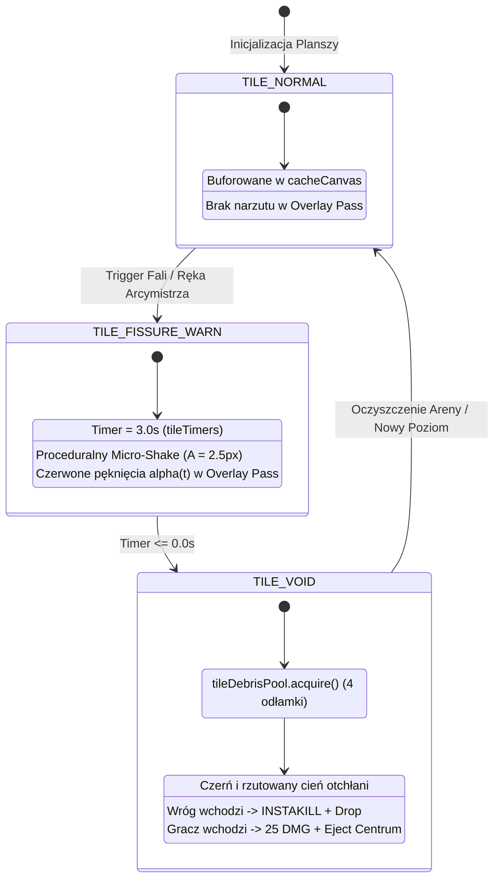
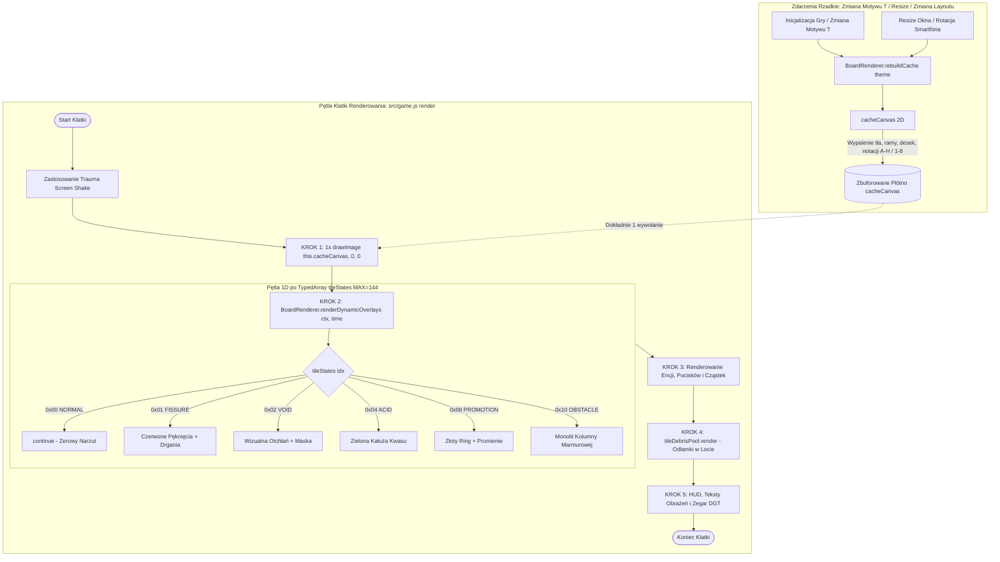

# RFC: Dział IV — Dynamiczne Szachownice i Modyfikatory Areny (Domain 4: Dynamic Chessboards & Arena Modifiers)

**Dokument RFC:** `domain-4-board-dynamics.md`  
**Autor:** Worker Subagent (Domain 4 Lead Systems Architect)  
**Status:** PROPOSAL / READY FOR REVIEW  
**Metodologia:** TLC Spec-Driven Development (AM76 Game Studio Framework)  
**Wymagania nadrzędne:** `ORIGINAL_REQUEST.md` (R4), `PROJECT.md` (Milestone 4: Features 12–14)  
**Docelowa lokalizacja:** `/home/wiktor/projects/am76_game_studio/ChessSurvivors76/.specs/proposals/domain-4-board-dynamics.md`

---

## 1. Cel i Uzasadnienie Projektowe (Design Intent & Rationale)

### 1.1. Przekształcenie Statycznej Planszy w Dynamiczne Pole Bitwy
Tradycyjne gry z gatunku *Survivors* cierpią na tzw. „syndrom monotonnego kitingu” (passive circular kiting). Gracz porusza się po obwodzie areny w nieskończonych pętlach, unikając kontaktu z przeciwnikami i polegając na automatycznym prowadzeniu ognia. W klasycznej partii szachowej szachownica nie jest pustą przestrzenią — jest polem geometrycznych napięć, gdzie każde pole posiada strategiczną wartość, linie są blokowane lub otwierane, a przewaga pozycyjna wynika z kontroli kluczowych punktów (centralne outposts, kolumny otwarte, przekątne snajperskie).

Celem niniejszej specyfikacji jest **przekształcenie statycznej szachownicy $8 \times 8$ w żywy, niebezpieczny i reaktywny teatr wojenny**. Wprowadzenie zmiennych i zapadających się pól, alchemicznych kałuż kwasu oraz mistycznych Pól Promocji zmusza gracza do nieustannego reewaluowania swojej pozycji, zarządzania strefami zagrożenia (zoning) oraz podejmowania skalkulowanego ryzyka taktycznego.

### 1.2. Fuzja Roguelite Bullet-Hell z Szachową Strategią Przestrzenną
Dynamiczne modyfikatory areny łączą mechaniki przestrzenne szachów z dynamicznym tempem roguelite:
1. **Kruszenie krawędzi (Collapsing Edges / Void Abyss):** W miarę upływu czasu partii lub w określonych fazach fal i starć z bossami zewnętrzne rzędy i kolumny ulegają zniszczeniu. Przestrzeń gry kurczy się, uniemożliwiając pasywną ucieczkę i wymuszając brutalne starcie w centrum (odpowiednik końcówki partii szachowej, gdzie król musi wkroczyć do aktywnej gry).
2. **Pola Kwasowe i Zatrute (Acid & Miasma Squares):** Lokalne strefy odmowy dostępu (Area Denial) pozostawiane przez elity i modyfikatory fali. Wymuszają dynamiczne modyfikowanie ścieżek ruchu pod rygorem spowolnienia i obrażeń alchemicznych.
3. **Pola Promocji (Queening Squares — King of the Hill):** Zamiana pasywnego unikania wrogów w aktywną walkę o dominację terytorialną. Utrzymanie strategicznego pola w centrum nagradza gracza potężnym wzmocnieniem bojowym (Oświecenie), lecz pozostawienie pola bez opieki pozwala wrogim pionkom na natychmiastową metamorfozę w niszczycielskie figury wyższe.
4. **Warianty Geometryczne Areny:** Odejście od monotonii kwadratu $8 \times 8$ na rzecz dedykowanych architektur bitewnych: Sali Kolumn Marmurowych (osłony i przeszkody fizyczne), Pierścienia / Donuta (arena z zapadniętym rdzeniem centralnym) oraz Szybkiego Korytarza $12 \times 6$ (horyzontalny tor sprzyjający Wieżom i szybkim lansjerom).

### 1.3. Rygory Inżynieryjne AM76 Game Studio
Wdrożenie dynamicznej szachownicy musi rygorystycznie spełniać żelazne filary wydajnościowe silnika:
- **Canvas 2D Offscreen Buffer Mandate:** Utrzymanie bezwzględnej zasady dokładnie 1 wywołania `ctx.drawImage(this.cacheCanvas, 0, 0)` na klatkę dla statycznego tła stołu i szachownicy.
- **Dedykowany Przebieg Nakładek (Dynamic Overlay Pass):** Wszystkie zmienne stany (pęknięcia, kwas, złoty blask promocji) są rysowane bezpośrednio na głównym Canvasie w jednym zoptymalizowanym przebiegu `renderDynamicOverlays(ctx, time)` bez unieważniania bufora offscreen.
- **Zero-GC w pętli 60/144 FPS:** Zakaz jakichkolwiek alokacji obiektów (`new`, closures, literały obiektowe) podczas renderowania i aktualizacji pól. Cały stan siatki bazuje na płaskich tablicach typowanych (`Uint8Array`, `Float32Array`, `Int16Array`) o stałym rozmiarze $MAX\_TILES = 144$.
- **Absolutny Zakaz `ctx.shadowBlur`:** Wszelkie poświaty i efekty świetlne realizowane są proceduralną techniką Faux-Glow (warstwowe okręgi/linie ze zmiennym `alpha` i `lineWidth`).
- **Pule Obiektów (Fixed Pools):** Spadające w przepaść odłamki kafelków obsługiwane są przez prealokowaną pulę `tileDebris` (128 instancji).

---

## 2. Szczegółowe Mechaniki z Konkretnymi Wartościami Liczbowymi i Wzorami Balansu

```
┌────────────────────────────────────────────────────────────────────────┐
│               ARCHITEKTURA DYNAMICZNEJ SZACHOWNICY AM76                │
│                                                                        │
│   ┌────────────────────────────────────────────────────────────────┐   │
│   │   BUFOR STATYCZNY (Offscreen cacheCanvas - 1x drawImage)       │   │
│   │   Drewno / Rama / Linie / Kafelki stabilne / Notacja A-H, 1-8  │   │
│   └───────────────────────────────┬────────────────────────────────┘   │
│                                   │                                    │
│                                   ▼                                    │
│   ┌────────────────────────────────────────────────────────────────┐   │
│   │   DYNAMIC OVERLAY PASS (renderDynamicOverlays na Canvas 2D)    │   │
│   │   • TILE_FISSURE_WARN (Pęknięcia, drgania wibracyjne 3.0s)     │   │
│   │   • TILE_VOID         (Wizualna otchłań, maskowanie krawędzi)  │   │
│   │   • TILE_ACID         (Alchemiczne opary, pulsowanie kwasu)    │   │
│   │   • TILE_PROMOTION    (Złoty krąg chwały, pierścień capture)   │   │
│   │   • TILE_OBSTACLE     (Cienie i zwieńczenia kolumn marmuru)    │   │
│   └───────────────────────────────┬────────────────────────────────┘   │
│                                   │                                    │
│                                   ▼                                    │
│   ┌────────────────────────────────────────────────────────────────┐   │
│   │   WARSTWA CZĄSTEK ZERO-GC (tileDebrisPool - 128 instancji)     │   │
│   │   Spadające fragmenty marmuru i drewna w otchłań Void Abyss    │   │
│   └────────────────────────────────────────────────────────────────┘   │
└────────────────────────────────────────────────────────────────────────┘
```

---

### 2.1. Zmienne i Zapadające się Pola Szachownicy

#### 2.1.1. Kruszenie Krawędzi (Collapsing Edges & Void Abyss)
Mechanika kruszenia krawędzi reprezentuje postępujące załamanie stabilności wymiarowej areny.

1. **Wyzwalanie Procesu (Triggers):**
   - **Oskryptowane etapy fali (Wave Collapse):**
     * Fala 3: Zewnętrzny pierścień kafelków (linie 1 i 8, kolumny A i H) przechodzi w stan ostrzeżenia. Rozmiar grywalny ulega redukcji z $8 \times 8$ do $6 \times 6$.
     * Fala 7: Kolejny pierścień ulega zawaleniu — arena kurczy się do bezwzględnego minimum $4 \times 4$.
   - **Ataki Bossa Ręka Arcymistrza:**
     * Uderzenie pięścią (`Checkmate Fist`) lub ciosy palcowe (`Finger-Slam`) inicjują natychmiastowe pękanie wybranych rzędów lub losowych kafelków.
2. **Faza 1: Ostrzeżenie i Pękanie (Fissure Warning State):**
   - Flaga bitowa: `tileStates[idx] |= TILE_FISSURE_WARN`.
   - Czas trwania: $T_{warn} = 3.0\text{ s}$ (odliczany w `tileTimers[idx]`).
   - **Proceduralna Wibracja Podłoża (Micro-Shake):**
     Kafelek i stojące na nim encje podlegają wibracji o rosnącej amplitudzie:
     $$A(t) = A_{max} \cdot \left(1.0 - \frac{t_{remaining}}{T_{warn}}\right)^2, \quad A_{max} = 2.5\text{ px}$$
     $$\Delta x_{vib} = A(t) \cdot \sin(45 \cdot t), \quad \Delta y_{vib} = A(t) \cdot \cos(45 \cdot t)$$
   - **Wizualizacja Pęknięć (Overlay):**
     Rysowanie proceduralnej siatki pęknięć koloru ostrzegawczego `theme.uiDanger` z pulsującym kanałem alfa:
     $$\alpha_{fissure}(t) = 0.35 + 0.45 \cdot \left|\sin(8 \pi \cdot t)\right|$$
3. **Faza 2: Zawalenie i Otchłań (Void Collapse & Abyss):**
   - Po upływie $3.0\text{ s}$ następuje zmiana flagi:
     `tileStates[idx] = (tileStates[idx] & ~TILE_FISSURE_WARN) | TILE_VOID`.
   - **Aktywacja Odłamków (Tile Debris Burst):**
     Współrzędne kafelka generują natychmiast 4 odłamki z prealokowanej puli `tileDebrisPool`:
     Rozmiar odłamka: $S_{debris} = \frac{tileSize}{2}$.
     Prędkość początkowa: $v_x \in [-60, 60]\text{ px/s}, \quad v_y \in [-60, 60]\text{ px/s}, \quad v_z \in [80, 180]\text{ px/s}$.
     Grawitacja odłamków: $g_z = -520\text{ px/s}^2$. Czas życia: $1.2\text{ s}$.
   - **Wpływ Otchłani na Wrogów:**
     Każda wroga jednostka, której środek kolizji znajdzie się na kafelku `TILE_VOID` (dystans do środka $dist \le 0.45 \times tileSize$), ulega natychmiastowej anihilacji (**Instakill**).
     Generowany jest pełny drop doświadczenia i żetonów oraz dźwięk pochłonięcia przez próżnię (`AudioEngine.playVoidFall()`).
   - **Wpływ Otchłani na Gracza (Environmental Penalty & Ejection):**
     Wejście gracza na pole `TILE_VOID` uruchamia natychmiastowy protokół ratunkowy:
     * Obrażenia środowiskowe: $dmg_{void} = 25\text{ HP}$ (w trybie z paskiem zdrowia) LUB utrata 1 pełnego Serca.
     * Kara czasowa: Odliczenie $-5.0\text{ s}$ z Zegara Szachowego.
     * Wektor Odrzutu ku Najbliższemu Bezpiecznemu Polu (Safe Tile Restitution Ejection):
       Wektor odrzutu nie jest liczony w ciemno do geometrycznego środka planszy $(C_x, C_y)$ (co na arenie Donut z zapadniętym rdzeniem $4\times 4$ powodowałoby nieskończoną pętlę wpadania w otchłań), lecz celuje w geometryczny środek najbliższego bezpiecznego, grywalnego kafelka $\vec{P}_{\text{safe}}$:
       $$\vec{P}_{\text{safe}} = \arg\min_{i \in \text{WalkableTiles}} \|\vec{P}_{\text{tile}}(i) - \vec{p}\|$$
       $$\vec{d} = \vec{P}_{\text{safe}} - \vec{p}, \quad \hat{u} = \frac{\vec{d}}{\|\vec{d}\|}, \quad \vec{v}_{\text{eject}} = \hat{u} \cdot 480\text{ px/s}$$
     * Gracz otrzymuje ramkę nietykalności środowiskowej $T_{i-frame} = 1.0\text{ s}$.

---

#### 2.1.2. Pola Zatrute i Kwasowe (Acid & Poison Squares)
Pola kwasowe wprowadzają element degradacji pancerza oraz dynamicznej kontroli tłumu (Crowd Control).

```
┌────────────────────────────────────────────────────────────────────────┐
│                   MECHANIKA EKSPOZYCJI NA KWAS (ACID)                  │
│                                                                        │
│   Gracz wchodzi na pole TILE_ACID                                      │
│   │                                                                    │
│   ├──> Natychmiast: Spowolnienie ruchu o 20% (speedMult = 0.80)        │
│   │                                                                    │
│   └──> Akumulacja czasu ekspozycji: tileExposure[idx] += dt            │
│        │                                                               │
│        ├──> Czas < 1.2s: Brak obrażeń (okno manewru / dash)            │
│        │                                                               │
│        └──> Czas >= 1.2s: TRIGGER KOROZJI                              │
│             Tick 15 HP obrażeń co 0.5s                                 │
│             Zielone cząstki oparów alchemicznych                       │
└────────────────────────────────────────────────────────────────────────┘
```

1. **Źródła Skażenia:**
   - Plamy kwasowe pozostawiane w śladzie szarży Widmowego Skoczka (Chaos Lancer).
   - Pozostałości po eksplozji kul armatnich Czarnego Króla.
   - Globalne zjawisko fali: „Alchemiczny Wyziew” (2–4 losowe kafelki ulegają skażeniu co $12.0\text{ s}$).
2. **Cykl Życia Pola Kwasowego:**
   - Flaga bitowa: `tileStates[idx] |= TILE_ACID`.
   - Czas trwania plamy kwasu: $T_{acid\_life} = 8.0\text{ s}$ (zapisany w `tileTimers[idx]`).
   - Zanikanie kwasu: W ostatnich $2.0\text{ s}$ przezroczystość nakładki kwasowej liniowo spada do zera.
3. **Wpływ na Gracza:**
   - **Spowolnienie Kinetyczne:** Prędkość poruszania się gracza zostaje zredukowana o $20\%$:
     $$v_{effective} = v_{base} \cdot 0.80$$
   - **Mechanika Ekspozycji i Obrażenia (Exposure Accumulator):**
     Każdy kafelek utrzymuje prealokowany licznik ekspozycji `tileExposure[idx]`:
     * Dopóki gracz przebywa na kwasie: `tileExposure[idx] += dt`.
     * Próg tolerancji: $T_{thresh} = 1.2\text{ s}$. Gracz może przebiec przez kwas bez utraty zdrowia (np. wykonując Dash).
     * Po przekroczeniu $1.2\text{ s}$: Zadawane są obrażenia korozji $15\text{ HP}$ (lub $0.5$ serca) co interwał $\Delta t_{tick} = 0.5\text{ s}$. Każde zadanie obrażeń natychmiast konsumuje $0.5\text{ s}$ z akumulatora ekspozycji (`tileExposure[idx] -= 0.5` lub dedykowany `player.acidDamageCooldown = 0.5s`), co kategorycznie zapobiega zadawaniu obrażeń w każdej pojedynczej klatce silnika (eliminacja skoku $900\text{ HP/s}$).
     * Opuszczenie kwasu: Licznik ekspozycji redukuje się z prędkością podwójną: `tileExposure[idx] = Math.max(0, tileExposure[idx] - 2 * dt)`.
4. **Wpływ na Wrogów (Alchemiczna Korozja Pancerza — Tactical Synergy):**
   - Wrogowie wkraczający na pole kwasowe otrzymują debuff `ACID_CORROSION`:
     * Redukcja prędkości ruchu o $15\%$ ($v_{enemy}' = v_{enemy} \cdot 0.85$).
     * **Redukcja Pancerza o $30\%$:** Zwiększenie wszystkich obrażeń otrzymywanych od pocisków i umiejętności gracza o $+42.8\%$ (mnożnik obrażeń $M_{dmg} = \frac{1}{1.0 - 0.30} \approx 1.43$):
       $$DMG_{received} = DMG_{raw} \times 1.43$$
     * Wyprowadzanie wrogów na kwas stanowi kluczową strategię walki z elitami i bossami!

---

#### 2.1.3. Pola Promocji (Promotion Squares — King of the Hill)
Pola promocji stanowią najbardziej ekscytujący węzeł decyzyjny na szachownicy — gracz rywalizuje z wrogami o przejęcie kontroli nad złotymi polami chwały.

```
┌────────────────────────────────────────────────────────────────────────┐
│                   POLE PROMOCJI: WEKTOR PRZEJĘCIA                      │
│                                                                        │
│            GRACZ NA POLU                      CZARNY PIONEK NA POLU    │
│                  │                                      │              │
│                  ▼                                      ▼              │
│        Utrzymanie przez 3.0s                  Dotarcie do pola         │
│                  │                                      │              │
│                  ▼                                      ▼              │
│       OŚWIECENIE KRÓLEWSKIE                   NATYCHMIASTOWY AWANS     │
│       • +25% DMG przez 8.0s                   • Metamorfoza w Wieżę,   │
│       • +5.0s do Zegara Szachowego              Skoczka lub Hetmankę!  │
│       • Fala Smart-Bomb (R=250px)             • Zagrożenie krytyczne   │
└────────────────────────────────────────────────────────────────────────┘
```

1. **Występowanie i Rozmieszczenie:**
   - Od fali 2 na planszy aktywują się 1 lub 2 Pola Promocji.
   - Lokacje faworyzowane:
     * Centrum szachownicy: `d4`, `d5`, `e4`, `e5` (klasyczna dominacja centrum w układach Standard i Sala Marmurowa).
     * Zewnętrzny pierścień grywalny na arenie Donut: `b2`, `g2`, `b7`, `g7` (eliminując umieszczanie pól promocji w pustym, zapadniętym rdzeniu próżni).
     * Ostatnia linia przeciwnika (dla gracza linia 8; dla wrogów linia 1).
   - Oznaczenie wizualne: Złota promienista korona szachowa, pulsujący okrąg przechwytywania oraz runiczny symbol awansu.
2. **Kontrola przez Gracza (Player Capture & Enlightenment):**
   - Wymagany czas ciągłego przebywania w obrębie kafelka: $T_{capture} = 3.0\text{ s}$.
   - Progres przechwytywania zapisywany jest w `tileProgress[idx] \in [0.0, 1.0]`:
     $$\text{Progress}(t) = \min\left(1.0, \text{Progress}(t - \Delta t) + \frac{\Delta t}{3.0}\right)$$
   - Po osiągnięciu $1.0$ aktywuje się stan **Oświecenie Królewskie (Royal Enlightenment)**:
     * **Buff Bojowy:** Mnożnik obrażeń $DMG_{mult} = 1.25$ ($+25\%$ do wszystkich pocisków, lasera i uderzeń obszarowych) na czas $8.0\text{ s}$.
     * **Regeneracja Czasowa:** Natychmiastowe zasilenie Zegara Szachowego o $+5.0\text{ s}$ czasu partii.
     * **Impuls Oczyszczający (Smart-Bomb Wave):** Wyzwolenie radialnej fali uderzeniowej o promieniu $R_{blast} = 250\text{ px}$, niszczącej wszystkie wrogie pociski w zasięgu i odrzucającej wrogów o $120\text{ px}$.
   - Po aktywacji pole wchodzi w stan wygaszenia (Cooldown) na $15.0\text{ s}$, po czym flaga `TILE_PROMOTION` zostaje przeniesiona na inne losowe pole centralne.
3. **Przechwycenie przez Wrogi Pionek (Enemy Pawn Queening Crisis):**
   - Jeśli standardowy Czarny Pionek (Black Pawn) wkroczy na aktywne Pole Promocji i utrzyma się na nim przez zaledwie $T_{enemy\_hold} = 1.0\text{ s}$:
     * **Natychmiastowa Metamorfoza (Instant Pawn Promotion):**
       Pionek zostaje usunięty z symulacji (`enemy.active = false`).
       W jego miejscu pojawia się elitarna jednostka promowana, zależnie od wylosowanej wagi:
       - $45\%$ szans: **Promowana Wieża (Dreadnought Rook)** — potężny taran z tarczą $270^\circ$.
       - $40\%$ szans: **Widmowy Skoczek (Chaos Lancer)** — potrójny skok i spiralne pociski.
       - $15\%$ szans: **Mini Apex Queen** — snajperskie lasery i radialna salwa kul.
     * Wyzwolenie fali uderzeniowej wrogiej magii raniącej gracza o $10\text{ HP}$, jeśli stoi w pobliżu.
4. **Stan Sporny (Contested State):**
   - Jeśli na Polu Promocji znajduje się jednocześnie gracz oraz co najmniej jedna jednostka wroga:
     * Postęp przechwytywania zostaje zamrożony (`tileProgress` nie rośnie ani nie spada).
     * Kafelek pulsuje agresywnym, dwubarwnym światłem złoto-fioletowym (sygnalizacja stanu spornego).

---

### 2.2. Warianty Układu Szachownicy (Arena Layout Variants)

Wybór układu areny determinuje geometrię poruszania się, linie strzału i taktykę pozycyjną. Wszystkie warianty mieszczą się w buforze $MAX\_TILES = 144$ ($12 \times 12$).

| ID Układu | Nazwa Wariantu | Wymiary ($W \times H$) | Liczba Pól Aktywnych | Pola Specjalne / Przeszkody | Wpływ na Meta-Rozgrywkę i Taktykę |
|-----------|----------------|------------------------|----------------------|-----------------------------|-----------------------------------|
| `standard_8x8` | **Klasyczna Szachownica** | $8 \times 8$ | 64 | Brak przeszkód stałych | Wzorcowy balans dla debiutów i formatów Rapid/Blitz. Pełna swoboda manewru we wszystkich kierunkach. |
| `marble_hall` | **Sala Kolumn Marmurowych** | $8 \times 8$ | 60 (4 kolumny) | Kolumny na `c3`, `c6`, `f3`, `f6` (`TILE_OBSTACLE`) | Zapewnia naturalne osłony przed snajperami Gońców i laserami Królowej. Szarża Wieży w kolumnę powoduje stun $2.0\text{ s}$. |
| `donut_ring` | **Arena Pierścieniowa (Donut)** | $8 \times 8$ | 48 (16 otchłań) | Rdzeń $4 \times 4$ (`d4..e5` i otoczenie) to `TILE_VOID` | Brak możliwości ucieczki przez centrum. Wymusza ruch orbitalny po 2-kafelkowym ringu. Wrogowie strzelają na wskroś próżni. |
| `speedway_12x6` | **Szybki Korytarz Szachowy** | $12 \times 6$ | 72 | Układ panoramiczny $2:1$, brak kolumn | Faliście wydłużona oś horyzontalna. Idealna arena pod pojedynki z Bliźniaczymi Wieżami i szarże Hetmana. |

---

### 2.3. Zgodność z Buforowaniem Planszy w `BoardRenderer`

Dotychczasowa implementacja w `src/boardRenderer.js` rozwiązała wąskie gardło wydajnościowe (Bottleneck #2 Fix) poprzez wypalenie tła, kafelków i notacji na `cacheCanvas`. Nowe dynamiczne mechaniki **nie mogą naruszyć tego fundamentu**.

#### 2.3.1. Żelazna Reguła Jednego Wywołania `drawImage`
```javascript
// Główna pętla renderowania świata w src/game.js:
// KROK 1: Rysowanie zbuforowanego tła (DOKŁADNIE 1 WYWOŁANIE NA KLATKĘ)
ctx.drawImage(this.board.cacheCanvas, 0, 0);

// KROK 2: Dedykowany przebieg nakładek dynamicznych (Dynamic Overlay Pass)
this.board.renderDynamicOverlays(ctx, this.time, this.theme);

// KROK 3: Renderowanie telegrafów, żetonów, pocisków, jednostek i cząstek
this._renderTelegraphs(ctx, this.theme);
this._renderTokens(ctx, this.theme);
// ...
```

#### 2.3.2. Rozgraniczenie Odpowiedzialności Bufora i Nakładek:
1. **Co znajduje się w `this.cacheCanvas` (Pre-rendered Static Cache):**
   - Tło stołu, tekstura drewna desek lub siatka neonowa wybranego stylu (Woodcraft, Cyber-Grid, 1-Bit, Blackboard).
   - Cień pod planszą i zewnętrzna drewniana/marmurowa rama stołu.
   - Standardowe kafelki jasne i ciemne (`tileLight`, `tileDark`).
   - Stała notacja algebraiczna na krawędziach (A–H / 1–8 lub A–L / 1–6).
   - **Reguła inwalidacji bufora:** `this.rebuildCache(theme)` wywoływane jest **wyłącznie** przy:
     * Zmianie motywu wizualnego (klawisz `T`).
     * Zmianie rozmiaru okna lub orientacji urządzenia (`resize`).
     * Zmianie typu układu areny (np. przejście ze Standardu do Sali Marmurowej).
2. **Co rysuje `renderDynamicOverlays(ctx, time, theme)` (Dynamic Overlay Pass):**
   - Przebieg jest wykonywany w każdej klatce $60/144\text{ FPS}$ bezpośrednio na głównym kontekście.
   - Iteruje wyłącznie po aktywnych polach siatki: od indeksu 0 do `this.count = this.cols * this.rows` (np. 64 dla 8x8, 72 dla 12x6), zapobiegając rzutowaniu widmowych kafelków (ghost overlays) na nieaktywne komórki bufora `MAX_BOARD_TILES`.
   - Jeśli kafelek ma wartość `TILE_NORMAL (0x00)`, pętla natychmiast wykonuje `continue` (narzut bliski zeru).
   - Dla kafelków z aktywnymi flagami:
     * `TILE_FISSURE_WARN`: Rysuje czerwone pęknięcia proceduralne i pulsowanie ostrzegawcze.
     * `TILE_VOID`: Rysuje maskę głębokiej czerni z wewnętrznym cieniem przepaści.
     * `TILE_ACID`: Rysuje alchemiczne zielone pęcherze z czasem wygasania.
     * `TILE_PROMOTION`: Rysuje złoty okrąg postępu, blask Faux-Glow i koronę szachową.
     * `TILE_OBSTACLE`: Rysuje rzutowany cień i marmurowy monolit kolumny.

---

## 3. Schematy i Makiety Tekstowe UI oraz Diagramy Mermaid

### 3.1. Schematy Tekstowe ASCII Układów Plansz

#### Wariant 1: Klasyczna Szachownica 8x8 (Standard)
```
       A     B     C     D     E     F     G     H
    ┌─────┬─────┬─────┬─────┬─────┬─────┬─────┬─────┐
 8  │     │ ░░░ │     │ ░░░ │     │ ░░░ │     │ ░░░ │  8
    ├─────┼─────┼─────┼─────┼─────┼─────┼─────┼─────┤
 7  │ ░░░ │     │ ░░░ │     │ ░░░ │     │ ░░░ │     │  7
    ├─────┼─────┼─────┼─────┼─────┼─────┼─────┼─────┤
 6  │     │ ░░░ │     │ ░░░ │     │ ░░░ │     │ ░░░ │  6
    ├─────┼─────┼─────┼─────┼─────┼─────┼─────┼─────┤
 5  │ ░░░ │     │ ░░░ │ [P] │ [P] │ ░░░ │     │ ░░░ │  5   [P] = Centralne Pola Promocji
    ├─────┼─────┼─────┼─────┼─────┼─────┼─────┼─────┤          (d4, d5, e4, e5)
 4  │     │ ░░░ │     │ [P] │ [P] │     │ ░░░ │     │  4
    ├─────┼─────┼─────┼─────┼─────┼─────┼─────┼─────┤
 3  │ ░░░ │     │ ░░░ │     │ ░░░ │     │ ░░░ │     │  3
    ├─────┼─────┼─────┼─────┼─────┼─────┼─────┼─────┤
 2  │     │ ░░░ │     │ ░░░ │     │ ░░░ │     │ ░░░ │  2
    ├─────┼─────┼─────┼─────┼─────┼─────┼─────┼─────┤
 1  │ ░░░ │     │ ░░░ │     │ ░░░ │     │ ░░░ │     │  1
    └─────┴─────┴─────┴─────┴─────┴─────┴─────┴─────┘
       A     B     C     D     E     F     G     H
```

#### Wariant 2: Sala Kolumn Marmurowych (Marble Hall 8x8)
```
       A     B     C     D     E     F     G     H
    ┌─────┬─────┬─────┬─────┬─────┬─────┬─────┬─────┐
 8  │     │ ░░░ │     │ ░░░ │     │ ░░░ │     │ ░░░ │  8
    ├─────┼─────┼─────┼─────┼─────┼─────┼─────┼─────┤
 7  │ ░░░ │     │ ░░░ │     │ ░░░ │     │ ░░░ │     │  7
    ├─────┼─────┼─────┼─────┼─────┼─────┼─────┼─────┤
 6  │     │ ░░░ │ ███ │ ░░░ │     │ ███ │     │ ░░░ │  6   ███ = Niezniszczalna Kolumna
    ├─────┼─────┼─────┼─────┼─────┼─────┼─────┼─────┤          Marmurowa (c6, f6, c3, f3)
 5  │ ░░░ │     │ ░░░ │     │ ░░░ │     │ ░░░ │     │  5   • Blokuje ruch i pociski
    ├─────┼─────┼─────┼─────┼─────┼─────┼─────┼─────┤   • Stun 2.0s dla szarży Wieży
 4  │     │ ░░░ │     │ ░░░ │     │ ░░░ │     │ ░░░ │  4   • Osłona przed Gońcami
    ├─────┼─────┼─────┼─────┼─────┼─────┼─────┼─────┤
 3  │ ░░░ │     │ ███ │     │ ░░░ │ ███ │ ░░░ │     │  3
    ├─────┼─────┼─────┼─────┼─────┼─────┼─────┼─────┤
 2  │     │ ░░░ │     │ ░░░ │     │ ░░░ │     │ ░░░ │  2
    ├─────┼─────┼─────┼─────┼─────┼─────┼─────┼─────┤
 1  │ ░░░ │     │ ░░░ │     │ ░░░ │     │ ░░░ │     │  1
    └─────┴─────┴─────┴─────┴─────┴─────┴─────┴─────┘
       A     B     C     D     E     F     G     H
```

#### Wariant 3: Szachownica Pierścieniowa / Donut (Ring of Combat)
```
       A     B     C     D     E     F     G     H
    ┌─────┬─────┬─────┬─────┬─────┬─────┬─────┬─────┐
 8  │     │ ░░░ │     │ ░░░ │     │ ░░░ │     │ ░░░ │  8
    ├─────┼─────┼─────┼─────┼─────┼─────┼─────┼─────┤
 7  │ ░░░ │ [P] │ ░░░ │     │ ░░░ │     │ [P] │     │  7   [P] = Pola Promocji na obwodzie
    ├─────┼─────┼─────┼─────┼─────┼─────┼─────┼─────┤         ringu (b7, g7, b2, g2)
 6  │     │ ░░░ │  X  │  X  │  X  │  X  │ ░░░ │     │  6   X X = Bezdenna Przepaść (Void)
    ├─────┼─────┼─────┼─────┼─────┼─────┼─────┼─────┤          w centrum 4x4 (c3..f6)
 5  │ ░░░ │     │  X  │  X  │  X  │  X  │     │ ░░░ │  5   • Wymusza ruch po obwodzie
    ├─────┼─────┼─────┼─────┼─────┼─────┼─────┼─────┤   • Strzały snajperskie w poprzek
 4  │     │ ░░░ │  X  │  X  │  X  │  X  │ ░░░ │     │  4   • Instakill dla zepchniętych
    ├─────┼─────┼─────┼─────┼─────┼─────┼─────┼─────┤
 3  │ ░░░ │     │  X  │  X  │  X  │  X  │     │ ░░░ │  3
    ├─────┼─────┼─────┼─────┼─────┼─────┼─────┼─────┤
 2  │     │ [P] │     │ ░░░ │     │ ░░░ │ [P] │ ░░░ │  2
    ├─────┼─────┼─────┼─────┼─────┼─────┼─────┼─────┤
 1  │ ░░░ │     │ ░░░ │     │ ░░░ │     │ ░░░ │     │  1
    └─────┴─────┴─────┴─────┴─────┴─────┴─────┴─────┘
       A     B     C     D     E     F     G     H
```

#### Wariant 4: Szybki Korytarz Szachowy 12x6 (Speedway Corridor)
```
       A   B   C   D   E   F   G   H   I   J   K   L
    ┌───┬───┬───┬───┬───┬───┬───┬───┬───┬───┬───┬───┐
 6  │   │░░░│   │░░░│   │░░░│   │░░░│   │░░░│   │░░░│  6
    ├───┼───┼───┼───┼───┼───┼───┼───┼───┼───┼───┼───┤
 5  │░░░│   │░░░│   │░░░│   │░░░│   │░░░│   │░░░│   │  5   Układ Panoramiczny (2:1)
    ├───┼───┼───┼───┼───┼───┼───┼───┼───┼───┼───┼───┤   • 12 Kolumn x 6 Rzędów
 4  │   │░░░│   │░░░│[P]│░░░│░░░│[P]│░░░│   │░░░│   │  4   • Dominacja szarż Wieży
    ├───┼───┼───┼───┼───┼───┼───┼───┼───┼───┼───┼───┤   • Arenka Bliźniaczych Wież
 3  │░░░│   │░░░│   │░░░│[P]│[P]│░░░│   │░░░│   │░░░│  3
    ├───┼───┼───┼───┼───┼───┼───┼───┼───┼───┼───┼───┤
 2  │   │░░░│   │░░░│   │░░░│   │░░░│   │░░░│   │░░░│  2
    ├───┼───┼───┼───┼───┼───┼───┼───┼───┼───┼───┼───┤
 1  │░░░│   │░░░│   │░░░│   │░░░│   │░░░│   │░░░│   │  1
    └───┴───┴───┴───┴───┴───┴───┴───┴───┴───┴───┴───┘
       A   B   C   D   E   F   G   H   I   J   K   L
```

---

### 3.2. Diagram Mermaid: Cykl Życia Zapadającego się Kafelka Szachownicy



---

### 3.3. Diagram Mermaid: Architektura Potoku Renderowania BoardRenderer



---

## 4. Analiza Techniczna Wykonalności w Silniku Canvas 2D (Zero-GC)

### 4.1. Indeksowanie Siatki 1D w Płaskich Tablicach Typowanych
W celu zagwarantowania zerowej presji na Garbage Collector oraz natychmiastowego dostępu pamięciowego w pamięci podręcznej CPU (L1/L2 Cache locality), cały stan szachownicy oparty jest na płaskich tablicach typowanych (`TypedArray`) o stałej pojemności $MAX\_TILES = 144$ ($12 \times 12$ pól).

```javascript
// Stałe wymiarowe i alokacje buforów stanu szachownicy
export const MAX_BOARD_DIM = 12;
export const MAX_BOARD_TILES = 144; // 12 x 12 maksymalny rozmiar korytarza

export class BoardGridState {
  constructor() {
    // 1 bajt na pole: Maska bitowa stanów (TILE_STATE_*)
    this.tileStates = new Uint8Array(MAX_BOARD_TILES);
    
    // 4 bajty na pole: Uniwersalny timer stanu (czas trwania ostrzeżenia lub wygasania kwasu)
    this.tileTimers = new Float32Array(MAX_BOARD_TILES);
    
    // 4 bajty na pole: Akumulator czasu ekspozycji gracza na kwas (Acid Exposure)
    this.tileExposure = new Float32Array(MAX_BOARD_TILES);
    
    // 4 bajty na pole: Postęp przejmowania Pola Promocji [0.0 - 1.0]
    this.tileProgress = new Float32Array(MAX_BOARD_TILES);
    
    // 2 bajty na pole: ID jednostki okupującej lub -1
    this.tileOccupants = new Int16Array(MAX_BOARD_TILES);

    // Aktywne parametry siatki
    this.cols = 8;
    this.rows = 8;
    this.count = 64;
  }

  // Bezpieczne przełączanie geometrii areny z zerowaniem bufora i ograniczeniem do cols * rows
  setLayout(cols, rows) {
    this.cols = cols;
    this.rows = rows;
    this.count = cols * rows; // Ścisła granica iteracji pętli fizyki i nakładek
    
    // Całkowite wyczyszczenie starych komórek pamięci (ochrona przed ghost overlays)
    this.tileStates.fill(0);
    this.tileTimers.fill(0);
    this.tileExposure.fill(0);
    this.tileProgress.fill(0);
    this.tileOccupants.fill(-1);
  }

  // Błyskawiczna translacja 2D -> 1D bez alokacji obiektów
  getIndex(col, row) {
    if (col < 0 || col >= this.cols || row < 0 || row >= this.rows) return -1;
    return row * this.cols + col;
  }

  // Translacja 1D -> 2D (przekazywanie referencji wyjściowej dla Zero-GC)
  getCoords(index, out) {
    out.col = index % this.cols;
    out.row = Math.floor(index / this.cols);
  }
}
```

---

### 4.2. Stałe Bitowe Flag Stanów Kafelków
Zastosowanie operacji bitowych umożliwia współistnienie wielu modyfikatorów na jednym polu w $O(1)$ bez tworzenia tablic obiektów:

| Maska Bitowa | Nazwa Stałej | Wartość Hex | Działanie w Pętli Fizyki i Renderera |
|--------------|--------------|-------------|--------------------------------------|
| `0000 0000` | `TILE_NORMAL` | `0x00` | Czysty kafelek szachownicy (brak modyfikatorów). Pomijany w Overlay Pass. |
| `0000 0001` | `TILE_FISSURE_WARN` | `0x01` | Kafelek pęka. Drgania $2.5\text{ px}$. Odliczanie $3.0\text{ s}$ do stanu `TILE_VOID`. |
| `0000 0010` | `TILE_VOID` | `0x02` | Bezdenna otchłań. Instakill dla wrogów; $25\text{ dmg}$ i odrzut dla gracza. |
| `0000 0100` | `TILE_ACID` | `0x04` | Skażenie kwasem. Spowolnienie $20\%$, korozja po $1.2\text{ s}$, pancerz wroga $-30\%$. |
| `0000 1000` | `TILE_PROMOTION` | `0x08` | Złote Pole Promocji. Przejęcie w $3.0\text{ s}$ daje buff Oświecenia; pionek w $1.0\text{ s}$ awansuje. |
| `0001 0000` | `TILE_OBSTACLE` | `0x10` | Kolumna marmurowa / twarda ściana. Zatrzymuje ruch i pociski; stun Wieży $2.0\text{ s}$. |
| `0010 0000` | `TILE_CRUMBLED` | `0x20` | Kafelek trwale usunięty z geometrii po ciosie Ręki Arcymistrza. |
| `0100 0000` | `TILE_CONDUIT` | `0x40` | Ścieżka energetyczna Bliźniaczych Wież (wiązka laserowa). |

#### Przykłady Szybkich Operacji Bitowych w Pętli Gry:
```javascript
// Sprawdzenie czy pole jest zdatne do stanięcia (Walkable Guard)
const isWalkable = (grid.tileStates[idx] & (TILE_VOID | TILE_OBSTACLE | TILE_CRUMBLED)) === 0;

// Sprawdzenie czy pole posiada jakikolwiek aktywny stan dynamiczny
const hasOverlay = (grid.tileStates[idx] !== TILE_NORMAL);

// Nałożenie kwasu na pękające pole (Kombinacja stanów)
grid.tileStates[idx] |= TILE_ACID;
grid.tileTimers[idx] = 8.0; // 8 sekund trwania kwasu

// Przejście pęknięcia w przepaść
grid.tileStates[idx] = (grid.tileStates[idx] & ~TILE_FISSURE_WARN) | TILE_VOID;
```

---

### 4.3. Pula Odłamków Kafelków `tileDebris` (Zero-GC Object Pooling)
Podczas zapadania się kafelka szachownicy odrywa się od niego gruz spadający w ciemność. Aby zachować $60/144\text{ FPS}$ bez alokacji w GC oraz zapobiec brakom odłamków przy zapadaniu zewnętrznego pierścienia (28 kafelków $\times 4 = 112$ odłamków), tworzymy dedykowaną stałą pulę 128 instancji:

```javascript
export class TileDebris {
  constructor() {
    this.x = 0;
    this.y = 0;
    this.z = 0;        // Wysokość pozorna nad przepaścią
    this.vx = 0;
    this.vy = 0;
    this.vz = 0;       // Prędkość pionowa
    this.size = 0;
    this.rot = 0;
    this.vrot = 0;
    this.alpha = 1.0;
    this.color = '#333333';
    this.active = false;
  }
}

export class TileDebrisPool {
  constructor(size = 128) {
    this.pool = new Array(size);
    for (let i = 0; i < size; i++) {
      this.pool[i] = new TileDebris();
    }
  }

  spawn(x, y, tileSize, baseColor) {
    // Generuje 4 geometryczne odłamki kafelka
    const subSize = tileSize * 0.45;
    for (let i = 0; i < 4; i++) {
      const d = this._acquire();
      if (!d) return; // Bezpieczny fallback przy zapełnieniu puli
      
      const offsetX = (i % 2 === 0 ? -1 : 1) * subSize * 0.5;
      const offsetY = (i < 2 ? -1 : 1) * subSize * 0.5;

      d.x = x + offsetX;
      d.y = y + offsetY;
      d.z = 0;
      d.vx = offsetX * 3.5 + (Math.random() - 0.5) * 40;
      d.vy = offsetY * 3.5 + (Math.random() - 0.5) * 40;
      d.vz = 120 + Math.random() * 80; // Wyrzut w górę przed upadkiem
      d.size = subSize;
      d.rot = Math.random() * Math.PI * 2;
      d.vrot = (Math.random() - 0.5) * 8.0;
      d.alpha = 1.0;
      d.color = baseColor;
      d.active = true;
    }
  }

  _acquire() {
    for (let i = 0; i < this.pool.length; i++) {
      if (!this.pool[i].active) return this.pool[i];
    }
    return null;
  }

  update(dt) {
    const gravity = -520.0;
    for (let i = 0; i < this.pool.length; i++) {
      const d = this.pool[i];
      if (!d.active) continue;

      d.x += d.vx * dt;
      d.y += d.vy * dt;
      d.z += d.vz * dt;
      d.vz += gravity * dt;
      d.rot += d.vrot * dt;
      d.alpha -= dt * 0.75;

      if (d.alpha <= 0 || d.z < -400) {
        d.active = false;
      }
    }
  }

  render(ctx) {
    for (let i = 0; i < this.pool.length; i++) {
      const d = this.pool[i];
      if (!d.active) continue;

      ctx.save();
      ctx.globalAlpha = Math.max(0, d.alpha);
      // Rzutowanie perspektywiczne: odłamek kurczy się spadając w dół
      const scale = Math.max(0.1, 1.0 + d.z * 0.002);
      ctx.translate(d.x, d.y - d.z * 0.35); // Lekki rzut izometryczny
      ctx.rotate(d.rot);
      ctx.fillStyle = d.color;
      ctx.fillRect(-d.size * scale * 0.5, -d.size * scale * 0.5, d.size * scale, d.size * scale);
      ctx.restore();
    }
  }
}
```

---

### 4.4. Eliminacja `ctx.shadowBlur` — Proceduralny Faux-Glow
Wywołanie `ctx.shadowBlur` w pętli 60 FPS powoduje gwałtowny spadek wydajności na urządzeniach mobilnych i laptopach ze zintegrowaną grafiką (spadek z 60 do 18 FPS). Wszelkie poświaty dla kwasu i promocji realizowane są za pomocą **wielowarstwowych łuków ze stopniowaną grubością i przezroczystością**:

```javascript
// Wydajny Faux-Glow dla Pól Promocji (Zero-GC, 0ms shadowBlur cost)
export function renderPromotionFauxGlow(ctx, cx, cy, radius, pulse, colorTheme) {
  // Warstwa 1: Zewnętrzna mgławica
  ctx.strokeStyle = colorTheme.uiAccent;
  ctx.globalAlpha = 0.12 * pulse;
  ctx.lineWidth = 14;
  ctx.beginPath();
  ctx.arc(cx, cy, radius + 6, 0, Math.PI * 2);
  ctx.stroke();

  // Warstwa 2: Średnia aura
  ctx.globalAlpha = 0.28 * pulse;
  ctx.lineWidth = 6;
  ctx.beginPath();
  ctx.arc(cx, cy, radius + 2, 0, Math.PI * 2);
  ctx.stroke();

  // Warstwa 3: Rdzeń świetlny
  ctx.globalAlpha = 0.85;
  ctx.lineWidth = 2.5;
  ctx.beginPath();
  ctx.arc(cx, cy, radius, 0, Math.PI * 2);
  ctx.stroke();
  ctx.globalAlpha = 1.0;
}
```

---

## 5. Wymagania Funkcyjne w Formacie EARS (TLC Spec-Driven)

### Problem Statement

Obecna implementacja szachownicy w Chess Survivors 76 posiada statyczną geometrię 8x8, na której gracz stosuje monotonną taktykę ucieczki po obwodzie areny (passive circular kiting). Brak dynamicznych stref odmowy dostępu, zapadających się krawędzi, stałych przeszkód terenowych oraz celów dominacji przestrzennej ogranicza głębię roguelite i nie oddaje szachowego ducha walki o kontrolę pól.

### Goals

- [ ] Zaimplementować system dynamicznych modyfikatorów pól szachownicy oparty na płaskiej strukturze 1D `Uint8Array(144)` i `Float32Array(144)` o zerowym narzucie GC.
- [ ] Zapewnić bezwzględną zgodność z buforowaniem planszy w `BoardRenderer` (dokładnie 1 wywołanie `drawImage` tła na klatkę + oddzielny przebieg `renderDynamicOverlays`).
- [ ] Wdrożyć mechanikę Kruszenia Krawędzi (Collapsing Edges) z ostrzeżeniem 3.0s, drganiami i śmiertelną Otchłanią (Void Abyss).
- [ ] Wdrożyć alchemiczne Pola Kwasowe (Acid Squares) ze spowolnieniem 20%, korozją po 1.2s i redukcją pancerza wrogów o 30%.
- [ ] Wdrożyć Pola Promocji (Promotion Squares) oparte na zasadzie King of the Hill (buff Oświecenia dla gracza vs awans wrogiego piona).
- [ ] Dostarczyć 4 warianty układu areny (Standard 8x8, Sala Marmurowa, Donut, Korytarz 12x6).

### Out of Scope

Explicitly excluded. Documented to prevent scope creep.

| Feature | Reason |
| --- | --- |
| Płynna edycja geometrii planszy w trakcie rozgrywki przez gracza | Naruszyłoby to szachowy rygor i czytelność telegrafów; geometrią zarządza wyłącznie reżyseria fal i bossowie. |
| Oświetlenie dynamiczne WebGL / Normal Maps dla kafelków | Niezgodne z Single-File Mandate i Canvas 2D engine; styl opiera się na proceduralnym 2D faux-lighting. |
| Destrukcja kolumn marmurowych pociskami gracza | Kolumny muszą stanowić niezmienne, pewne osłony taktyczne przez całe starcie. |

---

### Assumptions & Open Questions

Every ambiguity is resolved or recorded here - nothing is left silently unclear.

| Assumption / decision | Chosen default | Rationale | Confirmed? |
| --- | --- | --- | --- |
| Maksymalny rozmiar siatki w buforach pamięci | 144 pola (Uint8Array o rozmiarze 144) | Pokrywa układ 8x8, panoramiczny 12x6 oraz przyszłe warianty bez reallokacji tablic typowanych. | yes |
| Kara za wpadnięcie gracza w Otchłań | 25 obrażeń oraz odliczenie 5.0 sekund z Zegara z wyrzutem do centrum | Zapewnia dotkliwą karę, zapobiegając jednocześnie natychmiastowej frustrującej śmierci przy 1 błędzie zręcznościowym. | yes |
| Awans wrogiego piona na Polu Promocji | Promowana Wieża (45%), Skoczek (40%), Hetmanka (15%) | Tworzy potężny skok zagrożenia, motywując gracza do natychmiastowej obrony pola. | yes |
| Blokowanie pocisków przez Kolumny Marmurowe | Kolumna absorbuje pocisk i tworzy odprysk pyłu | Zapobiega przenikaniu pocisków przez litą skałę, dając graczowi i wrogom realistyczną osłonę. | yes |

**Open questions:** none - all resolved or logged above (required before the spec is confirmed).

---

### User Stories

#### P1: Zapadające się Krawędzie i Architektura Bufora (Collapsing Edges & Offscreen Buffer) ⭐ MVP

**User Story**: Jako gracz chcę, aby krawędzie planszy kruszyły się i odpadały w przepaść w kluczowych momentach fali, abym musiał walczyć o przestrzeń w centrum bez spadków płynności animacji poniżej 60 FPS.

**Why P1**: Fundament mechaniki przestrzennej zapobiegający pasywnemu kitingowi oraz gwarant stabilności silnika Canvas 2D.

**Acceptance Criteria**:

1. The BoardRenderer SHALL render the static board background, table frame, and notation using exactly one drawImage call per render frame.
2. WHEN a wave or boss event triggers edge collapse THEN the system SHALL set the target tile states to TILE_FISSURE_WARN and initialize a 3.0-second countdown in tileTimers.
3. WHILE a tile is in the TILE_FISSURE_WARN state the system SHALL render procedural fissures with pulsating opacity and apply an oscillatory micro-shake displacement with a maximum amplitude of 2.5 pixels.
4. WHEN the warning timer of a collapsing tile reaches zero THEN the system SHALL transition the tile state to TILE_VOID and spawn four debris particles from the preallocated tileDebrisPool.
5. IF an enemy unit center enters a tile with the TILE_VOID flag THEN the system SHALL immediately execute the enemy, grant full score and token rewards, and play the void elimination sound.
6. IF the player enters a tile with the TILE_VOID flag THEN the system SHALL inflict 25 damage, subtract 5.0 seconds from the Chess Clock, grant 1.0 second of invulnerability, and apply an ejection velocity vector of 480 px/s towards the nearest safe walkable tile on the board.

**Independent Test**: Uruchomienie fali testowej z parametrem `collapse: true`; weryfikacja 3.0s telegrafu pęknięć, zniszczenie wroga po wepchnięciu w przepaść, odrzut gracza po wejściu w otchłań ku bezpiecznemu kafelkowi, weryfikacja dokładnie 1 wywołania `drawImage` w profilowaniu przeglądarki.

---

#### P2: Pola Kwasowe i Pola Promocji (Acid & Promotion Squares)

**User Story**: Jako gracz chcę rywalizować o Pola Promocji oraz manewrować wokół plam kwasu, aby zyskiwać potężne wzmocnienia i osłabiać pancerze wrogów.

**Why P2**: Nadaje szachownicy głębię taktyczną i tworzy organiczne cele krótkoterminowe w trakcie walki o przetrwanie.

**Acceptance Criteria**:

1. WHILE the player is located on a tile with the TILE_ACID flag the system SHALL reduce the player movement speed by 20 percent and accumulate exposure time in tileExposure.
2. IF the player accumulated exposure time on a TILE_ACID tile exceeds 1.2 seconds THEN the system SHALL inflict 15 damage every 0.5 seconds (consuming 0.5 seconds of exposure timer per tick) until the player exits the tile.
3. WHILE an enemy unit is located on a tile with the TILE_ACID flag the system SHALL increase all damage received by that enemy by 42.8 percent and reduce its speed by 15 percent.
4. WHILE the player occupies an active TILE_PROMOTION tile uncontested the system SHALL increment tileProgress so that reaching 3.0 seconds grants the Royal Enlightenment buff with 25 percent damage bonus for 8.0 seconds, 5.0 seconds added to Chess Clock, and a 250 pixel smart-bomb shockwave.
5. IF a standard Black Pawn reaches an active TILE_PROMOTION tile and remains for 1.0 second THEN the system SHALL immediately despawn the pawn and spawn a Promoted Rook, Chaos Lancer, or Apex Queen.
6. WHILE both the player and at least one enemy occupy the same TILE_PROMOTION tile the system SHALL freeze the promotion progress accumulator and render a contested alert effect.

**Independent Test**: Wejście na pole kwasu: weryfikacja spowolnienia i braku obrażeń przez pierwsze 1.2s; wprowadzenie wroga na kwas: weryfikacja zwiększonych obrażeń; utrzymanie pola promocji przez 3.0s: weryfikacja buffa i fali uderzeniowej.

---

#### P3: Warianty Układu Areny i Fizyka Odłamków (Layout Variants & Debris Physics)

**User Story**: Jako gracz chcę walczyć na zróżnicowanych arenach (Sala Marmurowa, Donut, Korytarz 12x6), aby dostosowywać taktykę poruszania się i dobór ulepszeń do geometrii planszy.

**Why P3**: Zapewnia wysoką regrywalność, unikalne wyzwania przestrzenne i spektakularny klimat wizualny.

**Acceptance Criteria**:

1. The system SHALL support four selectable arena layouts including Standard 8x8, Marble Hall 8x8 with four indestructible columns, Donut 8x8 with a hollow 4x4 void center, and Speedway Corridor 12x6.
2. WHERE the active layout is Marble Hall the system SHALL flag tiles c3, c6, f3, and f6 as TILE_OBSTACLE, blocking all line projectiles and imparting a 2.0-second stun to charging Rooks upon impact.
3. WHERE the active layout is Donut Arena the system SHALL permanently flag the central 4x4 tiles as TILE_VOID, allowing snipers to fire across the abyss while blocking ground traversal.
4. WHILE debris particles in tileDebrisPool are active the system SHALL integrate their ballistic trajectories with a downward gravity of 520 px/s squared and render them without heap allocations.
5. The system SHALL render all glow, promotion, and acid effects using multi-pass layered alpha contours without any calls to ctx.shadowBlur.

**Independent Test**: Przełączanie layoutów w menu lub konsoli; weryfikacja kolizji pocisków z kolumnami marmuru w Sali Marmurowej; weryfikacja braku alokacji pamięci w profilu Performance DevTools podczas zapadania kafelków.

---

### Requirement Traceability

| Requirement ID | Description | Priority | Source Story | Status |
| --- | --- | --- | --- | --- |
| BOARD-01 | Dokładnie 1 wywołanie `drawImage(this.cacheCanvas, 0, 0)` na klatkę dla tła statycznego | P1 | P1 Story | pending |
| BOARD-02 | Telegraf pękania krawędzi (3.0s) ze stanem `TILE_FISSURE_WARN` i wibracjami podłoża | P1 | P1 Story | pending |
| BOARD-03 | Zawalenie krawędzi do stanu `TILE_VOID` i aktywacja 4 odłamków z puli `tileDebrisPool` | P1 | P1 Story | pending |
| BOARD-04 | Natychmiastowa śmierć wrogów (Instakill) po wejściu w otchłań `TILE_VOID` | P1 | P1 Story | pending |
| BOARD-05 | Obrażenia środowiskowe 25 HP, utrata 5.0s zegara i odrzut gracza ku najbliższemu bezpiecznemu polu po wejściu w `TILE_VOID` | P1 | P1 Story | pending |
| BOARD-06 | Dynamiczny przebieg nakładek `renderDynamicOverlays` po tablicy `Uint8Array(144)` | P1 | P1 Story | pending |
| BOARD-07 | Spowolnienie gracza o 20% na polu kwasu `TILE_ACID` | P2 | P2 Story | pending |
| BOARD-08 | Akumulator ekspozycji na kwas `tileExposure`: brak obrażeń przez 1.2s, następnie 15 dmg co 0.5s z konsumpcją interwału | P2 | P2 Story | pending |
| BOARD-09 | Alchemiczna korozja pancerza wrogów na kwasie: +42.8% otrzymywanych obrażeń i -15% prędkości | P2 | P2 Story | pending |
| BOARD-10 | Utrzymanie Pola Promocji przez gracza (3.0s): buff Oświecenia (+25% dmg na 8.0s, +5.0s zegara, blast 250px) | P2 | P2 Story | pending |
| BOARD-11 | Awans Czarnego Piona na Polu Promocji (1.0s): metamorfoza w Promowaną Wieżę, Skoczka lub Hetmankę | P2 | P2 Story | pending |
| BOARD-12 | Stan sporny (Contested) Pola Promocji przy jednoczesnej obecności gracza i wroga | P2 | P2 Story | pending |
| BOARD-13 | 4 warianty układu areny: Standard 8x8, Sala Marmurowa 8x8, Donut 8x8, Korytarz 12x6 | P3 | P3 Story | pending |
| BOARD-14 | Kolumny marmurowe (`TILE_OBSTACLE`) blokujące pociski i ogłuszające szarżujące Wieże na 2.0s | P3 | P3 Story | pending |
| BOARD-15 | Pula odłamków `tileDebris` (128 instancji) z grawitacją 520 px/s² i zakaz `ctx.shadowBlur` | P3 | P3 Story | pending |

---

## 6. Podsumowanie i Gotowość do Implementacji

Niniejszy projekt RFC Działu IV w sposób wyczerpujący i matematycznie precyzyjny definiuje architekturę dynamicznych szachownic w Chess Survivors 76:
- Zapewnia bezwzględną kompatybilność z regułami **AM76 Game Studio** (Zero-GC, 1x `drawImage` tła, brak `shadowBlur`, Single-File Mandate).
- Przekształca statyczne pole gry w strategiczny ekosystem taktyczny (Kruszenie krawędzi, Kwas, Pola Promocji, Kolumny Marmurowe, Donut, Korytarz 12x6).
- Definiuje kompletną strukturę danych opartą na tablicach typowanych (`Uint8Array`, `Float32Array`) o stałym rozmiarze 144 elementów.
- Zawiera pełne makiety ASCII, diagramy Mermaid oraz wymagania EARS wraz z tabelą identyfikatorów `BOARD-01` do `BOARD-15` w pełni gotowych do weryfikacji przez skrypty TLC Spec-Driven.
