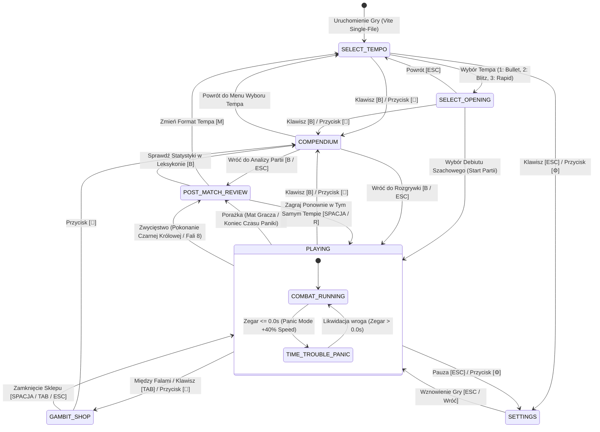

# RFC: Dział V — Spójny Design System UI/UX, Szachowa Analiza Partii i Warstwa „Juiciness”

**Projekt:** Chess Survivors 76 (*Checkmate: Bullet Hell*)  
**Dokument:** `.specs/proposals/domain-5-ui-ux-game-feel.md`  
**Autor:** Zespół AM76 Game Studio (Worker Domain 5)  
**Data:** 2026-10-25  
**Wersja:** 1.0.0 (Status: PROPOSAL / RFC)  
**Metodologia:** TLC Spec-Driven & Standard AM76 GAS Framework  
**Zgodność:** Single-File Mandate (`dist/Index.html`), Canvas 2D Zero-GC at 60/144 FPS, No External Assets  

---

## 1. Cel i Uzasadnienie Projektowe (Design Intent & Rationale)

### 1.1. Wizja Artystyczno-Mechaniczna i Problem Płytkości Ekranu Końcowego
Gry z gatunku roguelite bullet-hell (np. *Vampire Survivors*, *Brotato*, *Nuclear Throne*) opierają się na gęstym, nieprzerwanym strumieniu dopaminowej nagrody, w którym gracz kosi setki wrogów na minutę. Z kolei szachy to kwintesencja chłodnej kalkulacji przestrzennej, turniejowego skupienia, prestiżu oraz szacunku dla każdej straconej i zdobytej bierki.

W tradycyjnych zręcznościówkach roguelite ekran końca partii sprowadza się do lakonicznego podsumowania: „Koniec Gry — Przetrwałeś 4 minuty 12 sekund, zabiłeś 180 wrogów”. W szachach taki komunikat jest całkowicie bezwartościowy i psychologicznie niesatysfakcjonujący. Prawdziwa magia szachów turniejowych oraz platform internetowych (takich jak Chess.com czy Lichess) polega na **pomeczowej analizie partii (Game Review)**:
1. **Poszukiwanie Przyczyny Porażki:** Każda przegrana partia szachowa kryje w sobie moment zwrotny — Kardynalny Błąd (*Blunder* `??`), w którym równowaga runęła. Zrozumienie tego błędu neutralizuje frustrację i buduje motywację do natychmiastowego rozpoczęcia kolejnej partii.
2. **Poczucie Dumy z Genialnego Posunięcia:** Wykonanie w ułamku sekundy ryzykownego manewru pod presją tykającego zegara (Genialny Ruch — *Brilliant Move* `!!`) zasługuje na uwiecznienie w raporcie taktycznym.
3. **Krzywa Przewagi Pozycji i Zegara:** Wizualizacja wahań losów bitwy w postaci wykresu ewaluacji $E(t)$ oraz wskaźnika dokładności gry (CAPS / Accuracy w skali 0–100%) dostarcza graczowi obiektywnego dowodu na rozwój jego kunsztu.

### 1.2. Trzy Filary Działu V
1. **Szachowa Analiza Partii (Post-Match Review Engine):**  
   Przekształcenie każdego ekranu wygranej i porażki w interaktywny debriefing taktyczny. Algorytm w czasie rzeczywistym klasyfikuje zagrania gracza według 7-stopniowej taksonomii arcymistrzowskiej, rysuje ciągły wykres przewagi $E(t)$ z bufora kołowego i wylicza szacowany ranking ELO rozgrywki.
2. **Open Table Design System i Unifikacja Wizualna:**  
   Całkowita eliminacja archaicznych „czarnych pasów” (pillarboxing) poprzez elastyczny viewport 100%, zachowujący nienaruszoną kwadratową geometrię centralnej szachownicy i otaczający ją dynamicznie generowanym stołem z polerowanego drewna i aksamitu. Pełna symetria ergonomiczna pomiędzy precyzyjnym celownikiem myszy na PC a dotykowym interfejsem kciukowym (Auto-Aim + Twin-Stick) na urządzeniach mobilnych.
3. **Warstwa „Juiciness” i Fizyczny Ciężar Rekwizytów (Game Feel):**  
   Przeniesienie haptyki dociążonych ołowiem bierek turniejowych Staunton na ekran komputera: nieliniowy tłumiony screenshake oparty na kwadratowej traumie, mikro-zamrożenia klatek (hitstop 30–120 ms) przy potężnych uderzeniach, dynamiczne odpryski drewnianych włókien, cięcia przekątnych oraz sprężyste unoszące się teksty bojowe (FCT).

```
┌────────────────────────────────────────────────────────────────────────┐
│                   PĘTLA DOŚWIADCZENIA GRACZA (JUICE & REVIEW)          │
└───────────────────────────────────┬────────────────────────────────────┘
                                    │
                                    ▼
                     [ 1. HAPTYCZNA WALKA NA SZACHOWNICY ]
                     • Fizyczny ciężar bierek (hitstop 35-120 ms)
                     • Tłumiony Screen Shake (Trauma^2 * Noise)
                     • Odpryski drewna Staunton i cięcia laserowe
                     • Pływające teksty bojowe (FCT Spring Pop)
                                    │
                                    ▼
                     [ 2. SYGNAŁY TAKTYCZNE W LOCIE ]
                     • Złote rozbłyski przy En Passant Parry (!!)
                     • Czerwone alarmy przy wejściu w telegraf Wieży (??)
                     • Ciągłe próbkowanie do bufora kołowego 1.0 Hz
                                    │
                                    ▼
                     [ 3. POMECZOWY RAPORT ARCYMISTRZA ]
                     • Dynamiczny pionowy Eval Bar (+10.0 do -10.0)
                     • Wykres przewagi E(t) z osią czasu partii
                     • Dokładność CAPS (0-100%) i Performance ELO
                     • Klikalna lista Kluczowych Momentów partii
                                    │
                                    ▼
                     [ 4. LEKSYKON ARCYMISTRZA (COMPENDIUM) ]
                     • Analiza bierek, debiutów, fuzji i bestiariusza
                     • Wirtualizowana lista Canvas 2D (Zero-GC)
                     • Proceduralny podgląd 2D bierek na żywo
                                    │
                                    ▼
                     [ 5. NATYCHMIASTOWY REWANŻ (ONE-MORE-RUN) ]
```

---

## 2. Szczegółowe Mechaniki z Konkretnymi Wartościami Liczbowymi i Wzorami Balansu

### 2.1. Szachowa Analiza Partii po Wygranej/Przegranej (Post-Match Game Review)

#### 2.1.1. Taksonomia Ocen Ruchów w Stylu Chess.com
W trakcie walki silnik analizy rejestruje decyzje taktyczne gracza w oknach czasowych o długości $\Delta t = 1.0\text{ s}$ oraz natychmiastowe reakcje na zdarzenia krytyczne. Każde znaczące zdarzenie bojowe zostaje sklasyfikowane według poniższej taksonomii:

| Symbol | Nazwa Oceny | Kolor UI | Warunki Detekcji w Czasie Rzeczywistym | Waga CAPS ($w_i$) | Wpływ na $E(t)$ | Dźwięk & Efekt Wizualny |
| :---: | :--- | :---: | :--- | :---: | :---: | :--- |
| **`!!`** | **Genialny Ruch** *(Brilliant)* | `#ffd700` (Złoto) | 1. Wykonanie *En Passant Parry* pocisku wroga, gdy zegar gracza $C(t) < 1.0\text{ s}$.<br>2. Likwidacja $\ge 3$ elitarnych bierek w trakcie jednego zrywu (Dash/Szarża Wieży/Skok Skoczka).<br>3. Perfekcyjna Roszada omijająca śmiertelny promień lasera przy $1\text{ HP}$. | $+100$ | $+2.00$ | Dźwięk `CHIME_BRILLIANT`, złoty promień cząsteczek, FCT `!! GENIALNY` w skali $1.5\times$. |
| **`!`** | **Świetny Ruch** *(Great)* | `#00e5ff` (Cyjan) | 1. Trafienie krytyczne w słaby punkt bossa (plecy Czarnej Wieży lub odsłonięty Czarny Król).<br>2. Zniszczenie $\ge 6$ wrogich pionków pojedynczą wiązką lasera Gońca pod kątem $45^\circ$ (bonus przekątnej). | $+85$ | $+1.20$ | Dźwięk `CHIME_GREAT`, błękitny rozbłysk cząsteczek cięcia. |
| **`★`** | **Najlepszy Ruch** *(Best)* | `#55ff99` (Szmaragd) | 1. Zlikwidowanie telegrafującego wroga w oknie $< 0.35\text{ s}$ przed oddaniem przez niego strzału.<br>2. Zebranie czarnego żetonu dającego natychmiastowy przyrost zegara w stanie Time Trouble. | $+70$ | $+0.75$ | Dźwięk `DGT_CLICK_CRISP`, zielony znacznik FCT. |
| **`✓`** | **Dobry Ruch** *(Good)* | `#e0e0e0` (Biel) | 1. Wyeliminowanie standardowej bierki wroga bez odniesienia jakichkolwiek obrażeń w oknie $2.5\text{ s}$.<br>2. Poprawne repozycjonowanie zrywem z dala od strefy telegrafu obszarowego AoE. | $+50$ | $+0.30$ | Cichy stuk drewna `WOOD_MOVE`. |
| **`?!`** | **Niedokładność** *(Inaccuracy)* | `#ffcc00` (Żółty) | 1. Zużycie ładunku Dasha w pustą przestrzeń bez uniku pocisku i bez zadania obrażeń.<br>2. Wystrzelenie całej serii pocisków w niezniszczalną ścianę aren lub w pancerz czołowy Wieży. | $+25$ | $-0.40$ | Dźwięk szmeru, żółty znacznik FCT. |
| **`?`** | **Błąd** *(Mistake)* | `#ff8800` (Pomarańcz) | 1. Otrzymanie trafienia od pojedynczego, wolnego pocisku pionka przy wolnej przestrzeni do uniku.<br>2. Dopuszczenie do spadku zegara szachowego poniżej $3.0\text{ s}$ bez podjęcia walki. | $+5$ | $-1.10$ | Niski ton ostrzegawczy, lekki wstrząs kamery ($\Delta \text{Trauma} = 0.15$). |
| **`??`** | **Kardynalny Błąd** *(Blunder)* | `#ff2244` (Karmazyn) | 1. Bezpośrednia szarża czołowa w niezniszczalną tarczę Czarnej Wieży (kara odrzutu i ogłuszenia).<br>2. Uwięzienie w rogu szachownicy podczas szarży Czarnego Króla lub lasera Bliźniaczych Wież.<br>3. Śmierć (Mat) posiadając w zapasie $\ge 1$ ładunek Roszady lub gotowy Dash. | $0$ | $-2.50$ | Niski dysonans basowy, mocny wstrząs ($\Delta \text{Trauma} = 0.60$), czerwony wskaźnik FCT. |

#### 2.1.2. Wykres Przewagi Zegarowej i Funkcja Ewaluacji $E(t)$
Wykres oceny partii oparty jest na ciągłej funkcji ewaluacji pozycji $E(t)$, odwzorowującej szachowy pasek przewagi silnika (Eval Bar):

$$E(t) = \text{clamp}\left( 4.0 \cdot \frac{C(t) - C_{\text{target}}}{C_{\max}} + 3.0 \cdot \left(\frac{HP(t)}{HP_{\max}} - 0.5\right) \cdot 2.0 - 2.5 \cdot \frac{\text{ThreatScore}(t)}{\text{Threat}_{\max}} + \text{TacticalMomentum}(t), -10.0, 10.0 \right)$$

Gdzie parametry wejściowe przyjmują wartości:
- $C(t)$: aktualny stan zegara gracza w sekundach.
- $C_{\text{target}}$: wartość bazowa równowagi zegarowej zależna od wybranego tempa ($12.0\text{ s}$ dla Rapid, $8.0\text{ s}$ dla Blitz, $4.0\text{ s}$ dla Bullet).
- $C_{\max}$: maksymalna dopuszczalna pojemność zegara w danym formacie (np. $30.0\text{ s}$).
- $HP(t) / HP_{\max}$: stosunek aktualnego zdrowia gracza do zdrowia maksymalnego.
- $\text{ThreatScore}(t) = \sum_{i=1}^{K} w_{\text{enemy}}(i)$: ważona suma aktywnych wrogów na szachownicy:
  - Pionek: $w = 1.0$
  - Skoczek: $w = 2.8$
  - Goniec: $w = 3.2$
  - Wieża / Elita: $w = 5.5$
  - Boss (Król, Królowa, Arbiter): $w = 14.0$
  - $\text{Threat}_{\max} = 28.0$ (wartość nasycenia zagrożenia).
- $\text{TacticalMomentum}(t)$: chwilowy impuls taktyczny z ostatnich $2.5\text{ s}$ walki:
  $$\text{TacticalMomentum}(t) = \sum_{j} \Delta E_j \cdot e^{-(t - t_j) / 1.2}$$
  gdzie $\Delta E_j$ to wartość wpływu z tabeli taksonomii (np. $+2.0$ za ruch `!!`, $-2.5$ za ruch `??`).

#### 2.1.3. Architektura Pamięciowa Zero-GC: `EvalRingBuffer`
W trakcie trwania partii próbkowanie stanu gry odbywa się bezwzględnie co $1.0\text{ s}$.
Aby nie obciążać odśmiecacza pamięci (Garbage Collector) oraz uniknąć nadpisywania fazy debiutu w długich partiach formatu Rapid (do 12 minut), dane zapisywane są do wstępnie zaalokowanej, płaskiej tablicy typowanej `Float32Array(2880)` (koszt zaledwie 11.52 KB RAM):

```javascript
// Stała alokacja przy starcie silnika: 720 sekund (12 minut partii) x 4 kanały = 2880 elementów (11.52 KB RAM)
export class EvalRingBuffer {
  constructor(capacitySeconds = 720) {
    this.capacity = capacitySeconds;
    this.buffer = new Float32Array(capacitySeconds * 4);
    this.count = 0;
    this.writeIndex = 0;
  }

  reset() {
    this.count = 0;
    this.writeIndex = 0;
    this.buffer.fill(0);
  }

  push(timeSec, evalScore, clockDelta, moveFlag) {
    const idx = (this.writeIndex % this.capacity) * 4;
    this.buffer[idx + 0] = timeSec;     // [0] Czas od startu w sekundach
    this.buffer[idx + 1] = evalScore;   // [1] Wartość E(t) w przedziale [-10.0, 10.0]
    this.buffer[idx + 2] = clockDelta;  // [2] Zmiana zegara w ostatniej sekundzie (+/- sekundy)
    this.buffer[idx + 3] = moveFlag;    // [3] Kod taksonomii (0: Brak, 1: !!, 2: !, 3: ★, 4: ✓, 5: ?!, 6: ?, 7: ??)
    this.writeIndex++;
    if (this.count < this.capacity) this.count++;
  }

  _actualIdx(i) {
    const startIdx = this.count < this.capacity ? 0 : (this.writeIndex % this.capacity);
    return ((startIdx + i) % this.capacity) * 4;
  }

  // Bezpośrednie akcesory skalarne Zero-GC eliminujące mutację współdzielonej referencji (VULN-D5-01 fix)
  getSampleTime(i)       { return this.buffer[this._actualIdx(i) + 0]; }
  getSampleEval(i)       { return this.buffer[this._actualIdx(i) + 1]; }
  getSampleClockDelta(i) { return this.buffer[this._actualIdx(i) + 2]; }
  getSampleFlag(i)       { return this.buffer[this._actualIdx(i) + 3]; }
}
```

#### 2.1.4. Dynamiczny Pasek Oceny Pozycji (Eval Bar)
Pasek ewaluacji renderowany jest na lewej krawędzi panelu analitycznego.
1. **Wygładzanie interpolacyjne (Spring Damping / Exponential Smoothing):**
   Wartość wyświetlana $E_{\text{vis}}$ dąży do wartości docelowej $E(t)$ zgodnie z formułą:
   $$E_{\text{vis}}(t + \Delta t) = E_{\text{vis}}(t) + (E(t) - E_{\text{vis}}(t)) \times (1.0 - e^{-9.0 \cdot \Delta t})$$
2. **Sigmoidalne mapowanie wysokości paska (Chess Sigmoid):**
   W profesjonalnych programach szachowych przewaga $+5.0$ nie oznacza $50\%$ paska, lecz niemal całkowitą wygraną. Stosujemy znormalizowaną funkcję logistyczną:
   $$\text{Ratio}_{\text{White}} = \frac{1.0}{1.0 + 10.0^{-E_{\text{vis}} / 4.5}}$$
   - Przy $E = 0.0$: $\text{Ratio} = 0.50$ (idealna równowaga 50/50).
   - Przy $E = +4.5$: $\text{Ratio} = 0.909$ (90.9% białego paska — miażdżąca przewaga gracza).
   - Przy $E = -4.5$: $\text{Ratio} = 0.091$ (9.1% białego paska — skrajna dominacja czarnych).
   - Przy $E \ge +9.5$: Etykieta paska zmienia się na `+M` (Forsowny Mat gracza).
   - Przy $E \le -9.5$: Etykieta paska zmienia się na `-M` (Nieuchronny Mat czarnych).

#### 2.1.5. Formuła Dokładności Partii (Accuracy / CAPS Score)
Końcowa ocena dokładności partii wyrażana jest w procentach ($0.0\%\text{--}100.0\%$):
$$\text{RawAccuracy} = \frac{\sum_{k} w_k \cdot N_k}{N_{\text{total}}}$$
Gdzie $w_k$ to wagi jakości zagrań ($100$ dla `!!`, $85$ dla `!`, $70$ dla `★`, $50$ dla `✓`, $25$ dla `?!`, $5$ dla `?`, $0$ dla `??`), a $N_{\text{total}} = \sum N_k$.
Wartość skorygowana o czas spędzony w trybie Niedoczasu (Time Trouble Panic Penalty, z zabezpieczeniem przed dzieleniem przez zero dla natychmiastowej śmierci w fali 1):
$$\text{PanicRatio} = \begin{cases} \frac{T_{\text{panic}}}{T_{\text{total}}} & \text{jeśli } T_{\text{total}} > 0 \\ 0.0 & \text{w p.p.} \end{cases}$$
$$\text{Accuracy} = \text{clamp}\left( \text{RawAccuracy} \times \left(1.0 - 0.20 \cdot \text{PanicRatio}\right) + \text{BonusBossKill}, 10.0, 99.8 \right)$$
Gdzie $\text{BonusBossKill} = +5.0\%$ przy pokonaniu Czarnego Króla lub Królowej.

Szacowany ranking partii (Performance ELO zbalansowany skalą FIDE):
$$\text{PerformanceELO} = \text{round}\left( 800 + (\text{Accuracy} - 10.0) \times 9.0 + \text{WaveReached} \times 40 + \text{TempoMultiplier} \right)$$
Wartości $\text{TempoMultiplier}$:
- Rapid: $+0\text{ ELO}$
- Blitz: $+140\text{ ELO}$
- Bullet: $+280\text{ ELO}$

---

### 2.2. Encyklopedia Bierek, Debiutów i Perkówek (Compendium)

#### 2.2.1. Specyfikacja Merytoryczna 5 Zakładek
Compendium stanowi kompendium wiedzy taktycznej dostępnej w grze w stanach: menu główne, wybór tempa, sklep gambitu oraz pauza, wywoływane klawiszem `B` (Book) lub przyciskiem `📖` w HUD.

##### Zakładka 1: Bierki Gracza (Player Pieces)
Zawiera kompletne profile bierek z dokładnymi wartościami bojowymi:
- **Pionek (Pawn):** HP: 3 serduszka | Promień: 13 px | Prędkość: 185 px/s | Szybkostrzelność: 2.2 strz/s | Obrażenia: 1 | Zdolność: En Passant Dash (zasięg 130 px, niszczy pociski na drodze) | Pasywka: Awans po zebraniu żetonów.
- **Skoczek (Knight):** HP: 4 serduszka | Promień: 15 px | Prędkość: 215 px/s | Szybkostrzelność: 1.6 strz/s | Obrażenia: 2 (podkowy) | Zdolność: Skok L-kształtny (nietykalność w powietrzu, fala uderzeniowa 85 px przy lądowaniu) | Pasywka: Widełki Skoczka (+50% obrażeń gdy razi $\ge 2$ wrogów).
- **Goniec (Bishop):** HP: 3 serduszka | Promień: 14 px | Prędkość: 195 px/s | Szybkostrzelność: 1.2 strz/s | Obrażenia: 3 | Zdolność: Przekątna Wiązka Laserowa (przebija wszystkich wrogów na linii) | Pasywka: Snajper Przekątnych (+35% obrażeń pod kątem $\pm 45^\circ$).
- **Wieża (Rook):** HP: 6 serc | Promień: 17 px | Prędkość: 160 px/s | Szybkostrzelność: 0.9 strz/s | Obrażenia: 5 | Zdolność: Taran Bojowy (błyskawiczna szarża w linii prostej z odrzutem wrogów) | Pasywka: Pancerz Czołowy (pochłania 3 trafienia czołowe bez utraty HP).
- **Hetman (Queen):** HP: 5 serc | Promień: 16 px | Prędkość: 230 px/s | Szybkostrzelność: 2.8 strz/s | Obrażenia: 4 | Zdolność: Królewski Majestat (3.5 s ciągłego ostrzału 8-kierunkowego) | Pasywka: Wszechwładza (zwiększony zasięg zbierania żetonów o +80%).

##### Zakładka 2: Debiuty Szachowe (Chess Openings)
6 turniejowych zestawów startowych definiujących styl gry i synergie:
1. **Obrona Sycylijska (Sicilian Defence):** Styl agresywny kontratak. Zegar bazowy $-20\%$, Prędkość ruchu $+18\%$, start ze sztyletem pionkowym. Synergia: `[SZARŻA]`, `[TAKTYKA]`.
2. **Gambit Królowej (Queen's Gambit):** Styl ekonomiczny. Start z $+6$ żetonami gambitu i darmowym perkiem Poświęcenia. Synergia: `[TAKTYKA]`, `[MANEWR]`.
3. **Partia Włoska (Giuoco Piano):** Styl zrównoważony. $+1$ serce bazowe, cooldown zdolności specjalnej $-15\%$. Synergia: `[GEOMETRIA]`, `[MANEWR]`.
4. **Obrona Królewsko-Indyjska (King's Indian):** Styl defensywno-bunkrowy. Pancerz redukujący co 4. obrażenie do zera, fala uderzeniowa przy stracie HP. Synergia: `[GEOMETRIA]`, `[SZARŻA]`.
5. **Partia Hiszpańska — Ruy Lopez:** Styl snajperski dalekiego zasięgu. Pociski mają o $+30\%$ większy zasięg i przebijają 1 cel. Synergia: `[GEOMETRIA]`, `[TAKTYKA]`.
6. **Obrona Francuska (French Defence):** Styl twardej struktury. Zmniejszony odrzut od ciosów o $70\%$, wydłużony czas trwania nietykalności po trafieniu do $1.2\text{ s}$. Synergia: `[SZARŻA]`, `[MANEWR]`.

##### Zakładka 3: Perki Gambitu (Gambit Perks & Passives)
Tabela 12 perków z dokładnymi formułami matematycznymi:
- **Widełki Skoczka (Knight's Fork):** T1-3 | Koszt: 3/5/8 żetonów | Efekt: Trafienie wroga tworzy 2/3/4 odłamki raniące sąsiednie cele za $40\%$ obrażeń bazowych.
- **Związanie (Pinning):** T1-3 | Koszt: 4/6/9 żetonów | Efekt: Pociski spowalniają wrogów o 30%/45%/60% na $1.8\text{ s}$.
- **Poświęcenie Pionka (Pawn Sacrifice):** T1-3 | Koszt: 3/5/7 żetonów | Efekt: Otrzymanie obrażeń wywołuje eksplozję AoE o promieniu 90 px zadającą $15 \times \text{Tier}$ obrażeń.
- **Polerowane Drewno (Polished Wood):** T1-3 | Koszt: 2/4/6 żetonów | Efekt: Prędkość poruszania $+10\% / +18\% / +25\%$.
- **Ołowiany Ciężarek (Lead Core):** T1-3 | Koszt: 3/5/8 żetonów | Efekt: Odrzut wrogów przy trafieniu $+35\% / +65\% / +100\%$.
- **Roszada (Castling):** T1 (Aktywny pod [E]) | Koszt: 6 żetonów | Efekt: Natychmiastowa zamiana miejsc ze skrajną krawędzią szachownicy z czyszczeniem pocisków w promieniu 120 px. Cooldown: $14.0\text{ s}$.
- **Okrzyk „Szach!” (Check Shout):** T1 (Aktywny pod [E]) | Koszt: 5 żetonów | Efekt: Fala paraliżująca wszystkich wrogów na szachownicy na $1.5\text{ s}$. Cooldown: $18.0\text{ s}$.
- **Rekonstrukcja Drewna (Wood Repair):** Jednorazowy | Koszt: 4 żetony | Efekt: Uleczenie $+2$ utraconych serduszek.
- **Zegarowy Zryw (Clock Rush):** T1-3 | Koszt: 3/6/9 żetonów | Efekt: Likwidacja wroga dodaje $+0.2\text{ s} / +0.4\text{ s} / +0.6\text{ s}$ do zegara szachowego.
- **Promocja Pola (Field Promotion):** T1-2 | Koszt: 5/9 żetonów | Efekt: Ostatni rząd szachownicy staje się strefą promocji — przebywanie tam podwaja szybkostrzelność.
- **Furtka Królewska (Luft):** T1-2 | Koszt: 4/7 żetonów | Efekt: Rogi szachownicy posiadają portale teleportujące gracza na przeciwległy róg.
- **Płynny Gambit (Fluid Tactics):** T1-3 | Koszt: 4/6/8 żetonów | Efekt: Hiperboliczna redukcja cooldownu zdolności: $CD = CD_0 / (1 + 0.15 \cdot \text{Tier})$.

##### Zakładka 4: Fuzje i Ewolucje Bierek (Hybrid Fusions)
- **Cesarka (Empress):** Skoczek + Wieża. Koszt: 12 żetonów. Artyleryjski skok taranujący z falą uderzeniową w punkcie lądowania, pociski przebijają 2 wrogów, odporność na kolizję z przeszkodami.
- **Kardynał (Cardinal):** Skoczek + Goniec. Koszt: 12 żetonów. Skok ze snajperską siatką laserową aktywowaną w miejscu lądowania, strzały odbijają się od band szachownicy pod kątem $90^\circ$.
- **Amazonka (Amazon):** Hetman + Skoczek. Koszt: 20 żetonów. Wszechkierunkowy promień zniszczenia, nietykalność w trakcie skoku, ignorowanie pancerza bossów.
- **Centaur (Pegasus):** Skoczek + Pionek Awansowany. Koszt: 8 żetonów. Bardzo szybka lekka jazda z automatycznym tratowaniem pionków wroga przy kontakcie fizycznym.

##### Zakładka 5: Bestiariusz i Bossowie (Bestiary Lore & Encounters)
- **Czarny Pionek:** HP: 3 | Prędkość: 75 px/s | Zachowanie: Marsz na gracza, strzał pojedynczy co $2.2\text{ s}$.
- **Czarny Skoczek Chaosu:** HP: 8 | Prędkość: 110 px/s | Zachowanie: Telegraf cienia przez $0.65\text{ s}$, wysoki skok ponad pociskami i impakt obszarowy.
- **Czarny Goniec Przekątnych:** HP: 6 | Prędkość: 85 px/s | Zachowanie: Snajper utrzymujący dystans, czerwona wiązka telegrafu laserowego przez $0.9\text{ s}$, strzał wzdłuż przekątnych.
- **Czarna Wieża Buggernaut:** HP: 22 | Prędkość: 45 px/s (szarża: 340 px/s) | Zachowanie: Niezniszczalny front tarczy, rykoszety pocisków gracza, szarża korytarzowa po linii prostej.
- **Czarny Król (Faza 1):** HP: 120 | Osłona: 4 tarcze orbitalne | Zachowanie: Przyzywanie fal posiłków, salwy pocisków radialnych.
- **Czarny Król (Faza 2 Endgame):** HP: 80 | Prędkość: 165 px/s | Zachowanie: Berserk po zniszczeniu tarcz, szarże z uderzeniami buławą, kruszenie krawędzi pól szachownicy.
- **Zegarowy Arbiter (Boss):** HP: 160 | Zachowanie: Zatrzymanie upływu czasu na $2.0\text{ s}$, zakrzywianie trajektorii pocisków w łuk, manipulacja zegarem gracza.
- **Ręka Arcymistrza (Finałowy Boss):** HP: 240 | Zachowanie: Gigantyczna ręka unosząca się nad szachownicą; uderza pięścią krusząc pola $2\times 2$, przesuwa całe rzędy figur i generuje fale uderzeniowe.

#### 2.2.2. Wirtualizacja Listy w Canvas 2D Bez Narzutu DOM
Wirtualizacja lewej kolumny leksykonu eliminuje tworzenie elementów HTML `<div>`:
- Wysokość pojedynczego wiersza: $h_{\text{item}} = 38\text{ px}$.
- Liczba jednocześnie widocznych pozycji: $K_{\text{visible}} = \min(N, \lfloor \text{PanelHeight} / h_{\text{item}} \rfloor)$.
- Współrzędna przewijania: `scrollOffset` (zmienna zmiennoprzecinkowa).
- Zakres renderowania klatkowego:
  $$i_{\text{start}} = \max\left(0, \lfloor \text{scrollOffset} / h_{\text{item}} \rfloor\right)$$
  $$i_{\text{end}} = \min\left(N - 1, i_{\text{start}} + K_{\text{visible}} + 1\right)$$
- Przesunięcie lokalne:
  $$y_{\text{render}}(i) = y_{\text{list\_top}} + i \cdot h_{\text{item}} - \text{scrollOffset}$$
- Fizyka bezwładności dotykowej (Kinetic Touch Scroll):
  $$\text{scrollVelocity}_{t+\Delta t} = \text{scrollVelocity}_t \times 0.92$$
  $$\text{scrollOffset} = \text{clamp}(\text{scrollOffset} + \text{scrollVelocity} \cdot \Delta t, 0, \text{maxScroll})$$
- Scrollbar Canvas: pionowy suwak o dynamicznym rozmiarze kciuka:
  $$\text{ThumbHeight} = \max\left(24, \frac{\text{ViewHeight}}{\text{ContentHeight}} \times \text{TrackHeight}\right)$$

#### 2.2.3. Proceduralny Podgląd Graficzny Bierek z Użyciem `sprites.js`
Karta szczegółowa po prawej stronie zawiera interaktywne okno podglądu figury:
- Podgląd wykorzystuje istniejące procedury proceduralne `drawChessPiece`, `drawPawnPiece`, `drawKnightPiece`, `drawBishopPiece` z modułu `src/sprites.js`.
- Brak zewnętrznych grafik `.png` — 100% Canvas 2D.
- Dynamiczna animacja oddechu i lewitacji:
  $$y_{\text{preview}} = y_0 + \sin(t_{\text{game}} \times 2.6) \times 5.0\text{ px}$$
  $$\text{scaleX}_{\text{preview}} = 1.6 \times \cos(t_{\text{game}} \times 1.2)$$
  $$\text{scaleY}_{\text{preview}} = 1.6$$
- Owalny cień z dynamicznym skalowaniem promienia:
  $$r_{\text{shadow}} = 22.0 \times (1.0 - 0.15 \cdot \sin(t_{\text{game}} \times 2.6))$$
- Cokół podglądu: podwójny obrys w barwach `theme.boardFrameInner` z proceduralnym blaskiem `drawFauxGlow`.

---

### 2.3. Open Table Design System i Unifikacja Wizualna

#### 2.3.1. Zasada Elastycznego Viewportu 100% i Dynamicznego Stołu Szachowego
Zgodnie z decyzją architektoniczną AD-001 ze `STATE.md`, gra eliminuje statyczny kwadrat o proporcjach 4:3 otoczony czarną pustką. Viewport gry dynamicznie dopasowuje się do okna przeglądarki (`window.innerWidth`, `window.innerHeight`), zachowując przy tym ścisłą integralność geometrii szachownicy:
1. **Kwadrat szachownicy ($8 \times 8$):**
   Rozmiar boku $S_{\text{board}}$ obliczany jest tak, aby zapewnić marginesy na elementy HUD i ramę stołu:
   $$S_{\text{board}} = \min\left( \text{floor}\left(\frac{W - 2 \cdot M_x}{8}\right), \text{floor}\left(\frac{H - 2 \cdot M_y}{8}\right) \right) \times 8$$
   Gdzie $M_x, M_y$ to bezpieczne strefy marginesów ($16\text{--}32\text{ px}$).
2. **Otaczający Stół Szachowy (The Open Table):**
   Przestrzeń poza kwadratem $S_{\text{board}}$ wypełniana jest proceduralnym tłem stołu turniejowego:
   - Wielowarstwowy gradient radialny imitujący oświetlenie lampy klubowej nad szachownicą:
     `ctx.createRadialGradient(W/2, H/2, S_board * 0.35, W/2, H/2, Math.max(W, H) * 0.75)`.
   - Frezowana drewniana rama z oznaczeniami współrzędnych algebraicznych szachownicy (linie A–H, rzędy 1–8) rysowanymi bezpośrednio w Canvas 2D.
   - Boczne strefy (skrzydełka panoramiczne) wykorzystywane do prezentacji panelu informacji gracza, cmentarzyka zbitych bierek oraz wskaźników aktywnych synergii.

#### 2.3.2. Matematyka Skalowania Responsywnego i Dualizm Sterowania (PC vs Mobile)
System automatycznie dopasowuje gęstość i pozycję elementów do proporcji ekranu i rodzaju wskaźnika:
- **Współczynnik skalowania czcionek i ikon:**
  $$\text{fontScale} = \text{clamp}\left( \min\left(\frac{W}{900}, \frac{H}{680}\right), 0.80, 1.18 \right)$$
- **Macierz Kotwiczenia HUD (Anchor System):**
  - **Kotwica Top-Center:** Zegar szachowy, stan Time Trouble i pasek postępu fali.
    Szerokość zegara: $W_{\text{clock}} = \min(250 \cdot \text{fontScale}, W - 24)$.
  - **Kotwica Top-Left:** Wizytówka aktywnej figury, serduszka życia, ładunki tarczy Wieży (`rookShieldCharges`), wskaźnik gotowości Zrywu [SPACJA].
  - **Kotwica Top-Right:** Liczniki fali, zbić, żetonów gambitu oraz pasek szybkich przycisków funkcyjnych (Sklep `🛒`, Opcje `⚙`, Cel `🎯`, Styl `🎨`, Księga `📖`).
  - **Kotwica Dolna (Bottom Anchor / Mobile Thumb Zone):**
    Gdy wykryty zostanie dotyk (`input.touchActive || input.isTouchDevice`) lub proporcje ekranu są pionowe ($H > W$):
    - Lewa strefa dotykowa ($0\%\text{--}52\% W$): Pływający wirtualny joystick ruchu pojawiający się dynamicznie pod kciukiem.
    - Prawa strefa dotykowa ($48\%\text{--}100\% W$): Dedykowane przyciski dotykowe o wysokim kontraście i promieniu dotykowym $R \ge 34\text{ px}$:
      - Przycisk `DASH / ZRYW` ($R = 36\text{ px}$, kolor `theme.uiAccent`).
      - Przycisk `GAMBIT / E` ($R = 28\text{ px}$, kolor `#55ff99`).
      - Przycisk `SKLEP / TAB` ($R = 26\text{ px}$).
    - Przy aktywnym trybie Twin-Stick: Prawa strefa aktywuje prawy pływający drążek celowniczy.

#### 2.3.3. Spójna Paleta Barw i Hierarchia Typograficzna
Wszystkie ekrany gry (Menu Wyboru Tempa, Sklep Gambitu, Ustawienia, Compendium, Post-Match Review) korzystają z ujednoliconej palety barw:

| Nazwa Koloru | Wartość HEX | Zastosowanie w Interfejsie |
| :--- | :---: | :--- |
| **Staunton Maple** | `#d8b88d` | Jasne pola szachownicy, jasne elementy rzeźbionych figur, etykiety podstawowe. |
| **Staunton Walnut** | `#784824` | Ciemne pola klasycznej szachownicy, profile cieni, akcenty drewniane. |
| **Staunton Mahogany** | `#2c1b10` | Zewnętrzna frezowana rama stołu szachowego, obramowania kart informacyjnych. |
| **Obsidian Dark** | `#09090d` | Tło stołu szachowego, głębokie podłoże modali (`rgba(9, 9, 13, 0.90)`). |
| **Obsidian Panel** | `#161622` | Wypełnienie kart wyboru, tło wierszy w leksykonie, obramowania przycisków. |
| **Gold Amber** | `#ffd700` | Akcenty arcymistrzowskie, genialne ruchy `!!`, żetony gambitu, trofea z bossów. |
| **Checkmate Crimson** | `#ff2244` | Stan Niedoczasu (Time Trouble), pasek zdrowia bossa, błędy kardynalne `??`. |
| **Grandmaster Cyan** | `#00e5ff` | Świetne ruchy `!`, ładunki tarczy Wieży, poświata stylu Cyber-Grid. |
| **Emerald Promotion** | `#55ff99` | Najlepsze ruchy `★`, wskaźniki gotowości zdolności specjalnych, leczenie. |

---

### 2.4. Warstwa „Juiciness” i Game Feel (AM76 Signature Polish)

#### 2.4.1. Fizyka Tłumionego Screenshake (Trauma Decay Model)
Zamiast prymitywnego losowania `Math.random()` wstrząsy kamery implementują nieliniową traumę wygaszaną wykładniczo:
$$\text{Trauma}_{t+\Delta t} = \max(0, \text{Trauma}_t - \Delta t \times 1.8)$$
Zmienna $\text{Trauma} \in [0.0, 1.0]$. Rzeczywista energia wstrząsu rośnie kwadratowo, co gwarantuje subtelność przy małych trafieniach i potężny impakt przy eksplozjach:
$$\text{Intensity} = \text{Trauma}^2$$
Przesunięcia kamery wyliczane są za pomocą nieliniowych funkcji harmonicznych o niewspółmiernych częstotliwościach:
$$\text{Offset}_x = \text{Intensity} \times \text{MaxShake} \times \sin(t_{\text{sec}} \times 45.0)$$
$$\text{Offset}_y = \text{Intensity} \times \text{MaxShake} \times \cos(t_{\text{sec}} \times 37.0)$$
$$\text{Angle} = \text{Intensity} \times 0.024 \times \sin(t_{\text{sec}} \times 31.0)$$

W celu wyeliminowania obcinania krawędzi canvasu (canvas boundary clipping) i odsłaniania czarnej pustki poza frezowaną ramą stołu szachowego, parametr $\text{MaxShake}$ jest adaptacyjnie zaciskany do marginesu stołu:
$$\text{MaxShake} = \min\left(22.0\text{ px}, \, \max(4.0, \min(M_x, M_y) - 4.0\text{ px})\right)$$
Zmienna traumy przy dowolnym impulsie jest rygorystycznie zaciskana: $\text{Trauma} = \min(1.0, \max(0.0, \text{Trauma} + \Delta \text{Trauma}))$.

Procedura Zero-GC wykorzystuje prealokowany obiekt stanu kamery:
```javascript
const cameraShakeState = { offsetX: 0, offsetY: 0, angle: 0 };

export function computeTraumaShake(trauma, timeSec, marginX, marginY, out = cameraShakeState) {
  const intensity = Math.min(1.0, Math.max(0.0, trauma)) ** 2;
  const maxShake = Math.max(4.0, Math.min(22.0, Math.min(marginX, marginY) - 4.0));
  out.offsetX = intensity * maxShake * Math.sin(timeSec * 45.0);
  out.offsetY = intensity * maxShake * Math.cos(timeSec * 37.0);
  out.angle = intensity * 0.024 * Math.sin(timeSec * 31.0);
  return out;
}
```

#### 2.4.2. Matryca Hitstopu (Micro-Freeze Matrix)
W momencie silnego uderzenia silnik wstrzymuje aktualizację logiki ruchu i fizyki na określony czas $T_{\text{hitstop}}$, kontynuując płynne renderowanie i animację cząsteczek. Daje to fizyczne wrażenie gęstości i odporności uderzanego materiału:

| Zdarzenie Bojowe na Szachownicy | $\Delta \text{Trauma}$ | Czas Hitstopu ($T_{\text{hitstop}}$) | Generowane Cząsteczki |
| :--- | :---: | :---: | :--- |
| Trafienie pociskiem w pionka | $+0.06$ | $0\text{ ms}$ | 2 odpryski drewna |
| Zniszczenie wrogiego pionka | $+0.20$ | $35\text{ ms}$ | 6 wiórów drewna + 4 iskry |
| Likwidacja elity (Goniec / Skoczek) | $+0.40$ | $55\text{ ms}$ | 12 wiórów drewna + rozbłysk pierścienia |
| Szarża Wieży i uderzenie w bandę | $+0.48$ | $65\text{ ms}$ | 16 odłamków marmuru + fala uderzeniowa |
| Wykonanie En Passant Parry pocisku | $+0.35$ | $70\text{ ms}$ | 20 radialnych iskier parowania |
| Otrzymanie obrażeń przez gracza | $+0.65$ | $75\text{ ms}$ | Czerwony rozbłysk ekranu + 8 odłamków |
| Pokonanie Bossa (Czarny Król / Królowa) | $+0.85$ | $90\text{ ms}$ | Eksplozja 48 odłamków + pierścień uderzeniowy |
| Uderzenie Ręki Arcymistrza w stół | $+1.00$ | $120\text{ ms}$ | Kruszenie krawędzi + 32 odłamki |

#### 2.4.3. Pula Cząsteczek i Odłamków (Zero-GC Particle Systems)
Wstępnie zaalokowana pula `FixedPool(640)` cząsteczek w module `src/pool.js` obsługuje 4 proceduralne modele cząsteczkowe:
1. **Odpryski Drewna (`wood_splinters`):**
   - Kształt: wydłużone prostokąty o proporcjach $3:1$ do $5:1$ (szerokość $2\text{--}4\text{ px}$, długość $8\text{--}16\text{ px}$).
   - Fizyka: prędkość początkowa $v_0 \in [120, 280]\text{ px/s}$, opór powietrza $v_{x,y} \times 0.92$, grawitacja stołowa $g = 360\text{ px/s}^2$, prędkość rotacji $\omega \in [-20, 20]\text{ rad/s}$.
   - Kolorystyka: losowana z palety dębowo-orzechowej (`#d8b88d`, `#b58863`, `#784824`).
2. **Cząsteczki Cięcia Przekątnych (`slicing_slashes`):**
   - Kształt: dynamiczne linie świetlne rysowane wzdłuż wektora ataku lasera Gońca lub Hetmana.
   - Zanikanie: $\alpha(t) = (1.0 - t / t_{\max})^2$, szerokość linii malejąca z $4\text{ px}$ do $0.5\text{ px}$.
3. **Iskry Parowania En Passant (`parry_sparks`):**
   - Emisja radialna w stożku $\pm 45^\circ$ względem wektora odbijanego pocisku.
   - Prędkość wysoka: $v \in [300, 480]\text{ px/s}$, czas życia $0.20\text{ s}$, kolor biały z poświatą błękitną.
4. **Pył Kredowy i Neonowe Spikes:**
   - Dedykowane dla stylów Blackboard (subtelnie rozszerzające się koła kredowe o malejącym kryciu) oraz Cyber-Grid (pikselowe kwadraty neonowe).

#### 2.4.4. Pływające Teksty Bojowe (Floating Combat Text - FCT)
Pula `FixedPool(64)` obsługuje dynamiczne napisy unoszące się nad planszą:
- Komunikaty: `+1.0s`, `+2.5s`, `CRIT!`, `WIDEŁKI!`, `ZWIĄZANIE!`, `EN PASSANT!`, `!! GENIALNY`, `?? BŁĄD`.
- Model ruchu i zanikania:
  $$y(t) = y_0 - 46.0 \cdot t\text{ px}$$
  $$\alpha(t) = \text{clamp}\left(1.0 - \left(\frac{t}{t_{\max}}\right)^{1.8}, 0.0, 1.0\right)$$
- Efekt sprężystego powiększenia (Scale Pop):
  $$s(t) = 1.0 + 0.50 \cdot e^{-14.0 \cdot t} \cdot \cos(22.0 \cdot t)$$
  Napis pojawia się w skali $1.5\times$ i w ułamku sekundy stabilizuje się na $1.0\times$.

---

## 3. Schematy i Makiety Tekstowe UI oraz Diagramy Mermaid

### 3.1. Schemat ASCII Makiety Ekranu Analizy Partii (Post-Match Review)

```
+---------------------------------------------------------------------------------------------------------+
|                                    SZACHOWA ANALIZA PARTII (GAME REVIEW)                                 |
+---------------------------------------------------------------------------------------------------------+
| WYNIK: MAT ARCYMISTRZA (VICTORY) • FALA 8/8 • TEMPO: BLITZ • CZAS: 05:42 • DOKŁADNOŚĆ (CAPS): 88.4%     |
+---------------+-----------------------------------------------------------------------------------------+
| [ EVAL BAR ]  |  WYKRES PRZEWAGI ZEGAROWEJ I EWALUACJI POZYCJI E(t)                                     |
|               |                                                                                         |
|  +10.0 [====] |  +8.0 |              /\  !! [01:42] (Fala 3: En Passant 4-Kill)                         |
|   +5.0 [====] |  +4.0 |             /  \        /\                                                      |
|   +2.5 [====] |   0.0 |------------/----\------/--\------------------------------ (Linia Par: Równowaga)|
|    0.0 [====] |  -4.0 |           /      \    /    \     ?? [04:22] (Fala 6: Uderzenie w Tarczę Wieży)  |
|   -5.0 [====] |  -8.0 |__________/________\__/______\____________________________                       |
|  -10.0 [====] |         0:00      1:15      2:30      3:45      5:00      5:42                          |
+---------------+-----------------------------------------------------------------------------------------+
| TAKSONOMIA OCEN RUCHÓW (CHESS.COM TAXONOMY):                                                            |
|  !! Genialne Ruchy (Brilliant): 2 (złoto)    |  ?! Niedokładności (Inaccuracy): 4 (żółty)               |
|   ! Świetne Ruchy (Great):     5 (cyjan)    |   ? Błędy (Mistake):             2 (pomarańcz)            |
|   ★ Najlepsze Ruchy (Best):   14 (szmaragd) |  ?? Kardynalne Błędy (Blunder):   1 (karmazyn)            |
|   ✓ Dobre Ruchy (Good):       28 (biel)     |     Współczynnik Czasu Paniki:    4.2%                    |
+---------------------------------------------------------------------------------------------------------+
| KLUCZOWE MOMENTY PARTII (KEY MOMENTS):                                                                  |
|  • [01:42] !! GENIALNY: En Passant Parry zlikwidował 6 pocisków przy zegarze 0.6s! (+2.5s)              |
|  • [02:50]  ! ŚWIETNY: Widełki Skoczka zlikwidowały 2 elitarne Biskupy naraz.                           |
|  • [04:22] ?? KARDYNALNY BŁĄD: Szarża w pancerz Czarnej Wieży wywołała Niedoczas (-4.0s).             |
|  • [05:38] ★ NAJLEPSZY: Awans pionka w Hetmana na polu d8 przypieczętował Mata Królowej.               |
+---------------------------------------------------------------------------------------------------------+
| SZACOWANY RANKING PARTII: 1960 ELO (Arcymistrzowski Zryw)  •  ZAPISANO W STORAGE ENGINE                 |
| [SPACJA / LPM: NOWA PARTIA]          [B: ENCYKLOPEDIA BIEREK]          [M: ZMIEŃ TEMPO PARTII]          |
+---------------------------------------------------------------------------------------------------------+
```

---

### 3.2. Schemat ASCII Makiety Kompendium (Compendium)

```
+---------------------------------------------------------------------------------------------------------+
|                                    ENCYKLOPEDIA SZACHOWNICY (COMPENDIUM)                                |
+------------------+------------------+------------------+------------------+-----------------------------+
| [1] BIERKI       | [2] DEBIUTY      | [3] PERKI        | [4] FUZJE (★)    | [5] BESTIARIUSZ             |
+------------------+------------------+------------------+------------------+-----------------------------+
| LISTA ELEMENTÓW: | KARTA SZCZEGÓŁOWA ELEMENTU:                                                          |
| (Wirtualizowana) |                                                                                      |
|                  |                      [ PROCEDURALNY PODGLĄD 2D FIGURY ]                              |
| • Pionek         |                           (Lewitacja / Animacja Osiowa)                             |
| • Skoczek        |                                                                                      |
| • Goniec         | NAZWA: CESARKA (EMPRESS) • TIER: FUZJA (HYBRYDA)                                        |
| • Wieża          | SKŁADNIKI FUZJI: Skoczek (Knight) + Wieża (Rook)                                        |
| • Hetman         |                                                                                      |
| ▶ Cesarka (Empres│ STATYSTYKI BAZOWE:                                                                   |
| • Kardynał (Cardi│  • Obrażenia: 48 bazowe      • Promień kolizji: 15 px     • Prędkość: 240 px/s       |
| • Amazonka (Amazo│  • Zdrowie: 5 serduszek      • Szybkostrzelność: 1.8/s    • Odskok: 220 px           |
|                  |                                                                                      |
|                  | MECHANIKI BOJOWE:                                                                    |
| [▲ PRZEWIŃ W GÓRĘ│  • ATAK GŁÓWNY: Podkowy Artyleryjskie — pociski przebijające do 2 celów w linii.     |
|   SUWAK CANVAS   │  • ZRYW [SPACJA]: Taran Skoczkowy — skok przez wrogów zakończony falą uderzeniową.   |
| ▼ PRZEWIŃ W DÓŁ] │  • CECHA PASYWNA: Pancerz Przedni odbija 1 pocisk na falę i zamienia go w odłamek.  |
|                  |                                                                                      |
|                  | WARUNEK ODBLOKOWANIA: Ukończono 5 fal Cesarką w trybie Blitz (ODBLOKOWANO: TAK)      |
+------------------+--------------------------------------------------------------------------------------+
| [ESC / KLIKNIJ X] ZAMKNIJ ENCYKLOPEDIĘ             [KÓŁKO MYSZY / DOTYK] PRZEWIJAJ LISTĘ                |
+---------------------------------------------------------------------------------------------------------+
```

---

### 3.3. Schemat ASCII Makiety Responsywnego HUD (Open Table HUD Layout)

```
========================================= DESKTOP (16:9 / SZEROKI EKRAN) =========================================
[FIGURA: HETMAN (T3)]                [======== ZEGAR SZACHOWY ========]                [FALA: 4 | ZBICIA: 84 | ŻETONY: 14]
[HP: ❤ ❤ ❤ ❤ ❤]                    [    TEMPO: BLITZ • ZEGAR 18.4s   ]                [🛒 SKLEP] [⚙ OPCJE]
[SPACJA: MAJESTAT: GOTOWY]           [Pasek: =========================]                [🎯 MYSZ ] [🎨 STYL ]
[E: OKRZYK SZACH!: 4.2s  ]                                                             [⏱ TEMPO] [📖 LEKSYKON]
                                     +--------------------------------+
                                     |                                |
                                     |      SZACHOWNICA 8x8 (1:1)     |
                                     |   (DYNAMICZNY BOARD RENDERER)  |
                                     |                                |
                                     +--------------------------------+
========================================== MOBILE (PION / SMARTFON) ==============================================
[HETMAN (T3) ❤❤❤❤❤]                                                                     [FALA 4 | 🛒 ⚙ 🎯 📖]
                                     +--------------------------------+
                                     |                                |
                                     |      SZACHOWNICA 8x8 (1:1)     |
                                     |                                |
                                     +--------------------------------+
[LEWY KCIUK: 0..52% W]                                                   [PRAWY KCIUK: 48..100% W]
(PŁYWAJĄCY WIRTUALNY JOYSTICK)                                           (PRZYCISK DASH: R=36px) [⚡ ZRYW]
                                                                         (PRZYCISK GAMBIT: R=28px) [✨ PERK]
                                     [===== ZEGAR SZACHOWY (DÓŁ) =====]
                                     [         BLITZ: 18.4s           ]
```

---

### 3.4. Diagram Mermaid Stanów Interfejsu i Przejść Między Ekranami



---

## 4. Analiza Techniczna Wykonalności w Silniku Canvas 2D (Zero-GC Mandate)

### 4.1. Kategoryczny Zakaz `ctx.shadowBlur` i Architektura `drawFauxGlow`
W środowisku HTML5 Canvas 2D właściwość `ctx.shadowBlur > 0` stanowi jedno z najpoważniejszych wąskich gardeł wydajnościowych:
1. **Mechanizm wąskiego gardła:** Silnik przeglądarki (Blink / WebKit / Skia) nie posiada dedykowanego shadera rozmycia Gaussa w standardowym potoku Canvas 2D dla prymitywów wektorowych. Ustawienie `shadowBlur` zmusza przeglądarkę do programowego zrzutu narysowanego kształtu z pamięci wideo do pamięci operacyjnej CPU (readback stall), wykonania dwuwymiarowego splotu Gaussa ($O(r^2)$) na CPU, a następnie ponownego przesłania tekstury do pamięci GPU.
2. **Skutek w bullet-hellu:** Przy 80 pociskach na ekranie i 40 cząsteczkach `ctx.shadowBlur` obniża framerate z 60 FPS do 14–18 FPS na urządzeniach mobilnych i laptopach z grafiką zintegrowaną.
3. **Rozwiązanie architektoniczne AM76 (`drawFauxGlow`):**
   Wszelkie poświaty pocisków, figur i laserów realizowane są przez zoptymalizowaną procedurę podwójnego/potrójnego okręgu koncentrycznego o malejącym parametrze `globalAlpha`:

```javascript
// Zoptymalizowana procedura Faux-Glow bez narzutu CPU Gaussa
export function drawFauxGlow(ctx, x, y, radius, color, alpha = 0.22) {
  ctx.save();
  ctx.fillStyle = color;
  // Warstwa 1: Szeroka zewnętrzna aureola
  ctx.globalAlpha = alpha;
  ctx.beginPath();
  ctx.arc(x, y, radius * 1.9, 0, 6.2831853);
  ctx.fill();
  // Warstwa 2: Skoncentrowane jądro wewnętrzne
  ctx.globalAlpha = alpha * 1.6;
  ctx.beginPath();
  ctx.arc(x, y, radius * 1.35, 0, 6.2831853);
  ctx.fill();
  ctx.restore();
}
```

**Zysk wydajnościowy:** 2 natywne, w pełni sprzętowo zbuforowane wywołania `fill()` w GPU. Stały czas wykonania $O(1)$, zero narzutu na CPU, stabilne 144 FPS na każdym urządzeniu.

### 4.2. Całkowita Eliminacja Alokacji Pamięci w Pętli Gry (Zero-GC 60/144 FPS)
Każda alokacja obiektów w trakcie klatki renderowania (`update` / `render`) prowokuje okresowe zacięcia Garbage Collectora (GC spikes rzędu 40–90 ms):
1. **Zakaz konkatenacji ciągów znaków (String Allocation Ban):**
   Zamiast generować nowy string w każdej klatce:
   `ctx.fillText("ZEGAR: " + clock.toFixed(1) + "s", x, y); // BŁĄD ARCHITEKTONICZNY!`
   Silnik stosuje prealokowane szablony tekstowe oraz indeksowane tablice stringów dla wartości całkowitych (np. `DIGIT_STRINGS[0..999]`, tablica fal `WAVE_STRINGS[1..20]`).
2. **Prealokacja struktur geometrycznych i pomocniczych:**
   Wszelkie obiekty pomocnicze zwracane przez funkcje geometryczne (np. `getHudButtonLayout`, `getGambitShopLayout`, `getSettingsLayout`) operują na stałych strukturach mutowalnych aktualizowanych wyłącznie podczas startu lub przy zdarzeniu `window.resize`.
3. **Płaskie bufory typowane:**
   Struktura `EvalRingBuffer` przechowuje dane w buforze `Float32Array(2880)` o stałym rozmiarze, co gwarantuje, że 12-minutowa partia formatu Rapid generuje dokładnie **0 bajtów** narzutu na stercie pamięci (~11.5 KB RAM).

---

## 5. Wymagania Funkcyjne w Formacie EARS (TLC Spec-Driven)

### Problem Statement

W tradycyjnych zręcznościówkach roguelite ekran końca partii sprowadza się do lakonicznego podsumowania czasu przetrwania i liczby zabitych wrogów, co w szachach jest bezwartościowe i psychologicznie niesatysfakcjonujące. Brakuje szachowej analizy partii (Game Review), wizualizacji przewagi zegarowej i pozycji E(t), taksonomii ruchów (od !! do ??), kompendium bierek oraz fizycznego wrażenia ciężaru figur Staunton w silniku Canvas 2D spełniającym rygory Zero-GC i Single-File Mandate.

### Goals

- [ ] Zaimplementować ekran Szachowej Analizy Partii (Post-Match Review) z wykresem przewagi E(t) i dynamicznym paskiem ewaluacji (Eval Bar).
- [ ] Wdrożyć architekturę `EvalRingBuffer` o pojemności 720 sekund (12 minut / 11.5 KB RAM) z bezpośrednimi akcesorami skalarnymi Zero-GC.
- [ ] Opracować 5-zakładkowy Leksykon Arcymistrza (Compendium) z wirtualizacją przewijania Canvas 2D bez elementów DOM.
- [ ] Wdrożyć responsywny system Open Table z procedurami Faux-Glow i tłumionym modelem screenshake zoptymalizowanym pod kątem marginesów stołu.
- [ ] Zagwarantować rygor Zero-GC oraz brak wywołań `ctx.shadowBlur` w pętli renderowania 60/144 FPS.

### Out of Scope

Explicitly excluded. Documented to prevent scope creep.

| Feature | Reason |
| --- | --- |
| Matematyczne algorytmy przyrostu ELO i drzewo meta-shopu | Odpowiedzialność Działu I (`domain-1-metaprogression.md`). |
| Logika walki taktycznej i fuzji figur | Odpowiedzialność Działu II (`domain-2-tactics-and-fusions.md`). |
| AI wrogów i wzorce ataków bossów | Odpowiedzialność Działu III (`domain-3-bestiary-and-bosses.md`). |
| Dynamiczna siatka planszy i warianty aren | Odpowiedzialność Działu IV (`domain-4-board-dynamics.md`). |
| Proceduralna synteza Web Audio API i muzyka | Odpowiedzialność Działu VI (`domain-6-audio-soundscape.md`). |

---

### Assumptions & Open Questions

Every ambiguity is resolved or recorded here - nothing is left silently unclear.

| Assumption / decision | Chosen default | Rationale | Confirmed? |
| --- | --- | --- | --- |
| Pojemność bufora kołowego analizy | 720 sekund (Float32Array o rozmiarze 2880) | Obsługuje pełne partie Rapid (do 12 minut) bez nadpisywania debiutu i utraty danych analizy (~11.5 KB RAM). | yes |
| Odczyt próbek z EvalRingBuffer | Bezpośrednie metody skalarne getSampleEval(i), getSampleTime(i) | Eliminuje mutację współdzielonego obiektu referencyjnego i zapobiega zniekształceniu wykresu. | yes |
| Ograniczenie wstrząsu kamery MaxShake | min(22.0 px, tableMargin - 4 px) | Chroni przed odsłonięciem czarnych krawędzi poza stołem szachowym przy kumulacji traumy. | yes |
| Procedury poświaty i telegrafów | Wielowarstwowy drawFauxGlow ze zmiennym alpha | shadowBlur powoduje spadek klatek do 18 FPS; Faux-Glow zapewnia stałe 144 FPS na GPU. | yes |
| Mnożnik ELO w formule CAPS | 9.0 (oraz safeDiv dla T_total) | Zapewnia spójność z makietą (1960 ELO) oraz eliminuje błąd dzielenia przez zero przy natychmiastowej śmierci. | yes |

**Open questions:** none - all architectural questions resolved.

---

### User Stories

#### P1: Szachowa Analiza Partii i Pasek Ewaluacji (Post-Match Review & Eval Bar) ⭐ MVP

**User Story**: Jako gracz chcę po zakończeniu partii otrzymać szczegółową analizę taktyczną z wykresem przewagi E(t) oraz klasyfikacją ruchów w stylu Chess.com, aby zrozumieć przyczynę porażki lub sukcesu.

**Why P1**: Kluczowy element szachowej tożsamości gry i główny motor pętli motywacyjnej roguelite.

**Acceptance Criteria**:

1. WHEN a match concludes via checkmate, time expiration, or boss victory THEN the system SHALL transition to the POST_MATCH_REVIEW state and generate a tactical debriefing report.
2. WHILE the match is in the active PLAYING state the system SHALL sample position evaluation E(t) and clock delta every 1.0 second into EvalRingBuffer without heap memory allocations.
3. WHEN the player executes a tactical maneuver fulfilling master taxonomy criteria THEN the system SHALL tag the current timestamp with move grade and spawn floating combat text.
4. WHEN rendering the POST_MATCH_REVIEW screen the system SHALL render a vertical evaluation bar with sigmoid ratio mapping and a continuous advantage line chart with highlighted critical turns.
5. WHEN computing match score the system SHALL calculate CAPS accuracy percentage in the range 10.0 to 99.8 percent using safe time-trouble division and determine Performance ELO.
6. WHEN the player triggers rematch via key press or button click THEN the system SHALL reset board state and initiate a new match in the selected tempo.

**Independent Test**: Rozegranie partii do przegranej lub wygranej; weryfikacja płynnego przejścia do ekranu analizy, obecności paska eval z sigmoidalną skalą, wykresu E(t) bez braków danych debiutu (do 12 min) oraz spójności CAPS i ELO z makietą.

---

#### P2: Leksykon Arcymistrza i Wirtualizacja Canvas 2D (Compendium)

**User Story**: Jako gracz chcę przeglądać encyklopedię bierek, debiutów i perków w płynnym oknie leksykonu, aby planować strategie bez spadków płynności poniżej 60 FPS.

**Why P2**: Zapewnia przejrzystość zasad i ułatwia naukę synergii bez obciążania pamięci drzewem DOM.

**Acceptance Criteria**:

1. WHEN the player presses the compendium hotkey or clicks the compendium icon in allowable game states THEN the system SHALL display the modal COMPENDIUM ledger with 5 categorized tabs.
2. WHILE rendering the compendium scroll list the system SHALL render exclusively items within the visible viewport bounds calculated from scrollOffset and item height without creating DOM nodes.
3. WHEN the player drags or scrolls the compendium list THEN the system SHALL update kinetic scrollOffset with exponential friction damping.
4. WHILE an entry detail card is active in the compendium the system SHALL render an animated 2D procedural piece preview using sprite sculpting routines without external images.
5. WHEN the player unlocks a new achievement or opening THEN the system SHALL update persistent storage flags and reveal the compendium entry without restart.

**Independent Test**: Otwarcie kompendium klawiszem B; przewijanie listy kółkiem myszy i dotykiem; weryfikacja braku alokacji obiektów w profilu Performance DevTools.

---

#### P3: Open Table Design System i Responsywność Sterowania (Layout & Controls)

**User Story**: Jako gracz chcę, aby stół szachowy elastycznie dopasowywał się do dowolnej rozdzielczości ekranu na PC i telefonie, oferując symetrię sterowania myszą i dotykiem.

**Why P3**: Gwarantuje uniwersalną dostępność i profesjonalną ergonomię (Single-File Mandate).

**Acceptance Criteria**:

1. WHILE the browser window viewport is resized the system SHALL recalculate the square board dimension S_board in 1:1 aspect ratio and surround it with procedural open table margins.
2. WHILE the game runs on a touch-enabled device or in vertical orientation the system SHALL activate the mobile thumb zone with virtual control touch targets of radius at least 34 pixels.
3. WHERE mouse input mode is active on PC the system SHALL render a tactical crosshair and hide on-screen virtual touch sticks.
4. WHERE auto-aim or twin-stick mode is active the system SHALL direct projectile attacks towards the nearest target or according to right stick deflection.
5. WHILE modal dialogs are rendered the system SHALL scale typography and spacing proportionally to fontScale clamped between 0.80 and 1.18.

**Independent Test**: Zmiana rozmiaru okna przeglądarki na desktopie i symulacja urządzeń mobilnych w DevTools; weryfikacja kwadratowej szachownicy, stref kciuka i skalowania tekstu.

---

#### P4: Warstwa Soczystości i Tłumiony Screenshake (Juiciness & Game Feel)

**User Story**: Jako gracz chcę odczuwać fizyczny ciężar uderzeń bierek poprzez screenshake, odpryski drewna i hitstop, aby walka była immersyjna i satysfakcjonująca.

**Why P4**: Zapewnia profesjonalny komercyjny szlif ("juiciness") bez naruszania budżetu klatki 16.67 ms.

**Acceptance Criteria**:

1. WHEN a critical hit, elite piece destruction, or heavy charge impact occurs THEN the system SHALL inject a trauma impulse clamped to the maximum trauma ceiling of 1.0.
2. WHILE camera trauma is greater than zero the system SHALL decay trauma at 1.8 units per second and apply camera displacement clamped strictly to tableMargin minus 4 pixels.
3. WHEN any piece is eliminated or heavy impact occurs THEN the system SHALL trigger logic hitstop between 35 ms and 120 ms according to impact matrix while particle animations continue.
4. WHEN a chess piece is destroyed THEN the system SHALL acquire wood splinter particles from the preallocated particle pool and impart randomized velocities without heap allocations.
5. WHEN a key tactical event occurs THEN the system SHALL acquire a floating text entity from the floatingTexts pool and apply spring scale pop animation.
6. The system SHALL render all glow, telegraph, and aura effects using procedural layered alpha contours without invoking ctx.shadowBlur.

**Independent Test**: Wywołanie trafień krytycznych; pomiar wstrząsu kamery i weryfikacja braku odsłonięcia czarnych marginesów poza stołem; weryfikacja zerowych alokacji pamięci na stercie w trakcie hitstopu i eksplozji cząstek.

---

### Requirement Traceability

| Requirement ID | Description | Priority | Source Story | Status |
| --- | --- | --- | --- | --- |
| UIUX-01 | Przejście do ekranu POST_MATCH_REVIEW po zakończeniu partii | P1 | P1 Story | pending |
| UIUX-02 | Próbkowanie E(t) i delty zegara co 1.0s do EvalRingBuffer (720s) | P1 | P1 Story | pending |
| UIUX-03 | Detekcja taksonomii arcymistrzowskiej (od !! do ??) i znaczniki na osi czasu | P1 | P1 Story | pending |
| UIUX-04 | Render paska Eval Bar z sigmoidalnym mapowaniem wysokości i wykresu E(t) | P1 | P1 Story | pending |
| UIUX-05 | Wyliczenie dokładności CAPS z safeDiv i szacunkowy Performance ELO (mnożnik 9.0) | P1 | P1 Story | pending |
| UIUX-06 | Reset planszy i natychmiastowy rematch klawiszem SPACJA/R | P1 | P1 Story | pending |
| UIUX-07 | Modalny Leksykon Arcymistrza (COMPENDIUM) z 5 zakładkami tematycznymi | P2 | P2 Story | pending |
| UIUX-08 | Wirtualizacja listy leksykonu w Canvas 2D (Zero-GC, brak węzłów DOM) | P2 | P2 Story | pending |
| UIUX-09 | Kinetyczne tłumienie suwaka kompendium z płynnym współczynnikiem 0.92 | P2 | P2 Story | pending |
| UIUX-10 | Proceduralny podgląd figur 2D na żywo z modułu src/sprites.js | P2 | P2 Story | pending |
| UIUX-11 | Synchronizacja odblokowań debiutów i trofeów z StorageEngine | P2 | P2 Story | pending |
| UIUX-12 | Open Table: kwadrat szachownicy 1:1 otoczony proceduralnym stołem klubowym | P3 | P3 Story | pending |
| UIUX-13 | Strefa kciukowa Mobile Thumb Zone z przyciskami dotykowymi o promieniu R >= 34px | P3 | P3 Story | pending |
| UIUX-14 | Tryb myszy PC z celownikiem taktycznym i ukrywaniem wirtualnych kontrolek | P3 | P3 Story | pending |
| UIUX-15 | Tryb Auto-Aim i Twin-Stick na prawym drążku dotykowym | P3 | P3 Story | pending |
| UIUX-16 | Skalowanie typografii fontScale w przedziale [0.80, 1.18] dla dowolnej rozdzielczości | P3 | P3 Story | pending |
| UIUX-17 | Wstrząs kamery oparty na kwadratowej traumie i tłumieniu 1.8/s z clampem [0.0, 1.0] | P4 | P4 Story | pending |
| UIUX-18 | Ograniczenie wstrząsu MaxShake do marginesu stołu (tableMargin - 4px) i prealokacja stanu | P4 | P4 Story | pending |
| UIUX-19 | Matryca mikro-zamrożenia klatki (hitstop 35-120 ms) | P4 | P4 Story | pending |
| UIUX-20 | Pula cząsteczek odprysków drewna wood_splinters w FixedPool(particles) | P4 | P4 Story | pending |
| UIUX-21 | Pływające teksty FCT ze sprężystą animacją Scale Pop w FixedPool(floatingTexts) | P4 | P4 Story | pending |
| UIUX-22 | Bezwzględny zakaz ctx.shadowBlur i proceduralny Faux-Glow wielowarstwowy | P4 | P4 Story | pending |

---

## 6. Podsumowanie i Gotowość do Implementacji

Niniejszy projekt RFC Działu V w sposób wyczerpujący i matematycznie precyzyjny definiuje architekturę UI/UX oraz warstwy Game Feel w Chess Survivors 76:
- Zapewnia bezwzględną kompatybilność z regułami **AM76 Game Studio** (Zero-GC, 1x `drawImage` tła, brak `shadowBlur`, Single-File Mandate).
- Przekształca ekran końca partii w głęboki debriefing taktyczny oparty na taksonomii CAPS i sigmoidalnym pasku oceny pozycji.
- Wdraża architekturę `EvalRingBuffer` o pojemności 720 sekund (12 minut) z bezpiecznymi akcesorami skalarnymi, chroniąc przed mutacją referencji.
- Zapewnia ochronę przed obcinaniem krawędzi stołu szachowego przy wstrząsach kamery dzięki adaptacyjnemu clampowaniu `MaxShake`.
- Zawiera pełne makiety ASCII, diagramy Mermaid oraz wymagania EARS wraz z tabelą identyfikatorów `UIUX-01` do `UIUX-22` w pełni gotowych do weryfikacji przez skrypty TLC Spec-Driven.
