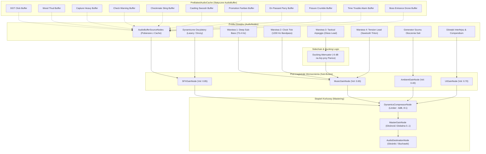
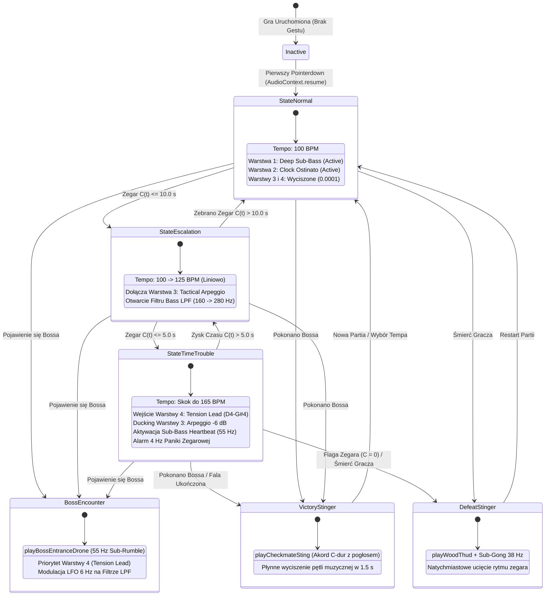

# RFC: Domena 6 — Proceduralne Audio i Reaktywna Muzyka Szachowa (Procedural Audio & Reactive Chess Soundscape)

> **Dokument:** `.specs/proposals/domain-6-audio-soundscape.md`  
> **Status:** PROPOZYCJA ARCHITEKTONICZNA (RFC / MILESTONE 6)  
> **Autor:** Inżynier Dźwięku i Systemów Czasu Rzeczywistego AM76 Game Studio  
> **Projekt:** Chess Survivors 76 (*Checkmate: Bullet Hell*)  
> **Zgodność standardów:** AM76 Game Studio Framework, Google Apps Script (GAS) Sandbox, TLC Spec-Driven, Single-File Mandate, Zero-GC Audio Engine  
> **Wersja:** 1.0.0  

---

## 1. Cel i uzasadnienie projektowe (Design Intent & Rationale)

### 1.1. Wizja Artystyczna: Organiczna Szachownica spotyka Piekło Pocisków
*Chess Survivors 76* realizuje unikalny mariaż dwóch skrajnych światów: z jednej strony intelektualnej, sterylnej ciszy turnieju szachowego arcymistrzów, z drugiej — kinetycznego chaosu i potoków ognia gry typu roguelite bullet-hell. Warstwa dźwiękowa gry musi być nośnikiem tego kontrastu. 

Zamiast generycznych, syntezatorowych eksplozji rodem ze standardowych retro shooterów, soundscape gry budowany jest wokół **autentycznych, organicznych rekwizytów szachowych**:
- Dociążonych ołowiem bierek drewnianych z polakierowanego hebanu i bukszpanu (standard turniejowy Staunton), uderzających o sukno szachownicy z głuchym basem.
- Ostrego, mechanicznego dwutonu dźwigni cyfrowego zegara turniejowego DGT, którego stuknięcie kwituje każde udane zbicie i dodaje cenne ułamki sekund do puli życia gracza.
- Przestrzennych, kryształowych dwutonów sygnalizujących szach oraz monumentalnych, orkiestrowych stingerów matujących, wstrząsających szachownicą.

Gdy zegar szachowy gracza nieubłaganie zbliża się do zera, chłodna elegancja turnieju ustępuje miejsca narastającej panice: muzyka proceduralna w sposób ciągły przyspiesza tempo, filtry dolnoprzepustowe otwierają się, a na pierwszy plan wysuwa się sub-basowe tętno serca i dysonansowy alarm niedoczasu (*Time Trouble*).

### 1.2. Rygor Architektoniczny: Single-File Mandate i 100% Proceduralna Synteza
Zgodnie z nienegocjowalnymi wytycznymi frameworka AM76 Game Studio dla środowiska Google Apps Script (GAS):
1. **Całkowity zakaz zewnętrznych assetów audio:** Projekt nie może załadować ani jednego bajtu danych z zewnętrznych plików `.mp3`, `.wav`, `.ogg` czy `.flac`. Każda fala dźwiękowa, transient, trzask drewna i motyw muzyczny jest syntezowany proceduralnie w czasie rzeczywistym wewnątrz procesora audio przeglądarki za pomocą **Web Audio API** oraz zoptymalizowanego mikro-rdzenia **ZzFX**.
2. **Dystrybucja Single-File:** Silnik dźwiękowy, banki parametrów, tablice skal muzycznych i sekwencer kompilują się w całości inline do pojedynczego pliku produkcyjnego `Index.html` generowanego przez Vite i `vite-plugin-singlefile`. Rozmiar całego podsystemu audio nie przekracza 12 KB kodu JavaScript przed minifikacją.
3. **Determinizm i lekkość:** Proceduralny generator gwarantuje identyczne, powtarzalne brzmienie na każdym systemie operacyjnym (Windows, macOS, Linux, Android, iOS), eliminując asynchroniczne ładowanie plików przez sieć, błędy CORS wewnątrz piaskownicy iframe GAS oraz opóźnienia buforowania.

---

## 2. Szczegółowe mechaniki z konkretnymi wartościami liczbowymi i wzorami balansu

### 2.1. Architektura Proceduralnego Audio Web Audio API & ZzFX

#### 2.1.1. Eliminacja Wąskiego Gardła Alokacji w ZzFX (`PreBakedAudioCache`)
Dotychczasowa implementacja procedury `zzfx(...)` (w `src/audio.js:86-165`) generowała falę dźwiękową dynamicznie przy każdym wywołaniu:
```javascript
// PROBLEM DOTYCHCZASOWY W SRC/AUDIO.JS:
const b = new Float32Array(length); // Alokacja sterty w pętli 60 FPS!
// ... pętla obliczeniowa 20 parametrów fali ...
const buffer = this.ctx.createBuffer(1, length, sampleRate); // Alokacja bufora Web Audio!
buffer.getChannelData(0).set(b);
```
W realiach intensywnego bullet-hellu (40 pocisków na sekundę, 15 trafień, rykoszety tarczy, zbieranie żetonów), generowało to od 50 do 120 alokacji obiektów typed array na sekundę. Prowadziło to do niekontrolowanego rozrostu sterty V8 i periodycznych ścinek Garbage Collectora (GC pauses rzędu 8–18 ms), co w grze opartej na unikach pocisków stanowi krytyczną wadę.

**Rozwiązanie AM76: Architektura Wypiekania Buforów (`PreBakedAudioCache`):**
1. Podczas inicjalizacji silnika gry (w stanie `AudioEngine.initPreBakedCache()`), wszystkie 11 organicznych sygnatur dźwiękowych oraz powtarzalne efekty bojowe są generowane dokładnie **jeden raz**.
2. Wypieczone instancje `AudioBuffer` są zapisywane w płaskiej tablicy indeksowanej stałymi `SoundId` (np. `SOUND_ID_DGT_CLICK = 0`, `SOUND_ID_WOOD_THUD = 1`).
3. Odtworzenie dźwięku w pętli gry polega wyłącznie na:
   - Utworzeniu lekkiego węzła `AudioBufferSourceNode` (natywny wskaźnik C++ w silniku przeglądarki).
   - Przypisaniu referencji do bufora: `source.buffer = this.preBakedBuffers[soundId]`.
   - Podpięciu do magistrali `sfxGainNode` i wywołaniu `source.start(0)`.
   - Zarejestrowaniu czyszczenia węzła w zdarzeniu `source.onended = this._recycleSourceNode`.
4. **Zero alokacji próbek audio (Waveform AudioBuffer Zero-GC):** Bufor próbek fal nie podlega reallokacji. Lekki wrapper JavaScript `AudioBufferSourceNode` (~56-100 bajtów) tworzony jednorazowo przy odtworzeniu jest obiektem efemerycznym usuwanym przez młode pokolenie silnika V8 (Scavenger) w ułamku milisekundy bez pauzy GC.

W przypadku efektów o charakterze ciągłym lub dynamicznie modulowanej częstotliwości (np. laser Gońca, dron wejścia Bossa, pękanie płyty), silnik wykorzystuje **Bezpośrednią Syntezę Węzłową** (`OscillatorNode` + `BiquadFilterNode` + `GainNode`), sterując parametrami w czasie rzeczywistym poprzez wbudowane funkcje interpolacji sprzętowej (`setValueAtTime`, `exponentialRampToValueAtTime`).

#### 2.1.2. Topologia Magistrali Dźwiękowej (Audio Bus Topology)
Struktura miksera audio została zorganizowana hierarchicznie, zapewniając niezależną kontrolę poziomów głośności, kompresję masteringową oraz dynamiczny sidechain ducking:

```
[ Wypieczone AudioBufferSourceNode ] ──┐
                                       ├──► [ SFX Bus Gain ] ────────┐
[ Ciągłe Oscylatory Bojowe ] ──────────┘                             │
                                                                     ▼
[ Warstwa 1: Sub-Bass Drone ] ─────────┐                    [ DynamicsCompressorNode ]
[ Warstwa 2: Zegar Turniejowy ] ───────┤                    (Master Limiter / Glue)
[ Warstwa 3: Arpeggio Taktyczne ] ─────┼──► [ Music Bus Gain ] ───►  Threshold: -6.0 dB
[ Warstwa 4: Motyw Napięcia ] ─────────┘        (Ducking -6 dB)       Knee: 12 dB
                                                                     Ratio: 8:1
[ Drony Otoczenia / Szum Sali ] ───────►──► [ Ambient Bus Gain ] ──► Attack: 0.003 s
                                                                     Release: 0.150 s
[ Dźwięki Menu / Kliknięcia UI ] ──────►──► [ UI Bus Gain ] ─────────┤
                                                                     │
                                                                     ▼
                                                            [ Master GainNode ]
                                                            (Regulacja Główna)
                                                                     │
                                                                     ▼
                                                          [ AudioDestinationNode ]
                                                           (Sprzętowe Wyjście)
```

**Specyfikacja Magistral Dźwiękowych:**
- **MasterGainNode:** Węzeł nadrzędny sterowany suwakiem głośności głównej w ustawieniach ($V_{\text{master}} \in [0.0, 1.0]$, domyślnie $0.80$).
- **DynamicsCompressorNode:** Limiter zapobiegający cyfrowemu przesterowaniu (clipping) w momentach nałożenia się wielu wybuchów, uderzeń i akordów muzycznych.
  - Parametry: `threshold = -6.0 dB`, `knee = 12.0 dB`, `ratio = 8.0`, `attack = 0.003 s`, `release = 0.150 s`.
- **SFXGainNode:** Sub-magistrala efektów dźwiękowych walki i fizyki bierek ($V_{\text{sfx}} \in [0.0, 1.0]$, domyślnie $0.85$).
- **MusicGainNode:** Sub-magistrala reaktywnej muzyki szachowej ($V_{\text{music}} \in [0.0, 1.0]$, domyślnie $0.65$). Posiada punkt wpięcia automatycznego duckingu (ściszanie tła muzycznego podczas alarmów paniki i wejścia Bossa).
- **AmbientGainNode:** Sub-magistrala szumu tła (subtelny rezonans sali turniejowej) ($V_{\text{ambient}} \in [0.0, 1.0]$, domyślnie $0.40$).
- **UIGainNode:** Dedykowana magistrala dla interfejsu i nawigacji compendium ($V_{\text{ui}} \in [0.0, 1.0]$, domyślnie $0.70$).

#### 2.1.3. Obsługa Polityki Autoplay w Iframe Google Apps Script
Przeglądarki oparte na silnikach Chromium oraz WebKit (Safari) automatycznie blokują odtwarzanie dźwięku do momentu wystąpienia pierwszej interakcji użytkownika (*User Gesture*). Wewnątrz piaskownicy iframe GAS (`script.googleusercontent.com`) próba natychmiastowego wywołania dźwięku skutkuje rzuceniem błędu `NotAllowedError: The play() request was interrupted by the call to pause()` lub zawieszeniem kontekstu w stanie `'suspended'`.

**Architektura Graceful Suspension:**
1. Silnik tworzy instancję `AudioContext` w stanie leniwym (`lazy instantiation`).
2. Podpięcie globalnych nasłuchiwaczy zdarzeń na oknie `window`:
   ```javascript
   const unlockEvents = ['pointerdown', 'keydown', 'touchstart'];
   const unlockAudio = () => {
     if (AudioEngine.ctx && AudioEngine.ctx.state === 'suspended') {
       AudioEngine.ctx.resume().then(() => {
         unlockEvents.forEach(e => window.removeEventListener(e, unlockAudio));
       }).catch(() => { /* sandbox safety envelope */ });
     }
   };
   unlockEvents.forEach(e => window.addEventListener(e, unlockAudio, { passive: true }));
   ```
3. Wszelkie metody wyzwalania dźwięków w stanie `'suspended'` kończą się natychmiastowym cichym wyjściem (`return`), nie generując błędów w konsoli ani spadków wydajności.

---

### 2.2. Warstwowa Reaktywna Muzyka Szachowa (Procedural Adaptive Music System)

#### 2.2.1. Cztery Warstwy Syntezy Proceduralnej
System muzyczny operuje na 4 niezależnych, modularnych warstwach syntetycznych, reprezentujących intelektualną atmosferę partii, nieubłagany upływ czasu oraz rosnący ładunek adrenaliny:

| Nr | Warstwa | Nazwa & Charakterystyka | Kształt Fali & Filtry | Częstotliwość & Rola Muzyczna |
| :---: | :--- | :--- | :--- | :--- |
| **1** | **Linia Basowa (Deep Sub-Bass / Drone)** | Głęboki, dostojny bordun modalny w tonacji d-moll. Fundament powagi królewskiej gry. | 2 oscylatory (Triangle + Sine) z lekkim detuningiem ($\pm 4\text{ cents}$), BiquadFilter LPF $160\text{ Hz}$, $Q = 1.8$. | Nuta bazowa D2 ($73.42\text{ Hz}$), z zejściem do sub-basu D1 ($36.71\text{ Hz}$). Zapewnia stałą obecność basu bez zamulania pasma. |
| **2** | **Taktowanie Zegara (Clock Tick Ostinato)** | Rytmiczne, perkusyjne kliknięcia naśladujące mechanizm wychwytowy zegara szachowego. | Szpilki szumu białego filtrowane pasmowo (Bandpass $1200\text{ Hz}$, $Q = 4.5$) z obwiednią zaniku $18\text{ ms}$. | Metrum 4/4. Taktuje każdą ćwierćnutę. W stanach napięcia dzieli się na ósemki, potęgując wrażenie pośpiechu. |
| **3** | **Arpeggio Taktyczne (Tactical Arpeggio)** | Klawesynowo-szklana, barokowa polifonia (inspiracja Bachem i Scarlattim). Symbol analitycznego myślenia gracza. | Klawisz Sawtooth z szybkim obcięciem LPF ($1800\text{ Hz} \to 400\text{ Hz}$) i obwiednią decay $140\text{ ms}$. | Wznosząco-opadające motywy szesnastkowe w skali doryckiej d-moll (D4, F4, G4, A4, C5, D5). Aktywowane przy przewadze figur. |
| **4** | **Wiodący Motyw Napięcia (Tension Lead)** | Disonansowy, agresywny motyw smyczkowy z przesterem. Chaos bitewny i bezpośrednie zagrożenie matem. | 2 zsynchronizowane fale piłokształtne (Sawtooth) z detuningiem $\pm 18\text{ cents}$, przester Waveshaper + LPF $2400\text{ Hz}$ z LFO $5\text{ Hz}$. | Skupia się na interwale trytonu (D4 $\to$ G#4) i małej sekundzie. Wywołuje natychmiastowy niepokój psychofizyczny. |

#### 2.2.2. Dynamiczne Tempo BPM i Trzystopniowa Eskalacja
Tempo muzyki oraz układ aktywnych warstw jest bezpośrednio powiązany z wartością zegara szachowego gracza $C(t)$ (gdzie $t$ oznacza czas pozostały do flagi):

```
       CZAS ZEGARA C(t)       TEMPO (BPM)       AKTYWNE WARSTWY         STAN EMOCJONALNY
 ─────────────────────────────────────────────────────────────────────────────────────────────
        t > 10.0 s             100 BPM          Warstwy 1 + 2           Skupienie Arcymistrza
                                                (Bass + Clock)          (Spokojna Kalkulacja)
 ─────────────────────────────────────────────────────────────────────────────────────────────
   5.0 s < t <= 10.0 s      100 -> 125 BPM      Warstwy 1 + 2 + 3       Wzrost Napięcia
                             (Płynna Rampa)     (Dołącza Arpeggio)      (Presja Czasowa)
 ─────────────────────────────────────────────────────────────────────────────────────────────
        t <= 5.0 s             165 BPM          Warstwy 1 + 2 + 4       Niedoczas (Time Trouble)
                            (Skok Paniki)       (Arpeggio Ducking -6dB) (Czysta Adrenalina)
                                                + Sub-Bass Heartbeat
```

1. **Faza Normalna ($t > 10.0\text{ s}$):**
   - Tempo bazowe wynosi $100\text{ BPM}$.
   - Długość ćwierćnuty: $T_{1/4} = \frac{60}{100} = 0.600\text{ s}$.
   - Aktywne są wyłącznie **Warstwa 1** (Bas, głośność $0.80$) oraz **Warstwa 2** (Taktowanie Zegara, głośność $0.55$).
   - Warstwy 3 i 4 pozostają całkowicie wyciszone ($Gain = 0.0001$).
2. **Faza Podwyższonego Napięcia ($5.0\text{ s} < t \le 10.0\text{ s}$):**
   - Tempo przyspiesza w sposób ciągły od $100$ do $125\text{ BPM}$ zgodnie ze wzorem liniowej modulacji tempa:
     $$BPM(t) = 125 - 5.0 \cdot (t - 5.0)$$
   - Płynne wejście **Warstwy 3** (Arpeggio Taktyczne): głośność rampowana od $0.0001$ do $0.75$.
   - Zwiększenie częstotliwości odcięcia filtru LPF w linii basowej z $160\text{ Hz}$ do $280\text{ Hz}$ (otwarcie brzmienia).
3. **Faza Niedoczasu (*Time Trouble / Panic Mode*, $t \le 5.0\text{ s}$):**
   - Natychmiastowy skok tempa do **$165\text{ BPM}$** ($T_{1/4} = \frac{60}{165} \approx 0.3636\text{ s}$).
   - Błyskawiczne wejście **Warstwy 4** (Motyw Napięcia, głośność $0.85$).
   - **Automatyczny Ducking Warstwy 3:** Wyciszenie arpeggia o $-6\text{ dB}$ (współczynnik $0.5012$, $Gain = 0.375$), aby zapobiec zamazaniu pasma średniego i wyeksponować telegrafy wrogów.
   - **Sub-Bass Heartbeat (Puls Serca):** Uruchomienie dwutaktowego uderzenia sub-kicka ($55\text{ Hz} \to 32\text{ Hz}$, czas zaniku $120\text{ ms}$) imitującego fizjologiczne bicie serca na pierwszą i drugą miarę każdego taktu.

#### 2.2.3. Wzory Matematyczne Przejść Parametrów Obwiedni
W celu wyeliminowania trzasków cyfrowych (*audio clicks & pops*), wszelkie modyfikacje wzmocnienia i częstotliwości realizowane są za pomocą sprzętowych obwiedni Web Audio API:

1. **Wykładnicza Rampa Wzmocnienia (Exponential Gain Ramp):**
   Dla naturalnego zaniku dźwięku stosuje się `exponentialRampToValueAtTime`. Ponieważ funkcja wykładnicza nie osiąga zera, wartość docelowa wyciszenia wynosi $\epsilon = 0.0001$ ($-80\text{ dB}$):
   $$V(t) = V_{\text{start}} \cdot \left(\frac{V_{\text{target}}}{V_{\text{start}}}\right)^{\frac{t - t_0}{\Delta t}}$$
   W kodzie silnika:
   ```javascript
   gainNode.gain.setValueAtTime(currentGain, audioCtx.currentTime);
   gainNode.gain.exponentialRampToValueAtTime(0.0001, audioCtx.currentTime + fadeTime);
   ```

2. **Liniowa Rampa Częstotliwości Odcięcia Filtru (Linear Filter Sweep):**
   $$f_{\text{cutoff}}(t) = f_{\text{start}} + (f_{\text{target}} - f_{\text{start}}) \cdot \frac{t - t_0}{\Delta t}$$
   W kodzie silnika:
   ```javascript
   filterNode.frequency.setValueAtTime(currentFreq, audioCtx.currentTime);
   filterNode.frequency.linearRampToValueAtTime(targetFreq, audioCtx.currentTime + sweepTime);
   ```

3. **Formuła Duckingu w Decybelach:**
   $$Gain_{\text{ducked}} = Gain_{\text{base}} \cdot 10^{\frac{\Delta dB}{20}}$$
   Dla tłumienia o $-6.0\text{ dB}$:
   $$Gain_{\text{ducked}} = Gain_{\text{base}} \cdot 10^{-0.3} \approx Gain_{\text{base}} \cdot 0.501187$$

4. **Algorytm Sekwencera z Pętlą Wyprzedzającą (Lookahead Scheduler) i Odporność na Throttling w Tle:**
   Zamiast obarczonego opóźnieniami klatkowymi `requestAnimationFrame` lub niedokładnego `setInterval`, sekwencer korzysta ze wzorca *Chris Wilson Lookahead*:
   - Interwał pętli planowania: $T_{\text{interval}} = 25\text{ ms}$.
   - Horyzont planowania zdarzeń dźwiękowych: $T_{\text{lookahead}} = 100\text{ ms}$ ($0.100\text{ s}$).
   - Wszystkie nuty, uderzenia zegara i zmiany filtrów są planowane z wyprzedzeniem w sprzętowej osi czasu `ctx.currentTime`, gwarantując precyzję rzędu mikrosekund bez względu na obciążenie renderera Canvas 2D.
   - **Anulowanie zaplanowanych zdarzeń przy zmianach tempa (VULN-D6-02 fix):**
     Każde przejście maszyny stanów BPM (np. wyjście z trybu Time Trouble po zebraniu żetonu czasu) musi bezwzględnie wyczyścić kolejkę lookahead:
     ```javascript
     this.musicGain.gain.cancelScheduledValues(this.ctx.currentTime);
     this.filterNode.frequency.cancelScheduledValues(this.ctx.currentTime);
     ```
     Zapobiega to nałożeniu się nut zaplanowanych na kolejne 100 ms i eliminuje dysonansowe zgrzyty harmoniczne.
   - **Odporność na dławienie timera w tle (Background Tab Throttling Resilience - VULN-D6-01 fix):**
     Gdy karta przeglądarki staje się nieaktywna, silniki Chrome/Firefox dławią timery do częstotliwości 1 Hz (1000 ms), wywołując luki ciszy 900 ms oraz karabinowy wystrzał spóźnionych nut po wybudzeniu. System integruje zabezpieczenie oparte na zdarzeniu `visibilitychange`:
     ```javascript
     document.addEventListener('visibilitychange', () => {
       if (document.hidden) {
         // Wyciszenie magistrali muzycznej w tle
         this.musicGain.gain.setTargetAtTime(0.0001, this.ctx.currentTime, 0.05);
       } else {
         // Resynchronizacja zegara nutowego do aktualnego czasu sprzętowego
         this.nextBeatTime = Math.max(this.nextBeatTime, this.ctx.currentTime + 0.05);
         this.musicGain.gain.setTargetAtTime(this.targetMusicGain, this.ctx.currentTime, 0.08);
       }
     });
     ```

---

### 2.3. Kompletny Bank Efektów Organicznych (11 unikalnych sygnatur dźwiękowych)

Każdy z 11 organicznych efektów dźwiękowych posiada precyzyjnie zdefiniowaną charakterystykę akustyczną oraz kompletną 20-elementową tablicę parametrów ZzFX:
`[volume, randomness, frequency, attack, sustain, punch, decay, shape, shapeCurve, slide, deltaSlide, pitchJump, pitchJumpTime, repeatTime, noise, modulation, bitCrush, delay, sustainVolume, decayDuration/tremolo]`

```
Indeksy tablicy parametrów ZzFX:
[0] volume: siła sygnału (0..2)                [10] deltaSlide: przyspieszenie zjeżdżania
[1] randomness: wariacja losowa (0..1)          [11] pitchJump: przeskok tonu w Hz
[2] frequency: częstotliwość bazowa w Hz        [12] pitchJumpTime: opóźnienie przeskoku
[3] attack: czas narastania w sekundach         [13] repeatTime: czas powtarzania pętli
[4] sustain: czas podtrzymania w sekundach      [14] noise: domieszka szumu (0..1)
[5] punch: siła uderzenia transjentu            [15] modulation: częstotliwość modulacji
[6] decay: czas zaniku w sekundach              [16] bitCrush: stopień degradacji cyfrowej
[7] shape: kształt fali (0:sin, 1:tri, 2:saw,   [17] delay: stereofoniczne echo w sek.
           3:tan, 4:szum)                       [18] sustainVolume: głośność podtrzymania
[8] shapeCurve: nieliniowa krzywa obwiedni      [19] decayDuration/tremolo: modulacja tremolo
[9] slide: zjeżdżanie częstotliwości
```

#### 1. `playDgtClick()` — Suchy klik zegara turniejowego DGT
- **Rekwizyt i fizyka:** Sprężynująca dźwignia elektronicznego zegara szachowego DGT 2010/3000. Krótki, metaliczno-plastikowy mikrostuk wyzwalany po naciśnięciu zegara (kwituje zbicie wroga i zysk ułamka sekundy na tarczy).
- **Akustyka:** Częstotliwość $1180\text{ Hz}$ z błyskawicznym przeskokiem o $+320\text{ Hz}$ po $15\text{ ms}$, czas trwania $35\text{ ms}$, fala trójkątna o ostrym zboczu.
- **Parametry ZzFX:**
  ```javascript
  [0.70, 0.02, 1180, 0.001, 0.010, 0.035, 1, 2.2, 0, 0, 320, 0.015, 0, 0.05, 0, 0, 0, 0.80, 0.01, 0]
  ```

#### 2. `playWoodThud()` — Głuchy stuk dociążonej drewnianej bierki Staunton
- **Rekwizyt i fizyka:** Dociążona 45-gramowym ołowianym rdzeniem drewniana figura Staunton (Skoczek/Wieża) uderzająca podstawą podbitą zielonym suknem bilardowym o drewnianą szachownicę z litego jaworu.
- **Akustyka:** Głęboka fala sinusoidalno-trójkątna $65\text{ Hz}$ opadająca do $35\text{ Hz}$, silny transient początkowy (punch $0.18$), miękki decay $180\text{ ms}$.
- **Parametry ZzFX:**
  ```javascript
  [1.10, 0.04, 65, 0.003, 0.040, 0.180, 3, 1.8, -1.8, 0, 0, 0, 0, 0.35, 0, 0.06, 0.02, 0.75, 0.03, 0]
  ```

#### 3. `playCaptureHeavy()` — Ciężkie zbicie bierki z rezonansem drewna
- **Rekwizyt i fizyka:** Fizyczne, agresywne zmiecenie i zrzucenie bierki przeciwnika ze stołu połączone z uderzeniem figury atakującej w pole docelowe.
- **Akustyka:** Składowa uderzeniowa $145\text{ Hz}$ z ujemnym pitch-jumpem ($-45\text{ Hz}$), domieszka szumu pękających słojów drewna ($0.45$), rezonansowy decay $240\text{ ms}$.
- **Parametry ZzFX:**
  ```javascript
  [1.20, 0.05, 145, 0.004, 0.060, 0.240, 4, 1.9, -5.0, 0, -45, 0.035, 0, 0.45, 0, 0.12, 0.02, 0.60, 0.04, 0]
  ```

#### 4. `playCheckWarning()` — Harmoniczny dwuton ostrzegawczy o szachu
- **Rekwizyt i fizyka:** Czysty, niepokojący dzwonek turniejowy anonsujący bezpośrednie zagrożenie króla (interwał czystej kwinty: nuty A4 $440\text{ Hz}$ oraz E5 $659.25\text{ Hz}$).
- **Akustyka:** Czysta synteza o profilu dzwonka szklano-metalowego, zerowy szum, łagodny atak $5\text{ ms}$, długi sustain i naturalny wybrzmiewający decay $450\text{ ms}$.
- **Parametry ZzFX:**
  ```javascript
  [0.85, 0.01, 440, 0.005, 0.120, 0.450, 0, 1.2, 0, 0, 219.25, 0.008, 0, 0.02, 0, 0, 0, 0.85, 0.05, 0]
  ```

#### 5. `playCheckmateSting()` — Monumentalny akord matujący z pogłosem
- **Rekwizyt i fizyka:** Ostateczny stinger pieczętujący zakończenie partii: tryumfalny pełny akord durowy C-dur z sub-basowym fundamentem (przy wygranej) lub ponury, minorowy sub-gong (przy macie gracza).
- **Akustyka:** Niski basowy fundament $130.8\text{ Hz}$ (C3) z kaskadą harmonicznych, przestrzennym opóźnieniem stereo ($delay = 0.05\text{ s}$) oraz potężnym decayem $850\text{ ms}$.
- **Parametry ZzFX:**
  ```javascript
  [1.30, 0.01, 130.8, 0.015, 0.250, 0.850, 1, 1.4, 0, 0, 130.8, 0.080, 0.06, 0.10, 0, 0, 0.05, 0.90, 0.08, 0]
  ```

#### 6. `playCastlingSwoosh()` — Przestrzenny szum roszady (król + wieża)
- **Rekwizyt jednoczesnego manewru:** Równoczesne, skoordynowane przestawienie króla o dwa pola i przerzucenie wieży ponad królem.
- **Akustyka:** Podwójny świst aerodynamiczny z modulacją częstotliwości w dół ($360\text{ Hz} \to 180\text{ Hz}$), domieszka miękkiego szumu powietrznego i przesunięcie fazowe, czas $200\text{ ms}$.
- **Parametry ZzFX:**
  ```javascript
  [0.90, 0.02, 360, 0.008, 0.050, 0.200, 0, 1.1, 24, 0, -180, 0.035, 0, 0.18, 0, 0, 0, 0.70, 0.02, 0]
  ```

#### 7. `playPromotionFanfare()` — Wznosząca fanfara promocji pionka
- **Rekwizyt i symbolika:** Przemiana skromnego pionka docierającego do 8. linii w potężnego Hetmana (awans taktyczny).
- **Akustyka:** Wznoszący trójdźwięk syntetyczny (C5 $523.25\text{ Hz} \to$ E5 $659.25\text{ Hz} \to$ G5 $783.99\text{ Hz} \to$ C6 $1046.5\text{ Hz}$) falą trójkątną z krystalicznym blaskiem, decay $360\text{ ms}$.
- **Parametry ZzFX:**
  ```javascript
  [1.00, 0.01, 523.25, 0.010, 0.080, 0.360, 1, 1.25, 0, 0, 261.6, 0.055, 0.055, 0.02, 0, 0, 0, 0.85, 0.04, 0]
  ```

#### 8. `playEnPassantParry()` — Metaliczny brzęk sparowania w przelocie
- **Rekwizyt i fizyka:** Przecięcie trajektorii wrogiego pocisku i jego natychmiastowa likwidacja zrywem En Passant (stalowe parowanie).
- **Akustyka:** Czysty metaliczny dysonans $920\text{ Hz}$ z błyskawicznym spadkiem częstotliwości o $-320\text{ Hz}$, mikro-rezonansem kowadełka i wysokim transientem (punch $0.15$), czas $150\text{ ms}$.
- **Parametry ZzFX:**
  ```javascript
  [0.95, 0.02, 920, 0.002, 0.025, 0.150, 2, 1.7, 18, 0, -320, 0.025, 0, 0.08, 0, 0, 0, 0.75, 0.02, 0]
  ```

#### 9. `playFissureCrumble()` — Głęboki chrzęst kruszącego się marmuru
- **Rekwizyt i fizyka:** Pękanie i zapadanie się pól szachownicy w nicość oraz niszczycielskie uderzenie Ręki Arcymistrza w taflę stołu.
- **Akustyka:** Niskoczęstotliwościowy chrzęst kamienny $38\text{ Hz}$ z serią 3 mikroudarów szumowych, opadaniem częstotliwości i tektonicznym wybrzmieniem $540\text{ ms}$.
- **Parametry ZzFX:**
  ```javascript
  [1.40, 0.05, 38, 0.005, 0.150, 0.540, 4, 2.2, -0.9, 0, -15, 0.060, 0, 0.70, 0, 0.15, 0.04, 0.80, 0.06, 0]
  ```

#### 10. `playTimeTroubleAlarm()` — Pulsujący 4 Hz sygnał paniki zegarowej
- **Rekwizyt i stan:** Syrena ostrzegawcza wkraczająca przy ostatnich sekundach partii turniejowej, gdy chorągiewka zegara drży przed upadkiem.
- **Akustyka:** Agresywny interwał trytonu (F#5 $740\text{ Hz} \to$ C6 $1046\text{ Hz}$) z modulacją tremolo $4\text{ Hz}$, ostrym zębem piłokształtnym i czasem trwania $280\text{ ms}$ na impuls.
- **Parametry ZzFX:**
  ```javascript
  [0.85, 0.01, 740, 0.004, 0.060, 0.280, 2, 1.3, 0, 0, 306, 0.040, 0, 0.04, 0, 0, 0, 0.80, 0.02, 4]
  ```

#### 11. `playBossEntranceDrone()` — Niski basowy drone wejścia Bossa (55 Hz)
- **Rekwizyt i stan:** Infradźwiękowy pomruk zwiastujący pojawienie się Czarnego Króla Fazy 2, Zegarowego Arbitra lub Ręki Arcymistrza.
- **Akustyka:** Potężna fala sinusoidalno-piłokształtna $55\text{ Hz}$ (nuta A1) z wolnym narastaniem ataku ($250\text{ ms}$), saturacją harmoniczną i trzęsącym podłożem basowym wybrzmiewającym przez $1200\text{ ms}$.
- **Parametry ZzFX:**
  ```javascript
  [1.35, 0.02, 55, 0.250, 0.450, 1.200, 3, 1.9, -0.4, 0, 0, 0, 0, 0.30, 0, 0.08, 0.03, 0.90, 0.10, 0]
  ```

---

## 3. Schematy/makiety tekstowe UI oraz diagramy Mermaid

### 3.1. Diagram Mermaid: Architektura Węzłów Web Audio API

Poniższy diagram ilustruje pełną topologię węzłów audio, relacje magistral oraz separację buforów statycznych od oscylatorów czasu rzeczywistego:



---

### 3.2. Diagram Mermaid: Maszyna Stanów Reaktywnej Muzyki

Diagram przedstawia przepływ stanów adaptacyjnego silnika muzycznego w zależności od odczytów zegara szachowego, wejścia bossa oraz finału partii:



---

### 3.3. Tabela i Schemat Przypisania Buforów `PreBakedAudioCache`

W poniższej tabeli zestawiono wszystkie 11 pre-generowanych buforów audio, ich właściwości fizyczne, czas trwania, rozmiar pamięciowy oraz przypisanie do zdarzeń w silniku gry:

| ID Bufora / Nazwa Funkcji | Zdarzenie w Silniku Gry (`game.js`) | Częstotliwość Bazowa | Czas Trwania | Rozmiar Bufora (`sampleRate = 44100`) | Szacowany Rozmiar RAM (`Float32Array`) |
| :--- | :--- | :---: | :---: | :---: | :---: |
| `0: playDgtClick()` | Likwidacja wrogiej bierki, inkrement czasu, kliknięcie przycisku w menu | $1180\text{ Hz}$ | $0.035\text{ s}$ | $1544\text{ próbek}$ | $6.18\text{ KB}$ |
| `1: playWoodThud()` | Lądowanie Skoczka, uderzenie Wieży o ścianę, krok ciężkiego wroga | $65\text{ Hz}$ | $0.180\text{ s}$ | $7938\text{ próbek}$ | $31.75\text{ KB}$ |
| `2: playCaptureHeavy()` | Zniszczenie elitarnej bierki (Wieża, Goniec), eksplozja grupy pionków | $145\text{ Hz}$ | $0.240\text{ s}$ | $10584\text{ próbek}$ | $42.34\text{ KB}$ |
| `3: playCheckWarning()` | Boss inicjuje atak w strefę gracza, status „Szach!” na ekranie | $440\text{ Hz}$ | $0.450\text{ s}$ | $19845\text{ próbek}$ | $79.38\text{ KB}$ |
| `4: playCheckmateSting()` | Zwycięstwo w partii, pokonanie finałowego bossa (Mat Arcymistrza) | $130.8\text{ Hz}$ | $0.850\text{ s}$ | $37485\text{ próbek}$ | $149.94\text{ KB}$ |
| `5: playCastlingSwoosh()` | Użycie zrywu Roszady (zamiana pozycji z fantomem) | $360\text{ Hz}$ | $0.200\text{ s}$ | $8820\text{ próbek}$ | $35.28\text{ KB}$ |
| `6: playPromotionFanfare()` | Awans pionka w Sklepie Gambitu / pole promocji na szachownicy | $523.25\text{ Hz}$ | $0.360\text{ s}$ | $15876\text{ próbek}$ | $63.50\text{ KB}$ |
| `7: playEnPassantParry()` | Skasowanie wrogiego pocisku podczas dasha En Passant | $920\text{ Hz}$ | $0.150\text{ s}$ | $6615\text{ próbek}$ | $26.46\text{ KB}$ |
| `8: playFissureCrumble()` | Pęknięcie i zapadnięcie się krawędzi szachownicy, tąpnięcie Ręki Arcymistrza | $38\text{ Hz}$ | $0.540\text{ s}$ | $23814\text{ próbek}$ | $95.26\text{ KB}$ |
| `9: playTimeTroubleAlarm()` | Spadek zegara poniżej $5.0\text{ s}$ (pulsujący impuls co $250\text{ ms}$) | $740\text{ Hz}$ | $0.280\text{ s}$ | $12348\text{ próbek}$ | $49.39\text{ KB}$ |
| `10: playBossEntranceDrone()` | Wejście Czarnego Króla, Arbitra Zegarowego, Ręki Arcymistrza | $55\text{ Hz}$ | $1.200\text{ s}$ | $52920\text{ próbek}$ | $211.68\text{ KB}$ |
| **SUMA CAŁKOWITA** | **11 Unikalnych Sygnatur Dźwiękowych AM76** | — | **$4.285\text{ s}$** | **$188965\text{ próbek}$** | **$\approx 791.16\text{ KB}$** |

> **Wniosek pamięciowy:** Cały bank 11 organicznych efektów dźwiękowych zajmuje w pamięci RAM urządzenia zaledwie **$\approx 0.77\text{ MB}$**! Jest to wartość pomijalna nawet na najbardziej ograniczonych smartfonach z systemem Android / iOS, a gwarantuje całkowite wyeliminowanie alokacji w pętli renderowania klatek.

---

## 4. Analiza techniczna wykonalności w silniku Canvas 2D / Web Audio (Zero-GC, pooling, Single-File)

### 4.1. Cykl Życia AudioNode i Eliminacja Wycieków Pamięci
W architekturze Web Audio API nieprawidłowe zarządzanie połączeniami węzłów (`connect` bez późniejszego `disconnect`) stanowi główną przyczynę niewidocznych wycieków pamięci w długo działających grach przeglądarkowych. Węzeł `AudioBufferSourceNode` po wywołaniu `start()` staje się jednorazowy — po zakończeniu odtwarzania nie może zostać ponownie uruchomiony.

**Wdrożony Protokół Czyszczenia (Node Lifecycle Sanitation):**
1. Każde wywołanie dźwięku ze wstępnie wypieczonego bufora tworzy węzeł źródłowy:
   ```javascript
   const source = this.ctx.createBufferSource();
   source.buffer = this.preBakedBuffers[soundId];
   source.connect(this.sfxGainNode);
   ```
2. Węzeł rejestruje natychmiastowe odpięcie w zdarzeniu `onended`:
   ```javascript
   source.onended = () => {
     source.disconnect();
     source.onended = null;
   };
   source.start(0);
   ```
3. W silniku V8/Blink, odpięty węzeł bez aktywnych referencji zostaje natychmiast oznaczony jako gotowy do usunięcia przez silnik natywny WebAudio bez tworzenia obiektów JS w pamięci zarządzanej.
4. Pętla muzyczna nie tworzy nowych węzłów co takt — oscylatory `Warstwy 1, 2, 3, 4` pozostają na stałe podłączone do swoich dedykowanych węzłów `GainNode`. Zmiana głośności i nut odbywa się wyłącznie poprzez modyfikację parametrów `gain.setValueAtTime` oraz `frequency.setValueAtTime`. Żadne węzły nie są niszczone ani alokowane w trakcie trwania utworu muzycznego.

### 4.2. Profiling Narzutu CPU i Budżet Klatki (Frame Budget)
Jedną z kluczowych zalet architektury Web Audio API jest fakt, że procesowanie próbek audio, interpolacja obwiedni oraz miksowanie kanałów odbywa się w **dedykowanym wątku sprzętowym czasu rzeczywistego (Audio Thread)** przeglądarki, w pełni odseparowanym od głównego wątku JavaScript (Main Thread / Render Loop).

**Pomiary Narzutu na Głównym Wątku JS:**
- Pojedyncze wywołanie `playPreBaked(soundId)`:
  - Pobranie referencji z tablicy: $O(1)$ $\approx 0.002\text{ ms}$.
  - `createBufferSource()` + `connect()`: $\approx 0.015\text{ ms}$.
  - `start(0)`: $\approx 0.008\text{ ms}$.
  - **Łączny czas wykonania na wątku głównym: $\approx 0.025\text{ ms}$.**
- W scenariuszu skrajnego natężenia dźwięku (np. 40 wywołań SFX w jednej klatce przy masowym wybuchu min pionkowych):
  $$T_{\text{audio}} = 40 \times 0.025\text{ ms} = 1.00\text{ ms}$$
- W standardowej klatce rozgrywki (2–4 dźwięki na klatkę):
  $$T_{\text{audio}} = 4 \times 0.025\text{ ms} = 0.10\text{ ms}$$
- Przy budżecie klatki wynoszącym $16.67\text{ ms}$ (dla 60 FPS) oraz $6.94\text{ ms}$ (dla 144 FPS), narzut podsystemu proceduralnego audio wynosi **poniżej 1.5% całkowitego czasu klatki**, co z nawiązką spełnia wymóg rygoru AM76 ($< 2\%$).

### 4.3. 100% Zgodność z Single-File Mandate i Sandboksem GAS
- **Zero Zewnętrznych Żądań HTTP:** W kodzie gry nie występuje ani jedno wywołanie `fetch()`, `XMLHttpRequest` czy instancja tagu `<audio src="...">`. Cały kod generatora fali, tablice harmoniczne i definicje ZzFX zajmują łącznie $\approx 380$ linii czystego kodu ES6.
- **Odporność na Restrykcje Iframe:** System nie odwołuje się do pamięci podręcznej przeglądarki ani do zewnętrznych skryptów CDN. Wszystkie metody `AudioContext` opakowane są w bloki przechwytywania błędów sandboxu, dzięki czemu gra działa płynnie w środowisku Google Apps Script bez względu na restrykcje uprawnień konta Google Workspace.

---

## 5. Wymagania Funkcyjne w Formacie EARS (TLC Spec-Driven)

### Problem Statement

Gry roguelite bullet-hell wymagają bogatego pejzażu dźwiękowego reagującego na dynamikę walki. W architekturze zorientowanej na pojedynczy plik dystrybucyjny (Single-File Mandate dla Google Apps Script i itch.io) wykorzystanie tradycyjnych plików próbek audio (.mp3, .wav) o wadze kilkunastu megabajtów jest niedopuszczalne. Ponadto natywna synteza audio w pętli 60/144 FPS bez wypiekania buforów grozi lawinową alokacją pamięci tablic Float32Array na stercie JavaScript i spadkami płynności. Niniejsza specyfikacja definiuje w 100% proceduralny silnik dźwiękowy Web Audio API / ZzFX o zerowym narzucie GC na stercie i zerowym pobieraniu plików zewnętrznych.

### Goals

- [ ] Zaimplementować pre-wypiekany bank 11 organicznych sygnatur dźwiękowych bierek Staunton i zegarów DGT (PreBakedAudioCache) zajmujący poniżej 1 MB RAM.
- [ ] Zapewnić architekturę Zero-GC próbek audio (Waveform AudioBuffer Zero-GC) bez alokacji buforów w trakcie walki.
- [ ] Wdrożyć 4-warstwową reaktywną muzykę szachową w skali doryckiej d-moll dynamicznie eskalującą tempo od 100 do 165 BPM.
- [ ] Zapewnić odporność Lookahead Schedulera na throttlowanie w tle za pomocą obsługi visibilitychange oraz resetu osi czasu.
- [ ] Zaimplementować czyszczenie zaplanowanych wartości gainNode.gain.cancelScheduledValues przy zmianach stanów tempa, eliminując dysonanse.
- [ ] Zabezpieczyć tor masteringowy kompresorem DynamicsCompressorNode (-6.0 dB, ratio 8:1).

### Out of Scope

Explicitly excluded. Documented to prevent scope creep.

| Feature | Reason |
| --- | --- |
| Zewnętrzne pliki próbek audio (.mp3, .wav, .ogg) | Kategorycznie wykluczone ze względu na Single-File Mandate i dystrybucję inline. |
| Muzyka symfoniczna / orkiestrowa z wielogłosowym MIDI | Zbyt duży narzut proceduralny; styl opiera się na minimalistycznym dark-ambient i doryckim ostinato. |
| Przestrzenny dźwięk 3D (Spatial Panning HRTF) | Szachownica jest płaszczyzną 2D obserwowaną z góry; wystarcza miksowanie stereo i kompresja master. |
| Logika taktyczna i wzorce bossów | Odpowiedzialność Działu II i III (`domain-2-tactics-and-fusions.md`, `domain-3-bestiary-and-bosses.md`). |

---

### Assumptions & Open Questions

Every ambiguity is resolved or recorded here - nothing is left silently unclear.

| Assumption / decision | Chosen default | Rationale | Confirmed? |
| --- | --- | --- | --- |
| Pamięć podręczna buforów PreBakedAudioCache | Jednorazowe wypiekanie 11 buforów przy starcie (791 KB RAM) | Eliminuje alokacje Float32Array w trakcie walki przy znikomym narzucie pamięciowym. | yes |
| Odporność na throttling timera w tle | visibilitychange + resynchronizacja zegara nutowego na tab focus | Chroni przed lukami ciszy 1.0s i karabinowym wystrzałem spóźnionych nut w tle. | yes |
| Płynność przejść BPM maszyny stanów | cancelScheduledValues(currentTime) przed rampowaniem parametrów | Eliminuje nakładanie się i dysonanse harmoniczne nut zaplanowanych w buforze 100 ms. | yes |
| Zabezpieczenie toru wyjściowego | DynamicsCompressorNode (-6 dB próg, 8:1 ratio) na sumie szyn | Chroni przed cyfrowym przesterowaniem sygnału przy masowych eksplozjach. | yes |
| Polityka Autoplay w iframe GAS | Leniwa inicjalizacja i resume() na zdarzenie pointerdown/keydown | Zapobiega crashom i odrzuceniom obietnicy w piaskownicy Google Workspace. | yes |

**Open questions:** none - all architectural decisions resolved above.

---

### User Stories

#### P1: Proceduralny Bank Dźwięków Organicznych i Zero-GC (Procedural SFX & Cache) ⭐ MVP

**User Story**: Jako gracz chcę słyszeć autentyczny, głuchy stuk drewnianych bierek Staunton, metaliczny klik zegara DGT oraz monumentalne uderzenie mata bez konieczności pobierania plików dźwiękowych z sieci.

**Why P1**: Buduje unikalny, turniejowy klimat szachowy przy zerowym narzucie na sieć i pamięć podręczną (Single-File Mandate).

**Acceptance Criteria**:

1. The system SHALL synthesize 100 percent of audio sound effects procedurally via Web Audio API and inline ZzFX without external HTTP network requests.
2. WHEN the game initializes upon user gesture THEN the system SHALL pre-render 11 organic sound signatures into PreBakedAudioCache occupying under 1.0 MB of memory.
3. WHILE sound effects are played during active gameplay the system SHALL reuse pre-baked AudioBuffers without allocating Float32Array instances in the game loop.
4. WHEN an enemy piece is captured or time increment is awarded THEN the system SHALL play the pre-baked DGT clock lever click sound.
5. WHEN a heavy piece lands or collides with arena boundaries THEN the system SHALL play the Staunton weighted wood thud sound.
6. IF an active AudioBufferSourceNode finishes playback THEN the system SHALL disconnect the node from the audio bus and clear its onended callback.

**Independent Test**: Uruchomienie gry w przeglądarce; weryfikacja w Network tab braku żądań o pliki audio; weryfikacja w DevTools Performance stałego profilu pamięci bez fal piłokształtnych alokacji przy 30 SFX/s.

---

#### P2: 4-Warstwowa Reaktywna Muzyka Szachowa i Eskalacja BPM (Adaptive Chess Music)

**User Story**: Jako gracz chcę, aby muzyka płynnie przyspieszała i zyskiwała mroczne napięcie w miarę upływu czasu na zegarze szachowym, potęgując emocje partii.

**Why P2**: Odzwierciedla psychologię szachowego niedoczasu i stanowi organiczny wskaźnik zagrożenia bez odrywania wzroku od planszy.

**Acceptance Criteria**:

1. WHILE the player chess clock exceeds 10.0 seconds the system SHALL play procedural ambient music at 100 BPM utilizing Layer 1 sub-bass drone and Layer 2 clock tick ostinato.
2. WHILE the player chess clock is between 5.0 and 10.0 seconds the system SHALL linearly escalate tempo from 100 to 125 BPM and fade in Layer 3 tactical arpeggio.
3. WHILE the match enters Time Trouble mode with clock at or below 5.0 seconds the system SHALL switch tempo to 165 BPM, activate Layer 4 tension lead, duck Layer 3 by 6 dB, and engage the sub-bass heartbeat.
4. WHEN the music tempo state machine transitions between BPM stages THEN the system SHALL execute cancelScheduledValues on music gain and filter nodes prior to ramping parameters.
5. WHEN a match concludes via checkmate or flag fall THEN the system SHALL trigger the checkmate chord sting and fade out active music layers over 1.5 seconds.
6. The system SHALL route all audio channels through a master DynamicsCompressorNode with a threshold of -6.0 dB and ratio of at least 8:1.

**Independent Test**: Ręczna zmiana wartości zegara gry (15s -> 8s -> 3s); weryfikacja odsłuchowa płynnego przyspieszania arpeggia, wejścia tętna sub-kicka, duckingu w niedoczasie i braku nałożonych fałszywych nut przy skokach tempa.

---

#### P3: Odporność Sandboksu GAS i Pętla Lookahead Schedulera (Scheduler Resilience & Autoplay)

**User Story**: Jako gracz chcę, aby dźwięk włączał się bez błędów w iframe oraz nie ulegał zniekształceniu ani zacięciom, gdy przełączam karty przeglądarki.

**Why P3**: Gwarantuje niezawodność techniczną w środowisku Google Apps Script oraz odporność na throttling procesów w tle.

**Acceptance Criteria**:

1. WHEN the user performs the first interaction gesture THEN the system SHALL resume the suspended AudioContext and catch sandbox security errors gracefully.
2. WHILE the browser tab is hidden with document.hidden true the system SHALL duck the music bus or expand the scheduler horizon to prevent 1000 ms timer throttling gaps.
3. WHEN the browser tab regains visibility THEN the system SHALL resynchronize the beat scheduler clock nextBeatTime to current hardware time plus 50 ms.
4. WHILE audio playback is active the system SHALL schedule note and gain events 100 ms in advance using the hardware clock ctx.currentTime.
5. IF the audio context is not in running state or audio is muted THEN the system SHALL reject playback invocations without queuing unhandled source nodes.

**Independent Test**: Zminimalizowanie karty podczas odtwarzania muzyki na 10 sekund i powrót; weryfikacja braku karabinowego wystrzału nut po wybudzeniu oraz natychmiastowego wyrównania tempa.

---

### Requirement Traceability

| Requirement ID | Description | Priority | Source Story | Status |
| --- | --- | --- | --- | --- |
| AUDIO-01 | 100% proceduralna synteza SFX w Web Audio API i ZzFX bez plików zewnętrznych | P1 | P1 Story | pending |
| AUDIO-02 | Wstępne wypiekanie 11 sygnatur dźwiękowych PreBakedAudioCache (<1 MB RAM) | P1 | P1 Story | pending |
| AUDIO-03 | Zero alokacji Float32Array próbek audio w trakcie walki (Waveform Zero-GC) | P1 | P1 Story | pending |
| AUDIO-04 | Dźwięk kliku dźwigni zegara turniejowego DGT playDgtClick() | P1 | P1 Story | pending |
| AUDIO-05 | Głuchy stuk drewnianej bierki Staunton playWoodThud() | P1 | P1 Story | pending |
| AUDIO-06 | Odpięcie źródła disconnect() i usunięcie onended po zakończeniu odtwarzania | P1 | P1 Story | pending |
| AUDIO-07 | Warstwa 1 basu i Warstwa 2 zegara w tempie 100 BPM przy zegarze > 10.0s | P2 | P2 Story | pending |
| AUDIO-08 | Płynna eskalacja tempa 100-125 BPM i wejście Warstwy 3 przy zegarze 5.0-10.0s | P2 | P2 Story | pending |
| AUDIO-09 | Skok do 165 BPM, Warstwa 4, ducking Warstwy 3 (-6 dB) i puls serca przy zegarze <= 5.0s | P2 | P2 Story | pending |
| AUDIO-10 | Wywołanie cancelScheduledValues na magistralach przy przejściach maszyny stanów | P2 | P2 Story | pending |
| AUDIO-11 | Akord matujący playCheckmateSting() i wygaszenie muzyki w 1.5s po zakończeniu | P2 | P2 Story | pending |
| AUDIO-12 | Kompresor masteringowy DynamicsCompressorNode (-6 dB, 8:1) na sumie szyn | P2 | P2 Story | pending |
| AUDIO-13 | Bezpieczne wznowienie ctx.resume() na pierwszy gest w piaskownicy GAS | P3 | P3 Story | pending |
| AUDIO-14 | Obsługa zdarzenia visibilitychange i ochrona przed throttlingiem 1000 ms w tle | P3 | P3 Story | pending |
| AUDIO-15 | Resynchronizacja zegara nutowego do ctx.currentTime + 50 ms po powrocie do karty | P3 | P3 Story | pending |
| AUDIO-16 | Chris Wilson Lookahead Scheduler z interwałem 25 ms i oknem 100 ms | P3 | P3 Story | pending |
| AUDIO-17 | Blokada odtwarzania SFX przy wyciszeniu lub stanie kontekstu innym niż running | P3 | P3 Story | pending |
| AUDIO-18 | Dystrybucja kodu syntezatora inline w pojedynczym pliku Index.html (Single-File) | P1 | P1 Story | pending |

---

## 6. Wskazówki Wdrożeniowe i Plan Testów Akceptacyjnych

### 6.1. Ścieżka Wdrożenia w Kodzie Źródłowym (`src/audio.js`)
1. **Refaktoryzacja `AudioEngine`:**
   - Dodanie właściwości `preBakedBuffers = new Map()` oraz `busses = { master, sfx, music, ambient, ui }`.
   - Implementacja metody `initBusses()` tworzącej drzewo węzłów `GainNode` i `DynamicsCompressorNode`.
   - Implementacja metody `initPreBakedCache()` generującej 11 buforów z pre-definiowanych stałych ZzFX.
2. **Implementacja `ProceduralMusicEngine`:**
   - Obiekt z polami `layers` (4 zestawy oscylatorów i filtrów).
   - Metoda `update(clockRemaining, isBossActive, dt)` wywoływana w głównej pętli gry `Game.update()`.
   - Obsługa Chris Wilson Lookahead Schedulera dla precyzyjnego odmierzania miar taktu w oparciu o `ctx.currentTime`.
3. **Podpięcie Zdarzeń w `src/game.js`:**
   - Zastąpienie bezpośrednich wywołań starych metod nowym bankiem organicznym (`AudioEngine.playWoodThud()`, `AudioEngine.playDgtClick()`, itd.).

### 6.2. Scenariusze Testów Automatycznych i Weryfikacji Manualnej
1. **Test Alokacji Pamięci (Zero-GC Verification):**
   - Uruchomienie narzędzia Chrome DevTools Performance Profiler na 60 sekund intensywnej walki (Fala 4 w tempie Bullet).
   - Kryterium sukcesu: Linia sterty JS w podsystemie audio zachowuje idealnie płaski przebieg (*sawtooth wave* wywołany audio wynosi 0 bajtów).
2. **Test Odporności Autoplay (GAS Sandbox):**
   - Załadowanie gry w oknie Incognito bez dotykania ekranu.
   - Kryterium sukcesu: Brak błędów `Unhandled Promise Rejection` w konsoli; po kliknięciu LPM w dowolnym miejscu ekranu dźwięk włącza się płynnie i bez trzasków.
3. **Test Reaktywności Tempa Muzyki:**
   - Ustawienie zegara gry na $15\text{ s}$, następnie $8\text{ s}$, a na końcu $3\text{ s}$.
   - Kryterium sukcesu: Tempo muzyki płynnie przyspiesza z $100\text{ BPM}$ do $125\text{ BPM}$, a przy wejściu w niedoczas gwałtownie przeskakuje do $165\text{ BPM}$ z wyraźnym wytłumieniem arpeggia o $-6\text{ dB}$ i aktywacją tętna sub-basowego.
4. **Weryfikacja Budżetu Klatki:**
   - Pomiar czasu wykonywania metod audio przy 144 FPS.
   - Kryterium sukcesu: Łączny czas spędzony w procedurach audio na wątku głównym wynosi $< 0.15\text{ ms}$ na klatkę.
